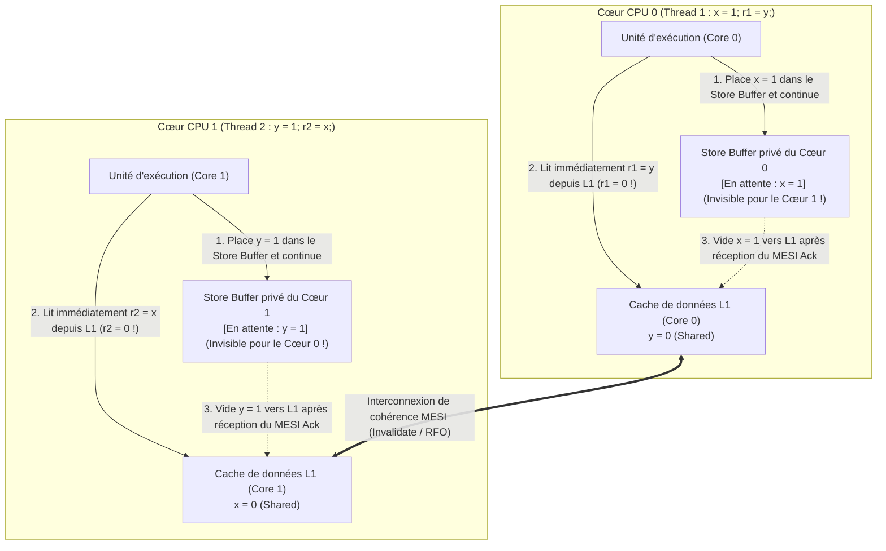
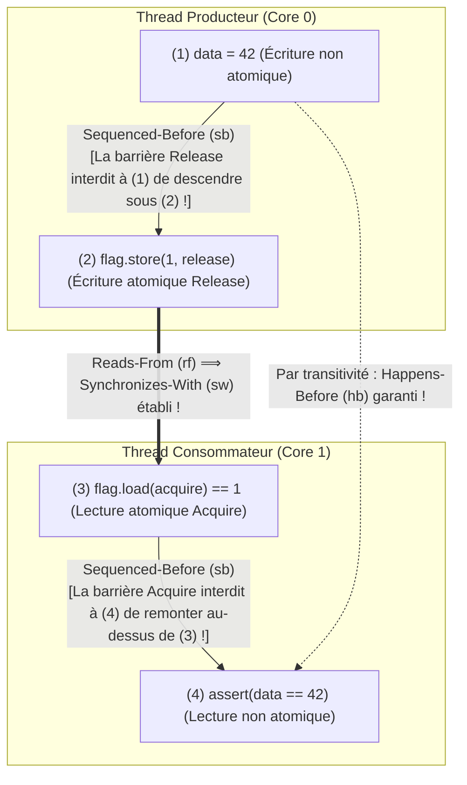

## Introduction : Quatre lignes de code qui défient la logique ── Le test décisif Store Buffering (`SB`)

Examinons ce programme C concurrent de quatre lignes. Deux variables entières partagées `x` et `y` sont initialisées à `0`. Deux threads s'exécutant sur deux cœurs CPU distincts effectuent chacun une écriture (Store) suivie d'une lecture (Load) :

```c
// Initial state in shared memory:
int x = 0, y = 0;
int r1 = 0, r2 = 0;

// Thread 1 (Core 0)          // Thread 2 (Core 1)
void thread1(void) {          void thread2(void) {
    x = 1;      // (S1)           y = 1;      // (S2)
    r1 = y;     // (L1)           r2 = x;     // (L2)
}                             }
```

Quelles valeurs finales de `(r1, r2)` sont possibles à la fin de l'exécution ?
Selon l'intuition humaine :
- Si le Thread 1 s'exécute avant le Thread 2, on obtient `r1 = 0, r2 = 1`.
- Si le Thread 2 s'exécute avant le Thread 1, on obtient `r1 = 1, r2 = 0`.
- Si les deux exécutent leur première ligne (`x = 1` et `y = 1`) avant la seconde, on obtient `r1 = 1, r2 = 1`.

Dans tous les cas imaginables, au moins une écriture de `1` doit précéder la lecture adverse : <strong>le résultat `r1 == 0 && r2 == 0` semble mathématiquement impossible</strong>. Pourtant, si vous exécutez ce code en boucle sur un processeur moderne Intel/AMD x86-64, une puce Apple Silicon (ARMv8) ou avec un compilateur C/C++/Rust optimisant (`-O2`), <strong>le résultat « impossible » `r1 == 0 && r2 == 0` se produit des milliers de fois par seconde</strong> ! Ni le processeur ni le compilateur ne sont bogués : ils réordonnent légitimement les instructions mémoire en vertu de la <strong>règle « As-If » mono-thread</strong>.

---

## Chapitre 1 : L'illusion de la cohérence séquentielle (Sequential Consistency)

En 1979, le lauréat du prix Turing <strong>Leslie Lamport</strong> a formalisé le modèle mental intuitif des programmeurs sous le nom de <strong>cohérence séquentielle (Sequential Consistency, SC)</strong> : le résultat de toute exécution est le même que si les opérations de tous les processeurs étaient exécutées dans un ordre total global unique ($\prec_m$), et que les opérations de chaque processeur apparaissaient dans cette séquence selon l'<strong>ordre du programme (Program Order, $\prec_p$)</strong>.

Sous l'hypothèse de cohérence séquentielle, l'impossibilité de `r1 == 0 && r2 == 0` se démontre en trois lignes :

$$\text{Program Order: } S_1 \prec_p L_1 \quad \land \quad S_2 \prec_p L_2$$

$$\text{Assume } r_1 = 0 \land r_2 = 0 \implies L_1 \prec_m S_2 \quad \land \quad L_2 \prec_m S_1$$

$$\implies S_1 \prec_p L_1 \prec_m S_2 \prec_p L_2 \prec_m S_1 \implies S_1 \prec S_1 \quad (\text{Contradiction!})$$

Pour que $r_1 = 0$, la lecture $L_1$ doit précéder l'écriture $S_2$ ($L_1 \prec_m S_2$). De même, $r_2 = 0$ implique $L_2 \prec_m S_1$. En combinant ces relations avec l'ordre du programme $S_1 \prec_p L_1$ et $S_2 \prec_p L_2$, on obtient un <strong>cycle contradictoire</strong> $S_1 \prec L_1 \prec S_2 \prec L_2 \prec S_1$ ! Cependant, comme `x` et `y` sont des adresses distinctes sans dépendance de données dans un thread isolé, le matériel et le compilateur brisent cet ordre global pour masquer la latence de la mémoire.

---

## Chapitre 2 : Modèles mémoire matériels ── Store Buffers, protocole MESI et files d'invalidation

### 2.1 Cohérence de cache MESI et réordonnancement Store-Load via le Store Buffer

Sur un processeur moderne à 4 GHz, un accès registre prend $0,25\text{ ns}$ (1 cycle) et un cache L1 environ $1\text{ ns}$, tandis qu'une synchronisation inter-cœurs ou un accès DRAM exige $50\text{ à }100\text{ ns}$ (jusqu'à 300 cycles). Les cœurs maintiennent la cohérence des lignes de cache via le <strong>protocole MESI (Modified, Exclusive, Shared, Invalid)</strong>. Lorsqu'un cœur 0 veut modifier une variable `x` actuellement dans l'état `Shared`, il doit diffuser un message <strong>Invalidate (Read-For-Ownership, RFO)</strong> aux autres cœurs et attendre leur accusé de réception (Ack).

Pour éviter de bloquer le pipeline pendant des dizaines de cycles à chaque écriture, tous les processeurs modernes (y compris x86-64 !) intercalent une file d'attente privée appelée <strong>Store Buffer (tampon d'écriture)</strong> entre l'unité d'exécution et le cache L1 :



Le cœur 0 place `x = 1` dans son Store Buffer privé (totalement invisible pour le cœur 1) et lit immédiatement `r1 = y` (`0`) dans son cache L1. Simultanément, le cœur 1 place `y = 1` dans son Store Buffer et lit `r2 = x` (`0`) dans son cache L1. La lecture (Load) dépasse ainsi l'écriture précédente (Store) dans la visibilité globale : c'est le <strong>réordonnancement Store-Load</strong> ! (Si le cœur 0 relit sa propre variable `x`, le mécanisme de <strong>Store Buffer Forwarding</strong> lui renvoie directement `x = 1` depuis son tampon local, préservant l'illusion mono-thread.)

### 2.2 Modèle fort x86-TSO vs Architectures faiblement ordonnées (ARMv8, RISC-V, PowerPC)

L'architecture <strong>x86-TSO (Total Store Order)</strong> d'Intel et AMD utilise un Store Buffer FIFO strict : elle interdit tout réordonnancement `Load-Load`, `Load-Store` et `Store-Store`, et <strong>n'autorise que le réordonnancement `Store -> Load`</strong>. À l'inverse, <strong>ARMv8-A (AArch64 / Apple Silicon), RISC-V (RVWMO) et IBM PowerPC</strong> adoptent des <strong>modèles mémoire faiblement ordonnés (Weakly Ordered)</strong> : grâce à la fusion d'écritures non-FIFO, aux lectures spéculatives dans le désordre et aux <strong>files d'invalidation (Invalidate Queues)</strong>, <strong>les quatre combinaisons (`Load-Load`, `Load-Store`, `Store-Store`, `Store-Load`) peuvent être réordonnées par le matériel</strong> !

| Modèle mémoire matériel | `Load -> Load` | `Load -> Store` | `Store -> Store` | `Store -> Load` | Atomicité multi-copie (MCA) |
| :--- | :---: | :---: | :---: | :---: | :--- |
| <strong>Cohérence séquentielle (SC)</strong> | Non | Non | Non | Non | Totalement MCA |
| <strong>x86 / x64 (TSO)</strong> | Non | Non | Non | <strong>Oui (Store Buffer)</strong> | Other-MCA |
| <strong>ARMv8-A (AArch64)</strong> | <strong>Oui</strong> | <strong>Oui</strong> | <strong>Oui</strong> | <strong>Oui</strong> | Other-MCA |
| <strong>RISC-V (RVWMO)</strong> | <strong>Oui</strong> | <strong>Oui</strong> | <strong>Oui</strong> | <strong>Oui</strong> | Other-MCA |
| <strong>IBM PowerPC</strong> | <strong>Oui</strong> | <strong>Oui</strong> | <strong>Oui</strong> | <strong>Oui</strong> | <strong>Non-MCA</strong> |

---

## Chapitre 3 : Réordonnancement par le compilateur et théorème DRF-SC ── Pourquoi les Data Races sont un comportement indéfini (UB)

Même sur un processeur x86, le passage de message non synchronisé `data = 42; ready = 1;` est voué à l'échec car <strong>le compilateur optimisant (`gcc`, `clang`, `rustc`) réordonne librement les quatre types d'accès mémoire</strong> avant même d'émettre le code machine. Pire encore : par <strong>promotion en registre (Register Promotion) et extraction d'invariants de boucle (LICM)</strong>, le compilateur transforme `while (!ready)` en une lecture unique suivie d'une <strong>boucle infinie</strong> ! Quant au mot-clé `volatile` en C/C++, il ne sert qu'aux registres matériels MMIO et n'émet aucune barrière mémoire CPU.

En 1990, <strong>Sarita Adve et Mark Hill</strong> ont établi le <strong>théorème DRF-SC (Data-Race-Free Sequential Consistency)</strong> :
- <strong>Data Race (course aux données)</strong> : Deux threads accèdent simultanément au même emplacement mémoire, au moins un accès est une écriture, au moins un est non atomique, et aucun n'est ordonné avant l'autre par la relation <strong>Happens-Before ($\xrightarrow{hb}$)</strong>.
- <strong>Le contrat DRF-SC</strong> : Si un programme est <strong>sans course aux données (DRF)</strong>, le compilateur et le processeur garantissent que toute exécution est mathématiquement indiscernable d'une exécution <strong>séquentiellement cohérente (SC)</strong>. En revanche, la moindre Data Race en C/C++ ou Rust `unsafe` entraîne un <strong>comportement indéfini (Undefined Behavior, UB)</strong>.

---

## Chapitre 4 : La relation Happens-Before ($\xrightarrow{hb}$) et la synchronisation Acquire-Release

Dans le modèle mémoire formel de C++11 / C11 / Rust, lorsqu'un Thread 1 effectue une écriture atomique <strong>Release</strong> $W_{\text{rel}}(x, v)$ et qu'un Thread 2 effectue une lecture atomique <strong>Acquire</strong> $R_{\text{acq}}(x, v)$ qui lit cette valeur ($W_{\text{rel}} \xrightarrow{rf} R_{\text{acq}}$), une relation inter-threads <strong>Synchronizes-With ($\xrightarrow{sw}$)</strong> est établie. La fermeture transitive de l'ordre intra-thread (<strong>Sequenced-Before, $\xrightarrow{sb}$</strong>) et de $\xrightarrow{sw}$ définit la relation <strong>Happens-Before ($\xrightarrow{hb}$)</strong> :

$$W_{\text{rel}}(x, v) \xrightarrow{rf} R_{\text{acq}}(x, v) \implies W_{\text{rel}}(x, v) \xrightarrow{sw} R_{\text{acq}}(x, v)$$

$$\xrightarrow{hb} \;\; \triangleq \;\; \left( \xrightarrow{sb} \;\cup\; \xrightarrow{sw} \right)^+$$

Voici l'implémentation formellement prouvée du passage de message avec `memory_order_release` et `memory_order_acquire` :

```cpp
#include <atomic>
#include <cassert>

int data = 0;                        // Non-atomic payload
std::atomic<int> flag{0};            // Atomic synchronization variable

void producer_thread() {
    data = 42;                                           // (1) Sequenced-before (2)
    flag.store(1, std::memory_order_release);            // (2) Release store
}

void consumer_thread() {
    while (flag.load(std::memory_order_acquire) == 0) {  // (3) Acquire load
        // spin until flag == 1
    }
    assert(data == 42);                                  // (4) Guaranteed never to fail!
}
```



La preuve mathématique est immédiate :

$$W(\text{data}=42) \xrightarrow{sb} W_{\text{rel}}(\text{flag}=1) \xrightarrow{sw} R_{\text{acq}}(\text{flag}=1) \xrightarrow{sb} R(\text{data})$$

$$\implies W(\text{data}=42) \xrightarrow{hb} R(\text{data}) \implies R(\text{data}) = 42$$

---

## Chapitre 5 : Spectre des ordres mémoire et instructions CPU (`MFENCE`, `DMB`, `LDAR`/`STLR`)

C++ et Rust proposent trois niveaux principaux d'ordonnancement :
1. <strong>`Relaxed`</strong> : Garantit uniquement l'atomicité et l'ordre de modification ($\xrightarrow{mo}$) d'une variable isolée, sans synchronisation $\xrightarrow{sw}$ (compteurs statistiques).
2. <strong>`Acquire` / `Release` / `AcqRel`</strong> : Barrières unidirectionnelles (sémantique *Roach Motel*) créant une relation $\xrightarrow{sw}$, mais <strong>n'empêchant pas le réordonnancement `Store -> Load`</strong> entre un `store(release)` antérieur et un `load(acquire)` ultérieur !
3. <strong>`SeqCst` (par défaut)</strong> : Impose en plus un <strong>ordre total global unique $\xrightarrow{S}$</strong> sur toutes les opérations `SeqCst` et interdit le réordonnancement `Store -> Load` (indispensable pour empêcher `r1 == 0 && r2 == 0` dans le test `SB`).

| Opération atomique (C++ / Rust) | Instructions x86-64 (TSO) | Instructions ARMv8-A (AArch64) | Instructions RISC-V (RVWMO) |
| :--- | :--- | :--- | :--- |
| <strong>`load(relaxed)`</strong> | `mov eax, [rdi]` | `ldr w0, [x0]` | `lw a0, 0(a0)` |
| <strong>`load(acquire)`</strong> | <strong>`mov eax, [rdi]`</strong> *(Coût matériel nul !)* | <strong>`ldar w0, [x0]`</strong> *(Load-Acquire)* | `lw a0, 0(a0)` + `fence r, rw` |
| <strong>`store(release, v)`</strong> | <strong>`mov [rdi], esi`</strong> *(Coût matériel nul !)* | <strong>`stlr w1, [x0]`</strong> *(Store-Release)* | `fence rw, w` + `sw a1, 0(a0)` |
| <strong>`store(seq_cst, v)`</strong> | <strong>`xchg [rdi], esi`</strong> *(ou `mov` + `mfence`)* | <strong>`stlr w1, [x0]`</strong> *(ordonné avec `ldar`)* | `fence rw, rw` + `sw` + `fence rw, rw` |
| <strong>Barrière `fence(seq_cst)`</strong> | <strong>`mfence`</strong> *(ou `lock or [rsp], 0`)* | <strong>`dmb ish`</strong> *(Data Memory Barrier)* | <strong>`fence rw, rw`</strong> |

Sur x86-64, `Acquire` et `Release` sont compilés en simples instructions `mov` sans surcoût matériel, tandis que `store(seq_cst)` utilise `xchg` (préfixe `LOCK` implicite) ou `mfence` pour vider le Store Buffer. Sur ARMv8-A, les instructions dédiées `LDAR` et `STLR` réalisent élégamment Acquire-Release et SeqCst sans recourir à une lourde barrière globale `DMB ISH`.
