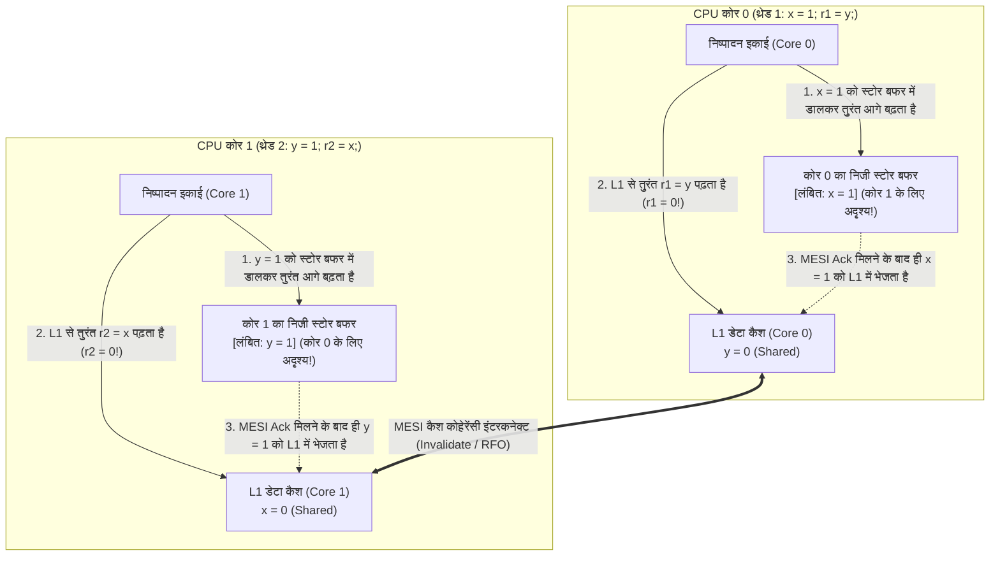
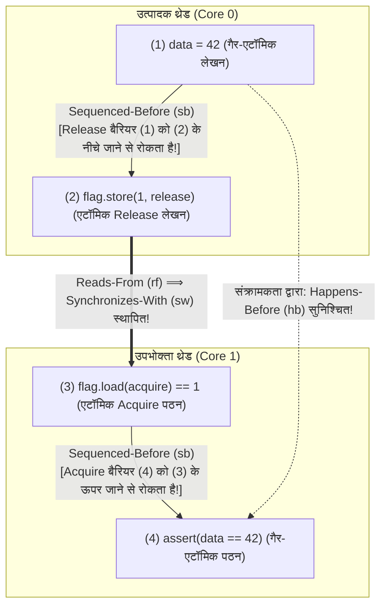

## प्रस्तावना: मानवीय सहज ज्ञान को चुनौती देते चार पंक्तियों के कोड ── Store Buffering (`SB`) लिटमस टेस्ट

नीचे दिए गए मात्र चार निर्देशों वाले समवर्ती (concurrent) C प्रोग्राम को देखिए। साझा मेमोरी (shared memory) में दो पूर्णांक चर `x` और `y` प्रारंभ में `0` हैं। दो अलग-अलग CPU कोर पर चलने वाले थ्रेड 1 और थ्रेड 2 क्रमशः एक लेखन (Store) और एक पठन (Load) करते हैं:

```c
// Initial state in shared memory:
int x = 0, y = 0;
int r1 = 0, r2 = 0;

// Thread 1 (Core 0)          // Thread 2 (Core 1)
void thread1(void) {          void thread2(void) {
    x = 1;      // (S1)           y = 1;      // (S2)
    r1 = y;     // (L1)           r2 = x;     // (L2)
}                             }
```

जब दोनों थ्रेड्स अपना निष्पादन समाप्त करते हैं, तो `(r1, r2)` के क्या संभावित मान हो सकते हैं?
सामान्य तर्क के अनुसार:
- यदि थ्रेड 1, थ्रेड 2 से पहले चलता है, तो `r1 = 0, r2 = 1` प्राप्त होता है।
- यदि थ्रेड 2, थ्रेड 1 से पहले चलता है, तो `r1 = 1, r2 = 0` प्राप्त होता है।
- यदि दोनों पहले अपनी पहली पंक्ति (`x = 1` और `y = 1`) चलाते हैं और फिर दूसरी पंक्ति, तो `r1 = 1, r2 = 1` प्राप्त होता है।

किसी भी संभावित क्रम में, कम से कम एक `1` का लेखन दूसरे थ्रेड के पठन से पहले होना ही चाहिए; इसलिए <strong>`r1 == 0 && r2 == 0` का परिणाम गणितीय रूप से पूर्णतः असंभव प्रतीत होता है</strong>। किंतु यदि आप इस कोड को किसी भी आधुनिक Intel/AMD x86-64 प्रोसेसर, Apple Silicon (ARMv8) चिप, या `-O2` ऑप्टिमाइज़ेशन वाले C/C++/Rust कंपाइलर पर चलाते हैं, तो <strong>यह "असंभव" परिणाम `r1 == 0 && r2 == 0` प्रति सेकंड हज़ारों बार वास्तव में घटित होता है!</strong> यह कोई हार्डवेयर दोष नहीं है, बल्कि एकल-थ्रेड <strong>"As-If नियम"</strong> के तहत आधुनिक CPU और कंपाइलर द्वारा किए जाने वाले निर्देश पुनर्व्यवस्थापन (Instruction Reordering) का परिणाम है।

---

## अध्याय 1: अनुक्रमिक संगति (Sequential Consistency) का भ्रम और गणितीय विरोधाभास

1979 में, ट्यूरिंग पुरस्कार विजेता <strong>लेस्ली लैम्पोर्ट (Leslie Lamport)</strong> ने प्रोग्रामरों के सहज मानसिक मॉडल को <strong>अनुक्रमिक संगति (Sequential Consistency, SC)</strong> के रूप में परिभाषित किया: किसी भी निष्पादन का परिणाम वैसा ही होना चाहिए मानो सभी प्रोसेसरों के ऑपरेशन किसी एकल वैश्विक कुल क्रम ($\prec_m$) में निष्पादित हुए हों, और प्रत्येक प्रोसेसर के ऑपरेशन उस अनुक्रम में ठीक उसी <strong>प्रोग्राम क्रम (Program Order, $\prec_p$)</strong> में दिखाई दें जैसा सोर्स कोड में लिखा गया है।

अनुक्रमिक संगति (SC) के अंतर्गत `r1 == 0 && r2 == 0` की असंभवता तीन पंक्तियों में सिद्ध की जा सकती है:

$$\text{Program Order: } S_1 \prec_p L_1 \quad \land \quad S_2 \prec_p L_2$$

$$\text{Assume } r_1 = 0 \land r_2 = 0 \implies L_1 \prec_m S_2 \quad \land \quad L_2 \prec_m S_1$$

$$\implies S_1 \prec_p L_1 \prec_m S_2 \prec_p L_2 \prec_m S_1 \implies S_1 \prec S_1 \quad (\text{Contradiction!})$$

यदि $r_1 = 0$ है, तो पठन $L_1$ अवश्य ही लेखन $S_2$ से पहले हुआ होगा ($L_1 \prec_m S_2$)। इसी प्रकार, $r_2 = 0$ के लिए $L_2 \prec_m S_1$ होना आवश्यक है। इन्हें प्रोग्राम क्रम $S_1 \prec_p L_1$ और $S_2 \prec_p L_2$ के साथ जोड़ने पर $S_1 \prec L_1 \prec S_2 \prec L_2 \prec S_1$ का <strong>समय-चक्र विरोधाभास (Cycle)</strong> उत्पन्न होता है! तथापि, चूंकि `x` और `y` अलग-अलग मेमोरी पते हैं जिनमें एकल थ्रेड के भीतर कोई डेटा निर्भरता नहीं है, हार्डवेयर और कंपाइलर मेमोरी विलंबता (latency) को छिपाने के लिए इस वैश्विक क्रम को तोड़ देते हैं।

---

## अध्याय 2: हार्डवेयर मेमोरी मॉडल ── स्टोर बफर (Store Buffer), MESI प्रोटोकॉल और इनवैलिडेट क्यू

### 2.1 MESI कैश कोहेरेंसी और स्टोर बफर के कारण होने वाली Store-Load रीऑर्डरिंग

आधुनिक 4 GHz CPU में रजिस्टर एक्सेस में केवल $0.25\text{ ns}$ (1 साइकिल) और L1 कैश में $\sim 1\text{ ns}$ लगता है, जबकि अंतर-कोर कैश समन्वय या मुख्य मेमोरी (DRAM) एक्सेस में $50\text{–}100\text{ ns}$ (300 साइकिल तक) लगते हैं। मल्टीकोर प्रोसेसर <strong>MESI प्रोटोकॉल (Modified, Exclusive, Shared, Invalid)</strong> द्वारा कैश संगति बनाए रखते हैं। जब कोर 0 किसी `Shared` अवस्था वाले कैश लाइन `x` में लिखना चाहता है, तो उसे अन्य सभी कोरों को <strong>Invalidate (Read-For-Ownership, RFO)</strong> संदेश भेजना पड़ता है और उनकी स्वीकृति (Ack) की प्रतीक्षा करनी पड़ती है।

प्रत्येक लेखन (Store) पर दर्जनों साइकिल तक रुकने से बचने के लिए, सभी आधुनिक CPU (x86-64 सहित!) निष्पादन इकाई और L1 कैश के बीच एक निजी FIFO कतार लगाते हैं जिसे <strong>स्टोर बफर (Store Buffer)</strong> कहा जाता है:



कोर 0 अपने निजी स्टोर बफर में `x = 1` डालता है (जो कोर 1 को अभी दिखाई नहीं देता!) और तुरंत अपने L1 कैश से `r1 = y` (`0`) पढ़ लेता है। उसी समय कोर 1 अपने स्टोर बफर में `y = 1` डालता है और अपने L1 कैश से `r2 = x` (`0`) पढ़ लेता है। इस प्रकार पठन (Load) वैश्विक दृश्यता में पूर्ववर्ती लेखन (Store) से आगे निकल जाता है — यही <strong>Store-Load रीऑर्डरिंग</strong> है! (यदि कोर 0 स्वयं द्वारा अभी-अभी लिखे गए `x` को पढ़ता है, तो <strong>Store Buffer Forwarding</strong> सीधे उसके स्थानीय बफर से `x = 1` लौटा देता है जिससे एकल-थ्रेड नियम सुरक्षित रहता है।)

### 2.2 मजबूत x86-TSO बनाम कमजोर क्रम वाले आर्किटेक्चर (ARMv8, RISC-V, PowerPC)

Intel और AMD का <strong>x86-TSO (Total Store Order)</strong> एक सख्त FIFO स्टोर बफर का उपयोग करता है: यह कभी भी `Load-Load`, `Load-Store` या `Store-Store` को पुनर्व्यवस्थित नहीं करता, और <strong>केवल `Store -> Load` रीऑर्डरिंग की अनुमति देता है</strong>। इसके विपरीत, <strong>ARMv8-A (AArch64 / Apple Silicon), RISC-V (RVWMO) और IBM PowerPC</strong> <strong>कमजोर मेमोरी मॉडल (Weakly Ordered Memory Models)</strong> अपनाते हैं: गैर-FIFO स्टोर मर्जिंग, सट्टा (speculative) आउट-ऑफ-ऑर्डर लोड और <strong>इनवैलिडेट क्यू (Invalidate Queues)</strong> के कारण, वहां <strong>चारों संयोजन (`Load-Load`, `Load-Store`, `Store-Store`, `Store-Load`) हार्डवेयर स्तर पर पुनर्व्यवस्थित हो सकते हैं</strong>!

| हार्डवेयर मेमोरी मॉडल | `Load -> Load` | `Load -> Store` | `Store -> Store` | `Store -> Load` | मल्टी-कॉपी एटॉमिसिटी (MCA) |
| :--- | :---: | :---: | :---: | :---: | :--- |
| <strong>अनुक्रमिक संगति (SC)</strong> | नहीं | नहीं | नहीं | नहीं | पूर्ण MCA |
| <strong>x86 / x64 (TSO)</strong> | नहीं | नहीं | नहीं | <strong>हाँ (Store Buffer)</strong> | Other-MCA |
| <strong>ARMv8-A (AArch64)</strong> | <strong>हाँ</strong> | <strong>हाँ</strong> | <strong>हाँ</strong> | <strong>हाँ</strong> | Other-MCA |
| <strong>RISC-V (RVWMO)</strong> | <strong>हाँ</strong> | <strong>हाँ</strong> | <strong>हाँ</strong> | <strong>हाँ</strong> | Other-MCA |
| <strong>IBM PowerPC</strong> | <strong>हाँ</strong> | <strong>हाँ</strong> | <strong>हाँ</strong> | <strong>हाँ</strong> | <strong>गैर-MCA (Non-MCA)</strong> |

---

## अध्याय 3: कंपाइलर रीऑर्डरिंग और DRF-SC प्रमेय ── डेटा रेस अपरिभाषित व्यवहार (UB) क्यों है

x86 प्रोसेसर पर भी बिना सिंक्रोनाइज़ेशन वाला संदेश प्रेषण `data = 42; ready = 1;` विफल हो जाता है क्योंकि <strong>ऑप्टिमाइज़िंग कंपाइलर (`gcc`, `clang`, `rustc`) मशीन कोड बनाने से पहले ही चारों प्रकार के मेमोरी एक्सेस को पुनर्व्यवस्थित कर देता है</strong>। इससे भी घातक यह है कि <strong>रजिस्टर प्रमोशन (Register Promotion) और लूप-इनवैरिएंट कोड मोशन (LICM)</strong> द्वारा कंपाइलर `while (!ready)` लूप को केवल एक बार रजिस्टर में पढ़कर <strong>अनंत लूप (infinite loop)</strong> में बदल देता है! इसके अतिरिक्त, C/C++ में `volatile` केवल MMIO रजिस्टरों के लिए है और कोई CPU मेमोरी बैरियर उत्पन्न नहीं करता।

1990 में, <strong>सरिता अडवे और मार्क हिल</strong> ने <strong>DRF-SC प्रमेय (Data-Race-Free Sequential Consistency)</strong> सिद्ध किया:
- <strong>डेटा रेस (Data Race)</strong>: जब दो थ्रेड एक ही मेमोरी स्थान को एक साथ एक्सेस करते हैं, कम से कम एक लेखन (write) है, कम से कम एक गैर-परमाण्विक (non-atomic) है, और उनके बीच कोई <strong>Happens-Before ($\xrightarrow{hb}$)</strong> संबंध नहीं है।
- <strong>DRF-SC अनुबंध</strong>: यदि प्रोग्राम <strong>डेटा रेस से मुक्त (DRF)</strong> है, तो कंपाइलर और CPU गारंटी देते हैं कि प्रत्येक निष्पादन पूर्णतः <strong>अनुक्रमिक संगति (SC)</strong> के समान व्यवहार करेगा। किंतु C/C++ या Unsafe Rust में एक भी डेटा रेस होने पर संपूर्ण प्रोग्राम <strong>अपरिभाषित व्यवहार (Undefined Behavior, UB)</strong> हो जाता है।

---

## अध्याय 4: Happens-Before संबंध ($\xrightarrow{hb}$) और Acquire-Release सिंक्रोनाइज़ेशन

C++11 / C11 / Rust के औपचारिक मेमोरी मॉडल में, जब थ्रेड 1 किसी एटॉमिक चर $x$ पर <strong>Release लेखन</strong> $W_{\text{rel}}(x, v)$ करता है और थ्रेड 2 उसी पर <strong>Acquire पठन</strong> $R_{\text{acq}}(x, v)$ करके वह मान पढ़ता है ($W_{\text{rel}} \xrightarrow{rf} R_{\text{acq}}$), तो दोनों थ्रेड्स के बीच <strong>Synchronizes-With ($\xrightarrow{sw}$)</strong> सेतु स्थापित होता है। थ्रेड के आंतरिक क्रम (<strong>Sequenced-Before, $\xrightarrow{sb}$</strong>) और $\xrightarrow{sw}$ का संक्रामक समापन (transitive closure) ही <strong>Happens-Before ($\xrightarrow{hb}$)</strong> कहलाता है:

$$W_{\text{rel}}(x, v) \xrightarrow{rf} R_{\text{acq}}(x, v) \implies W_{\text{rel}}(x, v) \xrightarrow{sw} R_{\text{acq}}(x, v)$$

$$\xrightarrow{hb} \;\; \triangleq \;\; \left( \xrightarrow{sb} \;\cup\; \xrightarrow{sw} \right)^+$$

`memory_order_release` और `memory_order_acquire` का उपयोग करके संदेश प्रेषण गणितीय रूप से पूर्णतः सुरक्षित हो जाता है:

```cpp
#include <atomic>
#include <cassert>

int data = 0;                        // Non-atomic payload
std::atomic<int> flag{0};            // Atomic synchronization variable

void producer_thread() {
    data = 42;                                           // (1) Sequenced-before (2)
    flag.store(1, std::memory_order_release);            // (2) Release store
}

void consumer_thread() {
    while (flag.load(std::memory_order_acquire) == 0) {  // (3) Acquire load
        // spin until flag == 1
    }
    assert(data == 42);                                  // (4) Guaranteed never to fail!
}
```



औपचारिक प्रमाण:

$$W(\text{data}=42) \xrightarrow{sb} W_{\text{rel}}(\text{flag}=1) \xrightarrow{sw} R_{\text{acq}}(\text{flag}=1) \xrightarrow{sb} R(\text{data})$$

$$\implies W(\text{data}=42) \xrightarrow{hb} R(\text{data}) \implies R(\text{data}) = 42$$

---

## अध्याय 5: मेमोरी ऑर्डरिंग स्पेक्ट्रम और CPU निर्देश मैपिंग (`MFENCE`, `DMB`, `LDAR`/`STLR`)

C++ और Rust तीन प्रमुख मेमोरी ऑर्डरिंग स्तर प्रदान करते हैं:
1. <strong>`Relaxed`</strong>: केवल एकल चर की अविभाज्यता और संशोधन क्रम ($\xrightarrow{mo}$) की गारंटी देता है, बिना किसी $\xrightarrow{sw}$ सिंक्रोनाइज़ेशन के (सरल काउंटरों के लिए उपयुक्त)।
2. <strong>`Acquire` / `Release` / `AcqRel`</strong>: एकदिशीय बैरियर (*Roach Motel* सेमैंटिक्स) जो $\xrightarrow{sw}$ स्थापित करते हैं, किंतु पूर्ववर्ती `store(release)` और अनुवर्ती `load(acquire)` के बीच <strong>`Store -> Load` रीऑर्डरिंग को नहीं रोकते</strong>!
3. <strong>`SeqCst` (डिफ़ॉल्ट)</strong>: सभी `SeqCst` ऑपरेशनों पर <strong>एकल वैश्विक कुल क्रम $\xrightarrow{S}$</strong> लागू करता है और `Store -> Load` रीऑर्डरिंग को भी प्रतिबंधित करता है (`SB` लिटमस टेस्ट में `r1 == 0 && r2 == 0` को रोकने का एकमात्र उपाय)।

| एटॉमिक ऑपरेशन (C++ / Rust) | x86-64 (TSO) मशीन निर्देश | ARMv8-A (AArch64) मशीन निर्देश | RISC-V (RVWMO) मशीन निर्देश |
| :--- | :--- | :--- | :--- |
| <strong>`load(relaxed)`</strong> | `mov eax, [rdi]` | `ldr w0, [x0]` | `lw a0, 0(a0)` |
| <strong>`load(acquire)`</strong> | <strong>`mov eax, [rdi]`</strong> *(शून्य हार्डवेयर फ़ेंस लागत!)* | <strong>`ldar w0, [x0]`</strong> *(Load-Acquire)* | `lw a0, 0(a0)` + `fence r, rw` |
| <strong>`store(release, v)`</strong> | <strong>`mov [rdi], esi`</strong> *(शून्य हार्डवेयर फ़ेंस लागत!)* | <strong>`stlr w1, [x0]`</strong> *(Store-Release)* | `fence rw, w` + `sw a1, 0(a0)` |
| <strong>`store(seq_cst, v)`</strong> | <strong>`xchg [rdi], esi`</strong> *(या `mov` + `mfence`)* | <strong>`stlr w1, [x0]`</strong> *(`ldar` के साथ क्रमित)* | `fence rw, rw` + `sw` + `fence rw, rw` |
| <strong>पूर्ण बैरियर `fence(seq_cst)`</strong> | <strong>`mfence`</strong> *(या `lock or [rsp], 0`)* | <strong>`dmb ish`</strong> *(Data Memory Barrier)* | <strong>`fence rw, rw`</strong> |

x86-64 पर `Acquire` और `Release` बिना किसी हार्डवेयर लागत के साधारण `mov` निर्देशों में कंपाइल होते हैं, जबकि `store(seq_cst)` स्टोर बफर को खाली करने के लिए `xchg` (अंतर्निहित `LOCK` प्रीफ़िक्स के साथ) या `mfence` का उपयोग करता है। वहीं ARMv8-A पर समर्पित `LDAR` और `STLR` निर्देश बिना किसी भारी `DMB ISH` बैरियर के अत्यंत कुशलता से Acquire-Release और SeqCst दोनों को लागू करते हैं।
