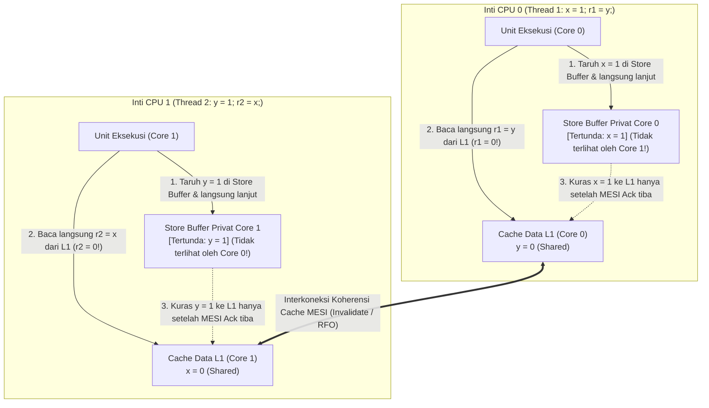
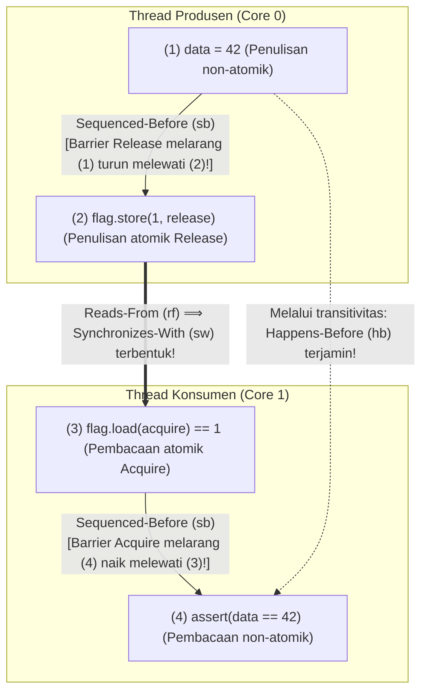

## Pendahuluan: Empat Baris Kode yang Melawan Intuisi ── Uji Litmus Store Buffering (`SB`)

Perhatikan program C konkuren bốn baris berikut. Dua variabel integer bersama `x` dan `y` diinisialisasi ke `0`. Dua thread yang berjalan pada dua inti (core) CPU berbeda masing-masing mengeksekusi satu penulisan (Store) diikuti satu pembacaan (Load):

```c
// Initial state in shared memory:
int x = 0, y = 0;
int r1 = 0, r2 = 0;

// Thread 1 (Core 0)          // Thread 2 (Core 1)
void thread1(void) {          void thread2(void) {
    x = 1;      // (S1)           y = 1;      // (S2)
    r1 = y;     // (L1)           r2 = x;     // (L2)
}                             }
```

Nilai akhir `(r1, r2)` apa saja yang mungkin terjadi setelah kedua thread selesai?
Menurut akal sehat:
- Jika Thread 1 selesai sebelum Thread 2, hasilnya `r1 = 0, r2 = 1`.
- Jika Thread 2 selesai sebelum Thread 1, hasilnya `r1 = 1, r2 = 0`.
- Jika keduanya menjalankan baris pertama (`x = 1` dan `y = 1`) sebelum baris kedua, hasilnya `r1 = 1, r2 = 1`.

Dalam urutan mana pun, setidaknya satu penulisan `1` pasti terjadi sebelum pembacaan oleh thread lawan; oleh karena itu, <strong>hasil `r1 == 0 && r2 == 0` tampak mustahil secara matematis</strong>. Namun, jika Anda menjalankan kode ini pada prosesor modern Intel/AMD x86-64, chip Apple Silicon (ARMv8), atau dengan kompiler C/C++/Rust yang dioptimalkan (`-O2`), <strong>hasil "mustahil" `r1 == 0 && r2 == 0` benar-benar terjadi ribuan kali per detik!</strong> Ini bukan kerusakan perangkat keras, melainkan akibat dari pengurutan ulang instruksi (Instruction Reordering) di bawah <strong>aturan "As-If" thread tunggal</strong>.

---

## Bab 1: Ilusi Konsistensi Sekuensial (Sequential Consistency)

Pada tahun 1979, peraih Turing Award <strong>Leslie Lamport</strong> memformalkan model mental intuitif pemrogram sebagai <strong>Konsistensi Sekuensial (Sequential Consistency, SC)</strong>: hasil dari setiap eksekusi adalah sama seolah-olah operasi dari semua prosesor dijalankan dalam satu urutan total global ($\prec_m$), dan operasi dari masing-masing prosesor muncul dalam urutan tersebut tepat sesuai <strong>urutan program (Program Order, $\prec_p$)</strong> yang tertulis di kode sumber.

Di bawah Konsistensi Sekuensial, ketidakmungkinan `r1 == 0 && r2 == 0` dapat dibuktikan dalam tiga baris:

$$\text{Program Order: } S_1 \prec_p L_1 \quad \land \quad S_2 \prec_p L_2$$

$$\text{Assume } r_1 = 0 \land r_2 = 0 \implies L_1 \prec_m S_2 \quad \land \quad L_2 \prec_m S_1$$

$$\implies S_1 \prec_p L_1 \prec_m S_2 \prec_p L_2 \prec_m S_1 \implies S_1 \prec S_1 \quad (\text{Contradiction!})$$

Agar $r_1 = 0$, pembacaan $L_1$ harus mendahului penulisan $S_2$ ($L_1 \prec_m S_2$). Demikian pula, $r_2 = 0$ mengharuskan $L_2 \prec_m S_1$. Menggabungkannya dengan urutan program $S_1 \prec_p L_1$ dan $S_2 \prec_p L_2$ menghasilkan <strong>siklus waktu yang kontradiktif</strong> $S_1 \prec L_1 \prec S_2 \prec L_2 \prec S_1$. Akan tetapi, karena `x` dan `y` adalah alamat berbeda tanpa ketergantungan data dalam satu thread, perangkat keras dan kompiler melanggar urutan global ini demi menyembunyikan latensi memori.

---

## Bab 2: Model Memori Perangkat Keras ── Store Buffer, Protokol MESI, dan Invalidate Queue

### 2.1 Koherensi Cache MESI dan Reordering Store-Load melalui Store Buffer

Pada CPU 4 GHz modern, akses register hanya membutuhkan $0,25\text{ ns}$ (1 siklus) dan cache L1 sekitar $1\text{ ns}$, sedangkan sinkronisasi cache antar-inti atau akses DRAM membutuhkan $50\text{–}100\text{ ns}$ (hingga 300 siklus). Inti CPU menjaga koherensi baris cache melalui <strong>protokol MESI (Modified, Exclusive, Shared, Invalid)</strong>. Saat Core 0 ingin mengubah variabel `x` yang berstatus `Shared`, ia harus menyiarkan pesan <strong>Invalidate (Read-For-Ownership, RFO)</strong> ke inti lainnya dan menunggu balasan konfirmasi (Ack).

Agar tidak menghentikan eksekusi selama puluhan siklus setiap kali menulis, semua CPU modern (termasuk x86-64!) menempatkan antrean FIFO privat bernama <strong>Store Buffer (buffer tulis)</strong> di antara unit eksekusi dan cache L1:



Core 0 menyimpan `x = 1` ke Store Buffer privatnya (belum terlihat oleh Core 1) dan langsung membaca `r1 = y` (`0`) dari cache L1 miliknya. Secara bersamaan, Core 1 menyimpan `y = 1` ke Store Buffer-nya dan membaca `r2 = x` (`0`) dari cache L1 miliknya. Dengan demikian, pembacaan (Load) mendahului penulisan sebelumnya (Store) dalam visibilitas global: inilah <strong>Store-Load Reordering</strong>! (Jika Core 0 membaca kembali variabel `x` yang baru saja ditulisnya sendiri, mekanisme <strong>Store Buffer Forwarding</strong> langsung meneruskan `x = 1` dari buffer lokal sehingga perilaku thread tunggal tetap terjaga.)

### 2.2 Model Kuat x86-TSO vs. Arsitektur Urutan Lemah (ARMv8, RISC-V, PowerPC)

Model <strong>x86-TSO (Total Store Order)</strong> dari Intel dan AMD menggunakan Store Buffer FIFO yang ketat: tidak pernah mengurutkan ulang `Load-Load`, `Load-Store`, maupun `Store-Store`, dan <strong>hanya mengizinkan pengurutan ulang `Store -> Load`</strong>. Sebaliknya, <strong>ARMv8-A (AArch64 / Apple Silicon), RISC-V (RVWMO), dan IBM PowerPC</strong> mengadopsi <strong>Model Memori Urutan Lemah (Weakly Ordered)</strong>: akibat penggabungan tulis non-FIFO, pembacaan spekulatif out-of-order, dan <strong>Invalidate Queue</strong>, <strong>keempat kombinasi (`Load-Load`, `Load-Store`, `Store-Store`, `Store-Load`) dapat diurutkan ulang oleh perangkat keras</strong>!

| Model Memori Perangkat Keras | `Load -> Load` | `Load -> Store` | `Store -> Store` | `Store -> Load` | Atomisitas Multi-Salinan (MCA) |
| :--- | :---: | :---: | :---: | :---: | :--- |
| <strong>Konsistensi Sekuensial (SC)</strong> | Tidak | Tidak | Tidak | Tidak | MCA Penuh |
| <strong>x86 / x64 (TSO)</strong> | Tidak | Tidak | Tidak | <strong>Ya (Store Buffer)</strong> | Other-MCA |
| <strong>ARMv8-A (AArch64)</strong> | <strong>Ya</strong> | <strong>Ya</strong> | <strong>Ya</strong> | <strong>Ya</strong> | Other-MCA |
| <strong>RISC-V (RVWMO)</strong> | <strong>Ya</strong> | <strong>Ya</strong> | <strong>Ya</strong> | <strong>Ya</strong> | Other-MCA |
| <strong>IBM PowerPC</strong> | <strong>Ya</strong> | <strong>Ya</strong> | <strong>Ya</strong> | <strong>Ya</strong> | <strong>Non-MCA</strong> |

---

## Bab 3: Pengurutan Ulang Kompiler dan Teorema DRF-SC ── Mengapa Data Race Adalah Undefined Behavior (UB)

Bahkan pada CPU x86, pengiriman pesan tanpa sinkronisasi `data = 42; ready = 1;` tetap gagal karena <strong>kompiler pengoptimasi (`gcc`, `clang`, `rustc`) bebas mengurutkan ulang keempat jenis akses memori</strong>. Lebih buruk lagi: melalui <strong>Register Promotion dan Loop-Invariant Code Motion (LICM)</strong>, kompiler mengubah loop tunggu `while (!ready)` menjadi pembacaan satu kali ke register diikuti <strong>loop tak terbatas (infinite loop)</strong>! Selain itu, kata kunci `volatile` di C/C++ hanya ditujukan untuk register MMIO dan tidak menghasilkan memory barrier CPU.

Pada tahun 1990, <strong>Sarita Adve dan Mark Hill</strong> membuktikan <strong>teorema DRF-SC (Data-Race-Free Sequential Consistency)</strong>:
- <strong>Data Race</strong>: Dua thread mengakses lokasi memori yang sama secara bersamaan, setidaknya satu adalah penulisan, setidaknya satu non-atomik, dan tidak ada relasi <strong>Happens-Before ($\xrightarrow{hb}$)</strong> di antara keduanya.
- <strong>Kontrak DRF-SC</strong>: Jika program <strong>bebas dari Data Race (DRF)</strong>, kompiler dan CPU menjamin setiap eksekusi berperilaku persis seperti <strong>Konsistensi Sekuensial (SC)</strong>. Sebaliknya, satu saja Data Race di C/C++ atau Unsafe Rust menghasilkan <strong>Undefined Behavior (UB)</strong>.

---

## Bab 4: Relasi Happens-Before ($\xrightarrow{hb}$) dan Sinkronisasi Acquire-Release

Dalam model memori formal C++11 / C11 / Rust, ketika Thread 1 melakukan penulisan atomik <strong>Release</strong> $W_{\text{rel}}(x, v)$ dan Thread 2 melakukan pembacaan atomik <strong>Acquire</strong> $R_{\text{acq}}(x, v)$ yang membaca nilai tersebut ($W_{\text{rel}} \xrightarrow{rf} R_{\text{acq}}$), terbentuk jembatan lintas-thread bernama <strong>Synchronizes-With ($\xrightarrow{sw}$)</strong>. Penutupan transitif dari urutan internal thread (<strong>Sequenced-Before, $\xrightarrow{sb}$</strong>) dan $\xrightarrow{sw}$ mendefinisikan relasi <strong>Happens-Before ($\xrightarrow{hb}$)</strong>:

$$W_{\text{rel}}(x, v) \xrightarrow{rf} R_{\text{acq}}(x, v) \implies W_{\text{rel}}(x, v) \xrightarrow{sw} R_{\text{acq}}(x, v)$$

$$\xrightarrow{hb} \;\; \triangleq \;\; \left( \xrightarrow{sb} \;\cup\; \xrightarrow{sw} \right)^+$$

Dengan `memory_order_release` dan `memory_order_acquire`, pengiriman pesan dijamin aman secara matematis:

```cpp
#include <atomic>
#include <cassert>

int data = 0;                        // Non-atomic payload
std::atomic<int> flag{0};            // Atomic synchronization variable

void producer_thread() {
    data = 42;                                           // (1) Sequenced-before (2)
    flag.store(1, std::memory_order_release);            // (2) Release store
}

void consumer_thread() {
    while (flag.load(std::memory_order_acquire) == 0) {  // (3) Acquire load
        // spin until flag == 1
    }
    assert(data == 42);                                  // (4) Guaranteed never to fail!
}
```



Bukti formal:

$$W(\text{data}=42) \xrightarrow{sb} W_{\text{rel}}(\text{flag}=1) \xrightarrow{sw} R_{\text{acq}}(\text{flag}=1) \xrightarrow{sb} R(\text{data})$$

$$\implies W(\text{data}=42) \xrightarrow{hb} R(\text{data}) \implies R(\text{data}) = 42$$

---

## Bab 5: Spektrum Memory Ordering dan Pemetaan Instruksi CPU (`MFENCE`, `DMB`, `LDAR`/`STLR`)

C++ dan Rust menyediakan tiga tingkat pengurutan utama:
1. <strong>`Relaxed`</strong>: Hanya menjamin atomisitas dan urutan modifikasi ($\xrightarrow{mo}$) pada satu variabel tanpa sinkronisasi $\xrightarrow{sw}$ (cocok untuk penghitung sederhana).
2. <strong>`Acquire` / `Release` / `AcqRel`</strong>: Barrier satu arah (semantik *Roach Motel*) yang membentuk $\xrightarrow{sw}$, tetapi <strong>TIDAK mencegah pengurutan ulang `Store -> Load`</strong> ketika `store(release)` mendahului `load(acquire)`.
3. <strong>`SeqCst` (bawaan)</strong>: Menambahkan <strong>satu urutan total global $\xrightarrow{S}$</strong> pada semua operasi `SeqCst` dan melarang pengurutan ulang `Store -> Load` (solusi untuk mencegah `r1 == 0 && r2 == 0` pada uji `SB`).

| Operasi Atomik (C++ / Rust) | Instruksi x86-64 (TSO) | Instruksi ARMv8-A (AArch64) | Instruksi RISC-V (RVWMO) |
| :--- | :--- | :--- | :--- |
| <strong>`load(relaxed)`</strong> | `mov eax, [rdi]` | `ldr w0, [x0]` | `lw a0, 0(a0)` |
| <strong>`load(acquire)`</strong> | <strong>`mov eax, [rdi]`</strong> *(Biaya fence hardware nol!)* | <strong>`ldar w0, [x0]`</strong> *(Load-Acquire)* | `lw a0, 0(a0)` + `fence r, rw` |
| <strong>`store(release, v)`</strong> | <strong>`mov [rdi], esi`</strong> *(Biaya fence hardware nol!)* | <strong>`stlr w1, [x0]`</strong> *(Store-Release)* | `fence rw, w` + `sw a1, 0(a0)` |
| <strong>`store(seq_cst, v)`</strong> | <strong>`xchg [rdi], esi`</strong> *(atau `mov` + `mfence`)* | <strong>`stlr w1, [x0]`</strong> *(terurut dengan `ldar`)* | `fence rw, rw` + `sw` + `fence rw, rw` |
| <strong>Barrier `fence(seq_cst)`</strong> | <strong>`mfence`</strong> *(atau `lock or [rsp], 0`)* | <strong>`dmb ish`</strong> *(Data Memory Barrier)* | <strong>`fence rw, rw`</strong> |

Pada x86-64, `Acquire` dan `Release` dikompilasi menjadi instruksi `mov` biasa tanpa biaya perangkat keras, sedangkan `store(seq_cst)` menggunakan `xchg` (prefiks `LOCK` implisit) atau `mfence` untuk menguras Store Buffer. Pada ARMv8-A, instruksi khusus `LDAR` dan `STLR` menerapkan Acquire-Release dan SeqCst secara efisien tanpa memerlukan barrier penuh `DMB ISH`.
