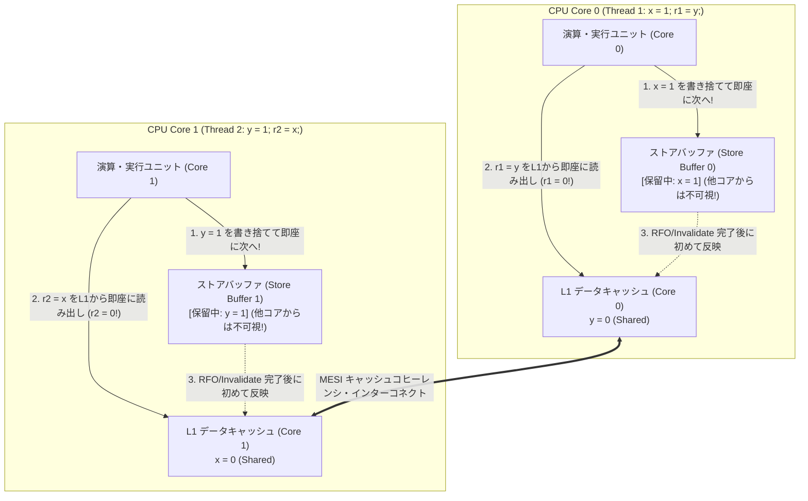
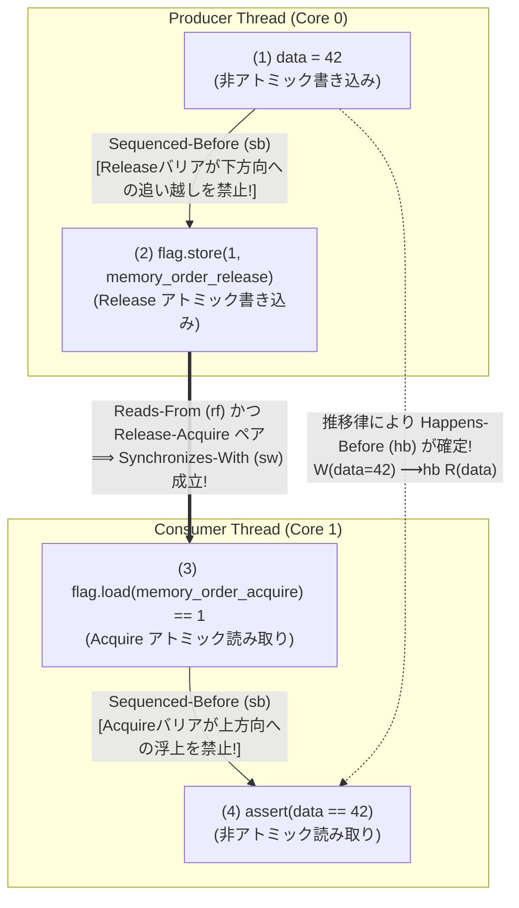

まずは、次のわずか数行のC言語コードを見てほしい。共有メモリ上に初期値 `0` の2つの整数変数 `x` と `y` があり、2つのスレッド（CPUコア0とコア1）がそれぞれたった2行の代入と読み取りを並行して実行する。

```c
// Initial state in shared memory:
int x = 0;
int y = 0;
int r1 = 0, r2 = 0;

// Thread 1 (Core 0)          // Thread 2 (Core 1)
void thread1(void) {          void thread2(void) {
    x = 1;      // (S1)           y = 1;      // (S2)
    r1 = y;     // (L1)           r2 = x;     // (L2)
}                             }
```

スレッド1は `x` に `1` を書き込んでから `y` の値を `r1` に読み込む。スレッド2は `y` に `1` を書き込んでから `x` の値を `r2` に読み込む。両方のスレッドの実行が終了したとき、ローカル変数 `(r1, r2)` の組み合わせとして<strong>あり得る値</strong>は何だろうか？

直感的に考えてみよう。
- もしスレッド1が先に走り切れば、`r1 = 0` となり、その後スレッド2が走るので `r2 = 1` となる。
- もしスレッド2が先に走り切れば、`r2 = 0` となり、その後スレッド1が走るので `r1 = 1` となる。
- もし両者がちょうど同時に1行目（`x = 1` と `y = 1`）を実行してから2行目を実行すれば、`r1 = 1` かつ `r2 = 1` となる。

どちらかのスレッドが必ず先に（あるいは同時に）変数へ `1` を書き込むのだから、両方のスレッドが相手の書き込みを見落として<strong>「`r1 == 0` かつ `r2 == 0`」になることだけは、どう順番を入れ替えても絶対にあり得ない</strong>ように思える。

ところが、このプログラムを私たちが毎日使っているIntelやAMDのx86-64プロセッサ、Apple Silicon（M1/M2/M3/M4）やスマートフォンのARMv8プロセッサ、あるいは最適化オプション（`-O2`）を有効にしたC/C++/Rustコンパイラで実際にコンパイルしてループ実行すると、<strong>数学的に絶対不可能であるはずの `r1 == 0 && r2 == 0` が、毎秒何千回、何万回という頻度で現実に発生する</strong>のである！

CPUが壊れているわけでも、コンパイラにバグがあるわけでもない。現代のコンピュータは、<strong>「人間がソースコードに書いた順番どおりに命令を実行していない」</strong>し、<strong>「あるCPUコアが書き込んだメモリが、別のCPUコアから即座に同じ順番で見える保証も存在しない」</strong>のである。

なぜこのような恐ろしい現象が起きるのか？ そして、私たちが書くマルチスレッドプログラムはどうやって正しさを保っているのか？ 本稿では、レスリー・ランポート（Leslie Lamport）の<strong>逐次一貫性（Sequential Consistency）</strong>の崩壊から出発し、ハードウェアのマイクロアーキテクチャ（<strong>ストアバッファ、MESIプロトコル、無効化キュー</strong>）、最適化コンパイラによる命令の並べ替え、<strong>データ競合（Data Race）とDRF-SC定理</strong>、そしてC++11/C11/Rustが採用する形式的な<strong>Happens-Before（$\xrightarrow{hb}$）関係、アトミック操作（Relaxed / Acquire-Release / SeqCst）、メモリフェンス命令（`MFENCE` / `DMB` / `LDAR` / `STLR`）</strong>のすべてを、ハードウェアとソフトウェアの両面から徹底的に解き明かす。

---

## 第1章：「書いた順番に動く」という幻想 ── リトマステストと逐次一貫性（Sequential Consistency）

### 1.1 逐次一貫性（Sequential Consistency: SC）の数学的定義

マルチスレッドプログラムの挙動を考えるとき、私たち人間が無意識のうちに前提としているメンタルモデルには名前がついている。チューリング賞受賞者である<strong>レスリー・ランポート（Leslie Lamport）</strong>が1979年の古典的論文で定式化した<strong>「逐次一貫性（Sequential Consistency: SC）」</strong>である。

> <strong>逐次一貫性（Lamport, 1979）の定義</strong>：
> 「いかなる実行の結果も、すべてのプロセッサの操作が<strong>ある1つの直列な順序（全順序）</strong>で実行され、かつ各プロセッサ自身の操作がその列の中で<strong>プログラムで指定された順序（Program Order）どおり</strong>に現れる場合と同一でなければならない。」

平たく言えば、逐次一貫性とは「各スレッドの命令カード順番を変えずに、複数のスレッドのカード束をトランプのシャッフル（リフルシャッフル）のように1つの山に交互に噛み合わせる（Interleaving）だけで説明できるモデル」であり、かつ「1つの巨大な共有メモリに対して、誰かが書き込んだ値は次の瞬間には全員から即座に見えるモデル」である。

冒頭のプログラム（並行処理理論ではデッカーのアルゴリズムに由来して<strong>Store Buffering (`SB`) リトマステスト</strong>と呼ばれる）において、スレッド1の2つの命令を $S_1\ (\text{x}=1), L_1\ (\text{r1}=\text{y})$、スレッド2の2つの命令を $S_2\ (\text{y}=1), L_2\ (\text{r2}=\text{x})$ と置こう。プログラム順序の制約 $S_1 \prec_p L_1$ および $S_2 \prec_p L_2$ を保ったまま、合計4つの命令を1列に並べる方法（インターリービング）は $\binom{4}{2} = 6$ 通りしか存在しない。

| 実行順序（インターリービング） | 実行トレース | 最終結果 `(r1, r2)` |
| :--- | :--- | :--- |
| パターン1 | $S_1(\text{x}=1) \to L_1(\text{r1}=\text{y}) \to S_2(\text{y}=1) \to L_2(\text{r2}=\text{x})$ | `r1 = 0, r2 = 1` |
| パターン2 | $S_1(\text{x}=1) \to S_2(\text{y}=1) \to L_1(\text{r1}=\text{y}) \to L_2(\text{r2}=\text{x})$ | `r1 = 1, r2 = 1` |
| パターン3 | $S_1(\text{x}=1) \to S_2(\text{y}=1) \to L_2(\text{r2}=\text{x}) \to L_1(\text{r1}=\text{y})$ | `r1 = 1, r2 = 1` |
| パターン4 | $S_2(\text{y}=1) \to L_2(\text{r2}=\text{x}) \to S_1(\text{x}=1) \to L_1(\text{r1}=\text{y})$ | `r1 = 1, r2 = 0` |
| パターン5 | $S_2(\text{y}=1) \to S_1(\text{x}=1) \to L_2(\text{r2}=\text{x}) \to L_1(\text{r1}=\text{y})$ | `r1 = 1, r2 = 1` |
| パターン6 | $S_2(\text{y}=1) \to S_1(\text{x}=1) \to L_1(\text{r1}=\text{y}) \to L_2(\text{r2}=\text{x})$ | `r1 = 1, r2 = 1` |

全6通りのどこを探しても、`r1 = 0, r2 = 0` は存在しない。それもそのはずで、背理法によってたった3行で証明できるからである。

$$\text{Program Order: } S_1 \prec_p L_1 \quad \land \quad S_2 \prec_p L_2$$

$$\text{Assume } r_1 = 0 \land r_2 = 0 \implies L_1 \prec_m S_2 \quad \land \quad L_2 \prec_m S_1$$

$$\implies S_1 \prec_p L_1 \prec_m S_2 \prec_p L_2 \prec_m S_1 \implies S_1 \prec S_1 \quad (\text{Contradiction: Cycle in Total Order!})$$

もし $r_1 = 0$ ならば、読み取り $L_1$ は書き込み $S_2$ より時間的に前（$L_1 \prec_m S_2$）に実行されていなければならない。同様に $r_2 = 0$ ならば、$L_2$ は $S_1$ より前（$L_2 \prec_m S_1$）に実行されていなければならない。これをプログラム順序 $S_1 \prec_p L_1$ および $S_2 \prec_p L_2$ と繋ぎ合わせると、$S_1 \prec L_1 \prec S_2 \prec L_2 \prec S_1$ という<strong>時間のループ（順序の循環矛盾）</strong>が発生する。したがって、逐次一貫性（SC）が成り立つ世界では `r1 == 0 && r2 == 0` は論理的に起こり得ない。

### 1.2 「As-Ifルール（あたかもその通りに動く規則）」の罠

では、なぜ現実のCPUとコンパイラはこの時間の法則を破り、`r1 == 0 && r2 == 0` を引き起こすのか？

それは、過去50年間のコンピュータアーキテクチャとコンパイラ設計の進化が、すべて<strong>「シングルスレッドにおける観測的等価性（As-If Rule）」</strong>だけを絶対の基準として突き進んできたからである。

スレッド1単独の視点に立ってみよう。命令 $S_1$（`x = 1`）はアドレス `x` への書き込みであり、命令 $L_1$（`r1 = y`）はまったく別のアドレス `y` からの読み取りである。シングルスレッドの世界では、`x` と `y` の間にデータ依存関係（Data Dependency）は一切存在しない。したがって、コンパイラやCPUが実行効率を高めるために<strong>こっそり2つの命令の順序を逆転させて、先に `r1 = y` を読み込んでから後で `x = 1` をメモリに書き込んだとしても、スレッド1自身からは結果が1ミリも変わらない</strong>のである！

この「別々のアドレスに対する操作なら順番を入れ替えてもシングルスレッドでは誰も気づかない」という最適化が、複数スレッドが同じメモリ空間を共有した瞬間に牙を剥く。その舞台裏を、まずはハードウェア（CPUのシリコン内部）から覗いてみよう。

---

## 第2章：ハードウェアメモリモデルの正体 ── ストアバッファ、MESIプロトコル、無効化キュー

### 2.1 メモリの壁（Memory Wall）とキャッシュコヒーレンシの遅延

現代のCPUコアは1秒間に数十億回（3GHz〜5GHz）のクロックで動作し、レジスタ間の加算やビット演算をわずか $0.2\text{〜}0.3$ ナノ秒（1クロック未満）で完了する。これに対して、メインメモリ（DRAM）へのアクセスには約 $80\text{〜}100$ ナノ秒（<strong>約300クロックサイクル以上</strong>）という途方もない時間がかかる。CPUにとってメインメモリは、人間にとっての「地球の裏側への郵便」ほど遠い存在なのである。

この速度差を埋めるために、各CPUコアは自身のすぐ隣に高速なL1キャッシュ（約1ナノ秒 / 3〜4サイクル）、L2キャッシュ（約3〜4ナノ秒）、そして全コア共有のL3キャッシュを備えている。しかし、複数のコアが同じメモリアドレスのコピーをそれぞれのL1キャッシュに持つと、「コア0が書き換えた最新の値を、どうやってコア1のキャッシュに反映するか」という<strong>キャッシュコヒーレンシ（Cache Coherency：キャッシュ一貫性）</strong>の問題が発生する。

ハードウェアはこの一貫性を保つため、キャッシュライン（通常64バイト単位）ごとに以下の4状態を管理する<strong>MESIプロトコル</strong>を実装している。

- <strong>M (Modified: 変更済み)</strong>：このコアのキャッシュだけが最新値を持ち、メインメモリより新しい（独占・書き込み可）。
- <strong>E (Exclusive: 排他)</strong>：このコアのキャッシュだけが保持しており、メインメモリの内容と一致している（独占・即座にMへ遷移可）。
- <strong>S (Shared: 共有)</strong>：複数のコアがこのキャッシュラインを同時に保持しており、全員が読み取り専用で共有している。
- <strong>I (Invalid: 無効)</strong>：このキャッシュラインのデータは古く無効である（読み取るには他コアまたはメモリから再取得が必要）。

### 2.2 ストアバッファ（Store Buffer）が引き起こす Store-Load リオーダリング

ここで、冒頭の `SB` リトマステスト（初期状態 `x = 0, y = 0` が両方のコアのキャッシュに `Shared` 状態で載っているとする）を、CPUコアのハードウェア視点で追跡してみよう。

コア0が1行目の命令 `x = 1;`（Store）を実行しようとする。しかし、変数 `x` のキャッシュラインは現在 `Shared` 状態（コア1も読んでいるかもしれない状態）にあるため、コア0が勝手に自分のL1キャッシュの `x` を書き換えることはMESIプロトコル上許されない。コア0はバス（インターコネクト）経由で他のすべてのコアに対して<strong>「これから私が `x` を書き換えるから、君たちが持っている `x` のキャッシュラインを `Invalid`（無効）にせよ！」という無効化メッセージ（Invalidate / Read-For-Ownership: RFO）</strong>を送信し、他コアから「無効化完了（Invalidate Acknowledge）」の返事が戻ってくるまで待たなければならない。

この通信には数十クロックサイクルがかかる。もし書き込み（Store）のたびにCPUコアが数十サイクルも完全に停止（ストール）していたら、現代のプロセッサの性能は数分の一に崩壊してしまう！

そこで、<strong>すべての現代CPU（Intel/AMD x86-64を含む！）は、CPUコアの実行ユニットとL1キャッシュの間に「ストアバッファ（Store Buffer / Write Buffer）」と呼ばれるコア専用の高速な一時待機キュー（FIFOバッファ）を設けている</strong>。



この図を見れば、なぜ `r1 == 0 && r2 == 0` が起きるのかが一目瞭然となる。

1. コア0は `x = 1` を実行すると、L1キャッシュへの反映やMESI通信の完了を待たず、<strong>自分専用の「ストアバッファ0」に `x = 1` を放り込んだだけで「書き込み完了！」とみなして即座に次の命令へ進む</strong>。この時点では、コア0のストアバッファの中身はコア1からは一切見えない！
2. 同様に、コア1も `y = 1` を自分専用の「ストアバッファ1」に放り込み、即座に次の命令へ進む。
3. コア0は次の命令 `r1 = y`（Load）を実行する。変数 `y` はコア0のL1キャッシュに `Shared` 状態（値 `0`）で存在しているため、キャッシュヒットして即座に <strong>`r1 = 0`</strong> を読み出す！
4. コア1も次の命令 `r2 = x`（Load）を実行し、自分のL1キャッシュにある古い値 <strong>`r2 = 0`</strong> を読み出す！
5. その数十ナノ秒後、ようやくMESIの無効化確認が終わって、ストアバッファ0の `x = 1` とストアバッファ1の `y = 1` がL1キャッシュへと吐き出される（Flush / Drain）。

つまり、ハードウェアの内部では、各コアが<strong>「自分のストアバッファに溜まった書き込みが全世界（L1キャッシュ）に公開される前に、後続の読み取り（Load）を先に実行してしまった」</strong>のである。これを<strong>Store-Load リオーダリング（Store-Load Reordering：書き込みと読み取りの順序逆転）</strong>と呼ぶ。

なお、もしコア0自身が `x = 1; r1 = x;` のように「自分が直前に書き込んだ変数 `x`」を自分で読み直した場合はどうなるか？ このときは、CPUがL1キャッシュを見に行く前に自分のストアバッファを覗き見て最新の `x = 1` を直接引き渡す。これを<strong>ストアバッファ・フォワーディング（Store Buffer Forwarding / Store-to-Load Forwarding）</strong>と呼ぶ。そのおかげで、シングルスレッド内では常に自分が書いた最新値が読めるため、「As-Ifルール」は完璧に守られているのである。

### 2.3 x86-TSO（Total Store Order）と ARM/RISC-V/PowerPC の弱いメモリモデル

IntelやAMDのx86/x64アーキテクチャが採用しているハードウェアメモリモデルは、<strong>TSO（Total Store Order：全ストア順序）</strong>と呼ばれる比較的「強い（Strong）」モデルである。x86-TSOでは、ストアバッファは厳密なFIFO（先入れ先出し）キューとして動作し、次の特徴を持つ。

- <strong>Store $\to$ Store（書き込み同士の順序）は絶対に逆転しない</strong>：コア0が `data = 42; flag = 1;` の順に書き込めば、ストアバッファからL1キャッシュへも必ず `data = 42` $\to$ `flag = 1` の順に出ていく。
- <strong>Load $\to$ Load および Load $\to$ Store も逆転しない</strong>。
- <strong>唯一、異なるアドレスに対する Store $\to$ Load（書き込みの直後の読み取り）だけが、ストアバッファによって逆転する！</strong>

ところが、スマートフォンやMac（Apple Silicon）、クラウドサーバで主流の<strong>ARMv8（AArch64）</strong>、<strong>RISC-V（RVWMO）</strong>、および<strong>IBM PowerPC</strong>は、省電力性とパイプライン並列性を極限まで高めるため、x86よりもはるかに制約の緩い<strong>「弱いメモリモデル（Weakly Ordered Memory Model）」</strong>を採用している。これらのアーキテクチャでは、ストアバッファでの結合・追い越し、アウトオブオーダ実行による投機的ロード（Speculative Load）、バンク分割されたキャッシュ、さらには<strong>無効化キュー（Invalidate Queue）</strong>によって、<strong>4種類すべてのメモリアクセス順序（Store-Load, Store-Store, Load-Load, Load-Store）がハードウェアレベルで逆転し得る</strong>！

| ハードウェアアーキテクチャ | Load $\to$ Load 逆転 | Load $\to$ Store 逆転 | Store $\to$ Store 逆転 | Store $\to$ Load 逆転 | マルチコピーアトミック性 |
| :--- | :---: | :---: | :---: | :---: | :--- |
| <strong>逐次一貫性 (Sequential Consistency: SC)</strong> | 不可 | 不可 | 不可 | 不可 | 完全（Multi-Copy Atomic） |
| <strong>x86 / x64 (Intel / AMD TSO)</strong>, SPARC TSO | 不可 | 不可 | 不可 | <strong>発生する！</strong> | 他コア間は完全（Other-MCA） |
| <strong>ARMv8-A (AArch64 / Apple Silicon)</strong> | <strong>発生する！</strong> | <strong>発生する！</strong> | <strong>発生する！</strong> | <strong>発生する！</strong> | 他コア間は完全（ARMv8.0以降 Other-MCA） |
| <strong>RISC-V (RVWMO)</strong> | <strong>発生する！</strong> | <strong>発生する！</strong> | <strong>発生する！</strong> | <strong>発生する！</strong> | 他コア間は完全（Other-MCA） |
| <strong>IBM Power / PowerPC</strong> | <strong>発生する！</strong> | <strong>発生する！</strong> | <strong>発生する！</strong> | <strong>発生する！</strong> | <strong>非マルチコピーアトミック（Non-MCA）</strong> |
| <strong>DEC Alpha (歴史的極限モデル)</strong> | <strong>発生する（依存ロードすら逆転！）</strong> | <strong>発生する！</strong> | <strong>発生する！</strong> | <strong>発生する！</strong> | 非マルチコピーアトミック |

これがどれほど衝撃的な結果を生むか、マルチスレッドで最も頻繁に書かれる<strong>Message Passing（`MP`：メッセージパッシング）リトマステスト</strong>で見てみよう。

- <strong>スレッド1（送信側）</strong>：`data = 42;` を書き込んだ後、`flag = 1;` を書き込む。
- <strong>スレッド2（受信側）</strong>：`while (flag == 0);` でフラグが立つのを待ち、ループを抜けたら `r1 = data;` を読み取る。

x86-TSOでは、ハードウェア単体で見れば Store-Store も Load-Load も逆転しないため、`flag == 1` が見えた時点で必ず `data == 42` も見えている（ただし後述の通りコンパイラが逆転させるためC言語ではNG！）。しかし<strong>ARMやPowerPC、RISC-Vでは、ハードウェアレベルで `flag = 1` の書き込みが `data = 42` を追い越したり、受信側コアが `data` の古いキャッシュライン（無効化キューに溜まったまままだ消去されていない古い値 `0`）を投機的に先に読み込んだりするため、`flag == 1` を確認した後に読んだにもかかわらず `r1 == 0`（初期化前のゴミデータ！）が読み出される</strong>のである。

---

## 第3章：コンパイラによる命令の並べ替えと DRF-SC 定理 ── なぜデータ競合は「未定義動作（UB）」なのか

### 3.1 ハードウェアが x86 でも救われない理由：最適化コンパイラの変形

「自分のプログラムはx86-64サーバでしか動かさないから、Store-StoreやLoad-Loadの逆転は気にしなくていいのでは？」と思うかもしれない。それは大きな間違いである。なぜなら、<strong>CPUが命令を実行する前の段階で、C/C++/Rust/Go/Javaの最適化コンパイラが容赦なく命令の順番を並べ替え、さらにはメモリアクセスそのものを消去してしまう</strong>からである。

たとえば、次のコードに対してコンパイラ（`gcc -O2` や `clang -O2`）がどのような最適化を行うか見てみよう。

```c
int data = 0;
int ready = 0;

// スレッド1
void producer(void) {
    data = 42;
    ready = 1;
}

// スレッド2
void consumer(void) {
    while (!ready) {
        // 待機ループ
    }
    printf("%d\n", data);
}
```

1. <strong>命令スケジューリングによる順序逆転</strong>：`producer()` において、`data` と `ready` は無関係な別々の変数である。コンパイラのレジスタ割り当てやパイプラインスケジューラは、`ready = 1;` を先に実行し、その後で `data = 42;` を書き込む機械語を生成する自由を完全に持っている。
2. <strong>レジスタ昇格（Register Promotion）とループ不変コード外出し（LICM）による無限ループ化</strong>：さらに致命的なのが `consumer()` の `while (!ready)` である。シングルスレッドの視点（As-Ifルール）では、この `while` ループの内部で変数 `ready` を書き換える処理は1行も存在しない。したがって、コンパイラは「毎回遅いメモリから `ready` を読み直すのは無駄だ！ 最初に1回だけレジスタ `eax` に読み込んで、そのレジスタの値を判定しよう」と最適化し、次のコードへと書き換えてしまう！

```c
// コンパイラが -O2 で実際に生成する等価コード：
int tmp_reg = ready;     // メモリから1回だけレジスタへロード
if (tmp_reg == 0) {
    while (true) {       // 永久にメモリを再読み込みしない無限ループ！
    }
}
```

一度 `tmp_reg == 0` だった瞬間、スレッド1がいくら後から `ready = 1` をメモリに書き込もうとも、スレッド2は二度とメモリを見に行かず、プログラムは<strong>永久に停止（デッドロック）する</strong>！

> [!WARNING] <strong>C/C++の `volatile` はマルチスレッド同期には使えない！</strong>
> C言語やC++の `volatile` キーワードは、メモリマップドI/O（MMIO）レジスタやシグナルハンドラのために「コンパイラによるレジスタキャッシュを抑止する」だけの機能であり、<strong>CPUのストアバッファやキャッシュによるハードウェアリオーダリングを防ぐ機能（メモリバリア）は一切持たず、非volatile変数との順序入れ替えも防げない</strong>（JavaやC#の `volatile` とは意味がまったく異なるため注意が必要である）。

### 3.2 データ競合（Data Race）と DRF-SC 定理（Adve & Hill, 1990）

では、もしコンパイラに対して「すべてのメモリアクセスで他スレッドからの書き換えを想定し、一切の並べ替えもレジスタ保持も禁止せよ」と命じたらどうなるか？ ループのカウンタ変数すら毎回メモリに書き戻し、さらに1命令ごとにCPUのストアバッファをフラッシュする重いフェンス命令を挿入しなければならず、あらゆるソフトウェアの実行速度が10分の1以下に激減してしまう。

この「コンパイラ・CPUの最適化の自由」と「プログラマにとっての分かりやすい逐次一貫性（SC）」を両立させるために、1990年にサリタ・アドヴェ（Sarita V. Adve）とマーク・ヒル（Mark D. Hill）が提唱し、後のC++11 / C11 / Java / Rustメモリモデルの理論的礎となったのが<strong>DRF-SC定理（Data-Race-Free Sequential Consistency Theorem）</strong>である。

まず、<strong>データ競合（Data Race）</strong>を厳密に定義しよう。
> <strong>データ競合の定義</strong>：
> 異なるスレッドが<strong>同一のメモリ位置</strong>に対して同時にアクセスし、そのうち<strong>少なくとも一方が書き込み（Store）</strong>であり、かつそれらのアクセス間に<strong>同期操作による順序付け（Happens-Before関係）が存在しない</strong>とき、それを<strong>データ競合（Data Race）</strong>と呼ぶ。

そして、DRF-SC定理は次のような美しい契約（Contract）をハードウェア・コンパイラとプログラマの間に結ぶ。

- <strong>プログラマ側の義務</strong>：共有変数へアクセスする際は、必ずミューテックス（ロック）またはアトミック操作（Atomic Operations）を用いて同期を行い、プログラムから<strong>データ競合を完全に排除（Data-Race-Free: DRF）</strong>せよ。
- <strong>コンパイラ・CPU側の保証（DRF-SC定理）</strong>：もしプログラムにデータ競合が1つも存在しない（DRFである）ならば、コンパイラとCPUが同期ポイントの間でどれほど過激な命令並べ替えやストアバッファリングを行おうとも、<strong>プログラム全体の観測可能な実行結果は、あたかも完全な逐次一貫性（Sequential Consistency: SC）マシン上で実行されたかのように振る舞うことを数学的に保証する</strong>！
- <strong>契約違反のペナルティ（Undefined Behavior）</strong>：逆に、プログラムにたった1箇所でも非アトミックな<strong>データ競合が存在した場合、C/C++およびUnsafe Rustではその瞬間にプログラム全体の挙動が「未定義動作（Undefined Behavior: UB）」となる</strong>。

---

## 第4章：Happens-Before 関係（$\xrightarrow{hb}$）とアトミック操作のメモリオーダリング

DRF-SC定理の契約を守るために、C++11（`std::atomic`）、C11（`<stdatomic.h>`）、およびRust（`std::sync::atomic`）は、機械語やCPUアーキテクチャの違いを抽象化した形式的な<strong>言語メモリモデル</strong>を提供している。その骨格をなすのが、ランポートの概念を拡張した<strong>Happens-Before（$\xrightarrow{hb}$：〜より先に起こる）関係</strong>である。

### 4.1 Sequenced-Before（$\xrightarrow{sb}$）、Synchronizes-With（$\xrightarrow{sw}$）、Happens-Before（$\xrightarrow{hb}$）

言語メモリモデルでは、プログラムの実行をメモリアクセス事象（Event：読み取り $R$、書き込み $W$、フェンス $F$）の集合と、それらの間の二項関係（有向グラフ）として数理的に定義する。

1. <strong>Sequenced-Before（$\xrightarrow{sb}$：スレッド内プログラム順序）</strong>：
   同一スレッド内で、文 $A$ が文 $B$ よりソースコード上で前に書かれているとき、$A \xrightarrow{sb} B$ と書く。
2. <strong>Reads-From（$\xrightarrow{rf}$：読み取り元関係）</strong>：
   あるスレッドの書き込み事象 $W(x, v)$（変数 $x$ に値 $v$ を書く）が、別スレッドの読み取り事象 $R(x, v)$（変数 $x$ からその値 $v$ を読む）によって観測されたとき、$W(x, v) \xrightarrow{rf} R(x, v)$ と書く。
3. <strong>Synchronizes-With（$\xrightarrow{sw}$：スレッド間同期関係）</strong>：
   アトミック変数 $x$ に対する<strong>Release書き込み</strong> $W_{\text{rel}}(x, v)$ の値を、別スレッドの<strong>Acquire読み取り</strong> $R_{\text{acq}}(x, v)$ が読み取ったとき（すなわち $W_{\text{rel}}(x, v) \xrightarrow{rf} R_{\text{acq}}(x, v)$ が成立したとき！）、この2つの操作の間にスレッドを跨ぐ同期の橋 <strong>$W_{\text{rel}}(x, v) \xrightarrow{sw} R_{\text{acq}}(x, v)$</strong> が架かる（ミューテックスの `unlock()` と後続の `lock()` の間にも同様に $\xrightarrow{sw}$ が成立する）。
4. <strong>Happens-Before（$\xrightarrow{hb}$：先行発生関係）</strong>：
   スレッド内の順序 $\xrightarrow{sb}$ とスレッド間の同期 $\xrightarrow{sw}$ を繋ぎ合わせた<strong>推移閉包（Transitive Closure）</strong>を Happens-Before 関係 $\xrightarrow{hb}$ と定義する（単純化したコア定義）。

$$W_{\text{rel}}(x, v) \xrightarrow{rf} R_{\text{acq}}(x, v) \implies W_{\text{rel}}(x, v) \xrightarrow{sw} R_{\text{acq}}(x, v)$$

$$\xrightarrow{hb} \;\; \triangleq \;\; \left( \xrightarrow{sb} \;\cup\; \xrightarrow{sw} \right)^+$$

もし2つのメモリアクセス $A$ と $B$ の間に $A \xrightarrow{hb} B$ が成り立てば、<strong>ハードウェアが何であれ、コンパイラの最適化レベルが何であれ、$A$ のメモリ書き込み効果は $B$ の実行時点ですべて確実に可視（Visible）であることが100%保証され、かつデータ競合も発生しない</strong>！

### 4.2 Acquire-Release 同期によるメッセージパッシングの完全証明

この数理モデルを使って、第2章・第3章で壊れていたメッセージパッシング（`data = 42` を書いてから `flag = 1` で通知するパターン）を、C++の `std::memory_order_release` と `std::memory_order_acquire` で正しく書き直してみよう。

```cpp
#include <atomic>
#include <cassert>

int data = 0;                        // Non-atomic payload
std::atomic<int> flag{0};            // Atomic synchronization variable

void producer_thread() {
    data = 42;                                           // (1) Sequenced-before (2)
    flag.store(1, std::memory_order_release);            // (2) Release store
}

void consumer_thread() {
    while (flag.load(std::memory_order_acquire) == 0) {  // (3) Acquire load
        // spin until flag == 1
    }
    assert(data == 42);                                  // (4) Guaranteed never to fail!
}
```

なぜこのコードでは、通常の非アトミック変数である `data = 42` の書き込みが、別スレッドの `assert(data == 42)` で絶対に失敗しないのか？ 矢印を繋いで証明してみよう。



$$W(\text{data}=42) \xrightarrow{sb} W_{\text{rel}}(\text{flag}=1) \xrightarrow{sw} R_{\text{acq}}(\text{flag}=1) \xrightarrow{sb} R(\text{data})$$

$$\implies W(\text{data}=42) \xrightarrow{hb} R(\text{data}) \implies R(\text{data}) = 42 \quad (\text{Guaranteed!})$$

1. Producerスレッド内では、`(1) data = 42` は `(2) flag.store(1, release)` より前に書かれているため、$(1) \xrightarrow{sb} (2)$ である。ここで <strong>Release操作</strong> は「それより前（上）にあるすべてのメモリ読み書きが、Release書き込みより後（下）へ沈み込むことを禁止する」という片方向バリアとして働く。
2. Consumerスレッドが `while` ループを抜けるのは、`(3) flag.load(acquire)` が `(2)` の書き込んだ値 `1` を読み取った瞬間（$(2) \xrightarrow{rf} (3)$）である。Release書き込みをAcquire読み取りが観測したため、定義により<strong>スレッド間同期 $(2) \xrightarrow{sw} (3)$ が成立する</strong>！
3. Consumerスレッド内では、`(3) flag.load(acquire)` は `(4) dataの読み取り` より前に書かれているため、$(3) \xrightarrow{sb} (4)$ である。ここで <strong>Acquire操作</strong> は「それより後（下）にあるすべてのメモリ読み書きが、Acquire読み取りより前（上）へ浮き上がることを禁止する」という片方向バリアとして働く。
4. したがって、推移律により $(1) \xrightarrow{sb} (2) \xrightarrow{sw} (3) \xrightarrow{sb} (4) \implies \mathbf{(1) \xrightarrow{hb} (4)}$ が成立する！ `(1)` と `(4)` は Happens-Before で順序付けられているため、非アトミック変数 `data` であってもデータ競合（UB）にはならず、かつ `(4)` は必ず `data == 42` を観測することが数学的に保証されるのである。

### 4.3 メモリオーダリングの3段階スペクトラム：`Relaxed` vs `Acquire-Release` vs `SeqCst`

C++11やRustでは、アトミック操作に対してどこまでの順序制約とハードウェアコストを要求するかを3つの主要な段階（オーダリング）から選択できる。

| メモリオーダリング (C++ / Rust) | 保証される性質 | スレッド間同期 ($\xrightarrow{sw}$) | 典型的なユースケース |
| :--- | :--- | :---: | :--- |
| <strong>`memory_order_relaxed`</strong><br>(`Ordering::Relaxed`) | <strong>単一変数の不可分性（Atomicity）と変更順序（$\xrightarrow{mo}$）のみ保証</strong>。他変数の並べ替えは一切防がない。 | <strong>なし</strong> | 他のメモリと連動しない単純な統計カウンタ（`counter.fetch_add(1, Relaxed)`） |
| <strong>`memory_order_acquire` / `release` / `acq_rel`</strong><br>(`Ordering::Acquire` / `Release` / `AcqRel`) | Release書き込み以前の全アクセスが、それを読んだAcquire読み取り以降で確実に可視になる（<strong>片方向バリア</strong>）。 | <strong>あり</strong><br>（ペア成立時） | スピンロックの実装、SPSCリングバッファ、ポインタやデータのスレッド間受け渡し |
| <strong>`memory_order_seq_cst`</strong><br>(`Ordering::SeqCst`：デフォルト) | Acquire-Releaseの保証に加え、<strong>全スレッドのすべての `seq_cst` 操作に対して単一のグローバル全順序 $\xrightarrow{S}$ が存在すること</strong>を保証（Store-Load逆転も禁止）。 | <strong>あり</strong><br>＋全順序 $\xrightarrow{S}$ | デッカーのアルゴリズム（Store Buffering）、複数アトミック変数が絡む複雑なロックフリー構造 |

ここで極めて重要な問いがある。<strong>「なぜ `Acquire-Release` だけでは冒頭の Store Buffering リトマステスト（`x = 1; r1 = y;` / `y = 1; r2 = x;`）の `r1 == 0 && r2 == 0` を防げないのか？」</strong>

仮に `x.store(1, release); r1 = y.load(acquire);` と書いたとしよう。
1. まず、Releaseバリアは「前のアクセスが下へ越えること」を禁じ、Acquireバリアは「後のアクセスが上へ越えること」を禁じる（これを<strong>ローチ・モーテル（Roach Motel：ゴキブリホイホイ）セマンティクス</strong>と呼ぶ——中へ入る方向の移動は許される！）。そのため、<strong>前にある `store(release)` と後ろにある `load(acquire)` が互いにすれ違って順序逆転（Store-Load リオーダリング）することは、Acquire-Release の規則に一切違反しない</strong>！
2. しかも、`r1 == 0 && r2 == 0` が起きるとき、どちらの `load(acquire)` も相手の `store(release)` が書いた `1` を読んでいない（初期値 `0` を読んでいる）ため、$\xrightarrow{sw}$ の橋が1本も架からないのである。

この Store-Load リオーダリング（ストアバッファによる遅延）まで完全に封じ込め、全スレッドで単一の全順序を強制したい場合にのみ、最も強い <strong>`memory_order_seq_cst`（デフォルト）</strong> または明示的なフルメモリフェンスが必要となる。

---

## 第5章：CPU命令へのマッピングとメモリフェンス（`MFENCE`, `LOCK`, `DMB`, `LDAR`/`STLR`）

最後に、私たちがC++やRustで書いた各メモリオーダリングが、コンパイラによって実際のCPU機械語（x86-64、ARMv8-A、RISC-V）へどのように翻訳されるのか、その決定的な違いを見てみよう。

| アトミック操作 (C++ / Rust) | x86-64 (TSO) での生成命令 | ARMv8-A (AArch64) での生成命令 | RISC-V (RVWMO) での生成命令 |
| :--- | :--- | :--- | :--- |
| <strong>`load(relaxed)`</strong> | `mov eax, [rdi]` | `ldr w0, [x0]` | `lw a0, 0(a0)` |
| <strong>`load(acquire)`</strong> | <strong>`mov eax, [rdi]`</strong>（ハードウェアフェンス不要！） | <strong>`ldar w0, [x0]`</strong>（Load-Acquire命令） | `lw a0, 0(a0)` + `fence r, rw` |
| <strong>`load(seq_cst)`</strong> | <strong>`mov eax, [rdi]`</strong> | <strong>`ldar w0, [x0]`</strong> | `fence rw, rw` + `lw a0, 0(a0)` + `fence r, rw` |
| <strong>`store(relaxed, v)`</strong> | `mov [rdi], esi` | `str w1, [x0]` | `sw a1, 0(a0)` |
| <strong>`store(release, v)`</strong> | <strong>`mov [rdi], esi`</strong>（ハードウェアフェンス不要！） | <strong>`stlr w1, [x0]`</strong>（Store-Release命令） | `fence rw, w` + `sw a1, 0(a0)` |
| <strong>`store(seq_cst, v)`</strong> | <strong>`xchg [rdi], esi`</strong>（または `mov` + <strong>`mfence`</strong>） | <strong>`stlr w1, [x0]`</strong>（後続の `ldar` と協調して順序維持） | `fence rw, rw` + `sw a1, 0(a0)` + `fence rw, rw` |
| <strong>フルフェンス `atomic_thread_fence(seq_cst)`</strong> | <strong>`mfence`</strong>（または `lock or dword ptr [rsp], 0`） | <strong>`dmb ish`</strong>（Data Memory Barrier Inner Shareable） | <strong>`fence rw, rw`</strong> |

この対応表には、システムプログラマなら誰もが震える3つの重大な事実が凝縮されている。

1. <strong>x86-64 では `acquire` と `release` のハードウェアコストが「実質ゼロ」である！</strong>
   第2章で学んだ通り、x86-64のハードウェア（TSOモデル）は最初から `Load-Load`、`Load-Store`、`Store-Store` の順序をハードウェアレベルで保証している。そのため、x86-64では `load(acquire)` も `store(release)` も、<strong>通常のメモリアクセスとまったく同じただの `mov` 命令1個</strong>にコンパイルされる（コンパイラ自身が命令を並べ替えないよう内部的な「コンパイラバリア」が置かれるだけである）。これが、「x86で適当に書いた並行コードがたまたま動いてしまい、ARM（M1 MacやAWS Graviton）に移植した瞬間にクラッシュする」最大の理由である！
2. <strong>x86-64 でも `store(seq_cst)` だけは激重のストアバッファ・フラッシュが必要になる！</strong>
   x86-TSOが唯一逆転させる `Store -> Load` を防ぐため、`store(seq_cst)` のときだけは通常の `mov` では済まない。コンパイラは暗黙の `LOCK` プレフィックスを持つアトミック交換命令 <strong>`xchg`</strong>（あるいは `mov` の直後に <strong>`mfence`</strong> 命令）を発行する。この命令が実行されると、CPUコアは<strong>ストアバッファの中身がすべてL1キャッシュに吐き出されて空になるまで後続のLoad命令を完全にストールさせる</strong>。これにより、冒頭の `r1 == 0 && r2 == 0` がハードウェアレベルで物理的に阻止されるのである。
3. <strong>ARMv8-A の革新的な `LDAR` / `STLR` 命令ペア</strong>：
   従来のARMv7では、順序を守るために `dmb ish`（Data Memory Barrier）というパイプライン全体のメモリアクセスを堰き止める重いフルバリア命令を挿入するしかなかった。これに対しARMv8-A（AArch64）は、C++11メモリモデルに合わせて設計された専用命令 <strong>`LDAR`（Load-Acquire Register）</strong>と <strong>`STLR`（Store-Release Register）</strong>を導入した。これにより、関係のないメモリアクセスを止めずに必要な片方向バリアだけを最小限のハードウェアコストで実現し、さらに `STLR` の後に `LDAR` が来た場合だけはハードウェアが自動的に追い越しを禁止することで、追加の `dmb` なしに `seq_cst` まで実現している。

---

## まとめ：メモリモデルの全体像

「書いた順番どおりに動かない」という現代コンピュータの深淵は、決して混沌としたバグではなく、シリコンの物理的遅延（メモリの壁）を克服するために人類が築き上げた緻密な階層設計そのものである。

- <strong>ハードウェアの現実</strong>：CPUはL1キャッシュミスとMESIコヒーレンシ通信の遅延を隠蔽するため<strong>ストアバッファ</strong>と<strong>無効化キュー</strong>を持ち、x86-TSOですら `Store -> Load` が逆転して `r1 == 0 && r2 == 0` を引き起こす。ARMv8やRISC-V、PowerPCでは4種類すべてのメモリアクセス順序が逆転し得る。
- <strong>コンパイラの現実とDRF-SC定理</strong>：コンパイラはシングルスレッドのAs-Ifルールのもとで命令の並べ替えやレジスタ昇格を行う。データ競合（Data Race）を含むプログラムは未定義動作（UB）となるが、すべての共有アクセスを適切に同期して<strong>データ競合を排除（DRF）すれば、完全な逐次一貫性（SC）が保証される（DRF-SC定理）</strong>。
- <strong>Happens-Beforeとオーダリングの使い分け</strong>：Release書き込みとAcquire読み取りのペアによってスレッド間に $\xrightarrow{sw}$ の橋を架け、推移的な $\xrightarrow{hb}$ 関係を構築することで、ロックフリーでも安全にデータを共有できる。そしてStore-Load逆転の禁止を含むグローバル全順序が必要な場面では `seq_cst` またはメモリフェンス（`MFENCE` / `DMB`）がその最後の砦となる。
