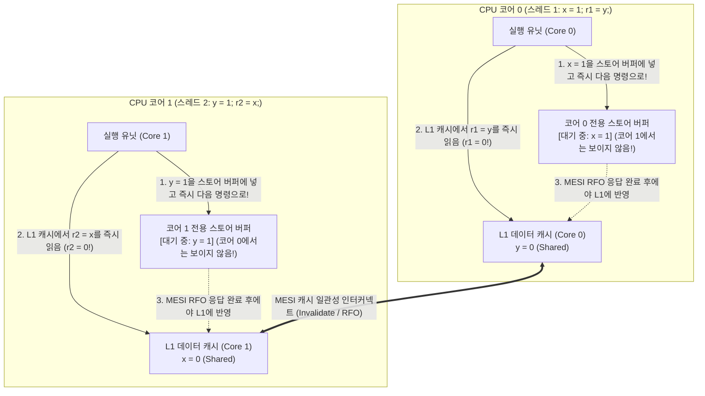
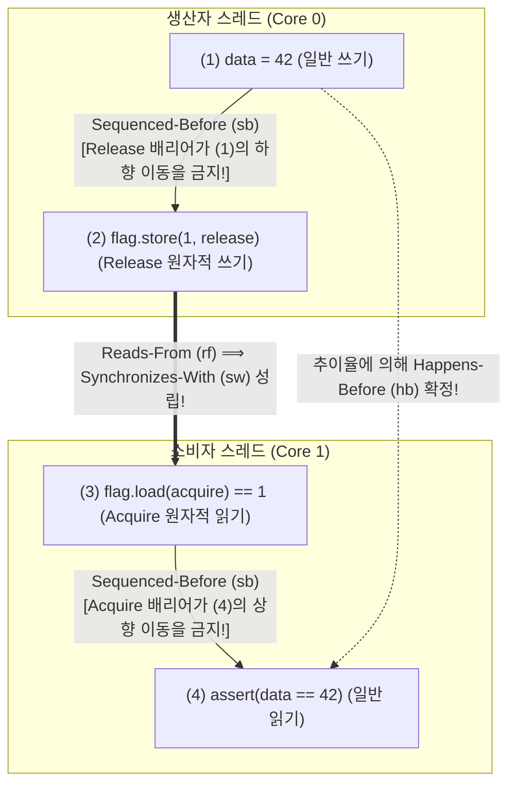

## 들어가며: 인간의 직관을 배신하는 4줄의 코드 ── Store Buffering (`SB`) 리트머스 테스트

공유 메모리에 초기값이 `0`인 두 정수 변수 `x`와 `y`가 있고, 두 개의 CPU 코어에서 실행되는 스레드 1과 스레드 2가 각각 단 두 줄의 명령어를 실행한다고 가정해 보자.

```c
// Initial state in shared memory:
int x = 0, y = 0;
int r1 = 0, r2 = 0;

// Thread 1 (Core 0)          // Thread 2 (Core 1)
void thread1(void) {          void thread2(void) {
    x = 1;      // (S1)           y = 1;      // (S2)
    r1 = y;     // (L1)           r2 = x;     // (L2)
}                             }
```

두 스레드의 실행이 모두 끝났을 때, 레지스터 `(r1, r2)`에 남을 수 있는 값은 무엇일까?
상식적으로 생각해 보면:
- 스레드 1이 먼저 실행되면 `x = 1, r1 = 0`이 되고, 이어서 스레드 2가 실행되어 `r2 = 1`이 된다.
- 스레드 2가 먼저 실행되면 `y = 1, r2 = 0`이 되고, 이어서 스레드 1이 실행되어 `r1 = 1`이 된다.
- 두 스레드가 동시에 첫 번째 줄(`x = 1`, `y = 1`)을 실행한 뒤 두 번째 줄을 실행하면 `r1 = 1, r2 = 1`이 된다.

어느 쪽이 먼저 실행되든 최소한 하나의 변수에는 `1`이 먼저 기록되므로, <strong>`r1 == 0 && r2 == 0`이라는 결과는 수학적으로 절대 불가능해 보인다</strong>. 그러나 이 코드를 현대의 Intel/AMD x86-64 프로세서나 Apple Silicon(ARMv8), 또는 `-O2` 최적화를 켠 C/C++/Rust 컴파일러로 실행해 보면, <strong>불가능해야 할 `r1 == 0 && r2 == 0`이 초당 수만 번씩 실제로 발생한다</strong>! 이는 버그가 아니라 현대 CPU와 컴파일러가 단일 스레드 <strong>'As-If 규칙'</strong> 하에서 메모리 명령어의 순서를 재배치(Instruction Reordering)하기 때문이다.

---

## 제1장: 순차 일관성(Sequential Consistency)의 환상과 수학적 모순 증명

1979년 튜링상 수상자 <strong>레슬리 램포트(Leslie Lamport)</strong>는 프로그래머가 직관적으로 가정하는 멀티스레드 메모리 모델을 <strong>순차 일관성(Sequential Consistency, SC)</strong>으로 정의했다. 즉, 모든 프로세서의 연산이 단일한 전역 전체 순서($\prec_m$)로 하나씩 실행되며, 각 프로세서 내부의 연산들은 소스 코드에 작성된 <strong>프로그램 순서(Program Order, $\prec_p$)</strong>대로 나타난다는 모델이다.

순차 일관성(SC) 하에서 `r1 == 0 && r2 == 0`이 불가능함은 단 세 줄로 증명된다:

$$\text{Program Order: } S_1 \prec_p L_1 \quad \land \quad S_2 \prec_p L_2$$

$$\text{Assume } r_1 = 0 \land r_2 = 0 \implies L_1 \prec_m S_2 \quad \land \quad L_2 \prec_m S_1$$

$$\implies S_1 \prec_p L_1 \prec_m S_2 \prec_p L_2 \prec_m S_1 \implies S_1 \prec S_1 \quad (\text{Contradiction!})$$

만약 $r_1 = 0$이라면 읽기 $L_1$은 쓰기 $S_2$보다 먼저 실행되었어야 하고($L_1 \prec_m S_2$), $r_2 = 0$이라면 $L_2$는 $S_1$보다 먼저 실행되었어야 한다($L_2 \prec_m S_1$). 이를 프로그램 순서 $S_1 \prec_p L_1$ 및 $S_2 \prec_p L_2$와 결합하면 $S_1 \prec L_1 \prec S_2 \prec L_2 \prec S_1$이라는 <strong>인과율의 순환 모순(Cycle)</strong>이 발생한다!

하지만 단일 스레드 관점에서는 `x = 1`과 `r1 = y`가 서로 다른 주소를 다루므로 데이터 의존성이 전혀 없다. 따라서 하드웨어와 컴파일러는 수백 클럭에 달하는 메모리 지연을 숨기기 위해 이 순서를 뒤바꾼다.

---

## 제2장: 하드웨어 메모리 모델 ── 스토어 버퍼(Store Buffer), MESI 프로토콜, 무효화 큐

### 2.1 MESI 캐시 일관성과 스토어 버퍼가 일으키는 Store-Load 리오더링

현대 CPU에서 레지스터 연산은 $0.25\text{ ns}$(1클럭), L1 캐시 히트는 약 $1\text{ ns}$에 불과하지만, 코어 간 캐시 일관성 통신이나 DRAM 접근에는 $50\sim 100\text{ ns}$(수백 클럭)가 소요된다. 멀티코어 CPU는 <strong>MESI 프로토콜(Modified, Exclusive, Shared, Invalid)</strong>을 통해 캐시 라인의 일관성을 유지한다. 코어 0이 `Shared` 상태인 변수 `x`에 값을 쓰려면, 다른 모든 코어에 <strong>무효화 메시지(Invalidate / RFO)</strong>를 보내고 응답(Ack)이 올 때까지 기다려야 한다.

쓰기 명령마다 수십 클럭씩 멈추는(Stall) 것을 막기 위해, 모든 현대 CPU(x86-64 포함!)는 코어 실행 유닛과 L1 캐시 사이에 코어 전용 <strong>스토어 버퍼(Store Buffer)</strong>를 두고 있다.



위 그림처럼 코어 0은 `x = 1`을 자신의 스토어 버퍼에 넣어둔 채(코어 1에는 아직 보이지 않음!) 곧바로 L1 캐시에서 `y = 0`을 읽어 `r1 = 0`을 얻고, 동시에 코어 1도 `y = 1`을 자신의 스토어 버퍼에 넣어둔 채 L1 캐시에서 `x = 0`을 읽어 `r2 = 0`을 얻는다. 이것이 <strong>Store-Load 리오더링</strong>이다. (단, 코어 0이 자신이 방금 쓴 `x`를 다시 읽을 때는 <strong>스토어 버퍼 포워딩(Store Buffer Forwarding)</strong>을 통해 스토어 버퍼에서 직접 `1`을 가져오므로 단일 스레드 동작은 완벽히 보존된다.)

### 2.2 x86-TSO 강한 모델 vs ARMv8 / RISC-V / PowerPC 약한 메모리 모델

Intel/AMD의 <strong>x86-TSO(Total Store Order)</strong>는 엄격한 FIFO 스토어 버퍼를 사용하여 `Load-Load`, `Load-Store`, `Store-Store` 순서는 절대 뒤집지 않으며, <strong>오직 `Store -> Load` 순서만 역전</strong>될 수 있다. 반면 <strong>ARMv8-A(AArch64), RISC-V(RVWMO), PowerPC</strong>는 비-FIFO 쓰기 병합, 투기적 로드, 그리고 <strong>무효화 큐(Invalidate Queue)</strong>를 사용하는 <strong>약한 메모리 모델(Weakly Ordered Memory Model)</strong>을 채택하여 <strong>4가지 메모리 접근 조합(`Load-Load`, `Load-Store`, `Store-Store`, `Store-Load`)이 모두 역전될 수 있다</strong>!

| 하드웨어 아키텍처 | `Load -> Load` 역전 | `Load -> Store` 역전 | `Store -> Store` 역전 | `Store -> Load` 역전 | 멀티카피 원자성 (MCA) |
| :--- | :---: | :---: | :---: | :---: | :--- |
| <strong>순차 일관성 (SC)</strong> | 불가 | 불가 | 불가 | 불가 | 완전 멀티카피 원자적 |
| <strong>x86 / x64 (TSO)</strong> | 불가 | 불가 | 불가 | <strong>발생함 (스토어 버퍼)</strong> | Other-MCA |
| <strong>ARMv8-A (AArch64)</strong> | <strong>발생함</strong> | <strong>발생함</strong> | <strong>발생함</strong> | <strong>발생함</strong> | Other-MCA |
| <strong>RISC-V (RVWMO)</strong> | <strong>발생함</strong> | <strong>발생함</strong> | <strong>발생함</strong> | <strong>발생함</strong> | Other-MCA |
| <strong>IBM PowerPC</strong> | <strong>발생함</strong> | <strong>발생함</strong> | <strong>발생함</strong> | <strong>발생함</strong> | <strong>비-멀티카피 원자적 (Non-MCA)</strong> |

---

## 제3장: 컴파일러 재배치와 DRF-SC 정리 ── 왜 데이터 경쟁은 미정의 동작(UB)인가

x86 서버에서만 실행하더라도 동기화 없는 `data = 42; ready = 1;` 코드는 안전하지 않다. <strong>최적화 컴파일러(GCC/Clang/Rustc)가 기계어를 생성하기 전에 4가지 메모리 접근을 모두 재배치</strong>할 뿐만 아니라, <strong>레지스터 승격(Register Promotion)과 루프 불변 코드 이동(LICM)</strong>을 통해 `while (!ready)` 루프를 메모리를 단 한 번만 읽는 무한 루프로 바꾸어 버리기 때문이다! 또한 C/C++의 `volatile`은 메모리 맵 I/O(MMIO) 전용일 뿐, 하드웨어 펜스를 생성하지도 않고 일반 변수의 재배치를 막지도 못한다.

1990년 <strong>Sarita Adve와 Mark Hill</strong>은 현대 언어 메모리 모델의 근간인 <strong>DRF-SC 정리(Data-Race-Free Sequential Consistency)</strong>를 증명했다:
- <strong>데이터 경쟁(Data Race)</strong>: 서로 다른 스레드가 동일한 메모리 위치에 동시에 접근하며, 적어도 하나가 쓰기이고, 적어도 하나가 비원자적 연산이며, 두 접근 사이에 <strong>Happens-Before($\xrightarrow{hb}$)</strong> 순서가 없는 상태.
- <strong>DRF-SC 계약</strong>: 프로그램에 <strong>데이터 경쟁이 전혀 없다면(DRF)</strong>, 컴파일러와 CPU가 내부적으로 어떤 최적화를 수행하더라도 프로그램의 모든 실행 결과는 <strong>완전한 순차 일관성(SC)</strong>을 보장한다. 반대로 비원자적 데이터 경쟁이 단 하나라도 존재하면 C/C++ 및 Unsafe Rust에서는 즉시 <strong>미정의 동작(Undefined Behavior, UB)</strong>이 된다.

---

## 제4장: Happens-Before 관계($\xrightarrow{hb}$)와 Acquire-Release 원자적 동기화

C++11 / C11 / Rust 메모리 모델에서 스레드 1이 원자 변수 $x$에 <strong>Release 쓰기</strong> $W_{\text{rel}}(x, v)$를 수행하고, 스레드 2가 $x$에 <strong>Acquire 읽기</strong> $R_{\text{acq}}(x, v)$를 수행하여 그 값을 읽었을 때($W_{\text{rel}} \xrightarrow{rf} R_{\text{acq}}$), 두 연산 사이에 스레드 간 <strong>Synchronizes-With($\xrightarrow{sw}$)</strong> 관계가 성립한다. 스레드 내 프로그램 순서($\xrightarrow{sb}$)와 $\xrightarrow{sw}$의 추이적 닫힘(Transitive Closure)이 바로 <strong>Happens-Before($\xrightarrow{hb}$)</strong>이다:

$$W_{\text{rel}}(x, v) \xrightarrow{rf} R_{\text{acq}}(x, v) \implies W_{\text{rel}}(x, v) \xrightarrow{sw} R_{\text{acq}}(x, v)$$

$$\xrightarrow{hb} \;\; \triangleq \;\; \left( \xrightarrow{sb} \;\cup\; \xrightarrow{sw} \right)^+$$

이를 이용해 메시지 패싱 패턴을 안전하게 구현한 코드는 다음과 같다:

```cpp
#include <atomic>
#include <cassert>

int data = 0;                        // Non-atomic payload
std::atomic<int> flag{0};            // Atomic synchronization variable

void producer_thread() {
    data = 42;                                           // (1) Sequenced-before (2)
    flag.store(1, std::memory_order_release);            // (2) Release store
}

void consumer_thread() {
    while (flag.load(std::memory_order_acquire) == 0) {  // (3) Acquire load
        // spin until flag == 1
    }
    assert(data == 42);                                  // (4) Guaranteed never to fail!
}
```



수식적 증명은 다음과 같다:

$$W(\text{data}=42) \xrightarrow{sb} W_{\text{rel}}(\text{flag}=1) \xrightarrow{sw} R_{\text{acq}}(\text{flag}=1) \xrightarrow{sb} R(\text{data})$$

$$\implies W(\text{data}=42) \xrightarrow{hb} R(\text{data}) \implies R(\text{data}) = 42$$

---

## 제5장: 메모리 오더링 스펙트럼과 CPU 명령어 매핑 (`MFENCE`, `DMB`, `LDAR`/`STLR`)

C++/Rust는 세 가지 주요 메모리 오더링을 제공한다:
1. <strong>`Relaxed`</strong>: 단일 원자 변수의 불가분성과 수정 순서($\xrightarrow{mo}$)만 보장하며, $\xrightarrow{sw}$ 동기화를 만들지 않는다(단순 카운터에 사용).
2. <strong>`Acquire` / `Release` / `AcqRel`</strong>: 단방향 배리어(Roach Motel 시맨틱)와 스레드 간 $\xrightarrow{sw}$ 동기화를 제공하지만, <strong>앞선 `Release` 쓰기와 뒤따르는 `Acquire` 읽기 사이의 `Store -> Load` 역전은 막지 못한다</strong>!
3. <strong>`SeqCst` (기본값)</strong>: Acquire-Release 보장에 더해 모든 스레드의 `SeqCst` 연산들이 <strong>단일한 전역 전체 순서 $\xrightarrow{S}$</strong>를 따르도록 강제하여 `Store -> Load` 역전을 원천 차단한다(서두의 `SB` 리트머스 테스트에서 `r1 == 0 && r2 == 0`을 막는 유일한 오더링).

| 원자적 연산 (C++ / Rust) | x86-64 (TSO) 기계어 명령어 | ARMv8-A (AArch64) 기계어 명령어 | RISC-V (RVWMO) 기계어 명령어 |
| :--- | :--- | :--- | :--- |
| <strong>`load(relaxed)`</strong> | `mov eax, [rdi]` | `ldr w0, [x0]` | `lw a0, 0(a0)` |
| <strong>`load(acquire)`</strong> | <strong>`mov eax, [rdi]`</strong> (하드웨어 펜스 비용 0!) | <strong>`ldar w0, [x0]`</strong> (Load-Acquire 명령어) | `lw a0, 0(a0)` + `fence r, rw` |
| <strong>`store(release, v)`</strong> | <strong>`mov [rdi], esi`</strong> (하드웨어 펜스 비용 0!) | <strong>`stlr w1, [x0]`</strong> (Store-Release 명령어) | `fence rw, w` + `sw a1, 0(a0)` |
| <strong>`store(seq_cst, v)`</strong> | <strong>`xchg [rdi], esi`</strong> (또는 `mov` + `mfence`) | <strong>`stlr w1, [x0]`</strong> (후속 `ldar`와 순서 유지) | `fence rw, rw` + `sw` + `fence rw, rw` |
| <strong>풀 펜스 `fence(seq_cst)`</strong> | <strong>`mfence`</strong> (또는 `lock or [rsp], 0`) | <strong>`dmb ish`</strong> (데이터 메모리 배리어) | <strong>`fence rw, rw`</strong> |

x86-64에서는 TSO 하드웨어 덕분에 `Acquire`와 `Release`가 일반 `mov` 명령어로 컴파일되어 하드웨어 오버헤드가 전혀 없으며, 오직 `store(seq_cst)`에서만 스토어 버퍼를 비우기 위해 암시적 `LOCK`이 걸린 `xchg`나 `mfence`가 사용된다. 반면 ARMv8-A는 전용 `LDAR`/`STLR` 명령어를 도입하여 무거운 `DMB ISH` 전체 배리어 없이도 효율적인 동기화와 `SeqCst`를 달성한다.
