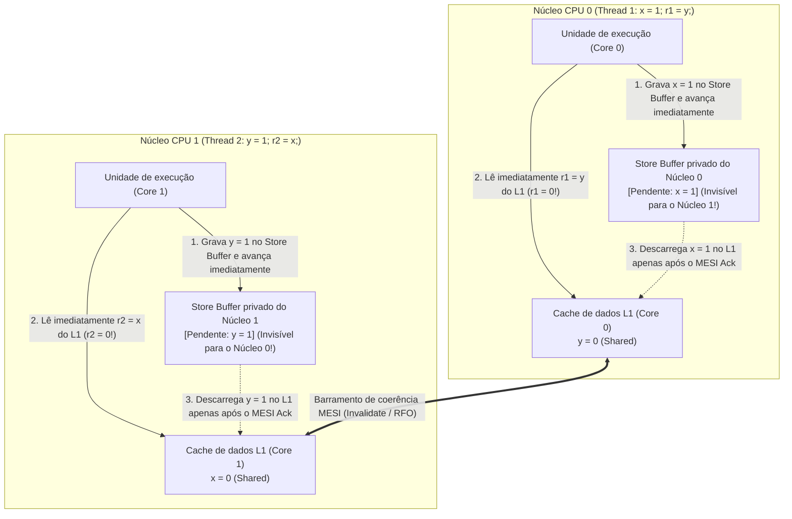
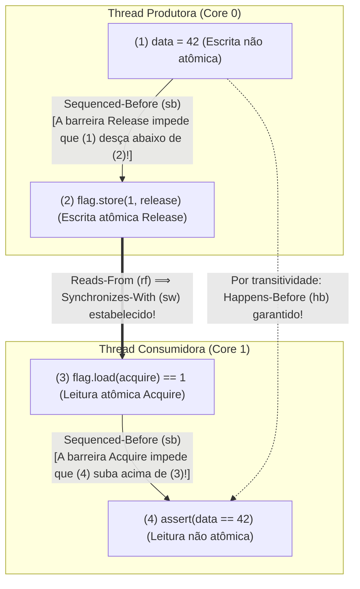

## Introdução: Quatro linhas de código que desafiam a intuição ── O teste de litmus Store Buffering (`SB`)

Observe o seguinte programa C concorrente de apenas quatro instruções. Duas variáveis inteiras compartilhadas `x` e `y` são inicializadas com `0`. Duas threads rodando em dois núcleos de CPU distintos executam cada uma uma escrita (Store) seguida de uma leitura (Load):

```c
// Initial state in shared memory:
int x = 0, y = 0;
int r1 = 0, r2 = 0;

// Thread 1 (Core 0)          // Thread 2 (Core 1)
void thread1(void) {          void thread2(void) {
    x = 1;      // (S1)           y = 1;      // (S2)
    r1 = y;     // (L1)           r2 = x;     // (L2)
}                             }
```

Quais valores finais de `(r1, r2)` são possíveis quando ambas as threads terminam?
Pelo senso comum:
- Se a Thread 1 terminar antes da Thread 2, obtemos `r1 = 0, r2 = 1`.
- Se a Thread 2 terminar antes da Thread 1, obtemos `r1 = 1, r2 = 0`.
- Se ambas executarem a primeira linha (`x = 1` e `y = 1`) antes da segunda, obtemos `r1 = 1, r2 = 1`.

Em qualquer intercalação concebível, pelo menos uma escrita de `1` deve ocorrer antes da leitura da outra thread; logo, <strong>o resultado `r1 == 0 && r2 == 0` parece matematicamente impossível</strong>. No entanto, se você executar esse código em um processador moderno Intel/AMD x86-64, em um chip Apple Silicon (ARMv8) ou com um compilador C/C++/Rust otimizador (`-O2`), <strong>o resultado "impossível" `r1 == 0 && r2 == 0` ocorre milhares de vezes por segundo!</strong> Isso não é um defeito de hardware, mas o resultado direto da reordenação de instruções sob a <strong>regra "As-If" de thread única</strong>.

---

## Capítulo 1: A ilusão da Consistência Sequencial (Sequential Consistency)

Em 1979, o vencedor do Prêmio Turing <strong>Leslie Lamport</strong> formalizou o modelo mental intuitivo dos programadores como <strong>Consistência Sequencial (Sequential Consistency, SC)</strong>: o resultado de qualquer execução é o mesmo que se as operações de todos os processadores fossem executadas em uma única ordem total global ($\prec_m$), e as operações de cada processador aparecessem nessa sequência na <strong>ordem do programa (Program Order, $\prec_p$)</strong> especificada pelo código-fonte.

Sob Consistência Sequencial, provamos em três linhas por que `r1 == 0 && r2 == 0` é impossível:

$$\text{Program Order: } S_1 \prec_p L_1 \quad \land \quad S_2 \prec_p L_2$$

$$\text{Assume } r_1 = 0 \land r_2 = 0 \implies L_1 \prec_m S_2 \quad \land \quad L_2 \prec_m S_1$$

$$\implies S_1 \prec_p L_1 \prec_m S_2 \prec_p L_2 \prec_m S_1 \implies S_1 \prec S_1 \quad (\text{Contradiction!})$$

Para que $r_1 = 0$, a leitura $L_1$ deve preceder a escrita $S_2$ ($L_1 \prec_m S_2$). Da mesma forma, $r_2 = 0$ exige que $L_2 \prec_m S_1$. Combinando isso com a ordem do programa $S_1 \prec_p L_1$ e $S_2 \prec_p L_2$, surge um <strong>ciclo temporal contraditório</strong> $S_1 \prec L_1 \prec S_2 \prec L_2 \prec S_1$. Contudo, como `x` e `y` são endereços distintos sem dependência de dados dentro de uma thread isolada, o hardware e o compilador quebram essa ordem global para ocultar a latência da memória.

---

## Capítulo 2: Modelos de memória em hardware ── Store Buffers, protocolo MESI e filas de invalidação

### 2.1 Coerência de cache MESI e reordenação Store-Load via Store Buffer

Em uma CPU moderna de 4 GHz, acessar um registrador leva $0,25\text{ ns}$ (1 ciclo) e o cache L1 leva $\sim 1\text{ ns}$, mas sincronizar caches entre núcleos ou acessar a DRAM demora de $50\text{ a }100\text{ ns}$ (até 300 ciclos). Os núcleos mantêm a coerência das linhas de cache por meio do <strong>protocolo MESI (Modified, Exclusive, Shared, Invalid)</strong>. Quando o Núcleo 0 quer modificar uma variável `x` no estado `Shared`, ele precisa transmitir uma mensagem <strong>Invalidate (Read-For-Ownership, RFO)</strong> aos outros núcleos e aguardar a confirmação (Ack).

Para evitar travar o núcleo por dezenas de ciclos a cada escrita, todos os processadores modernos (incluindo x86-64!) colocam uma fila FIFO privada chamada <strong>Store Buffer (buffer de escrita)</strong> entre a unidade de execução e o cache L1:



O Núcleo 0 coloca `x = 1` em seu Store Buffer privado (invisível para o Núcleo 1) e lê imediatamente `r1 = y` (`0`) de seu cache L1. Simultaneamente, o Núcleo 1 coloca `y = 1` em seu Store Buffer e lê `r2 = x` (`0`) de seu cache L1. Assim, a leitura (Load) ultrapassa a escrita anterior (Store) na visibilidade global: é a <strong>reordenação Store-Load</strong>! (Se o Núcleo 0 reler sua própria variável `x`, o <strong>Store Buffer Forwarding</strong> entrega diretamente `x = 1` de seu buffer local, preservando a semântica de thread única).

### 2.2 Modelo forte x86-TSO vs. Arquiteturas fracamente ordenadas (ARMv8, RISC-V, PowerPC)

O modelo <strong>x86-TSO (Total Store Order)</strong> da Intel e AMD usa um Store Buffer FIFO estrito: nunca reordena `Load-Load`, `Load-Store` nem `Store-Store`, <strong>permitindo apenas a reordenação `Store -> Load`</strong>. Já <strong>ARMv8-A (AArch64 / Apple Silicon), RISC-V (RVWMO) e IBM PowerPC</strong> adotam <strong>modelos de memória fracamente ordenados (Weakly Ordered)</strong>: graças à fusão de escritas não FIFO, leituras especulativas fora de ordem e <strong>filas de invalidação (Invalidate Queues)</strong>, <strong>todas as quatro combinações (`Load-Load`, `Load-Store`, `Store-Store`, `Store-Load`) podem ser reordenadas pelo hardware</strong>!

| Modelo de memória em hardware | `Load -> Load` | `Load -> Store` | `Store -> Store` | `Store -> Load` | Atomicidade multicópia (MCA) |
| :--- | :---: | :---: | :---: | :---: | :--- |
| <strong>Consistência Sequencial (SC)</strong> | Não | Não | Não | Não | MCA completa |
| <strong>x86 / x64 (TSO)</strong> | Não | Não | Não | <strong>Sim (Store Buffer)</strong> | Other-MCA |
| <strong>ARMv8-A (AArch64)</strong> | <strong>Sim</strong> | <strong>Sim</strong> | <strong>Sim</strong> | <strong>Sim</strong> | Other-MCA |
| <strong>RISC-V (RVWMO)</strong> | <strong>Sim</strong> | <strong>Sim</strong> | <strong>Sim</strong> | <strong>Sim</strong> | Other-MCA |
| <strong>IBM PowerPC</strong> | <strong>Sim</strong> | <strong>Sim</strong> | <strong>Sim</strong> | <strong>Sim</strong> | <strong>Não-MCA</strong> |

---

## Capítulo 3: Reordenação do compilador e o teorema DRF-SC ── Por que corridas de dados são Comportamento Indefinido (UB)

Mesmo em uma CPU x86, a passagem de mensagem sem sincronização `data = 42; ready = 1;` falha porque <strong>o compilador otimizador (`gcc`, `clang`, `rustc`) reordena livremente todos os quatro tipos de acessos à memória</strong>. Pior ainda: por meio de <strong>promoção a registrador (Register Promotion) e movimentação de código invariante de loop (LICM)</strong>, o compilador transforma `while (!ready)` em uma única leitura seguida de um <strong>loop infinito</strong>! Além disso, `volatile` em C/C++ serve apenas para registradores MMIO e não emite barreiras de memória de CPU.

Em 1990, <strong>Sarita Adve e Mark Hill</strong> provaram o <strong>teorema DRF-SC (Data-Race-Free Sequential Consistency)</strong>:
- <strong>Corrida de dados (Data Race)</strong>: Duas threads acessam concorrentemente o mesmo endereço de memória, pelo menos um acesso é de escrita, pelo menos um é não atômico e não há relação <strong>Happens-Before ($\xrightarrow{hb}$)</strong> entre eles.
- <strong>O contrato DRF-SC</strong>: Se um programa é <strong>livre de corridas de dados (DRF)</strong>, o compilador e o hardware garantem que toda execução se comportará exatamente com <strong>Consistência Sequencial (SC)</strong>. Se houver uma única corrida de dados em C/C++ ou Rust `unsafe`, todo o programa entra em <strong>Comportamento Indefinido (Undefined Behavior, UB)</strong>.

---

## Capítulo 4: A relação Happens-Before ($\xrightarrow{hb}$) e a sincronização Acquire-Release

No modelo formal de C++11 / C11 / Rust, quando a Thread 1 executa uma escrita atômica <strong>Release</strong> $W_{\text{rel}}(x, v)$ e a Thread 2 executa uma leitura atômica <strong>Acquire</strong> $R_{\text{acq}}(x, v)$ que lê esse valor ($W_{\text{rel}} \xrightarrow{rf} R_{\text{acq}}$), estabelece-se uma ponte entre threads chamada <strong>Synchronizes-With ($\xrightarrow{sw}$)</strong>. O fecho transitivo da ordem interna da thread (<strong>Sequenced-Before, $\xrightarrow{sb}$</strong>) e $\xrightarrow{sw}$ define a relação <strong>Happens-Before ($\xrightarrow{hb}$)</strong>:

$$W_{\text{rel}}(x, v) \xrightarrow{rf} R_{\text{acq}}(x, v) \implies W_{\text{rel}}(x, v) \xrightarrow{sw} R_{\text{acq}}(x, v)$$

$$\xrightarrow{hb} \;\; \triangleq \;\; \left( \xrightarrow{sb} \;\cup\; \xrightarrow{sw} \right)^+$$

Com `memory_order_release` e `memory_order_acquire`, a passagem de mensagens torna-se matematicamente segura:

```cpp
#include <atomic>
#include <cassert>

int data = 0;                        // Non-atomic payload
std::atomic<int> flag{0};            // Atomic synchronization variable

void producer_thread() {
    data = 42;                                           // (1) Sequenced-before (2)
    flag.store(1, std::memory_order_release);            // (2) Release store
}

void consumer_thread() {
    while (flag.load(std::memory_order_acquire) == 0) {  // (3) Acquire load
        // spin until flag == 1
    }
    assert(data == 42);                                  // (4) Guaranteed never to fail!
}
```



Prova formal:

$$W(\text{data}=42) \xrightarrow{sb} W_{\text{rel}}(\text{flag}=1) \xrightarrow{sw} R_{\text{acq}}(\text{flag}=1) \xrightarrow{sb} R(\text{data})$$

$$\implies W(\text{data}=42) \xrightarrow{hb} R(\text{data}) \implies R(\text{data}) = 42$$

---

## Capítulo 5: Espectro de ordenações de memória e instruções de CPU (`MFENCE`, `DMB`, `LDAR`/`STLR`)

C++ e Rust oferecem três níveis principais de ordenação:
1. <strong>`Relaxed`</strong>: Garante apenas atomicidade e ordem de modificação ($\xrightarrow{mo}$) de uma variável isolada, sem sincronização $\xrightarrow{sw}$ (ideal para contadores simples).
2. <strong>`Acquire` / `Release` / `AcqRel`</strong>: Barreiras unidirecionais (semântica *Roach Motel*) que criam elos $\xrightarrow{sw}$, mas <strong>NÃO impedem a reordenação `Store -> Load`</strong> quando um `store(release)` precede um `load(acquire)`.
3. <strong>`SeqCst` (padrão)</strong>: Impõe adicionalmente uma <strong>única ordem total global $\xrightarrow{S}$</strong> sobre todas as operações `SeqCst` e proíbe a reordenação `Store -> Load` (essencial para evitar `r1 == 0 && r2 == 0` no teste `SB`).

| Operação atômica (C++ / Rust) | Instruções x86-64 (TSO) | Instruções ARMv8-A (AArch64) | Instruções RISC-V (RVWMO) |
| :--- | :--- | :--- | :--- |
| <strong>`load(relaxed)`</strong> | `mov eax, [rdi]` | `ldr w0, [x0]` | `lw a0, 0(a0)` |
| <strong>`load(acquire)`</strong> | <strong>`mov eax, [rdi]`</strong> *(Custo zero em hardware!)* | <strong>`ldar w0, [x0]`</strong> *(Load-Acquire)* | `lw a0, 0(a0)` + `fence r, rw` |
| <strong>`store(release, v)`</strong> | <strong>`mov [rdi], esi`</strong> *(Custo zero em hardware!)* | <strong>`stlr w1, [x0]`</strong> *(Store-Release)* | `fence rw, w` + `sw a1, 0(a0)` |
| <strong>`store(seq_cst, v)`</strong> | <strong>`xchg [rdi], esi`</strong> *(ou `mov` + `mfence`)* | <strong>`stlr w1, [x0]`</strong> *(ordenado com `ldar`)* | `fence rw, rw` + `sw` + `fence rw, rw` |
| <strong>Barreira `fence(seq_cst)`</strong> | <strong>`mfence`</strong> *(ou `lock or [rsp], 0`)* | <strong>`dmb ish`</strong> *(Data Memory Barrier)* | <strong>`fence rw, rw`</strong> |

No x86-64, `Acquire` e `Release` compilam para simples instruções `mov` sem custo de hardware, enquanto `store(seq_cst)` emite `xchg` (prefixo `LOCK` implícito) ou `mfence` para drenar o Store Buffer. No ARMv8-A, as instruções dedicadas `LDAR` e `STLR` implementam Acquire-Release e SeqCst com eficiência cirúrgica sem exigir uma barreira global `DMB ISH`.
