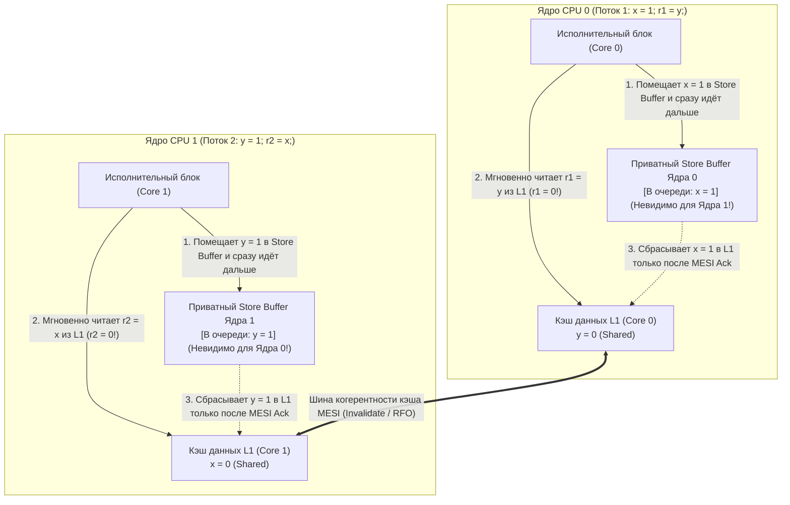
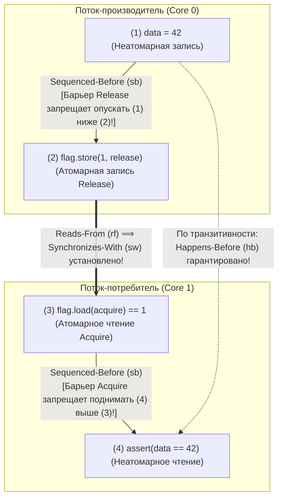

## Введение: Четыре строки кода против интуиции ── Лакмусовый тест Store Buffering (`SB`)

Рассмотрим следующую многопоточную программу на C из четырёх инструкций. Две общие переменные `x` и `y` инициализированы нулями (`0`). Два потока на двух разных ядрах процессора выполняют по одной записи (Store) и одному чтению (Load):

```c
// Initial state in shared memory:
int x = 0, y = 0;
int r1 = 0, r2 = 0;

// Thread 1 (Core 0)          // Thread 2 (Core 1)
void thread1(void) {          void thread2(void) {
    x = 1;      // (S1)           y = 1;      // (S2)
    r1 = y;     // (L1)           r2 = x;     // (L2)
}                             }
```

Какие значения `(r1, r2)` возможны после завершения обоих потоков?
Согласно здравому смыслу:
- Если Поток 1 выполнится раньше Потока 2, получим `r1 = 0, r2 = 1`.
- Если Поток 2 выполнится раньше Потока 1, получим `r1 = 1, r2 = 0`.
- Если оба сначала выполнят первую строку (`x = 1` и `y = 1`), а затем вторую, получим `r1 = 1, r2 = 1`.

При любом мыслимом чередовании хотя бы одна запись единицы должна произойти раньше чтения другого потока, поэтому <strong>исход `r1 == 0 && r2 == 0` кажется математически невозможным</strong>. Однако при запуске этого кода на современном процессоре Intel/AMD x86-64, чипе Apple Silicon (ARMv8) или с оптимизирующим компилятором C/C++/Rust (`-O2`) <strong>«невозможный» результат `r1 == 0 && r2 == 0` возникает тысячи раз в секунду!</strong> Это не ошибка оборудования, а следствие переупорядочивания инструкций (Instruction Reordering) в рамках однопоточного <strong>правила «As-If» (как если бы)</strong>.

---

## Глава 1: Иллюзия последовательной консистентности (Sequential Consistency)

В 1979 году лауреат премии Тьюринга <strong>Лесли Лампорт (Leslie Lamport)</strong> формализовал интуитивную модель многопоточности как <strong>последовательную консистентность (Sequential Consistency, SC)</strong>: результат любого выполнения должен быть таким же, как если бы операции всех процессоров выполнялись в некотором едином глобальном линейном порядке ($\prec_m$), причём операции каждого отдельного процессора шли бы в нём строго в <strong>порядке программы (Program Order, $\prec_p$)</strong>.

В модели SC невозможность `r1 == 0 && r2 == 0` доказывается в три строки:

$$\text{Program Order: } S_1 \prec_p L_1 \quad \land \quad S_2 \prec_p L_2$$

$$\text{Assume } r_1 = 0 \land r_2 = 0 \implies L_1 \prec_m S_2 \quad \land \quad L_2 \prec_m S_1$$

$$\implies S_1 \prec_p L_1 \prec_m S_2 \prec_p L_2 \prec_m S_1 \implies S_1 \prec S_1 \quad (\text{Contradiction!})$$

Чтобы получилось $r_1 = 0$, чтение $L_1$ должно произойти раньше записи $S_2$ ($L_1 \prec_m S_2$). Аналогично $r_2 = 0$ требует $L_2 \prec_m S_1$. Объединяя это с порядком программы $S_1 \prec_p L_1$ и $S_2 \prec_p L_2$, получаем <strong>замкнутый цикл во времени</strong> $S_1 \prec L_1 \prec S_2 \prec L_2 \prec S_1$! Но поскольку `x` и `y` — разные адреса без зависимости по данным внутри одного потока, процессор и компилятор нарушают глобальный порядок ради скрытия задержек памяти.

---

## Глава 2: Аппаратные модели памяти ── Буферы записи (Store Buffers), протокол MESI и очереди инвалидации

### 2.1 Кэш-когерентность MESI и переупорядочивание Store-Load из-за Store Buffer

На современном процессоре с частотой 4 ГГц обращение к регистру занимает $0{,}25\text{ нс}$ (1 такт), попадание в L1-кэш — около $1\text{ нс}$, тогда как межъядерная синхронизация кэшей или доступ к DRAM требует $50\text{–}100\text{ нс}$ (до 300 тактов). Ядра поддерживают когерентность кэш-линий по <strong>протоколу MESI (Modified, Exclusive, Shared, Invalid)</strong>. Чтобы Ядро 0 могло изменить кэш-линию `x`, находящуюся в состоянии `Shared`, оно обязано разослать остальным ядрам сообщение <strong>Invalidate (Read-For-Ownership, RFO)</strong> и дождаться подтверждения (Ack).

Чтобы не останавливать конвейер на десятки тактов при каждой записи, все современные CPU (включая x86-64!) помещают между исполнительным блоком и L1-кэшем приватную очередь <strong>Store Buffer (буфер записи)</strong>:



Ядро 0 кладёт `x = 1` в свой приватный Store Buffer (невидимый для Ядра 1!) и тут же читает `r1 = y` (`0`) из своего L1-кэша. Одновременно Ядро 1 кладёт `y = 1` в свой Store Buffer и читает `r2 = x` (`0`) из своего L1-кэша. Чтение (Load) обгоняет предшествующую запись (Store) в глобальной видимости — это <strong>переупорядочивание Store-Load</strong>! (Если же Ядро 0 читает собственную переменную `x`, механизм <strong>Store Buffer Forwarding</strong> напрямую возвращает `x = 1` из локального буфера, сохраняя однопоточную семантику.)

### 2.2 Строгая модель x86-TSO против слабых моделей памяти (ARMv8, RISC-V, PowerPC)

Модель <strong>x86-TSO (Total Store Order)</strong> от Intel и AMD использует строгий FIFO Store Buffer: она никогда не меняет местами `Load-Load`, `Load-Store` и `Store-Store`, <strong>допуская только переупорядочивание `Store -> Load`</strong>. Напротив, <strong>ARMv8-A (AArch64 / Apple Silicon), RISC-V (RVWMO) и IBM PowerPC</strong> используют <strong>слабо упорядоченные модели памяти (Weakly Ordered)</strong>: из-за не-FIFO слияния записей, спекулятивных чтений и <strong>очередей инвалидации (Invalidate Queues)</strong> <strong>все четыре комбинации (`Load-Load`, `Load-Store`, `Store-Store`, `Store-Load`) могут переупорядочиваться аппаратно</strong>!

| Аппаратная модель памяти | `Load -> Load` | `Load -> Store` | `Store -> Store` | `Store -> Load` | Мультикопийная атомарность (MCA) |
| :--- | :---: | :---: | :---: | :---: | :--- |
| <strong>Последовательная консистентность (SC)</strong> | Нет | Нет | Нет | Нет | Полная MCA |
| <strong>x86 / x64 (TSO)</strong> | Нет | Нет | Нет | <strong>Да (Store Buffer)</strong> | Other-MCA |
| <strong>ARMv8-A (AArch64)</strong> | <strong>Да</strong> | <strong>Да</strong> | <strong>Да</strong> | <strong>Да</strong> | Other-MCA |
| <strong>RISC-V (RVWMO)</strong> | <strong>Да</strong> | <strong>Да</strong> | <strong>Да</strong> | <strong>Да</strong> | Other-MCA |
| <strong>IBM PowerPC</strong> | <strong>Да</strong> | <strong>Да</strong> | <strong>Да</strong> | <strong>Да</strong> | <strong>Non-MCA</strong> |

---

## Глава 3: Переупорядочивание компилятором и теорема DRF-SC ── Почему гонки данных являются неопределённым поведением (UB)

Даже на процессоре x86 передача сообщений без синхронизации `data = 42; ready = 1;` не работает, так как <strong>оптимизирующий компилятор (`gcc`, `clang`, `rustc`) свободно меняет местами все четыре типа обращений к памяти</strong>. Более того, за счёт <strong>продвижения в регистры (Register Promotion) и выноса инвариантов цикла (LICM)</strong> компилятор превращает цикл ожидания `while (!ready)` в однократное чтение в регистр и <strong>бесконечный цикл</strong>! А ключевое слово `volatile` в C/C++ предназначено только для регистров MMIO и не генерирует аппаратных барьеров памяти.

В 1990 году <strong>Сарита Адве и Марк Хилл</strong> доказали фундаментальную <strong>теорему DRF-SC (Data-Race-Free Sequential Consistency)</strong>:
- <strong>Гонка данных (Data Race)</strong>: Одновременный доступ двух потоков к одной ячейке памяти, где хотя бы один доступ — запись, хотя бы один — неатомарный, и между ними нет отношения <strong>Happens-Before ($\xrightarrow{hb}$)</strong>.
- <strong>Контракт DRF-SC</strong>: Если в программе <strong>нет гонок данных (DRF)</strong>, компилятор и процессор гарантируют, что любое выполнение неотличимо от <strong>последовательно консистентного (SC)</strong>. Наличие же хотя бы одной гонки данных в C/C++ или Unsafe Rust приводит к <strong>неопределённому поведению (Undefined Behavior, UB)</strong>.

---

## Глава 4: Отношение Happens-Before ($\xrightarrow{hb}$) и синхронизация Acquire-Release

В формальной модели памяти C++11 / C11 / Rust, когда Поток 1 выполняет атомарную запись <strong>Release</strong> $W_{\text{rel}}(x, v)$, а Поток 2 выполняет атомарное чтение <strong>Acquire</strong> $R_{\text{acq}}(x, v)$ и считывает это значение ($W_{\text{rel}} \xrightarrow{rf} R_{\text{acq}}$), между потоками возникает связь <strong>Synchronizes-With ($\xrightarrow{sw}$)</strong>. Транзитивное замыкание внутрипоточного порядка (<strong>Sequenced-Before, $\xrightarrow{sb}$</strong>) и $\xrightarrow{sw}$ образует отношение <strong>Happens-Before ($\xrightarrow{hb}$)</strong>:

$$W_{\text{rel}}(x, v) \xrightarrow{rf} R_{\text{acq}}(x, v) \implies W_{\text{rel}}(x, v) \xrightarrow{sw} R_{\text{acq}}(x, v)$$

$$\xrightarrow{hb} \;\; \triangleq \;\; \left( \xrightarrow{sb} \;\cup\; \xrightarrow{sw} \right)^+$$

С помощью `memory_order_release` и `memory_order_acquire` передача сообщения становится математически надёжной:

```cpp
#include <atomic>
#include <cassert>

int data = 0;                        // Non-atomic payload
std::atomic<int> flag{0};            // Atomic synchronization variable

void producer_thread() {
    data = 42;                                           // (1) Sequenced-before (2)
    flag.store(1, std::memory_order_release);            // (2) Release store
}

void consumer_thread() {
    while (flag.load(std::memory_order_acquire) == 0) {  // (3) Acquire load
        // spin until flag == 1
    }
    assert(data == 42);                                  // (4) Guaranteed never to fail!
}
```



Строгое доказательство:

$$W(\text{data}=42) \xrightarrow{sb} W_{\text{rel}}(\text{flag}=1) \xrightarrow{sw} R_{\text{acq}}(\text{flag}=1) \xrightarrow{sb} R(\text{data})$$

$$\implies W(\text{data}=42) \xrightarrow{hb} R(\text{data}) \implies R(\text{data}) = 42$$

---

## Глава 5: Спектр порядков памяти и инструкции CPU (`MFENCE`, `DMB`, `LDAR`/`STLR`)

C++ и Rust предоставляют три основных уровня упорядочивания:
1. <strong>`Relaxed`</strong>: Гарантирует только неделимость и порядок модификации ($\xrightarrow{mo}$) одной переменной без синхронизации $\xrightarrow{sw}$ (для простых счётчиков).
2. <strong>`Acquire` / `Release` / `AcqRel`</strong>: Односторонние барьеры (семантика *Roach Motel*), создающие связь $\xrightarrow{sw}$, но <strong>НЕ предотвращающие переупорядочивание `Store -> Load`</strong> между предшествующим `store(release)` и последующим `load(acquire)`!
3. <strong>`SeqCst` (по умолчанию)</strong>: Дополнительно устанавливает <strong>единый глобальный линейный порядок $\xrightarrow{S}$</strong> для всех `SeqCst`-операций и запрещает переупорядочивание `Store -> Load` (единственный способ исключить `r1 == 0 && r2 == 0` в тесте `SB`).

| Атомарная операция (C++ / Rust) | Инструкции x86-64 (TSO) | Инструкции ARMv8-A (AArch64) | Инструкции RISC-V (RVWMO) |
| :--- | :--- | :--- | :--- |
| <strong>`load(relaxed)`</strong> | `mov eax, [rdi]` | `ldr w0, [x0]` | `lw a0, 0(a0)` |
| <strong>`load(acquire)`</strong> | <strong>`mov eax, [rdi]`</strong> *(Нулевая цена в железе!)* | <strong>`ldar w0, [x0]`</strong> *(Load-Acquire)* | `lw a0, 0(a0)` + `fence r, rw` |
| <strong>`store(release, v)`</strong> | <strong>`mov [rdi], esi`</strong> *(Нулевая цена в железе!)* | <strong>`stlr w1, [x0]`</strong> *(Store-Release)* | `fence rw, w` + `sw a1, 0(a0)` |
| <strong>`store(seq_cst, v)`</strong> | <strong>`xchg [rdi], esi`</strong> *(или `mov` + `mfence`)* | <strong>`stlr w1, [x0]`</strong> *(упорядочено с `ldar`)* | `fence rw, rw` + `sw` + `fence rw, rw` |
| <strong>Полный барьер `fence(seq_cst)`</strong> | <strong>`mfence`</strong> *(или `lock or [rsp], 0`)* | <strong>`dmb ish`</strong> *(Data Memory Barrier)* | <strong>`fence rw, rw`</strong> |

На x86-64 `Acquire` и `Release` компилируются в обычные инструкции `mov` без аппаратных затрат, тогда как `store(seq_cst)` использует `xchg` (с неявным префиксом `LOCK`) или `mfence` для принудительного сброса Store Buffer. На ARMv8-A специальные инструкции `LDAR` и `STLR` элегантно реализуют Acquire-Release и SeqCst без тяжёлого барьера `DMB ISH`.
