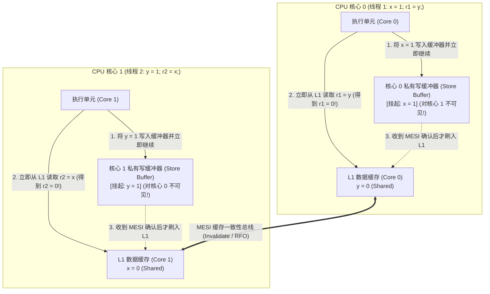
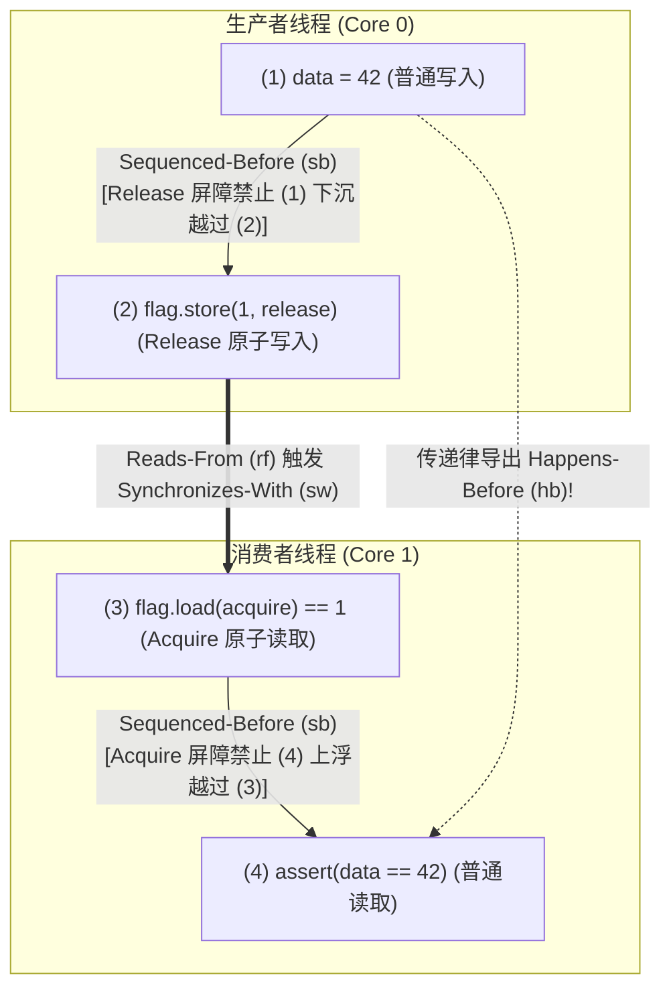

## 引言：四行代码打破人类直觉 ── Store Buffering (`SB`) 试金石测试

请看下面这段仅有四行有效代码的并发C程序。共享内存中两个整型变量 `x` 和 `y` 的初始值均为 `0`，运行在两个CPU核心上的线程1和线程2分别执行一次写入（Store）和一次读取（Load）：

```c
// Initial state in shared memory:
int x = 0, y = 0;
int r1 = 0, r2 = 0;

// Thread 1 (Core 0)          // Thread 2 (Core 1)
void thread1(void) {          void thread2(void) {
    x = 1;      // (S1)           y = 1;      // (S2)
    r1 = y;     // (L1)           r2 = x;     // (L2)
}                             }
```

当两个线程都执行完毕时，局部变量 `(r1, r2)` 可能出现什么结果？
按人类的常识推演：
- 若线程1先执行完，则 `x = 1, r1 = 0`，随后线程2执行得到 `r2 = 1`；
- 若线程2先执行完，则 `y = 1, r2 = 0`，随后线程1执行得到 `r1 = 1`；
- 若两个线程同时先执行第一行（`x = 1` 和 `y = 1`），再执行第二行，则 `r1 = 1, r2 = 1`。

无论如何交错，至少有一个线程会先写入 `1`，因此<strong>`r1 == 0 && r2 == 0` 在逻辑上似乎绝对不可能发生</strong>。然而，如果你在任何现代 Intel/AMD x86-64 处理器、Apple Silicon (ARMv8) 或开启了 `-O2` 优化的 C/C++/Rust 编译器上运行这段代码，<strong>`r1 == 0 && r2 == 0` 每秒钟都会真实发生成千上万次</strong>！这不是硬件故障，而是因为现代CPU与编译器都在单线程<strong>“As-If规则（表观等价规则）”</strong>下对内存操作进行了重排序（Instruction Reordering）。

---

## 第一章：顺序一致性（Sequential Consistency）的幻觉与数学反证

1979年，图灵奖得主<strong>莱斯利·兰伯特（Leslie Lamport）</strong>将程序员直觉中的理想多线程模型定义为<strong>顺序一致性（Sequential Consistency, SC）</strong>：所有处理器的操作都如同按某个全局全序（Total Order $\prec_m$）依次执行，且每个处理器自身的操作在该序列中严格保持源码编写的<strong>程序顺序（Program Order $\prec_p$）</strong>。

在顺序一致性下，我们可以用三行公式严格证明 `r1 == 0 && r2 == 0` 是不可能的：

$$\text{Program Order: } S_1 \prec_p L_1 \quad \land \quad S_2 \prec_p L_2$$

$$\text{Assume } r_1 = 0 \land r_2 = 0 \implies L_1 \prec_m S_2 \quad \land \quad L_2 \prec_m S_1$$

$$\implies S_1 \prec_p L_1 \prec_m S_2 \prec_p L_2 \prec_m S_1 \implies S_1 \prec S_1 \quad (\text{Contradiction!})$$

若 $r_1 = 0$，读取 $L_1$ 必然发生在写入 $S_2$ 之前（$L_1 \prec_m S_2$）；若 $r_2 = 0$，读取 $L_2$ 必然发生在写入 $S_1$ 之前（$L_2 \prec_m S_1$）。结合程序顺序 $S_1 \prec_p L_1$ 与 $S_2 \prec_p L_2$，就会导出 $S_1 \prec L_1 \prec S_2 \prec L_2 \prec S_1$ 的<strong>因果循环矛盾</strong>！

然而，由于单线程内 `x = 1` 与 `r1 = y` 访问的是不同地址，不存在数据依赖，硬件与编译器为了掩盖高达数百个时钟周期的内存延迟，会打破全局顺序一致性。

---

## 第二章：硬件内存模型 ── 写缓冲器（Store Buffer）、MESI协议与无效化队列

### 2.1 MESI缓存一致性与写缓冲器（Store Buffer）导致的 Store-Load 重排

现代CPU寄存器访问仅需 $0.25\text{ ns}$（1周期），L1缓存约 $1\text{ ns}$，而跨核心缓存同步或主存（DRAM）访问则需要 $50\sim 100\text{ ns}$（数百周期）。多核CPU通过<strong>MESI协议（Modified, Exclusive, Shared, Invalid）</strong>维护缓存一致性：当核心0想修改处于 `Shared` 状态的缓存行 `x` 时，必须先向其他所有核心广播<strong>无效化消息（Invalidate / RFO）</strong>并等待确认（Acknowledge）。

为了避免每次写入都停顿数十个周期，所有现代CPU（包括x86-64）都在核心与L1缓存之间加入了私有的<strong>写缓冲器（Store Buffer）</strong>：



如上图所示：核心0将 `x = 1` 放入自己的私有写缓冲器后立即执行 `r1 = y`（此时核心1的 `y = 1` 还停留在核心1的写缓冲器中，对核心0不可见），同时核心1也从L1缓存读到了旧值 `x = 0`！这就是<strong>Store-Load 重排序</strong>。如果核心0自己读取刚写入的 `x`，硬件会通过<strong>写缓冲器转发（Store Buffer Forwarding）</strong>直接返回新值 `1`，从而保证单线程语义不变。

### 2.2 x86-TSO 强模型 vs ARMv8 / RISC-V / PowerPC 弱内存模型

Intel/AMD 的 <strong>x86-TSO（Total Store Order）</strong> 采用严格的FIFO写缓冲器，保证 `Load-Load`、`Load-Store`、`Store-Store` 绝不重排，<strong>仅允许 `Store -> Load` 重排</strong>。而 <strong>ARMv8-A (AArch64)、RISC-V (RVWMO)、PowerPC</strong> 采用<strong>弱内存模型（Weakly Ordered Memory Model）</strong>，由于非FIFO写合并、乱序推测加载以及<strong>无效化队列（Invalidate Queue）</strong>的存在，<strong>全部四种组合（Load-Load, Load-Store, Store-Store, Store-Load）均可发生重排</strong>！

| 硬件架构与内存模型 | `Load -> Load` 重排 | `Load -> Store` 重排 | `Store -> Store` 重排 | `Store -> Load` 重排 | 多副本原子性 (MCA) |
| :--- | :---: | :---: | :---: | :---: | :--- |
| <strong>顺序一致性 (SC)</strong> | 禁止 | 禁止 | 禁止 | 禁止 | 完全多副本原子 |
| <strong>x86 / x64 (TSO)</strong> | 禁止 | 禁止 | 禁止 | <strong>允许 (写缓冲器)</strong> | Other-MCA (其他核同时可见) |
| <strong>ARMv8-A (AArch64)</strong> | <strong>允许</strong> | <strong>允许</strong> | <strong>允许</strong> | <strong>允许</strong> | Other-MCA |
| <strong>RISC-V (RVWMO)</strong> | <strong>允许</strong> | <strong>允许</strong> | <strong>允许</strong> | <strong>允许</strong> | Other-MCA |
| <strong>IBM PowerPC</strong> | <strong>允许</strong> | <strong>允许</strong> | <strong>允许</strong> | <strong>允许</strong> | <strong>非多副本原子 (Non-MCA)</strong> |

---

## 第三章：编译器重排与 DRF-SC 定理 ── 为什么数据竞争是未定义行为（UB）

即便在x86处理器上，普通变量的消息传递 `data = 42; ready = 1;` 也会崩溃，因为<strong>优化编译器（GCC/Clang/Rustc）在生成机器码前就会重排所有四种内存访问</strong>，甚至通过<strong>寄存器提升（Register Promotion）与循环不变代码外提（LICM）</strong>将等待循环 `while (!ready)` 优化为只读一次内存的死循环！此外，C/C++的 `volatile` 仅用于内存映射I/O（MMIO），<strong>既不生成CPU内存屏障，也不能阻止周围普通变量的重排</strong>。

1990年，<strong>Sarita Adve 与 Mark Hill</strong> 提出了现代编程语言内存模型的基石——<strong>DRF-SC定理（Data-Race-Free Sequential Consistency）</strong>：
- <strong>数据竞争（Data Race）定义</strong>：两个不同线程并发访问同一内存地址，至少一个是写操作，至少一个是非原子操作，且两者之间不存在 <strong>Happens-Before（$\xrightarrow{hb}$）</strong> 顺序。
- <strong>DRF-SC 契约</strong>：如果程序<strong>没有任何数据竞争（DRF）</strong>，编译器与CPU保证其所有执行结果与<strong>完全的顺序一致性（SC）</strong>不可区分；反之，一旦存在非原子数据竞争，C/C++与Unsafe Rust将其定义为<strong>未定义行为（Undefined Behavior, UB）</strong>。

---

## 第四章：Happens-Before 关系（$\xrightarrow{hb}$）与 Acquire-Release 原子同步

在 C++11 / C11 / Rust 形式化内存模型中，当线程1对原子变量 $x$ 执行 <strong>Release写入</strong> $W_{\text{rel}}(x, v)$，且线程2对 $x$ 执行 <strong>Acquire读取</strong> $R_{\text{acq}}(x, v)$ 并读到了该值（$W_{\text{rel}} \xrightarrow{rf} R_{\text{acq}}$）时，跨线程建立起<strong>同步关系（Synchronizes-With, $\xrightarrow{sw}$）</strong>。结合线程内顺序（Sequenced-Before, $\xrightarrow{sb}$），其传递闭包即为 <strong>Happens-Before（$\xrightarrow{hb}$）</strong>：

$$W_{\text{rel}}(x, v) \xrightarrow{rf} R_{\text{acq}}(x, v) \implies W_{\text{rel}}(x, v) \xrightarrow{sw} R_{\text{acq}}(x, v)$$

$$\xrightarrow{hb} \;\; \triangleq \;\; \left( \xrightarrow{sb} \;\cup\; \xrightarrow{sw} \right)^+$$

利用 `memory_order_release` 与 `memory_order_acquire`，我们可以写出绝对安全的消息传递代码：

```cpp
#include <atomic>
#include <cassert>

int data = 0;                        // Non-atomic payload
std::atomic<int> flag{0};            // Atomic synchronization variable

void producer_thread() {
    data = 42;                                           // (1) Sequenced-before (2)
    flag.store(1, std::memory_order_release);            // (2) Release store
}

void consumer_thread() {
    while (flag.load(std::memory_order_acquire) == 0) {  // (3) Acquire load
        // spin until flag == 1
    }
    assert(data == 42);                                  // (4) Guaranteed never to fail!
}
```



其严格证明如下：

$$W(\text{data}=42) \xrightarrow{sb} W_{\text{rel}}(\text{flag}=1) \xrightarrow{sw} R_{\text{acq}}(\text{flag}=1) \xrightarrow{sb} R(\text{data})$$

$$\implies W(\text{data}=42) \xrightarrow{hb} R(\text{data}) \implies R(\text{data}) = 42$$

---

## 第五章：内存序谱系与底层 CPU 指令映射（`MFENCE`, `DMB`, `LDAR`/`STLR`）

C++/Rust 提供了三档核心内存序：
1. <strong>`Relaxed`</strong>：仅保证单一原子变量的不可分割性与修改顺序（$\xrightarrow{mo}$），不建立 $\xrightarrow{sw}$ 同步（适用于独立计数器）。
2. <strong>`Acquire` / `Release` / `AcqRel`</strong>：提供单向屏障（Roach Motel语义）与跨线程成对同步 $\xrightarrow{sw}$，但<strong>仍允许先执行的 `Release` 写与后执行的 `Acquire` 读发生 `Store -> Load` 重排</strong>！
3. <strong>`SeqCst`（默认）</strong>：在 Acquire-Release 基础上强制所有 `SeqCst` 操作遵循<strong>单一全局全序 $\xrightarrow{S}$</strong>，彻底禁止 `Store -> Load` 重排（解决开头 `SB` 测试中 `r1 == 0 && r2 == 0` 的唯一方案）。

| 原子操作 (C++ / Rust) | x86-64 (TSO) 机器指令 | ARMv8-A (AArch64) 机器指令 | RISC-V (RVWMO) 机器指令 |
| :--- | :--- | :--- | :--- |
| <strong>`load(relaxed)`</strong> | `mov eax, [rdi]` | `ldr w0, [x0]` | `lw a0, 0(a0)` |
| <strong>`load(acquire)`</strong> | <strong>`mov eax, [rdi]`</strong>（零硬件屏障开销！） | <strong>`ldar w0, [x0]`</strong>（Load-Acquire指令） | `lw a0, 0(a0)` + `fence r, rw` |
| <strong>`store(release, v)`</strong> | <strong>`mov [rdi], esi`</strong>（零硬件屏障开销！） | <strong>`stlr w1, [x0]`</strong>（Store-Release指令） | `fence rw, w` + `sw a1, 0(a0)` |
| <strong>`store(seq_cst, v)`</strong> | <strong>`xchg [rdi], esi`</strong>（或 `mov` + `mfence`） | <strong>`stlr w1, [x0]`</strong>（与后续 `ldar` 保序） | `fence rw, rw` + `sw` + `fence rw, rw` |
| <strong>全屏障 `fence(seq_cst)`</strong> | <strong>`mfence`</strong>（或 `lock or [rsp], 0`） | <strong>`dmb ish`</strong>（数据内存屏障） | <strong>`fence rw, rw`</strong> |

在 x86-64 上，`Acquire` 与 `Release` 编译为普通的 `mov` 指令（仅含编译器屏障），硬件开销为零；唯有 `store(seq_cst)` 需要带隐式 `LOCK` 前缀的 `xchg` 或 `mfence` 来强制清空写缓冲器（Store Buffer）。而在 ARMv8-A 上，专用的 `LDAR` 与 `STLR` 指令无需昂贵的 `DMB ISH` 全流水线屏障即可优雅地实现 Acquire-Release 乃至 SeqCst 语义。
