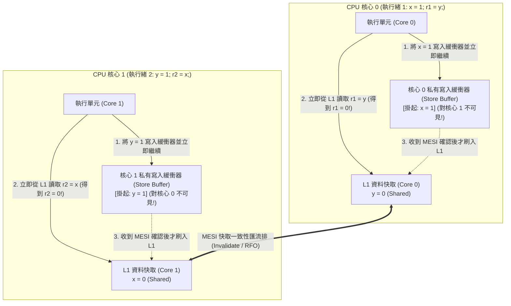
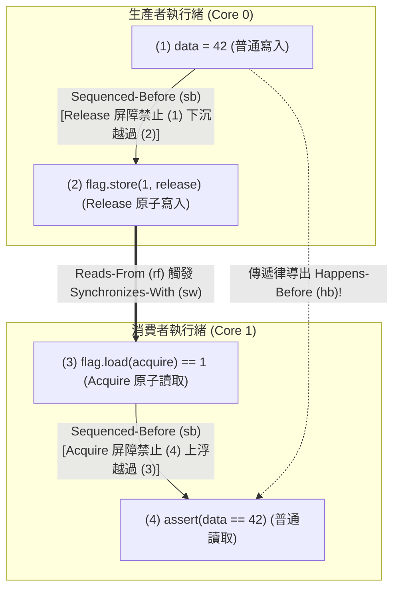

## 引言：四行程式碼打破人類直覺 ── Store Buffering (`SB`) 試金石測試

請看下面這段僅有四行有效程式碼的並行C程式。共享記憶體中兩個整數變數 `x` 和 `y` 的初始值均為 `0`，執行在兩個CPU核心上的執行緒1和執行緒2分別執行一次寫入（Store）和一次讀取（Load）：

```c
// Initial state in shared memory:
int x = 0, y = 0;
int r1 = 0, r2 = 0;

// Thread 1 (Core 0)          // Thread 2 (Core 1)
void thread1(void) {          void thread2(void) {
    x = 1;      // (S1)           y = 1;      // (S2)
    r1 = y;     // (L1)           r2 = x;     // (L2)
}                             }
```

當兩個執行緒都執行完畢時，區域變數 `(r1, r2)` 可能出現什麼結果？
按人類的常識推演：
- 若執行緒1先執行完，則 `x = 1, r1 = 0`，隨後執行緒2執行得到 `r2 = 1`；
- 若執行緒2先執行完，則 `y = 1, r2 = 0`，隨後執行緒1執行得到 `r1 = 1`；
- 若兩個執行緒同時先執行第一行（`x = 1` 和 `y = 1`），再執行第二行，則 `r1 = 1, r2 = 1`。

無論如何交錯，至少有一個執行緒會先寫入 `1`，因此<strong>`r1 == 0 && r2 == 0` 在邏輯上似乎絕對不可能發生</strong>。然而，如果你在任何現代 Intel/AMD x86-64 處理器、Apple Silicon (ARMv8) 或開啟了 `-O2` 最佳化的 C/C++/Rust 編譯器上執行這段程式碼，<strong>`r1 == 0 && r2 == 0` 每秒鐘都會真實發生成千上萬次</strong>！這不是硬體故障，而是因為現代CPU與編譯器都在單執行緒<strong>「As-If規則（表觀等價規則）」</strong>下對記憶體操作進行了重排序（Instruction Reordering）。

---

## 第一章：順序一致性（Sequential Consistency）的幻覺與數學反證

1979年，圖靈獎得主<strong>萊斯利·蘭伯特（Leslie Lamport）</strong>將程式設計師直覺中的理想多執行緒模型定義為<strong>順序一致性（Sequential Consistency, SC）</strong>：所有處理器的操作都如同按某個全域全序（Total Order $\prec_m$）依次執行，且每個處理器自身的操作在該序列中嚴格保持原始碼編寫的<strong>程式順序（Program Order $\prec_p$）</strong>。

在順序一致性下，我們可以用三行公式嚴格證明 `r1 == 0 && r2 == 0` 是不可能的：

$$\text{Program Order: } S_1 \prec_p L_1 \quad \land \quad S_2 \prec_p L_2$$

$$\text{Assume } r_1 = 0 \land r_2 = 0 \implies L_1 \prec_m S_2 \quad \land \quad L_2 \prec_m S_1$$

$$\implies S_1 \prec_p L_1 \prec_m S_2 \prec_p L_2 \prec_m S_1 \implies S_1 \prec S_1 \quad (\text{Contradiction!})$$

若 $r_1 = 0$，讀取 $L_1$ 必然發生在寫入 $S_2$ 之前（$L_1 \prec_m S_2$）；若 $r_2 = 0$，讀取 $L_2$ 必然發生在寫入 $S_1$ 之前（$L_2 \prec_m S_1$）。結合程式順序 $S_1 \prec_p L_1$ 與 $S_2 \prec_p L_2$，就會導出 $S_1 \prec L_1 \prec S_2 \prec L_2 \prec S_1$ 的<strong>因果循環矛盾</strong>！

然而，由於單執行緒內 `x = 1` 與 `r1 = y` 存取的是不同位址，不存在資料相依性，硬體與編譯器為了掩蓋高達數百個時脈週期的記憶體延遲，會打破全域順序一致性。

---

## 第二章：硬體記憶體模型 ── 寫入緩衝器（Store Buffer）、MESI協定與無效化佇列

### 2.1 MESI快取一致性與寫入緩衝器（Store Buffer）導致的 Store-Load 重排

現代CPU暫存器存取僅需 $0.25\text{ ns}$（1週期），L1快取約 $1\text{ ns}$，而跨核心快取同步或主記憶體（DRAM）存取則需要 $50\sim 100\text{ ns}$（數百週期）。多核CPU透過<strong>MESI協定（Modified, Exclusive, Shared, Invalid）</strong>維護快取一致性：當核心0想修改處於 `Shared` 狀態的快取行 `x` 時，必須先向其他所有核心廣播<strong>無效化訊息（Invalidate / RFO）</strong>並等待確認（Acknowledge）。

為了避免每次寫入都停頓數十個週期，所有現代CPU（包括x86-64）都在核心與L1快取之間加入了私有的<strong>寫入緩衝器（Store Buffer）</strong>：



如上圖所示：核心0將 `x = 1` 放入自己的私有寫入緩衝器後立即執行 `r1 = y`（此時核心1的 `y = 1` 還停留在核心1的寫入緩衝器中，對核心0不可見），同時核心1也從L1快取讀到了舊值 `x = 0`！這就是<strong>Store-Load 重排序</strong>。如果核心0自己讀取剛寫入的 `x`，硬體會透過<strong>寫入緩衝器轉發（Store Buffer Forwarding）</strong>直接回傳新值 `1`，從而保證單執行緒語意不變。

### 2.2 x86-TSO 強模型 vs ARMv8 / RISC-V / PowerPC 弱記憶體模型

Intel/AMD 的 <strong>x86-TSO（Total Store Order）</strong> 採用嚴格的FIFO寫入緩衝器，保證 `Load-Load`、`Load-Store`、`Store-Store` 絕不重排，<strong>僅允許 `Store -> Load` 重排</strong>。而 <strong>ARMv8-A (AArch64)、RISC-V (RVWMO)、PowerPC</strong> 採用<strong>弱記憶體模型（Weakly Ordered Memory Model）</strong>，由於非FIFO寫入合併、亂序推測載入以及<strong>無效化佇列（Invalidate Queue）</strong>的存在，<strong>全部四種組合（Load-Load, Load-Store, Store-Store, Store-Load）均可發生重排</strong>！

| 硬體架構與記憶體模型 | `Load -> Load` 重排 | `Load -> Store` 重排 | `Store -> Store` 重排 | `Store -> Load` 重排 | 多副本原子性 (MCA) |
| :--- | :---: | :---: | :---: | :---: | :--- |
| <strong>順序一致性 (SC)</strong> | 禁止 | 禁止 | 禁止 | 禁止 | 完全多副本原子 |
| <strong>x86 / x64 (TSO)</strong> | 禁止 | 禁止 | 禁止 | <strong>允許 (寫入緩衝器)</strong> | Other-MCA (其他核同時可見) |
| <strong>ARMv8-A (AArch64)</strong> | <strong>允許</strong> | <strong>允許</strong> | <strong>允許</strong> | <strong>允許</strong> | Other-MCA |
| <strong>RISC-V (RVWMO)</strong> | <strong>允許</strong> | <strong>允許</strong> | <strong>允許</strong> | <strong>允許</strong> | Other-MCA |
| <strong>IBM PowerPC</strong> | <strong>允許</strong> | <strong>允許</strong> | <strong>允許</strong> | <strong>允許</strong> | <strong>非多副本原子 (Non-MCA)</strong> |

---

## 第三章：編譯器重排與 DRF-SC 定理 ── 為什麼資料競爭是未定義行為（UB）

即便在x86處理器上，普通變數的訊息傳遞 `data = 42; ready = 1;` 也會崩潰，因為<strong>最佳化編譯器（GCC/Clang/Rustc）在生成機器碼前就會重排所有四種記憶體存取</strong>，甚至透過<strong>暫存器提升（Register Promotion）與迴圈不變程式碼外提（LICM）</strong>將等待迴圈 `while (!ready)` 最佳化為只讀一次記憶體的無限迴圈！此外，C/C++的 `volatile` 僅用於記憶體映射I/O（MMIO），<strong>既不生成CPU記憶體屏障，也不能阻止周圍普通變數的重排</strong>。

1990年，<strong>Sarita Adve 與 Mark Hill</strong> 提出了現代程式語言記憶體模型的基石——<strong>DRF-SC定理（Data-Race-Free Sequential Consistency）</strong>：
- <strong>資料競爭（Data Race）定義</strong>：兩個不同執行緒並行存取同一記憶體位址，至少一個是寫入操作，至少一個是非原子操作，且兩者之間不存在 <strong>Happens-Before（$\xrightarrow{hb}$）</strong> 順序。
- <strong>DRF-SC 契約</strong>：如果程式<strong>沒有任何資料競爭（DRF）</strong>，編譯器與CPU保證其所有執行結果與<strong>完全的順序一致性（SC）</strong>不可區分；反之，一旦存在非原子資料競爭，C/C++與Unsafe Rust將其定義為<strong>未定義行為（Undefined Behavior, UB）</strong>。

---

## 第四章：Happens-Before 關係（$\xrightarrow{hb}$）與 Acquire-Release 原子同步

在 C++11 / C11 / Rust 形式化記憶體模型中，當執行緒1對原子變數 $x$ 執行 <strong>Release寫入</strong> $W_{\text{rel}}(x, v)$，且執行緒2對 $x$ 執行 <strong>Acquire讀取</strong> $R_{\text{acq}}(x, v)$ 並讀到了該值（$W_{\text{rel}} \xrightarrow{rf} R_{\text{acq}}$）時，跨執行緒建立起<strong>同步關係（Synchronizes-With, $\xrightarrow{sw}$）</strong>。結合執行緒內順序（Sequenced-Before, $\xrightarrow{sb}$），其傳遞閉包即為 <strong>Happens-Before（$\xrightarrow{hb}$）</strong>：

$$W_{\text{rel}}(x, v) \xrightarrow{rf} R_{\text{acq}}(x, v) \implies W_{\text{rel}}(x, v) \xrightarrow{sw} R_{\text{acq}}(x, v)$$

$$\xrightarrow{hb} \;\; \triangleq \;\; \left( \xrightarrow{sb} \;\cup\; \xrightarrow{sw} \right)^+$$

利用 `memory_order_release` 與 `memory_order_acquire`，我們可以寫出絕對安全的訊息傳遞程式碼：

```cpp
#include <atomic>
#include <cassert>

int data = 0;                        // Non-atomic payload
std::atomic<int> flag{0};            // Atomic synchronization variable

void producer_thread() {
    data = 42;                                           // (1) Sequenced-before (2)
    flag.store(1, std::memory_order_release);            // (2) Release store
}

void consumer_thread() {
    while (flag.load(std::memory_order_acquire) == 0) {  // (3) Acquire load
        // spin until flag == 1
    }
    assert(data == 42);                                  // (4) Guaranteed never to fail!
}
```



其嚴格證明如下：

$$W(\text{data}=42) \xrightarrow{sb} W_{\text{rel}}(\text{flag}=1) \xrightarrow{sw} R_{\text{acq}}(\text{flag}=1) \xrightarrow{sb} R(\text{data})$$

$$\implies W(\text{data}=42) \xrightarrow{hb} R(\text{data}) \implies R(\text{data}) = 42$$

---

## 第五章：記憶體序譜系與底層 CPU 指令映射（`MFENCE`, `DMB`, `LDAR`/`STLR`）

C++/Rust 提供了三檔核心記憶體序：
1. <strong>`Relaxed`</strong>：僅保證單一原子變數的不可分割性與修改順序（$\xrightarrow{mo}$），不建立 $\xrightarrow{sw}$ 同步（適用於獨立計數器）。
2. <strong>`Acquire` / `Release` / `AcqRel`</strong>：提供單向屏障（Roach Motel語意）與跨執行緒成對同步 $\xrightarrow{sw}$，但<strong>仍允許先執行的 `Release` 寫入與後執行的 `Acquire` 讀取發生 `Store -> Load` 重排</strong>！
3. <strong>`SeqCst`（預設）</strong>：在 Acquire-Release 基礎上強制所有 `SeqCst` 操作遵循<strong>單一全域全序 $\xrightarrow{S}$</strong>，徹底禁止 `Store -> Load` 重排（解決開頭 `SB` 測試中 `r1 == 0 && r2 == 0` 的唯一方案）。

| 原子操作 (C++ / Rust) | x86-64 (TSO) 機器指令 | ARMv8-A (AArch64) 機器指令 | RISC-V (RVWMO) 機器指令 |
| :--- | :--- | :--- | :--- |
| <strong>`load(relaxed)`</strong> | `mov eax, [rdi]` | `ldr w0, [x0]` | `lw a0, 0(a0)` |
| <strong>`load(acquire)`</strong> | <strong>`mov eax, [rdi]`</strong>（零硬體屏障開銷！） | <strong>`ldar w0, [x0]`</strong>（Load-Acquire指令） | `lw a0, 0(a0)` + `fence r, rw` |
| <strong>`store(release, v)`</strong> | <strong>`mov [rdi], esi`</strong>（零硬體屏障開銷！） | <strong>`stlr w1, [x0]`</strong>（Store-Release指令） | `fence rw, w` + `sw a1, 0(a0)` |
| <strong>`store(seq_cst, v)`</strong> | <strong>`xchg [rdi], esi`</strong>（或 `mov` + `mfence`） | <strong>`stlr w1, [x0]`</strong>（與後續 `ldar` 保序） | `fence rw, rw` + `sw` + `fence rw, rw` |
| <strong>全屏障 `fence(seq_cst)`</strong> | <strong>`mfence`</strong>（或 `lock or [rsp], 0`） | <strong>`dmb ish`</strong>（資料記憶體屏障） | <strong>`fence rw, rw`</strong> |

在 x86-64 上，`Acquire` 與 `Release` 編譯為普通的 `mov` 指令（僅含編譯器屏障），硬體開銷為零；唯有 `store(seq_cst)` 需要帶隱式 `LOCK` 前綴的 `xchg` 或 `mfence` 來強制清空寫入緩衝器（Store Buffer）。而在 ARMv8-A 上，專用的 `LDAR` 與 `STLR` 指令無需昂貴的 `DMB ISH` 全管線屏障即可優雅地實現 Acquire-Release 乃至 SeqCst 語意。
