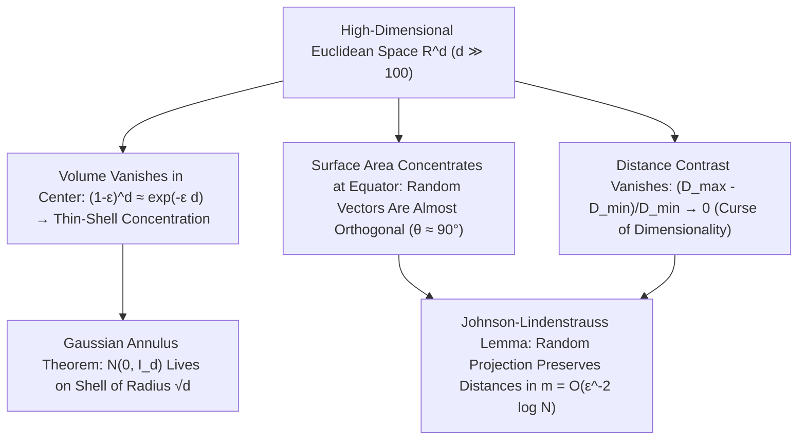

## 1. تلاشي حجم الكرة ومفارقة «الزوايا الشائكة» للمكعب الفائق

تطوّر الدماغ البشري عبر ملايين السنين للتعامل مع الفضاء الإقليدي ثنائي وثلاثي الأبعاد ($d=2, 3$). ولذلك نميل تلقائياً إلى تعميم حدسنا ثلاثي الأبعاد — مثل أن الكرة المحاطة بمكعب تملأ معظم حجمه، أو أن التوزيع الطبيعي يتجمع حول المتوسط عند نقطة الأصل، أو أن متجهين عشوائيين يصنعان زوايا متنوعة — على فضاءات البيانات ذات المئات أو الآلاف أو الملايين من الأبعاد ($\mathbb{R}^d, d \gg 100$). غير أن الرياضيات الحديثة تثبت أنه مع ازدياد البُعد $d$، لا يصبح حدسنا الهندسي غير دقيق فحسب، بل <strong>ينقلب رأساً على عقب بمقدار $180^\circ$</strong>!

لنتأمل أولاً صيغة حجم الكرة الإقليدية ذات نصف القطر $R$ في البُعد $d$: $V_d(R) = \frac{\pi^{d/2}}{\Gamma(d/2 + 1)}R^d$. بما أن دالة غاما في المقام تنمو نمواً فوق أُسّي مثل $(d/2e)^{d/2}$، فإن حجم كرة الوحدة ($R=1$) يبلغ <strong>قيمته العظمى المطلقة عند $d = 5$ ($V_5 \approx 5.2638$)</strong> ثم يتناقص بشكل رتيب: وعندما $d \to \infty$، <strong>يؤول حجم كرة الوحدة في الأبعاد العالية إلى الصفر تماماً ($\lim_{d\to\infty} V_d(1) = 0$)</strong>! وفي المقابل، ينفجر حجم المكعب الفائق المحيط $[-1, 1]^d$ بمقدار $2^d$ وتبلغ المسافة من المركز إلى رؤوسه الـ $2^d$ مقدار $\sqrt{d}$. أي أن معظم حجم المكعب الفائق يكمن في زواياه الحادة البعيدة؛ بل في <strong>مفارقة رصّ الكرات الشهيرة</strong>، إذا وضعنا $2^d$ كرات نصف قطرها $1/2$ في أرباع المكعب $[-1,1]^d$، فإن الكرة المركزية المماسة لها جميعاً يكون نصف قطرها $r_c = \frac{\sqrt{d}-1}{2}$، وهو يتجاوز $1$ عندما $d \ge 10$: <strong>فتخترق الكرة المحبوسة في قلب المكعب جدرانه إلى الخارج</strong>!

$$
V_d(R) = \frac{\pi^{d/2}}{\Gamma\!\left(\frac{d}{2} + 1\right)} R^d, \qquad \lim_{d \to \infty} V_d(1) = 0, \qquad \frac{V_d\big((1-\varepsilon)R\big)}{V_d(R)} = (1 - \varepsilon)^d \le e^{-\varepsilon d} \xrightarrow{d\to\infty} 0
$$

---

## 2. تركّز القياس (Concentration of Measure): البرتقالة الجوفاء وتعامل المتجهات العشوائية

أين يتوزع الحجم داخل كرة عالية الأبعاد؟ بما أن نسبة حجم كرة داخلية نصف قطرها $(1-\varepsilon)R$ إلى الكرة الكلية هي $(1-\varepsilon)^d \le e^{-\varepsilon d}$، ففي الفضاء ذي البُعد $d = 1000$، حتى لو أخذنا $\varepsilon = 0.01$، فإن الـ $99\%$ الداخلية من نصف القطر لا تحوي سوى $0.99^{1000} \approx 0.000043$ من الحجم! أي أن <strong>أكثر من $99.995\%$ من حجم الكرة عالية الأبعاد ينضغط في قشرة سطحية رقيقة جداً (Thin Shell) سمكها $O(1/d)$ تحت السطح مباشرة</strong>، بينما يكاد جوف الكرة يكون فارغاً تماماً!

وبالمثل، تُظهر مساحة سطح الكرة الفائقة <strong>تركّزاً استوائياً</strong> مذهلاً: فعند تثبيت أي قطب شمالي $\mathbf{p}$، تتركز معظم مساحة $S^{d-1}$ في حزام ضيق عرضه $\pm O(1/\sqrt{d})$ حول خط الاستواء. وينتج عن ذلك أن أي متجهين عشوائيين مستقلين $\mathbf{u}, \mathbf{v} \in S^{d-1}$ يكون لحاصل ضربهما الداخلي $\langle \mathbf{u}, \mathbf{v} \rangle$ تباين قدره $1/d$ ($\mathbb{P}(|\langle \mathbf{u}, \mathbf{v} \rangle| \ge \varepsilon) \le 2e^{-d\varepsilon^2/2}$): <strong>في الأبعاد العالية، يكون أي متجهين عشوائيين متعامدين تقريباً ($	heta \approx 90^\circ$) باحتمال يقترب من اليقين</strong>! وحتى التوزيع الطبيعي المعياري $\mathbf{x} \sim \mathcal{N}(\mathbf{0}, I_d)$ يهجر نقطة الأصل $\mathbf{0}$ ويتركز وفق <strong>مبرهنة الحلقة الغاوسية (Gaussian Annulus Theorem)</strong> على قشرة كروية نصف قطرها $\sqrt{d} \pm O(1)$:

$$
\mathbb{P}\!\left( \big| \langle \mathbf{u}, \mathbf{v} \rangle \big| \ge \varepsilon \right) \le 2 \exp\!\left(-\frac{d \varepsilon^2}{2}\right), \qquad \|\mathbf{x}\|_2 = \sqrt{\sum_{i=1}^d x_i^2} = \sqrt{d} \pm \mathcal{O}(1) \quad (\mathbf{x} \sim \mathcal{N}(\mathbf{0}, I_d))
$$

---

## 3. لعنة الأبعاد (Curse of Dimensionality) وانهيار تباين المسافات

تعبّر <strong>لعنة الأبعاد</strong> التي صاغها ريتشارد بيلمان عام 1957 عن الانفجار الأُسّي لحجم العينة: فشبكة منتظمة بخطوة $\varepsilon = 0.1$ في $[0,1]^d$ تتطلب $N = 10^d$ نقطة ($10^{100}$ نقطة عند $d=100$). والأخطر من ذلك ما أثبته باير وآخرون (Beyer et al., 1999) من <strong>تلاشي تباين المسافات</strong>: فعندما $d \to \infty$، تؤول النسبة بين الفرق $(D_{\max} - D_{\min})$ وأقرب مسافة $D_{\min}$ إلى الصفر ($\lim_{d\to\infty} \frac{D_{\max} - D_{\min}}{D_{\min}} = 0$). وبذلك تصبح جميع النقاط متساوية البعد تقريباً، مما يعطّل خوارزميات الجار الأقرب ($k$-NN) الساذجة ويولّد <strong>ظاهرة المراكز المهيمنة (Hubness)</strong>.

---

## 4. طوق النجاة: فرضية المتعدد وتوطئة الإسقاط العشوائي لجونسون-ليندنشتراوس (JL)

لماذا إذن ينجح التعلم العميق والنماذج اللغوية الكبيرة (LLMs) وقواعد البيانات المتجهة في آلاف الأبعاد؟ أولاً بفضل <strong>فرضية المتعدد (Manifold Hypothesis)</strong> القائلة بأن البيانات الحقيقية تقع قرب متعدد منخفض البُعد الجوهري $d_{\text{int}} \ll d$؛ وثانياً بفضل معجزة تركّز القياس ذاتها: <strong>توطئة جونسون-ليندنشتراوس (Johnson-Lindenstrauss Lemma, 1984)</strong>!

تثبت توطئة JL أنه بإسقاط $N$ نقطة من $\mathbb{R}^d$ خطياً عبر مصفوفة غاوسية عشوائية إلى فضاء جزئي بُعده $m = O(\varepsilon^{-2} \log N)$، تُحفظ جميع المسافات المتبادلة ضمن عامل $(1 \pm \varepsilon)$، حيث لا يعتمد البُعد الهدف $m$ <strong>إطلاقاً على البُعد الأصلي $d$</strong>!

| الخاصية الهندسية والاحتمالية | الحدس في الأبعاد المنخفضة ($d = 2, 3$) | الحقيقة الرياضية في الأبعاد العالية ($d \gg 100$) |
| :--- | :--- | :--- |
| <strong>توزيع الحجم داخل الكرة</strong> | موزع بين المركز والسطح | <strong>$>99.99\%$ مضغوط في قشرة سطحية سمكها $O(1/d)$ (الجوف فارغ)</strong> |
| <strong>الزاوية بين متجهين عشوائيين</strong> | موزعة على نطاق واسع من $0^\circ$ إلى $180^\circ$ | <strong>مركّزة عند $90^\circ \pm O(1/\sqrt{d})$ باحتمال $1 - 2e^{-d\varepsilon^2/2}$ (تعامد)</strong> |
| <strong>التوزيع الطبيعي $\mathcal{N}(\mathbf{0}, I_d)$</strong> | متجمع حول المتوسط في نقطة الأصل $\mathbf{0}$ | <strong>نقطة الأصل فارغة؛ الكتلة على قشرة كروية نصف قطرها $\sqrt{d} \pm O(1)$</strong> |
| <strong>تباين المسافات $(D_{\max}-D_{\min})/D_{\min}$</strong> | فرق واضح بين الجار الأقرب والأبعد | <strong>يؤول إلى $0$ (تصبح جميع النقاط متساوية البعد تقريباً)</strong> |

$$
(1 - \varepsilon) \|\mathbf{x}_i - \mathbf{x}_j\|_2^2 \le \|f(\mathbf{x}_i) - f(\mathbf{x}_j)\|_2^2 \le (1 + \varepsilon) \|\mathbf{x}_i - \mathbf{x}_j\|_2^2, \qquad m = \mathcal{O}\!\left(\frac{\log N}{\varepsilon^2}\right)
$$

