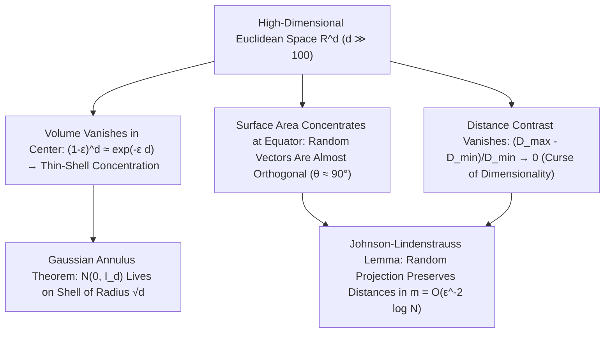

## 1. Das verschwindende Kugelvolumen und das „Stachel-Paradoxon“ des Hyperwürfels

Unser Gehirn hat sich in der Evolution entwickelt, um in zwei- und dreidimensionalen euklidischen Räumen ($d=2, 3$) zu überleben. Wir neigen dazu, unsere dreidimensionale geometrische Intuition – etwa dass eine einbeschriebene Kugel den Großteil eines Würfels ausfüllt, dass eine Gauß-Verteilung nahe ihrem Mittelwert im Ursprung konzentriert ist oder dass zwei zufällige Richtungen beliebige Winkel einschließen – unbesehen auf hundert-, tausend- oder millionendimensionale Datenräume ($\mathbb{R}^d, d \gg 100$) zu übertragen. Doch die moderne Mathematik beweist: Für große Dimensionen $d$ wird unsere niedrigdimensionale Intuition nicht nur ungenau, sondern <strong>kehrt sich um $180^\circ$ ins genaue Gegenteil um</strong>!

Betrachten wir zunächst das Volumen einer $d$-dimensionalen Kugel vom Radius $R$: $V_d(R) = \frac{\pi^{d/2}}{\Gamma(d/2 + 1)}R^d$. Da die Gammafunktion im Nenner nach der Stirling-Formel wie $(d/2e)^{d/2}$ superexponentiell wächst, erreicht das Volumen der Einheitskugel ($R=1$) bei <strong>$d = 5$ sein absolutes Maximum ($V_5 \approx 5{,}2638$)</strong> und fällt danach streng monoton ab: Für $d \to \infty$ <strong>strebt das Volumen der hochdimensionalen Einheitskugel gegen null ($\lim_{d\to\infty} V_d(1) = 0$)</strong>! Gleichzeitig wächst das Volumen des umschreibenden Hyperwürfels $[-1, 1]^d$ exponentiell mit $2^d$, und der Abstand vom Zentrum zu jeder der $2^d$ Ecken beträgt $\sqrt{d}$. Fast das gesamte Volumen eines hochdimensionalen Hyperwürfels steckt in seinen $2^d$ langen, spitzen Ecken; beim berühmten <strong>Kugelpackungs-Paradoxon</strong> hat eine zentrale Kugel, die zwischen $2^d$ Eckkugeln vom Radius $1/2$ in $[-1,1]^d$ eingeklemmt ist, den Radius $r_c = \frac{\sqrt{d}-1}{2}$ – für $d \ge 10$ wird $r_c > 1$, sodass <strong>die im Inneren eingesperrte Kugel durch die Wände des Hyperwürfels nach außen bricht</strong>!

$$
V_d(R) = \frac{\pi^{d/2}}{\Gamma\!\left(\frac{d}{2} + 1\right)} R^d, \qquad \lim_{d \to \infty} V_d(1) = 0, \qquad \frac{V_d\big((1-\varepsilon)R\big)}{V_d(R)} = (1 - \varepsilon)^d \le e^{-\varepsilon d} \xrightarrow{d\to\infty} 0
$$

---

## 2. Maßkonzentration (Concentration of Measure): Hohle Orangen und orthogonale Zufallsvektoren

Wo befindet sich das Volumen innerhalb einer hochdimensionalen Kugel? Da das Volumenverhältnis einer um $(1-\varepsilon)$ geschrumpften inneren Kugel zur Gesamtkugel $(1-\varepsilon)^d \le e^{-\varepsilon d}$ beträgt, enthält in $d = 1000$ Dimensionen selbst für $\varepsilon = 0{,}01$ das innere $99\%$ des Radius nur den Bruchteil $0{,}99^{1000} \approx 0{,}000043$ des Volumens! Das heißt: <strong>Über $99{,}995\%$ des Volumens einer hochdimensionalen Kugel drängen sich in einer hauchdünnen Schale (Thin Shell) der Dicke $O(1/d)$ direkt unter der Oberfläche</strong> – das Innere ist praktisch leer!

Ebenso zeigt die Kugeloberfläche eine extreme <strong>Äquatorkonzentration</strong>: Wählt man einen beliebigen Nordpol $\mathbf{p}$, liegt fast die gesamte Oberfläche innerhalb eines schmalen Gürtels der Breite $\pm O(1/\sqrt{d})$ um den Äquator. Daraus folgt unmittelbar: Zieht man zwei unabhängige Zufallsvektoren $\mathbf{u}, \mathbf{v} \in S^{d-1}$ auf der Einheitssphäre, ist ihr Skalarprodukt $\langle \mathbf{u}, \mathbf{v} \rangle$ asymptotisch normalverteilt mit Varianz $1/d$ ($\mathbb{P}(|\langle \mathbf{u}, \mathbf{v} \rangle| \ge \varepsilon) \le 2e^{-d\varepsilon^2/2}$). <strong>Im hochdimensionalen Raum stehen zwei beliebige Zufallsvektoren mit überwältigender Wahrscheinlichkeit nahezu senkrecht aufeinander ($	heta \approx 90^\circ$)</strong>! Selbst die hochdimensionale Standardnormalverteilung $\mathbf{x} \sim \mathcal{N}(\mathbf{0}, I_d)$ hat nahe ihrem Modus im Ursprung $\mathbf{0}$ fast keine Wahrscheinlichkeitsmasse, sondern konzentriert sich nach dem <strong>Gaußschen Ringtheorem (Gaussian Annulus Theorem)</strong> scharf auf einer Kugelschale vom Radius $\sqrt{d} \pm O(1)$:

$$
\mathbb{P}\!\left( \big| \langle \mathbf{u}, \mathbf{v} \rangle \big| \ge \varepsilon \right) \le 2 \exp\!\left(-\frac{d \varepsilon^2}{2}\right), \qquad \|\mathbf{x}\|_2 = \sqrt{\sum_{i=1}^d x_i^2} = \sqrt{d} \pm \mathcal{O}(1) \quad (\mathbf{x} \sim \mathcal{N}(\mathbf{0}, I_d))
$$

---

## 3. Der Fluch der Dimensionalität (Curse of Dimensionality) und der Kollaps des Distanzkontrasts

Der 1957 von Richard Bellman geprägte <strong>Fluch der Dimensionalität</strong> beschreibt die exponentielle Explosion des Stichprobenbedarfs: Ein gleichmäßiges Gitter mit Auflösung $\varepsilon = 0{,}1$ auf $[0,1]^d$ erfordert $N = 10^d$ Punkte – bei $d=100$ sind das $10^{100}$ Punkte (mehr als die $10^{80}$ Atome im sichtbaren Universum). Noch gravierender ist das von Beyer et al. (1999) bewiesene Theorem über den <strong>Verlust des Distanzkontrasts</strong>: Für $d \to \infty$ konvergiert die relative Differenz zwischen dem Abstand zum nächsten Nachbarn $D_{\min}$ und zum fernsten Punkt $D_{\max}$ gegen null ($\lim_{d\to\infty} \frac{D_{\max} - D_{\min}}{D_{\min}} = 0$). Alle Punkte werden nahezu gleich weit voneinander entfernt, was naive $k$-Nearest-Neighbor-Suchen ($k$-NN) aushebelt und das <strong>Hubness-Phänomen</strong> erzeugt.

---

## 4. Die Rettung: Mannigfaltigkeitshypothese und das Johnson-Lindenstrauss-Lemma (JL)

Warum funktionieren Deep Learning, große Sprachmodelle (LLMs) und Vektordatenbanken dennoch hervorragend in tausenddimensionalen Einbettungsräumen? Erstens wegen der <strong>Mannigfaltigkeitshypothese (Manifold Hypothesis)</strong>, wonach reale Daten (Bilder, Sprache, Text) auf niedrigdimensionalen Untermannigfaltigkeiten der intrinsischen Dimension $d_{\text{int}} \ll d$ liegen; zweitens wegen des Wunders der Maßkonzentration selbst: dem <strong>Johnson-Lindenstrauss-Lemma (1984)</strong>!

Das JL-Lemma beweist: Weil hochdimensionale Zufallsrichtungen fast orthogonal sind, genügt eine lineare Zufallsprojektion $f(\mathbf{x}) = \frac{1}{\sqrt{m}} R \mathbf{x}$ in einen Zielraum der Dimension $m = O(\varepsilon^{-2} \log N)$, um alle paarweisen Abstände von $N$ Punkten bis auf einen Faktor $(1 \pm \varepsilon)$ exakt zu erhalten – <strong>völlig unabhängig von der Ausgangsdimension $d$</strong>!

| Geometrische & stochastische Eigenschaft | Niedrigdimensionale Intuition ($d = 2, 3$) | Hochdimensionale mathematische Realität ($d \gg 100$) |
| :--- | :--- | :--- |
| <strong>Volumenverteilung in der Kugel</strong> | Gleichmäßig zwischen Zentrum und Rand | <strong>$>99{,}99\%$ in einer dünnen Schale der Dicke $O(1/d)$ an der Oberfläche</strong> |
| <strong>Winkel zweier Zufallsvektoren</strong> | Breit über $0^\circ$ bis $180^\circ$ verteilt | <strong>Mit Wahrscheinlichkeit $1 - 2e^{-d\varepsilon^2/2}$ bei $90^\circ \pm O(1/\sqrt{d})$ (orthogonal)</strong> |
| <strong>Standard-Gaußverteilung $\mathcal{N}(\mathbf{0}, I_d)$</strong> | Dicht gedrängt um den Mittelwert $\mathbf{0}$ | <strong>Ursprung ist leer; Masse liegt auf Kugelschale vom Radius $\sqrt{d} \pm O(1)$</strong> |
| <strong>Distanzkontrast $(D_{\max}-D_{\min})/D_{\min}$</strong> | Nächster und fernster Punkt klar getrennt | <strong>Konvergiert gegen $0$ (alle Punkte nahezu äquidistant)</strong> |

$$
(1 - \varepsilon) \|\mathbf{x}_i - \mathbf{x}_j\|_2^2 \le \|f(\mathbf{x}_i) - f(\mathbf{x}_j)\|_2^2 \le (1 + \varepsilon) \|\mathbf{x}_i - \mathbf{x}_j\|_2^2, \qquad m = \mathcal{O}\!\left(\frac{\log N}{\varepsilon^2}\right)
$$

