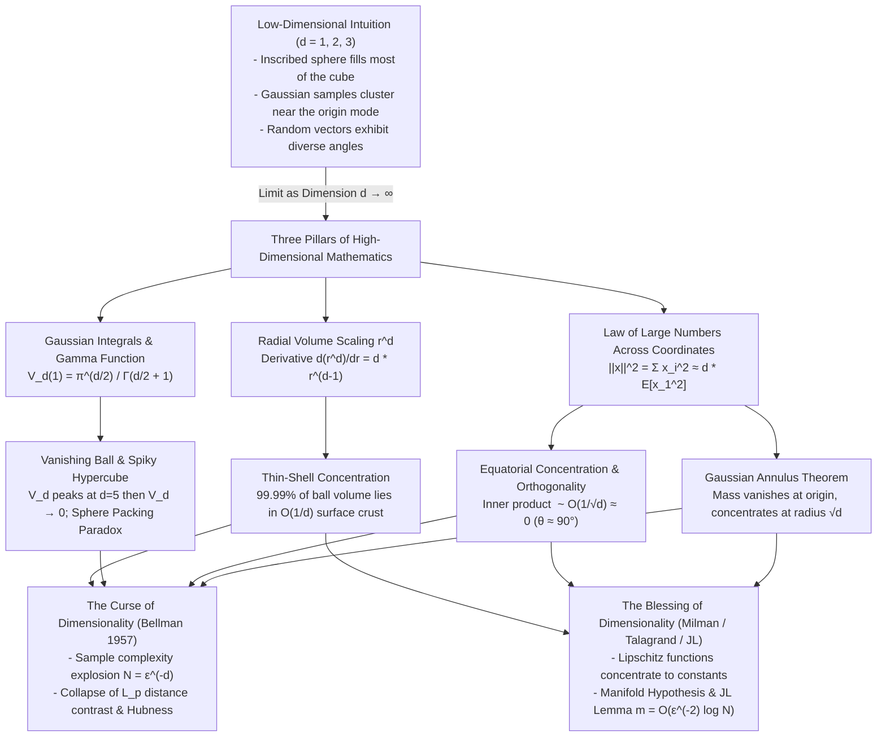

## 1. Introduction: The Three-Dimensional Cage and the Alien World of High-Dimensional Space

Human perception was forged by evolution to navigate a two-dimensional planetary surface and manipulate objects inside three-dimensional Euclidean space ($\mathbb{R}^3$). As a result, our brains possess deeply entrenched geometric and probabilistic intuitions about spheres, cubes, distances, angles, and bell curves. In three dimensions, certain facts feel self-evident: if you inscribe a sphere inside a cube, the sphere occupies a substantial fraction of the box's volume; when you peel an orange, almost all of the fruit's volume resides in the edible pulp rather than the thin skin; and if you draw random points from a standard bell-shaped Gaussian distribution centered at the origin, most points will land near the origin where the probability density is highest.

Yet modern science, physics, and artificial intelligence rarely operate in $\mathbb{R}^3$. The phase space of a mole of gas in statistical mechanics has dimension $d \sim 10^{23}$. Quantitative finance, genomics, and signal processing routinely analyze spaces of thousands or millions of variables. And contemporary deep learning—from Vision Transformers to Large Language Models (LLMs)—represents tokens, images, and concepts as vectors embedded in high-dimensional Euclidean spaces $\mathbb{R}^d$ where $d = 768, 4096, 12288$, or higher.

As pioneers of information theory and functional analysis such as Richard Hamming, Vitali Milman, and Michel Talagrand have emphasized, <strong>projecting three-dimensional geometric intuition into high-dimensional space is a guaranteed recipe for catastrophic error</strong>. When the dimension $d$ grows from $3$ to $100$, $1,000$, or $10^6$, Euclidean space undergoes a phase transition into an alien realm governed by five extraordinary paradoxes:

1. <strong>The Vanishing Hypersphere Paradox</strong>: The volume $V_d(1)$ of a $d$-dimensional unit ball of radius $R=1$ increases up to dimension $d = 5$ (reaching $V_5(1) = \frac{8\pi^2}{15} \approx 5.2638$), and then plummets toward <strong>zero</strong> as $d \to \infty$.
2. <strong>The Spiky Hypercube and the Sphere Packing Paradox</strong>: Relative to its inscribed sphere, a high-dimensional hypercube $[-1, 1]^d$ resembles a microscopic core with $2^d$ gigantic spikes shooting out to distance $\sqrt{d}$, storing nearly $100\%$ of its volume in the corners. Even more shockingly, if you pack $2^d$ spheres of radius $1/2$ inside $[-1, 1]^d$ and place a central sphere at the origin tangent to all $2^d$ spheres, <strong>for $d \ge 10$ the central sphere bursts through the walls of the bounding hypercube into the exterior</strong>!
3. <strong>Thin-Shell and Equatorial Concentration of Measure</strong>: In a high-dimensional ball (a "high-dimensional orange"), over $99.99\%$ of the volume is concentrated within a paper-thin crust of thickness $O(1/d)$ just beneath the surface. Furthermore, nearly $100\%$ of the surface area of the hypersphere $S^{d-1}$ lies within $\pm O(1/\sqrt{d})$ of any equator—meaning that <strong>two independent random vectors in high dimensions are almost surely orthogonal ($\theta \approx 90^\circ$)</strong>.
4. <strong>The Gaussian Soap Bubble (Gaussian Annulus Theorem)</strong>: Although the standard multivariate normal distribution $\mathcal{N}(\mathbf{0}, I_d)$ attains its maximum probability density at the origin $\mathbf{0}$, virtually zero samples ever land near the origin. Instead, <strong>almost all probability mass concentrates tightly on a thin spherical soap bubble of radius $\sqrt{d}$ and constant thickness $O(1)$</strong>.
5. <strong>The Curse vs. the Blessing of Dimensionality</strong>: While exponential grid growth ($N = \varepsilon^{-d}$), the collapse of pairwise Euclidean distance contrast, and the "Hubness" phenomenon cripple naive nearest-neighbor algorithms, the very same concentration of measure rescues modern machine learning via Lipschitz concentration, the Manifold Hypothesis, and the <strong>Johnson-Lindenstrauss Lemma</strong>—which projects data from arbitrarily high dimension $d$ down to $m = O(\varepsilon^{-2} \ln N)$ dimensions while preserving pairwise distances.

In this article, we derive each of these phenomena from first principles using Gaussian integrals, Gamma functions, and tail inequalities, unifying them into a rigorous mathematical picture of how high-dimensional geometry works and why modern AI thrives within it.

---

## 2. The Hypersphere Volume Paradox and the "Spiky" Hypercube

### 2.1 Exact Derivation of the $d$-Dimensional Ball Volume via Gaussian Integrals

Let us begin by deriving the exact volume $V_d(R)$ of the closed $d$-dimensional Euclidean ball of radius $R$,

$$B_d(R) = \left\{ \mathbf{x} = (x_1, x_2, \dots, x_d) \in \mathbb{R}^d \,\middle|\, \|\mathbf{x}\|_2 = \sqrt{\sum_{i=1}^d x_i^2} \le R \right\},$$

together with the surface area $A_{d-1}(R)$ of its boundary hypersphere $S^{d-1}(R) = \partial B_d(R)$. While one can integrate slice-by-slice using trigonometric recurrence relations, the most elegant and illuminating proof evaluates the $d$-dimensional Gaussian integral in two coordinate systems: Cartesian coordinates and spherical coordinates.

In Cartesian coordinates, the function $f(\mathbf{x}) = \exp(-\|\mathbf{x}\|_2^2) = \prod_{i=1}^d e^{-x_i^2}$ factors completely into $d$ independent one-dimensional Gaussian integrals, each equal to $\int_{-\infty}^\infty e^{-x^2} dx = \sqrt{\pi}$:

$$I_d = \int_{\mathbb{R}^d} e^{-\|\mathbf{x}\|_2^2} \, d\mathbf{x} = \prod_{i=1}^d \left( \int_{-\infty}^{\infty} e^{-x_i^2} \, dx_i \right) = \left(\sqrt{\pi}\right)^d = \pi^{d/2}.$$

Next, we evaluate the exact same integral $I_d$ by integrating over concentric spherical shells of radius $r = \|\mathbf{x}\|_2 \in [0, \infty)$ and infinitesimal thickness $dr$. By homogeneity of Lebesgue measure under scaling by $r$, the volume of a ball of radius $r$ is proportional to $r^d$:

$$V_d(r) = V_d(1) r^d.$$

Differentiating the volume with respect to the radius $r$ yields the surface area $A_{d-1}(r)$ of the $(d-1)$-dimensional sphere of radius $r$:

$$A_{d-1}(r) = \frac{d}{dr} V_d(r) = d \cdot V_d(1) r^{d-1} = \omega_{d-1} r^{d-1}, \qquad \text{where } \omega_{d-1} \equiv A_{d-1}(1) = d \cdot V_d(1).$$

Substituting this spherical shell element $A_{d-1}(r)\,dr$ into $I_d$ gives:

$$I_d = \int_0^\infty A_{d-1}(r) e^{-r^2} \, dr = d \cdot V_d(1) \int_0^\infty r^{d-1} e^{-r^2} \, dr.$$

Making the substitution $t = r^2$ (so $r = t^{1/2}$ and $dr = \frac{1}{2} t^{-1/2} dt$) transforms the radial integral directly into Euler's Gamma function $\Gamma(z) = \int_0^\infty t^{z-1} e^{-t} \, dt$:

$$I_d = d \cdot V_d(1) \int_0^\infty t^{\frac{d-1}{2}} e^{-t} \left(\frac{1}{2} t^{-1/2} \, dt\right) = V_d(1) \cdot \frac{d}{2} \int_0^\infty t^{\frac{d}{2} - 1} e^{-t} \, dt = V_d(1) \cdot \frac{d}{2} \Gamma\left(\frac{d}{2}\right).$$

Using the fundamental functional identity $z\Gamma(z) = \Gamma(z+1)$ to write $\frac{d}{2}\Gamma\left(\frac{d}{2}\right) = \Gamma\left(\frac{d}{2} + 1\right)$, and equating our two expressions for $I_d$, we obtain the closed-form formulas for the volume and surface area of a $d$-dimensional ball:

$$V_d(R) = \frac{\pi^{d/2}}{\Gamma\left(\frac{d}{2} + 1\right)} R^d, \qquad A_{d-1}(R) = \frac{2\pi^{d/2}}{\Gamma\left(\frac{d}{2}\right)} R^{d-1}.$$

---

### 2.2 Why Does the Unit Ball Volume Peak at $d = 5$ and Vanish as $d \to \infty$?

Examining $V_d(1) = \frac{\pi^{d/2}}{\Gamma(d/2 + 1)}$ as a function of dimension $d$ reveals our first major surprise. Using $\Gamma\left(\frac{d}{2} + 1\right) = \frac{d}{2}\Gamma\left(\frac{d-2}{2} + 1\right)$, we obtain the two-step recurrence relation:

$$V_d(1) = \frac{2\pi}{d} V_{d-2}(1).$$

Look closely at the multiplier $\frac{2\pi}{d} \approx \frac{6.28318}{d}$:
- As long as $d \le 6$, the factor $\frac{2\pi}{d}$ is strictly greater than $1$, so stepping up by two dimensions increases the volume.
- Once $d \ge 7$, $\frac{2\pi}{d} < 1$, so every two-dimensional increment shrinks the volume.
- Comparing the even sequence ($V_2 = \pi \approx 3.1416$, $V_4 = \frac{\pi^2}{2} \approx 4.9348$, $V_6 = \frac{\pi^3}{6} \approx 5.1677$) with the odd sequence ($V_1 = 2$, $V_3 = \frac{4\pi}{3} \approx 4.1888$, $V_5 = \frac{8\pi^2}{15} \approx 5.2638$, $V_7 = \frac{16\pi^3}{105} \approx 4.7248$), we see that <strong>the volume of the unit ball achieves its global maximum over integer dimensions at $d = 5$, where $V_5(1) = \frac{8\pi^2}{15} \approx 5.26379$</strong> (if $d$ is treated as a continuous real variable, the maximum occurs at $d \approx 5.2569$). Similarly, the unit sphere's surface area $A_{d-1}(1) = d \cdot V_d(1)$ peaks at $d = 7$ ($S^6$), where $A_6(1) = \frac{16\pi^3}{15} \approx 33.0734$, before also collapsing to zero.

To see how fast $V_d(1)$ vanishes as $d \to \infty$, we apply Stirling's asymptotic formula $\Gamma(z+1) \sim \sqrt{2\pi z}\left(\frac{z}{e}\right)^z$ at $z = d/2$:

$$V_d(1) \sim \frac{\pi^{d/2}}{\sqrt{\pi d}\left(\frac{d}{2e}\right)^{d/2}} = \frac{1}{\sqrt{\pi d}} \left(\frac{2\pi e}{d}\right)^{d/2} \xrightarrow{d \to \infty} 0.$$

Once $d > 2\pi e \approx 17.08$, the base $\frac{2\pi e}{d}$ drops below $1$ and $V_d(1)$ decays super-exponentially at rate $d^{-d/2}$. Consequently, if we ask the inverse question—"What radius $R_d$ is required for a $d$-dimensional ball to have unit volume $V_d(R_d) = 1$?"—setting $V_d(1) R_d^d = 1$ yields:

$$R_d = \left[\Gamma\left(\frac{d}{2} + 1\right)\right]^{1/d} \pi^{-1/2} \sim \sqrt{\frac{d}{2\pi e}} \approx 0.2420 \sqrt{d}.$$

A ball of volume $1$ must have a radius that grows proportionally to $\sqrt{d}$!

| Dimension $d$ | Unit Ball Volume $V_d(1)$ | Unit Sphere Area $A_{d-1}(1)$ | Bounding Cube Volume $2^d$ | Volume Ratio $V_d(1) / 2^d$ | Cube Corner Distance $\sqrt{d}$ | Radius $R_d$ for Unit Volume |
| :--- | :--- | :--- | :--- | :--- | :--- | :--- |
| $1$ | $2.0000$ | $2.0000$ | $2$ | $1.0000$ ($100\%$) | $1.000$ | $0.500$ |
| $2$ | $\pi \approx 3.1416$ | $2\pi \approx 6.2832$ | $4$ | $0.7854$ ($78.5\%$) | $1.414$ | $0.564$ |
| $3$ | $\frac{4}{3}\pi \approx 4.1888$ | $4\pi \approx 12.5664$ | $8$ | $0.5236$ ($52.4\%$) | $1.732$ | $0.620$ |
| $4$ | $\frac{1}{2}\pi^2 \approx 4.9348$ | $2\pi^2 \approx 19.7392$ | $16$ | $0.3084$ ($30.8\%$) | $2.000$ | $0.671$ |
| <strong>$5$ (Max Volume)</strong> | <strong>$\frac{8}{15}\pi^2 \approx 5.2638$</strong> | $\frac{8}{3}\pi^2 \approx 26.3189$ | $32$ | $0.1645$ ($16.5\%$) | $2.236$ | $0.717$ |
| $6$ | $\frac{1}{6}\pi^3 \approx 5.1677$ | $\pi^3 \approx 31.0063$ | $64$ | $0.0807$ ($8.07\%$) | $2.449$ | $0.761$ |
| <strong>$7$ (Max Area)</strong> | $\frac{16}{105}\pi^3 \approx 4.7248$ | <strong>$\frac{16}{15}\pi^3 \approx 33.0734$</strong> | $128$ | $0.0369$ ($3.69\%$) | $2.646$ | $0.802$ |
| $10$ | $\frac{1}{120}\pi^5 \approx 2.5502$ | $\frac{1}{12}\pi^5 \approx 25.5016$ | $1,024$ | $2.49 \times 10^{-3}$ | $3.162$ | $0.911$ |
| $20$ | $\frac{1}{10!}\pi^{10} \approx 0.0258$ | $0.5161$ | $1.05 \times 10^6$ | $2.46 \times 10^{-8}$ | $4.472$ | $1.201$ |
| $50$ | $1.73 \times 10^{-13}$ | $8.65 \times 10^{-12}$ | $1.13 \times 10^{15}$ | $1.54 \times 10^{-28}$ | $7.071$ | $1.800$ |
| $100$ | $2.37 \times 10^{-40}$ | $2.37 \times 10^{-38}$ | $1.27 \times 10^{30}$ | $1.87 \times 10^{-70}$ | $10.000$ | $2.491$ |
| $1000$ | $10^{-1274}$ | $10^{-1271}$ | $1.07 \times 10^{301}$ | $10^{-1575}$ | $31.623$ | $7.669$ |

---

### 2.3 The "Spiky" Hypercube and the Sphere Packing Paradox

This table forces a profound geometric question: *The unit ball $B_d(1)$ touches the center of every face of the bounding hypercube $[-1, 1]^d$, whose side length is $2$ and whose volume is $2^d$. How can an inscribed ball that touches every wall of a box occupy a vanishingly small fraction ($1.87 \times 10^{-70}$ at $d=100$) of the box's volume?*

The resolution lies in the Pythagorean theorem across $d$ orthogonal axes. In $[-1, 1]^d$:
- The distance from the origin $(0, 0, \dots, 0)$ to the <strong>center of any face</strong> $(\pm 1, 0, \dots, 0)$ is exactly $1$.
- However, the distance from the origin to any of the <strong>$2^d$ corners (vertices)</strong> $(\pm 1, \pm 1, \dots, \pm 1)$ is:
  $$\|\mathbf{v}_{\text{corner}}\|_2 = \sqrt{1^2 + 1^2 + \dots + 1^2} = \sqrt{d}.$$

In $d = 100$ dimensions, the walls of the hypercube are at distance $1$ from the center, whereas the $2^{100} \approx 1.27 \times 10^{30}$ corners stretch out to distance $\sqrt{100} = 10$! Meanwhile, for a point $\mathbf{x} = (x_1, \dots, x_d)$ to lie inside the unit ball $B_d(1)$, its coordinates must satisfy $\sum_{i=1}^d x_i^2 \le 1$, which forces the typical coordinate magnitude to be at most $|x_i| \sim \frac{1}{\sqrt{d}}$.

Consequently, if we visualize high-dimensional space with the isotropic unit sphere as our reference shape, <strong>a high-dimensional hypercube $[-1, 1]^d$ does not look like a blocky room at all—it looks like a sea urchin with a tiny central core of radius $1$ and $2^d$ long, needle-like spikes extending out to radius $\sqrt{d}$</strong>. Virtually $100\%$ of the hypercube's volume $2^d$ resides far out inside these $2^d$ corner spikes.

To see just how bizarre this geometry becomes, consider the classic <strong>Hypercube Sphere Packing Paradox</strong> (popularized by Richard Hamming and Vitali Milman):

Take the hypercube $[-1, 1]^d$ of side length $2$, which is naturally partitioned by the coordinate hyperplanes into $2^d$ unit sub-cubes of side length $1$ (one in each orthant, such as $[0, 1]^d$).
1. Inscribe one sphere of radius $1/2$ inside each of the $2^d$ unit sub-cubes, centered at $\mathbf{c} = (\pm \frac{1}{2}, \pm \frac{1}{2}, \dots, \pm \frac{1}{2})$. Each of these $2^d$ spheres is tangent to its neighboring spheres and tangent to the outer faces of $[-1, 1]^d$.
2. Now, in the empty cavity at the origin $\mathbf{0} = (0, \dots, 0)$ surrounded by all $2^d$ spheres, place a central sphere $B_d(r_d)$ that is externally tangent to all $2^d$ corner spheres. What is the radius $r_d$ of this central trapped sphere?

By the Pythagorean theorem, the distance from the origin $\mathbf{0}$ to the center $\mathbf{c} = (\pm \frac{1}{2}, \dots, \pm \frac{1}{2})$ of every corner sphere is:

$$D_{\text{center}} = \sqrt{\sum_{i=1}^d \left(\frac{1}{2}\right)^2} = \frac{\sqrt{d}}{2}.$$

Since each corner sphere has radius $1/2$, the radius $r_d$ of the central sphere tangent to them is simply:

$$r_d = D_{\text{center}} - \frac{1}{2} = \frac{\sqrt{d} - 1}{2}.$$

Let us track what happens to this central "cavity" sphere as the dimension $d$ increases:
- <strong>$d = 2$ (Plane)</strong>: $r_2 = \frac{\sqrt{2}-1}{2} \approx 0.2071$. A small circle nestled snugly in the gap between $4$ unit-diameter circles.
- <strong>$d = 3$ (3D Space)</strong>: $r_3 = \frac{\sqrt{3}-1}{2} \approx 0.3660$. A small ball fitting inside the central gap between $8$ spheres.
- <strong>$d = 4$ (4D Space)</strong>: $r_4 = \frac{\sqrt{4}-1}{2} = 0.5000$. The central sphere nestled in the gap is now <strong>exactly the same size</strong> as the $16$ spheres surrounding it!
- <strong>$d = 9$ (9D Space)</strong>: $r_9 = \frac{\sqrt{9}-1}{2} = 1.0000$. The central sphere—even though it is trapped inside the $2^9 = 512$ corner spheres—reaches radius $1$ and <strong>touches the outer boundary walls of the bounding hypercube $[-1, 1]^9$</strong>!
- <strong>$d \ge 10$ (10D and beyond)</strong>: $r_{10} = \frac{\sqrt{10}-1}{2} \approx 1.0811 > 1$. <strong>The central sphere bursts right through the faces of the outer hypercube $[-1, 1]^d$ and protrudes outside the box</strong>, even though it never intersects any of the $2^d$ spheres packed inside the box! For $d = 100$, the central sphere has radius $r_{100} = 4.5$, extending $3.5$ units outside every wall of the hypercube!

How is this geometrically possible without the central sphere colliding with the $2^d$ surrounding spheres? Because the $2^d$ surrounding spheres sit along the main diagonals $(\pm \frac{1}{2}, \dots, \pm \frac{1}{2})$ at distance $\frac{\sqrt{d}}{2}$ from the origin, leaving the coordinate axes $(\pm 1, 0, \dots, 0)$ completely unobstructed! The central sphere expands isotropically in all directions, reaching the nearby walls of the hypercube along the coordinate axes (at distance $1$) long before it hits the distant corner spheres along the diagonals (at distance $\frac{\sqrt{d}-1}{2}$).

---

## 3. Three Faces of the Concentration of Measure Phenomenon

The overarching principle governing high-dimensional geometry and probability is the <strong>Concentration of Measure Phenomenon</strong>. Informally, whenever a geometric object or probability distribution in $\mathbb{R}^d$ depends symmetrically on many coordinates, almost $100\%$ of its volume or probability mass concentrates tightly within a razor-thin subset of the space. Let us derive its three canonical manifestations.

### 3.1 Thin-Shell Concentration: Why a High-Dimensional Orange Is All Peel and No Pulp

Imagine a $d$-dimensional unit ball $B_d(1)$ as a "high-dimensional orange" of radius $1$, covered by a thin peel of thickness $\varepsilon \in (0, 1)$. The edible pulp inside is a concentric ball $B_d(1-\varepsilon)$ of radius $1-\varepsilon$. What fraction of the orange's total volume lies inside the pulp, and what fraction lies in the outer peel $\{ \mathbf{x} \in B_d(1) : 1-\varepsilon \le \|\mathbf{x}\|_2 \le 1 \}$?

Because $V_d(R) = V_d(1) R^d$, the complicated prefactor $\frac{\pi^{d/2}}{\Gamma(d/2+1)}$ cancels out completely when we take the ratio of volumes:

$$\frac{V_d(1-\varepsilon)}{V_d(1)} = (1 - \varepsilon)^d.$$

Using the elementary inequality $1 - \varepsilon \le e^{-\varepsilon}$, the fraction of volume contained within the outer shell of thickness $\varepsilon$ satisfies:

$$\frac{\operatorname{Vol}\left(\{\mathbf{x} \in B_d(1) : 1-\varepsilon \le \|\mathbf{x}\|_2 \le 1\}\right)}{V_d(1)} = 1 - (1-\varepsilon)^d \ge 1 - e^{-\varepsilon d}.$$

Consider a tiny peel thickness of just $\varepsilon = 0.01$ ($1\%$ of the radius):
- In $d = 3$ dimensions, the pulp retains $(0.99)^3 \approx 97.03\%$ of the volume; the peel is only $2.97\%$.
- In $d = 100$ dimensions, the pulp shrinks to $(0.99)^{100} \approx 36.6\%$, while $63.4\%$ of the volume is in the top $1\%$ crust.
- In $d = 1000$ dimensions, $(0.99)^{1000} \approx 4.317 \times 10^{-5}$, meaning <strong>$99.9957\%$ of the ball's entire volume resides within the outer $1\%$ skin</strong>!

Conversely, if we want a shell $1-\varepsilon \le \|\mathbf{x}\|_2 \le 1$ that captures a fraction $1 - \delta$ (say $99\%$, $\delta = 0.01$) of the ball's volume, setting $e^{-\varepsilon d} = \delta$ gives:

$$\varepsilon \approx \frac{\ln(1/\delta)}{d} = \mathcal{O}\left(\frac{1}{d}\right).$$

Thus, a high-dimensional ball has virtually no interior volume; almost all of its measure is concentrated in a surface crust of thickness $O(1/d)$.

---

### 3.2 Equatorial Concentration and the Mutual Orthogonality of Random Vectors

Now that we know the volume of $B_d(1)$ concentrates on its boundary sphere $S^{d-1}$, where does the surface area of $S^{d-1}$ itself live? The surprising answer is: <strong>almost entirely within a narrow belt of width $\pm O(1/\sqrt{d})$ around the equator</strong>.

Let $\mathbf{u} = (u_1, u_2, \dots, u_d)$ be a random vector drawn uniformly from the unit sphere $S^{d-1} = \{\mathbf{u} \in \mathbb{R}^d : \|\mathbf{u}\|_2 = 1\}$. Fix any unit vector as the "North Pole"—by rotational invariance, we may choose $\mathbf{e}_1 = (1, 0, \dots, 0)$. The inner product between $\mathbf{u}$ and the North Pole is simply the first coordinate:

$$\langle \mathbf{u}, \mathbf{e}_1 \rangle = u_1 = \cos\theta,$$

where $\theta \in [0, \pi]$ is the angle between $\mathbf{u}$ and $\mathbf{e}_1$. The slice of the sphere at height $u_1 = t \in [-1, 1]$ is a $(d-2)$-dimensional sphere $S^{d-2}\left(\sqrt{1-t^2}\right)$ of radius $\sqrt{1-t^2}$, whose surface area is proportional to $\left(\sqrt{1-t^2}\right)^{d-2} = (1-t^2)^{\frac{d-2}{2}}$. Multiplying by the arc-length Jacobian $ds = (1-t^2)^{-1/2} dt$ yields the exact marginal probability density function of $U_1$:

$$f_{U_1}(t) = \frac{\Gamma\left(\frac{d}{2}\right)}{\sqrt{\pi}\,\Gamma\left(\frac{d-1}{2}\right)} \left(1 - t^2\right)^{\frac{d-3}{2}}, \qquad t \in [-1, 1].$$

We can immediately compute the mean and variance of $U_1$ from symmetry and the unit-norm constraint $\sum_{i=1}^d U_i^2 = 1$. Since all $d$ coordinates $U_1, \dots, U_d$ are identically distributed:

$$1 = \mathbb{E}\left[\sum_{i=1}^d U_i^2\right] = d \cdot \mathbb{E}[U_1^2] \implies \mathbb{E}[U_1] = 0, \quad \operatorname{Var}(U_1) = \mathbb{E}[U_1^2] = \frac{1}{d}.$$

The standard deviation of the inner product $\langle \mathbf{u}, \mathbf{v} \rangle$ between two independent uniform unit vectors is therefore $\operatorname{Std}(\langle \mathbf{u}, \mathbf{v} \rangle) = \frac{1}{\sqrt{d}}$! Moreover, using $1 - t^2 \le e^{-t^2}$, one obtains the sharp sub-Gaussian tail bound for any $\varepsilon \in (0, 1)$:

$$\mathbb{P}\left( |\langle \mathbf{u}, \mathbf{v} \rangle| \ge \varepsilon \right) = \mathbb{P}\left(|U_1| \ge \varepsilon\right) \le 2 \exp\left(-\frac{(d-1)\varepsilon^2}{2}\right).$$

Under the rescaling $Z = \sqrt{d}\, U_1$, the density factor $\left(1 - \frac{z^2}{d}\right)^{\frac{d-3}{2}} \to e^{-z^2/2}$ as $d \to \infty$, proving <strong>Poincaré's Limit Theorem</strong>: the rescaled coordinate $\sqrt{d}\,\langle \mathbf{u}, \mathbf{v} \rangle$ converges in distribution to a standard Gaussian $\mathcal{N}(0, 1)$.

This simple calculation has two profound geometric consequences:
1. <strong>Simultaneous Concentration Around Every Equator</strong>: For large $d$, over $99.99\%$ of the surface area of $S^{d-1}$ lies within the equatorial band $|u_1| \le \frac{c}{\sqrt{d}}$. Because the sphere is rotationally symmetric, there is nothing special about $\mathbf{e}_1$: <strong>almost the entire surface area of a high-dimensional sphere lies simultaneously within $O(1/\sqrt{d})$ of every great circle (equator)</strong>!
2. <strong>Quasi-Orthogonality and Exponential Capacity</strong>: In $\mathbb{R}^d$, two independent random vectors have inner product $\langle \mathbf{u}, \mathbf{v} \rangle = \cos\theta = \mathcal{O}_p(1/\sqrt{d}) \to 0$, so their angle satisfies $\theta \approx 90^\circ \pm O(1/\sqrt{d})$. In $\mathbb{R}^d$, you can only find at most $d$ strictly orthogonal vectors ($\langle \mathbf{u}_i, \mathbf{u}_j \rangle = 0$). However, if you relax exact orthogonality to <strong>$\varepsilon$-quasi-orthogonality</strong> ($|\langle \mathbf{u}_i, \mathbf{u}_j \rangle| \le \varepsilon$), how many vectors $N$ can you pack into $\mathbb{R}^d$?
By the union bound over all $\binom{N}{2} < \frac{N^2}{2}$ pairs of $N$ randomly chosen unit vectors:
$$\mathbb{P}\left(\exists i \ne j : |\langle \mathbf{u}_i, \mathbf{u}_j \rangle| \ge \varepsilon\right) \le \binom{N}{2} \cdot 2 \exp\left(-\frac{(d-1)\varepsilon^2}{2}\right) < N^2 \exp\left(-\frac{(d-1)\varepsilon^2}{2}\right).$$
Setting the right-hand side $\le 1$ guarantees the existence of $N$ mutually $\varepsilon$-orthogonal vectors with:
$$N \sim \exp\left(\frac{(d-1)\varepsilon^2}{4}\right).$$
You can pack <strong>exponentially many</strong> ($\sim e^{c d \varepsilon^2}$) nearly orthogonal directions into a $d$-dimensional space! This exponential packing capacity is the mathematical engine behind <strong>Vector Symbolic Architectures (VSA) / Hyperdimensional Computing (HDC)</strong>, compressed sensing, and the <strong>Superposition Hypothesis in Mechanistic Interpretability</strong> (Elhage et al., Anthropic, 2022), which explains how neural networks with $d$ hidden neurons can represent $N \gg d$ sparse features as nearly orthogonal directions without catastrophic interference.

---

### 3.3 The Gaussian Annulus Theorem (The Gaussian Soap Bubble)

Our third manifestation of measure concentration concerns the standard $d$-dimensional Gaussian distribution $\mathbf{x} \sim \mathcal{N}(\mathbf{0}, I_d)$, whose probability density function is:

$$p(\mathbf{x}) = \frac{1}{(2\pi)^{d/2}} \exp\left(-\frac{\|\mathbf{x}\|_2^2}{2}\right).$$

Notice that $p(\mathbf{x})$ is strictly maximized at the origin $\mathbf{x} = \mathbf{0}$, and decays exponentially with the squared radius $r^2 = \|\mathbf{x}\|_2^2$. In $d = 1$ or $d = 2$ dimensions, drawing random samples from $\mathcal{N}(\mathbf{0}, I_d)$ produces a dense cloud centered right around the origin $\mathbf{0}$.

In high dimensions, however, the squared Euclidean norm $\|\mathbf{x}\|_2^2 = \sum_{i=1}^d x_i^2$ is the sum of $d$ independent squared standard normal variables, which follows a <strong>Chi-squared distribution $\chi^2_d$ with $d$ degrees of freedom</strong>. Since each $x_i^2$ has mean $\mathbb{E}[x_i^2] = 1$ and variance $\operatorname{Var}(x_i^2) = \mathbb{E}[x_i^4] - (\mathbb{E}[x_i^2])^2 = 3 - 1 = 2$, linearity of expectation and independence yield:

$$\mathbb{E}\left[\|\mathbf{x}\|_2^2\right] = d, \qquad \operatorname{Var}\left(\|\mathbf{x}\|_2^2\right) = 2d \implies \operatorname{Std}\left(\|\mathbf{x}\|_2^2\right) = \sqrt{2d}.$$

Taking the square root to pass from $\|\mathbf{x}\|_2^2$ to the Euclidean norm $\|\mathbf{x}\|_2$ itself, exact integration via Gamma functions (or first-order Taylor expansion $\sqrt{d + \sqrt{2d} Z} \approx \sqrt{d} + \frac{1}{\sqrt{2}} Z$) gives:

$$\mathbb{E}\left[\|\mathbf{x}\|_2\right] = \sqrt{2}\,\frac{\Gamma\left(\frac{d+1}{2}\right)}{\Gamma\left(\frac{d}{2}\right)} = \sqrt{d} - \frac{1}{4\sqrt{d}} + \mathcal{O}(d^{-3/2}), \qquad \operatorname{Var}\left(\|\mathbf{x}\|_2\right) = d - \left(\mathbb{E}[\|\mathbf{x}\|_2]\right)^2 \approx \frac{1}{2}.$$

Pause and appreciate this result: <strong>as the dimension $d$ grows to $1,000$ or $1,000,000$, the expected radius of a standard Gaussian vector grows as $\sqrt{d}$, while the standard deviation of its radius remains constant at $\approx \frac{1}{\sqrt{2}} \approx 0.707$</strong>! More precisely, the <strong>Gaussian Annulus Theorem</strong> (and Lipschitz concentration of the Euclidean norm) states that for any $t > 0$:

$$\mathbb{P}\left( \big| \|\mathbf{x}\|_2 - \sqrt{d} \big| \ge t \right) \le 2 \exp\left(-\frac{t^2}{2}\right).$$

Why does a distribution whose density $p(\mathbf{x})$ peaks at the origin $\mathbf{0}$ have virtually zero probability mass near the origin? Because the probability mass inside a spherical shell $[r, r+dr]$ is the product of the point density $p(r) \propto e^{-r^2/2}$ and the surface area $A_{d-1}(r) \propto r^{d-1}$ of the shell:

$$f_R(r)\,dr = \underbrace{\frac{1}{(2\pi)^{d/2}} e^{-r^2/2}}_{\text{Max at } r=0 \text{, decays fast}} \times \underbrace{\frac{2\pi^{d/2}}{\Gamma(d/2)} r^{d-1}}_{\text{Zero at } r=0 \text{, grows as } r^{d-1}} dr = \frac{2^{1-d/2}}{\Gamma(d/2)} r^{d-1} e^{-r^2/2} \, dr.$$

Near the origin ($r \ll \sqrt{d}$), the density $p(r)$ is high, but there is virtually <strong>zero volume</strong> ($r^{d-1} \approx 0$). Far from the origin ($r \gg \sqrt{d}$), there is enormous volume, but the Gaussian density $e^{-r^2/2}$ vanishes. Maximizing the log-radial density $\ln\left(r^{d-1} e^{-r^2/2}\right) = (d-1)\ln r - \frac{r^2}{2}$ with respect to $r$ gives:

$$\frac{d-1}{r} - r = 0 \implies r^* = \sqrt{d-1} \approx \sqrt{d}.$$

Thus, a high-dimensional Gaussian distribution is not a solid bell-shaped cloud—it is a hollow <strong>soap bubble (thin spherical annulus)</strong> of radius $\sqrt{d}$ and constant thickness $O(1)$!

This geometric fact has a direct practical consequence in deep generative modeling (VAEs, GANs, and Diffusion Models), which sample latent vectors $\mathbf{z} \sim \mathcal{N}(\mathbf{0}, I_d)$. If you take two random latent codes $\mathbf{z}_1, \mathbf{z}_2 \sim \mathcal{N}(\mathbf{0}, I_d)$ (both lying on the soap bubble at norm $\approx \sqrt{d}$ and nearly orthogonal to each other) and compute their naive linear interpolation midpoint $\mathbf{z}_{\text{mid}} = \frac{1}{2}\mathbf{z}_1 + \frac{1}{2}\mathbf{z}_2$, its norm drops to:

$$\|\mathbf{z}_{\text{mid}}\|_2 = \sqrt{\frac{1}{4}\|\mathbf{z}_1\|_2^2 + \frac{1}{4}\|\mathbf{z}_2\|_2^2 + \frac{1}{2}\langle \mathbf{z}_1, \mathbf{z}_2 \rangle} \approx \sqrt{\frac{d}{4} + \frac{d}{4} + 0} = \frac{\sqrt{d}}{\sqrt{2}} \approx 0.707\sqrt{d}.$$

Because radius $0.707\sqrt{d}$ lies deep inside the hollow interior of the Gaussian soap bubble—a region of practically zero probability mass that the neural network never encountered during training—linear interpolation produces blurry or broken artifacts. To stay on the high-density manifold of the Gaussian annulus, practitioners must instead use <strong>Spherical Linear Interpolation (SLERP)</strong>:

$$\operatorname{SLERP}(\mathbf{z}_1, \mathbf{z}_2; \alpha) = \frac{\sin((1-\alpha)\theta)}{\sin\theta}\mathbf{z}_1 + \frac{\sin(\alpha\theta)}{\sin\theta}\mathbf{z}_2,$$

which travels along the great circle arc of constant radius $\approx \sqrt{d}$ on the soap bubble!

---

## 4. Mathematical Anatomy of the "Curse of Dimensionality"

In 1957, while studying dynamic programming and optimal control, Richard Bellman coined the famous phrase <strong>"The Curse of Dimensionality"</strong> to describe the exponential explosion of computational effort as the number of state variables $d$ grows. In modern statistics, database theory, and machine learning, the Curse of Dimensionality encompasses three distinct mathematical pathologies.

### 4.1 Exponential Sample Complexity and the Sparsity of High-Dimensional Grids

Suppose we want to approximate a Lipschitz function or estimate an unknown probability density supported on the unit hypercube $[0, 1]^d$ by partitioning each coordinate axis into $1/\varepsilon$ intervals of width $\varepsilon = 0.1$. The total number of grid cells required to cover $[0, 1]^d$ is:

$$N(\varepsilon, d) = \left(\frac{1}{\varepsilon}\right)^d = 10^d.$$

In $d = 2$ dimensions, a grid of resolution $0.1$ has $10^2 = 100$ cells. In $d = 100$ dimensions, it requires $10^{100}$ cells—a Googol, exceeding the estimated number of atoms in the observable universe ($\sim 10^{80}$) by twenty orders of magnitude!

Viewed another way, suppose we sample $n$ data points uniformly in $[0, 1]^d$. For a new query point $\mathbf{x}_0$ to find at least one training sample within distance $r$, the ball around $\mathbf{x}_0$ must have volume roughly $1/n$, which requires radius $r \sim n^{-1/d}$. In nonparametric statistics (such as Kernel Density Estimation or local polynomial regression for $s$-times differentiable functions), Stone (1980) proved that the minimax optimal Mean Squared Error (MSE) decays at the rate:

$$\operatorname{MSE}(n) = \mathcal{O}\left(n^{-\frac{2s}{2s + d}}\right).$$

When $d$ is large (e.g., $d = 100, s = 2$), the exponent $-\frac{4}{104} = -\frac{1}{26}$ is tiny: to cut the estimation error in half, you must multiply your dataset size $n$ by $2^{26} \approx 6.7 \times 10^7$! In high dimensions, every finite dataset is astronomically sparse, and every data point sits isolated in a vast empty desert.

---

### 4.2 Collapse of Distance Contrast (Beyer et al., 1999)

Even more devastating for similarity search and clustering is the <strong>loss of distance contrast</strong> in high-dimensional space.

In a landmark 1999 paper (*"When Is 'Nearest Neighbor' Meaningful?"*), Kevin Beyer, Jonathan Goldstein, Raghu Ramakrishnan, and Uri Shaft analyzed the behavior of $L_p$ distances between a query point $\mathbf{Q} \in \mathbb{R}^d$ (say $\mathbf{Q} = \mathbf{0}$) and $N$ independent and identically distributed data points $\mathbf{X}_1, \mathbf{X}_2, \dots, \mathbf{X}_N \in \mathbb{R}^d$. Define the minimum (nearest-neighbor) distance and maximum (farthest-neighbor) distance as:

$$D_{\min}^{(d)} = \min_{1 \le i \le N} \|\mathbf{X}_i - \mathbf{Q}\|_p, \qquad D_{\max}^{(d)} = \max_{1 \le i \le N} \|\mathbf{X}_i - \mathbf{Q}\|_p.$$

Suppose the coordinates $X_{i,j}$ ($j = 1, \dots, d$) are i.i.d. across dimensions with mean $\mu_p = \mathbb{E}[|X_{i,j} - Q_j|^p]$ and variance $\sigma_p^2 = \operatorname{Var}(|X_{i,j} - Q_j|^p)$. Then the $p$-th power of the $L_p$ distance is a sum of $d$ i.i.d. random variables:

$$\left(\|\mathbf{X}_i - \mathbf{Q}\|_p\right)^p = \sum_{j=1}^d |X_{i,j} - Q_j|^p.$$

By the Law of Large Numbers and Central Limit Theorem, as $d \to \infty$, the expected value of $\|\mathbf{X}_i - \mathbf{Q}\|_p^p$ grows linearly as $d \mu_p$, whereas its standard deviation grows only as $\sqrt{d}\,\sigma_p$. Dividing by $d$ shows that $\frac{1}{d}\|\mathbf{X}_i - \mathbf{Q}\|_p^p \xrightarrow{p} \mu_p$ for all $N$ points simultaneously. Consequently, Beyer et al. proved that <strong>the relative contrast between the farthest point and the nearest point vanishes to zero</strong>:

$$\lim_{d \to \infty} \frac{D_{\max}^{(d)} - D_{\min}^{(d)}}{D_{\min}^{(d)}} \xrightarrow{p} 0.$$

Aggarwal, Hinneburg, and Keim (2001) refined this analysis by examining the exact asymptotic scaling of the absolute difference $D_{\max}^{(d)} - D_{\min}^{(d)}$ via the delta method:

$$\left(d \mu_p + \sqrt{d}\sigma_p Z\right)^{1/p} = (d\mu_p)^{1/p} \left(1 + \frac{\sigma_p}{p \mu_p \sqrt{d}} Z + \mathcal{O}_p(d^{-1})\right) = \mu_p^{1/p} d^{1/p} + \frac{\sigma_p}{p \mu_p^{1 - 1/p}} d^{\frac{1}{p} - \frac{1}{2}} Z + o_p\left(d^{\frac{1}{p} - \frac{1}{2}}\right).$$

Look at the exponent $\frac{1}{p} - \frac{1}{2}$ on the fluctuation term:

| $L_p$ Distance Metric | Scaling of $D_{\min}^{(d)}$ | Absolute Spread $D_{\max}^{(d)} - D_{\min}^{(d)}$ | Relative Contrast $\frac{D_{\max} - D_{\min}}{D_{\min}}$ | Geometric Behavior as $d \to \infty$ |
| :--- | :--- | :--- | :--- | :--- |
| $L_1$ (Manhattan) | $\Theta(d)$ | $\Theta(\sqrt{d}) \to \infty$ | $\mathcal{O}(d^{-1/2}) \to 0$ | Absolute spread grows, relative spread vanishes |
| $L_2$ (Euclidean) | $\Theta(d^{1/2})$ | $\Theta(1)$ (constant) | $\mathcal{O}(d^{-1/2}) \to 0$ | All points lie on a shell of radius $\propto \sqrt{d}$, thickness $O(1)$ |
| $L_p$ ($p \ge 3$) | $\Theta(d^{1/p})$ | $\mathcal{O}(d^{1/p - 1/2}) \to 0$ | $\mathcal{O}(d^{-1/2}) \to 0$ | Even the absolute spread $D_{\max} - D_{\min}$ collapses to $0$! |
| $L_\infty$ (Chebyshev) | $\Theta(\ln d)$ or bounded | $\to 0$ | $\to 0$ | Dominated by extreme coordinate; complete loss of contrast |

When all $d$ coordinates carry uninformative noise or independent variations, <strong>every point in a high-dimensional dataset becomes approximately equidistant from every query point</strong>! Under Euclidean distance ($p=2$), if $D_{\min} = 100.2$ and $D_{\max} = 101.5$, ranking points by raw Euclidean distance becomes dominated by noise, breaking naive $k$-Nearest Neighbor ($k$-NN) classifiers and $k$-means clustering. This analysis also explains why $L_1$ distance (or cosine similarity on normalized vectors) often outperforms $L_2$ and $L_\infty$ in high-dimensional information retrieval.

---

### 4.3 The Hubness Phenomenon (Radovanović et al., 2010)

A subtle and pervasive corollary of distance concentration is the <strong>Hubness Phenomenon</strong>, discovered in speech recognition and music retrieval and formalized mathematically by Miloš Radovanović, Alexandros Nanopoulos, and Mirjana Ivanović (2010).

In a dataset of $N$ points, let $N_k(\mathbf{x})$ denote the number of times point $\mathbf{x}$ appears among the $k$ nearest neighbors of the other $N-1$ points (i.e., the in-degree of $\mathbf{x}$ in the directed $k$-NN graph). While the mean of $N_k(\mathbf{x})$ across all points is always exactly $k$, its distribution changes dramatically as $d$ grows:
- In low dimensions ($d = 2, 3$), $N_k(\mathbf{x})$ is tightly symmetric around $k$.
- In high dimensions ($d \gg 50$), the distribution of $N_k(\mathbf{x})$ becomes heavily right-skewed: a tiny fraction of data points become <strong>"hubs"</strong> that appear in the $k$-NN lists of thousands of other points, while the vast majority of points become <strong>"anti-hubs" (orphans)</strong> with $N_k(\mathbf{x}) = 0$, never appearing as anyone's nearest neighbor!

Why do hubs emerge? Consider two points $\mathbf{x}$ and $\mathbf{y}$ drawn from a high-dimensional distribution centered at the origin. Because random vectors are nearly orthogonal ($\langle \mathbf{x}, \mathbf{y} \rangle \approx 0$), the squared distance between them is:

$$\|\mathbf{x} - \mathbf{y}\|_2^2 = \|\mathbf{x}\|_2^2 + \|\mathbf{y}\|_2^2 - 2\langle \mathbf{x}, \mathbf{y} \rangle \approx \|\mathbf{x}\|_2^2 + \|\mathbf{y}\|_2^2.$$

If a point $\mathbf{x}_{\text{hub}}$ happens by random fluctuation to lie slightly closer to the global mean of the distribution (say $\|\mathbf{x}_{\text{hub}}\|_2 = \sqrt{d} - 1.5$ instead of $\sqrt{d}$), its squared distance $\|\mathbf{x}_{\text{hub}} - \mathbf{y}\|_2^2$ is systematically smaller than $\|\mathbf{x}' - \mathbf{y}\|_2^2$ <strong>for almost every query point $\mathbf{y}$ in the entire space simultaneously</strong>! In multimodal AI (such as CLIP embeddings or vector databases for RAG), hubness causes certain "universal hub documents/images" to be falsely retrieved as top matches for completely unrelated queries unless techniques like cosine normalization, querybank normalization, or local scaling (CSLS: Cross-Domain Similarity Local Scaling) are applied.

---

## 5. From Curse to Blessing: Why Modern AI and Machine Learning Thrive in High Dimensions

If high-dimensional spaces suffer from vanishing ball volumes, collapsing distance contrast, and exponential grid complexity, why do modern deep neural networks and LLMs—operating in spaces of thousands or millions of dimensions—work so spectacularly well?

In his celebrated 2000 lecture, mathematician David Donoho coined the phrase <strong>"The Blessing of Dimensionality"</strong> as the dual counterpart to Bellman's Curse. The resolution of the paradox rests on three foundational pillars of modern mathematics: <strong>Lévy-Milman-Talagrand Concentration of Measure</strong>, the <strong>Manifold Hypothesis</strong>, and the <strong>Johnson-Lindenstrauss Lemma</strong>.

---

### 5.1 Lévy-Milman-Talagrand Concentration of Measure: Smooth Functions Become Constants

The modern functional-analytic theory of measure concentration was initiated by Paul Lévy (via the spherical isoperimetric inequality), revolutionized in the 1970s by Vitali Milman (in his probabilistic proof of <strong>Dvoretzky's Theorem</strong>, showing that every high-dimensional symmetric convex body possesses low-dimensional sections that are almost perfectly spherical), and brought to maturity by Michel Talagrand (2024 Abel Prize laureate).

Their central theorem states that <strong>any function of many variables that does not depend too violently on any single coordinate (a Lipschitz continuous function) is almost constant across almost the entire high-dimensional space</strong>.

Specifically, let $f: S^{d-1} \to \mathbb{R}$ be an $L$-Lipschitz function on the unit sphere, meaning $|f(\mathbf{x}) - f(\mathbf{y})| \le L \|\mathbf{x} - \mathbf{y}\|_2$ for all $\mathbf{x}, \mathbf{y} \in S^{d-1}$. Then for a uniformly distributed point $\mathbf{x} \in S^{d-1}$, <strong>Lévy's Concentration Inequality</strong> guarantees that $f(\mathbf{x})$ concentrates exponentially tightly around its expectation $\mathbb{E}[f]$ (or median $M_f$):

$$\mathbb{P}\left( \big| f(\mathbf{x}) - \mathbb{E}[f(\mathbf{x})] \big| \ge t \right) \le 2 \exp\left( -\frac{(d-1) t^2}{2 L^2} \right).$$

Similarly, for a standard Gaussian vector $\mathbf{x} \sim \mathcal{N}(\mathbf{0}, I_d)$ and any $L$-Lipschitz function $f: \mathbb{R}^d \to \mathbb{R}$, the <strong>Gaussian Concentration Inequality</strong> (Tsirelson-Ibragimov-Sudakov / Borell) gives the dimension-free bound:

$$\mathbb{P}\left( \big| f(\mathbf{x}) - \mathbb{E}[f(\mathbf{x})] \big| \ge t \right) \le 2 \exp\left( -\frac{t^2}{2 L^2} \right).$$

This principle explains why high dimensionality stabilizes complex systems:
1. <strong>Statistical Mechanics</strong>: Macroscopic observables like temperature, pressure, and free energy are smooth Lipschitz averages over $d \sim 10^{23}$ microscopic particle coordinates. By Lévy-Talagrand concentration, the probability that a macroscopic observable deviates perceptibly from its ensemble mean is bounded by $\exp(-10^{23}) \approx 0$, turning random molecular chaos into deterministic thermodynamic laws.
2. <strong>Random Matrix Theory and Deep Learning Loss Landscapes</strong>: Why can stochastic gradient descent (SGD) train neural networks with billions of parameters without getting trapped in poor local minima? Using Gaussian measure concentration and spin-glass theory (Auffinger, Ben Arous, & Černý, 2013; Choromanska et al., 2015), mathematicians showed that in high-dimensional non-convex loss landscapes, critical points ($\nabla \mathcal{L}(\mathbf{w}) = \mathbf{0}$) whose loss value is significantly above the global minimum are overwhelmingly <strong>saddle points</strong> (whose Hessian has negative eigenvalues offering escape directions), whereas true local minima concentrate tightly within a narrow band ("thin shell") of loss values very close to the global minimum!

---

### 5.2 The Manifold Hypothesis and Intrinsic Dimension ($d_{\text{int}} \ll d$)

The second reason machine learning escapes Bellman's curse is that <strong>real-world high-dimensional datasets are never uniformly distributed across $\mathbb{R}^d$</strong>.

Consider a $1024 \times 1024$ RGB image, which lives in an ambient space of dimension $d = 3,145,728$. If you sample points uniformly from $[0, 1]^{3145728}$, virtually $100\%$ of the samples are pure television static (white noise). Natural photographs of faces, cars, or cats obey strict physical laws of optics, geometry, smoothness, and symmetry; consequently, they occupy a vanishingly small subset of $\mathbb{R}^d$ that lies on or near a low-dimensional smooth nonlinear <strong>manifold $\mathcal{M}$ of intrinsic dimension $d_{\text{int}} \ll d$</strong>.

This is the <strong>Manifold Hypothesis</strong>. Empirical estimates of the intrinsic dimension $d_{\text{int}}$ of benchmark datasets show that:
- Handwritten digits (MNIST, ambient $d = 784$) have intrinsic dimension $d_{\text{int}} \approx 10 \text{ to } 14$.
- High-resolution human faces have intrinsic dimension $d_{\text{int}} \approx 15 \text{ to } 30$.
- Natural image patches on ImageNet (ambient $d \sim 10^5$) have intrinsic dimension $d_{\text{int}} \approx 25 \text{ to } 45$.

Crucially, modern statistical learning theory proves that nonparametric regression, classification, and nearest-neighbor search on a manifold $\mathcal{M} \subset \mathbb{R}^d$ achieve sample complexity rates governed solely by the <strong>intrinsic dimension $d_{\text{int}}$</strong> ($\operatorname{MSE} \sim n^{-2s/(2s + d_{\text{int}})}$), completely bypassing the ambient dimension $d$ (Bickel & Li, 2007; Narayanan & Mitter, 2010). Deep neural networks, Autoencoders, and Diffusion Models succeed precisely because their hierarchical layers learn to unfold and parameterize this low-dimensional manifold $\mathcal{M}$.

---

### 5.3 The Johnson-Lindenstrauss (JL) Lemma: Measure Concentration as Algorithmic Hero

Finally, what if we are given $N$ arbitrary high-dimensional points $\{\mathbf{x}_1, \dots, \mathbf{x}_N\} \subset \mathbb{R}^d$ and want to compress them into a low-dimensional space $\mathbb{R}^m$ while preserving all pairwise Euclidean distances? In 1984, William B. Johnson and Joram Lindenstrauss proved one of the crown jewels of modern mathematics and computer science:

> <strong>Theorem (Johnson-Lindenstrauss Lemma, 1984)</strong>
> Let $\varepsilon \in (0, 1)$ be any distortion tolerance and let $X = \{\mathbf{x}_1, \mathbf{x}_2, \dots, \mathbf{x}_N\} \subset \mathbb{R}^d$ be any set of $N$ points in $d$-dimensional Euclidean space. Then for any integer target dimension $m$ satisfying
>
> $$m \ge \frac{4 \ln N}{\varepsilon^2 / 2 - \varepsilon^3 / 3} = \mathcal{O}\left(\frac{\ln N}{\varepsilon^2}\right),$$
>
> there exists a linear map $f: \mathbb{R}^d \to \mathbb{R}^m$ such that for all pairs $\mathbf{x}_i, \mathbf{x}_j \in X$:
>
> $$(1 - \varepsilon) \|\mathbf{x}_i - \mathbf{x}_j\|_2^2 \le \|f(\mathbf{x}_i) - f(\mathbf{x}_j)\|_2^2 \le (1 + \varepsilon) \|\mathbf{x}_i - \mathbf{x}_j\|_2^2.$$

Two features of the Johnson-Lindenstrauss Lemma are nothing short of miraculous:
1. <strong>Complete Independence from the Ambient Dimension $d$</strong>: The required target dimension $m = \mathcal{O}(\varepsilon^{-2} \ln N)$ does not depend on $d$ at all! Whether your vectors originally live in $d = 10,000$ dimensions, $d = 10^{12}$ dimensions, or an infinite-dimensional Hilbert space, projecting $N = 10^6$ points with $\varepsilon = 0.1$ distortion requires only $m \approx \text{a few thousand}$ dimensions. Furthermore, the dependence on the dataset size $N$ is only <strong>logarithmic ($\ln N$)</strong>.
2. <strong>Data-Oblivious Random Projections</strong>: Unlike Principal Component Analysis (PCA), which must examine the data and compute an expensive singular value decomposition, the map $f$ in the JL Lemma is constructed <strong>obliviously at random</strong>! Specifically, let $R \in \mathbb{R}^{m \times d}$ be a random matrix whose entries $R_{k,l} \sim \mathcal{N}(0, 1)$ are independent standard Gaussians (or even sparse $\{-1, 0, +1\}$ random variables, Achlioptas 2003), and define:
   $$f(\mathbf{x}) = \frac{1}{\sqrt{m}} R \mathbf{x}.$$
   Then with high probability, this single random matrix $R$ simultaneously preserves all $\binom{N}{2}$ pairwise distances!

Why does multiplying by a random matrix preserve geometry? <strong>Because of the exact Gaussian Annulus / Thin-Shell Concentration we derived in Section 3.3!</strong> Let us write down the complete proof in a few lines:

<strong>Proof of the Johnson-Lindenstrauss Lemma via Measure Concentration:</strong>
Fix any pair of distinct points $\mathbf{x}_i, \mathbf{x}_j \in X$, and let $\mathbf{u} = \frac{\mathbf{x}_i - \mathbf{x}_j}{\|\mathbf{x}_i - \mathbf{x}_j\|_2} \in S^{d-1}$ be the unit vector pointing between them. By linearity of $f$, preserving $\|\mathbf{x}_i - \mathbf{x}_j\|_2^2$ within $(1 \pm \varepsilon)$ is equivalent to showing that $\|f(\mathbf{u})\|_2^2 \in [1 - \varepsilon, 1 + \varepsilon]$.

Let $\mathbf{r}_1, \dots, \mathbf{r}_m \in \mathbb{R}^d$ denote the $m$ rows of $R$, each drawn i.i.d. from $\mathcal{N}(\mathbf{0}, I_d)$. By rotational invariance of the standard Gaussian distribution, for any fixed unit vector $\mathbf{u} \in S^{d-1}$, the inner product $Z_k = \langle \mathbf{r}_k, \mathbf{u} \rangle$ is a 1D standard normal variable $\mathcal{N}(0, 1)$, and $Z_1, \dots, Z_m$ are independent. Therefore:

$$\|f(\mathbf{u})\|_2^2 = \frac{1}{m} \sum_{k=1}^m \langle \mathbf{r}_k, \mathbf{u} \rangle^2 = \frac{1}{m} \sum_{k=1}^m Z_k^2 \sim \frac{1}{m} \chi^2_m.$$

Its expectation is $\mathbb{E}[\|f(\mathbf{u})\|_2^2] = \frac{1}{m} \cdot m = 1$. By the standard Chernoff / Laurent-Massart tail bound for the $\chi^2_m$ distribution (the Gaussian Annulus concentration in $\mathbb{R}^m$), the probability that $\|f(\mathbf{u})\|_2^2$ deviates from $1$ by more than $\varepsilon$ for this single pair $(i, j)$ is bounded by:

$$\mathbb{P}\left( \big| \|f(\mathbf{u})\|_2^2 - 1 \big| > \varepsilon \right) \le 2 \exp\left( -m \left(\frac{\varepsilon^2}{4} - \frac{\varepsilon^3}{6}\right) \right).$$

Now apply the union bound over all $\binom{N}{2} = \frac{N(N-1)}{2} < \frac{N^2}{2}$ pairs in $X$:

$$\mathbb{P}\left( \exists i < j : \big| \|f(\mathbf{u}_{ij})\|_2^2 - 1 \big| > \varepsilon \right) \le \binom{N}{2} \cdot 2 \exp\left( -m \left(\frac{\varepsilon^2}{4} - \frac{\varepsilon^3}{6}\right) \right) < \exp\left( 2 \ln N - m \left(\frac{\varepsilon^2}{4} - \frac{\varepsilon^3}{6}\right) \right).$$

Choosing $m \ge \frac{4 \ln N}{\varepsilon^2/2 - \varepsilon^3/3}$ makes the exponent strictly negative, ensuring that the failure probability is $< 1$ (and vanishes to $0$ as $N \to \infty$ with a slightly larger constant)! $\blacksquare$

Here our journey comes full circle: <strong>the very same exponential concentration of $\chi^2$ norms that hollowed out the Gaussian distribution and collapsed uninformative distances in Section 3 and Section 4 is the exact mathematical mechanism that makes random projections, Locality-Sensitive Hashing (LSH), and Compressed Sensing (Candès, Romberg, & Tao, 2006; Donoho, 2006) work in Section 5</strong>!

| Dimensionality Reduction Method | Mathematical Paradigm | Computational Complexity & Mechanism | Geometric Structure Preserved | Primary Applications |
| :--- | :--- | :--- | :--- | :--- |
| <strong>Random Projection (JL Lemma)</strong> | Linear, Data-Oblivious | Ultra-fast matrix multiply ($O(d m N)$ or faster via Fast JL); $m = O(\varepsilon^{-2}\ln N)$ | Global pairwise Euclidean distances within $(1 \pm \varepsilon)$ | Approximate Nearest Neighbors (LSH), Compressed Sensing, Streaming |
| <strong>PCA / Truncated SVD</strong> | Linear, Data-Dependent | Eigendecomposition of covariance / SVD; orthogonal projection onto top-$m$ variance axes | Global variance (minimum Frobenius reconstruction error) | Denoising, feature compression, exploratory data analysis |
| <strong>t-SNE / UMAP</strong> | Nonlinear, Graph-Based | Matches local neighborhood probability distributions / fuzzy simplicial sets in $d=2, 3$ | Local geodesic neighborhood topology & cluster separation | Single-cell genomics (scRNA-seq), LLM embedding visualization |
| <strong>Autoencoders / VAEs / Diffusion</strong> | Nonlinear, Deep Learning | Parameterizes nonlinear manifold $\mathcal{M}$ via encoder/decoder neural networks | Intrinsic manifold dimension $d_{\text{int}}$ & semantic trajectories (SLERP) | Generative modeling, representation learning, anomaly detection |

---

## 6. Conclusion: Seeing Beyond Three Dimensions Through the Lens of Mathematics

Let us synthesize the grand architecture of high-dimensional space that we have uncovered:

1. Because the volume of a $d$-dimensional ball scales as $r^d$, its radial derivative scales as $d \cdot r^{d-1}$, driving <strong>over $99.99\%$ of a high-dimensional ball's volume into a thin surface crust of thickness $O(1/d)$</strong>.
2. Because the Pythagorean theorem sums $d$ squared coordinates, the $2^d$ corners of the hypercube $[-1, 1]^d$ stretch out to distance $\sqrt{d}$ while its faces remain at distance $1$. As a result, <strong>the unit ball's volume peaks at $d=5$ and vanishes to zero as $d \to \infty$, the hypercube's volume concentrates entirely in its $2^d$ spiky corners, and a central sphere inscribed between $2^d$ corner spheres bursts outside the hypercube for $d \ge 10$</strong>.
3. On the hypersphere $S^{d-1}$, surface area concentrates within $\pm O(1/\sqrt{d})$ of any equator, so <strong>random vectors are almost surely orthogonal ($\theta \approx 90^\circ$)</strong>—allowing $\mathbb{R}^d$ to pack $\sim \exp(c d \varepsilon^2)$ nearly orthogonal feature directions (powering LLM superposition and hyperdimensional computing).
4. Multiplying the decaying Gaussian density $e^{-r^2/2}$ by the growing surface area $r^{d-1}$ hollows out the multivariate normal distribution $\mathcal{N}(\mathbf{0}, I_d)$, concentrating its mass on a <strong>thin spherical soap bubble of radius $\sqrt{d}$ and constant thickness $O(1)$</strong>.
5. While naive grid methods and unnormalized $L_p$ distance metrics suffer from <strong>Bellman's Curse of Dimensionality</strong>, distance contrast collapse, and hubness, the <strong>Blessing of Dimensionality</strong>—via Lévy-Milman-Talagrand Lipschitz concentration, the Manifold Hypothesis ($d_{\text{int}} \ll d$), and the <strong>Johnson-Lindenstrauss Lemma</strong> ($m = O(\varepsilon^{-2} \ln N)$)—allows modern algorithms to tame high-dimensional spaces with mathematical precision.

Our biological eyes will never directly visualize a 1,000-dimensional sphere or a 10-dimensional hypercube. Yet armed with Gaussian integrals, concentration inequalities, and linear algebra, we do not need three-dimensional visualization—mathematics gives us rigorous vision in any dimension.

---

## References and Further Reading

- Bellman, R. (1957). *Dynamic Programming*. Princeton University Press.
- Johnson, W. B., & Lindenstrauss, J. (1984). "Extensions of Lipschitz mappings into a Hilbert space." *Contemporary Mathematics*, 26, 189–206.
- Milman, V. D., & Schechtman, G. (1986). *Asymptotic Theory of Finite Dimensional Normed Spaces*. Lecture Notes in Mathematics, Vol. 1200, Springer.
- Talagrand, M. (1995). "Concentration of measure and isoperimetric inequalities in product spaces." *Publications Mathématiques de l'IHÉS*, 81, 73–205.
- Beyer, K., Goldstein, J., Ramakrishnan, R., & Shaft, U. (1999). "When is 'nearest neighbor' meaningful?" In *Proceedings of ICDT '99* (pp. 217–235).
- Donoho, D. L. (2000). "High-dimensional data analysis: The curses and blessings of dimensionality." *AMS Math Challenges Lecture*, 1–32.
- Aggarwal, C. C., Hinneburg, A., & Keim, D. A. (2001). "On the surprising behavior of distance metrics in high dimensional space." In *Proceedings of ICDT 2001* (pp. 420–434).
- Ledoux, M. (2001). *The Concentration of Measure Phenomenon*. American Mathematical Society.
- Candès, E. J., Romberg, J., & Tao, T. (2006). "Robust uncertainty principles: Exact signal reconstruction from highly incomplete frequency information." *IEEE Transactions on Information Theory*, 52(2), 489–509.
- Radovanović, M., Nanopoulos, A., & Ivanović, M. (2010). "Hubs in space: Popular nearest neighbors in high-dimensional data." *Journal of Machine Learning Research*, 11, 2487–2531.
- Vershynin, R. (2018). *High-Dimensional Probability: An Introduction with Applications in Data Science*. Cambridge University Press.
- Blum, A., Hopcroft, J., & Kannan, R. (2020). *Foundations of Data Science*. Cambridge University Press. (Chapter 2: High-Dimensional Space)
- Elhage, N., Hume, T., Olsson, C., Schiefer, N., Henighan, T., Kravec, S., ... & Olah, C. (2022). "Toy Models of Superposition." *Transformer Circuits Thread*, Anthropic.
