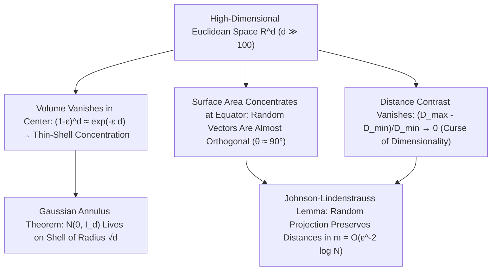

## 1. La desaparición del volumen de la esfera y la «paradoja de las puntas» del hipercubo

Nuestro cerebro evolucionó para orientarse en espacios euclídeos de dos y tres dimensiones ($d=2, 3$). Solemos extrapolar nuestras intuiciones tridimensionales —que una esfera inscrita ocupa gran parte de un cubo, que una distribución normal se agrupa cerca de su media en el origen o que dos direcciones elegidas al azar forman ángulos muy diversos— hacia los espacios de datos de cien, mil o un millón de dimensiones ($\mathbb{R}^d, d \gg 100$). Sin embargo, la matemática moderna demuestra que cuando la dimensión $d$ crece, nuestra intuición geométrica no solo pierde precisión, sino que <strong>se invierte por completo $180^\circ$</strong>.

Analicemos primero el volumen de una bola euclídea de radio $R$ en dimensión $d$: $V_d(R) = \frac{\pi^{d/2}}{\Gamma(d/2 + 1)}R^d$. Como la función Gamma del denominador crece de forma superexponencial como $(d/2e)^{d/2}$, el volumen de la bola unidad ($R=1$) alcanza su <strong>máximo absoluto en $d = 5$ ($V_5 \approx 5.2638$)</strong> y luego decrece monótonamente: cuando $d \to \infty$, <strong>el volumen de la bola unidad tiende exactamente a cero ($\lim_{d\to\infty} V_d(1) = 0$)</strong>. Mientras tanto, el volumen del hipercubo circunscrito $[-1, 1]^d$ crece como $2^d$ y la distancia del centro a sus $2^d$ vértices es $\sqrt{d}$. Casi todo el volumen del hipercubo reside en sus $2^d$ esquinas puntiagudas; en la célebre <strong>paradoja del empaquetamiento de esferas</strong>, la esfera central tangente a las $2^d$ esferas de radio $1/2$ inscritas en los ortantes de $[-1,1]^d$ tiene radio $r_c = \frac{\sqrt{d}-1}{2}$, que supera $1$ para $d \ge 10$: <strong>¡la esfera encerrada en el centro del cubo atraviesa las paredes del hipercubo hacia el exterior!</strong>

$$
V_d(R) = \frac{\pi^{d/2}}{\Gamma\!\left(\frac{d}{2} + 1\right)} R^d, \qquad \lim_{d \to \infty} V_d(1) = 0, \qquad \frac{V_d\big((1-\varepsilon)R\big)}{V_d(R)} = (1 - \varepsilon)^d \le e^{-\varepsilon d} \xrightarrow{d\to\infty} 0
$$

---

## 2. Concentración de la medida: naranjas huecas y vectores aleatorios ortogonales

¿Dónde se aloja el volumen dentro de una bola de alta dimensión? Dado que la razón de volumen entre una bola interior de radio $(1-\varepsilon)R$ y la bola total es $(1-\varepsilon)^d \le e^{-\varepsilon d}$, en dimensión $d = 1000$, incluso tomando $\varepsilon = 0.01$, el $99\%$ interior del radio apenas contiene el $0.99^{1000} \approx 0.000043$ del volumen. Es decir, <strong>más del $99.995\%$ del volumen de una esfera de alta dimensión se comprime en una finísima corteza superficial (Thin Shell) de espesor $O(1/d)$</strong>, mientras que su interior está prácticamente vacío.

Del mismo modo, el área superficial presenta una extraordinaria <strong>concentración ecuatorial</strong>: fijado cualquier polo norte $\mathbf{p}$, casi toda el área de $S^{d-1}$ se concentra en una franja de anchura $\pm O(1/\sqrt{d})$ alrededor del ecuador. De aquí se sigue que dos vectores unitarios independientes elegidos al azar $\mathbf{u}, \mathbf{v} \in S^{d-1}$ tienen producto escalar $\langle \mathbf{u}, \mathbf{v} \rangle$ con varianza $1/d$ ($\mathbb{P}(|\langle \mathbf{u}, \mathbf{v} \rangle| \ge \varepsilon) \le 2e^{-d\varepsilon^2/2}$): <strong>en alta dimensión, dos vectores aleatorios cualesquiera son casi con certeza ortogonales ($	heta \approx 90^\circ$)</strong>. Incluso la distribución normal estándar $\mathbf{x} \sim \mathcal{N}(\mathbf{0}, I_d)$ abandona su moda en el origen $\mathbf{0}$ y, por el <strong>teorema del anillo gaussiano (Gaussian Annulus Theorem)</strong>, se concentra sobre una cáscara esférica de radio $\sqrt{d} \pm O(1)$:

$$
\mathbb{P}\!\left( \big| \langle \mathbf{u}, \mathbf{v} \rangle \big| \ge \varepsilon \right) \le 2 \exp\!\left(-\frac{d \varepsilon^2}{2}\right), \qquad \|\mathbf{x}\|_2 = \sqrt{\sum_{i=1}^d x_i^2} = \sqrt{d} \pm \mathcal{O}(1) \quad (\mathbf{x} \sim \mathcal{N}(\mathbf{0}, I_d))
$$

---

## 3. La maldición de la dimensionalidad y el colapso del contraste de distancias

Acuñada por Richard Bellman en 1957, la <strong>maldición de la dimensionalidad (Curse of Dimensionality)</strong> refleja la explosión exponencial del muestreo: una rejilla de paso $\varepsilon = 0.1$ en $[0,1]^d$ exige $N = 10^d$ puntos ($10^{100}$ en dimensión $100$). Peor aún, Beyer et al. (1999) demostraron el <strong>colapso del contraste de distancias</strong>: cuando $d \to \infty$, la diferencia relativa entre la distancia al vecino más cercano $D_{\min}$ y al más lejano $D_{\max}$ tiende a cero ($\lim_{d\to\infty} \frac{D_{\max} - D_{\min}}{D_{\min}} = 0$). Todos los puntos se vuelven casi equidistantes, inutilizando la búsqueda ingenua de $k$ vecinos más cercanos ($k$-NN) y generando el <strong>fenómeno de hubness</strong>.

---

## 4. El rescate: hipótesis de la variedad y el lema de Johnson-Lindenstrauss (JL)

¿Por qué entonces el aprendizaje profundo, los grandes modelos de lenguaje (LLM) y las bases de datos vectoriales funcionan con éxito en miles de dimensiones? Primero, por la <strong>hipótesis de la variedad (Manifold Hypothesis)</strong>, según la cual los datos reales habitan cerca de una subvariedad de baja dimensión intrínseca $d_{\text{int}} \ll d$; segundo, gracias al milagro mismo de la concentración de la medida: el <strong>lema de Johnson-Lindenstrauss (1984)</strong>.

El lema JL demuestra que proyectando linealmente $N$ puntos de $\mathbb{R}^d$ mediante una matriz aleatoria gaussiana a un subespacio de dimensión $m = O(\varepsilon^{-2} \log N)$, todas las distancias mutuas se preservan dentro de un factor $(1 \pm \varepsilon)$, donde $m$ es <strong>totalmente independiente de la dimensión original $d$</strong>.

| Propiedad geométrica y probabilística | Intuición en baja dimensión ($d = 2, 3$) | Realidad matemática en alta dimensión ($d \gg 100$) |
| :--- | :--- | :--- |
| <strong>Distribución de volumen en la esfera</strong> | Repartido entre el centro y la superficie | <strong>$>99.99\%$ concentrado en una corteza superficial de grosor $O(1/d)$</strong> |
| <strong>Ángulo entre dos vectores aleatorios</strong> | Amplia distribución entre $0^\circ$ y $180^\circ$ | <strong>Concentrado en $90^\circ \pm O(1/\sqrt{d})$ con probabilidad $1 - 2e^{-d\varepsilon^2/2}$</strong> |
| <strong>Normal estándar $\mathcal{N}(\mathbf{0}, I_d)$</strong> | Agrupada alrededor de la media $\mathbf{0}$ | <strong>Origen vacío; masa concentrada en la cáscara de radio $\sqrt{d} \pm O(1)$</strong> |
| <strong>Contraste $(D_{\max}-D_{\min})/D_{\min}$</strong> | Vecino cercano y lejano bien diferenciados | <strong>Tiende a $0$ (todos los puntos se vuelven casi equidistantes)</strong> |

$$
(1 - \varepsilon) \|\mathbf{x}_i - \mathbf{x}_j\|_2^2 \le \|f(\mathbf{x}_i) - f(\mathbf{x}_j)\|_2^2 \le (1 + \varepsilon) \|\mathbf{x}_i - \mathbf{x}_j\|_2^2, \qquad m = \mathcal{O}\!\left(\frac{\log N}{\varepsilon^2}\right)
$$

