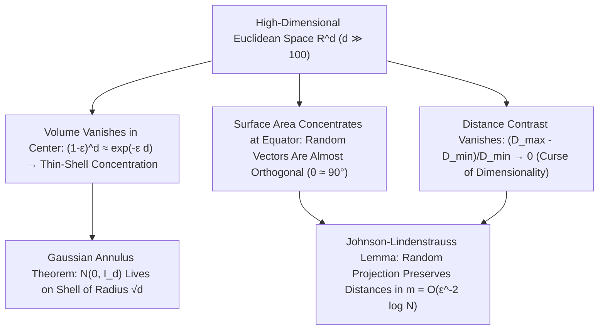

## 1. L'évanouissement du volume de la boule et le « paradoxe des pointes » de l'hypercube

Notre cerveau a évolué pour naviguer dans des espaces euclidiens à deux et trois dimensions ($d=2, 3$). Nous projetons spontanément nos intuitions tridimensionnelles — qu'une sphère inscrite occupe l'essentiel du volume d'un cube, qu'une loi normale se concentre autour de sa moyenne à l'origine, ou que deux directions tirées au hasard forment des angles variés — vers les espaces de données à cent, mille ou un million de dimensions ($\mathbb{R}^d, d \gg 100$). Or les mathématiques modernes démontrent qu'en grande dimension, notre intuition géométrique ne devient pas seulement approximative : elle <strong>s'inverse radicalement à $180^\circ$</strong> !

Considérons d'abord le volume de la boule euclidienne de rayon $R$ en dimension $d$ : $V_d(R) = \frac{\pi^{d/2}}{\Gamma(d/2 + 1)}R^d$. La fonction Gamma au dénominateur croissant de manière super-exponentielle comme $(d/2e)^{d/2}$, le volume de la boule unité ($R=1$) atteint son <strong>maximum absolu en $d = 5$ ($V_5 \approx 5{,}2638$)</strong> puis décroît inexorablement : lorsque $d \to \infty$, <strong>le volume de la boule unité tend exactement vers zéro ($\lim_{d\to\infty} V_d(1) = 0$)</strong> ! Pendant ce temps, le volume de l'hypercube circonscrit $[-1, 1]^d$ explose en $2^d$ et la distance du centre aux $2^d$ sommets vaut $\sqrt{d}$. Presque tout le volume d'un hypercube de grande dimension est logé dans ses $2^d$ coins effilés ; dans le célèbre <strong>paradoxe de l'empilement de sphères</strong>, la sphère centrale tangente aux $2^d$ sphères de rayon $1/2$ placées dans les orthants de $[-1,1]^d$ possède un rayon $r_c = \frac{\sqrt{d}-1}{2}$ qui dépasse $1$ dès $d = 10$ : <strong>la sphère enfermée au cœur du cube déborde hors des parois de l'hypercube</strong> !

$$
V_d(R) = \frac{\pi^{d/2}}{\Gamma\!\left(\frac{d}{2} + 1\right)} R^d, \qquad \lim_{d \to \infty} V_d(1) = 0, \qquad \frac{V_d\big((1-\varepsilon)R\big)}{V_d(R)} = (1 - \varepsilon)^d \le e^{-\varepsilon d} \xrightarrow{d\to\infty} 0
$$

---

## 2. Concentration de la mesure : oranges creuses et vecteurs aléatoires orthogonaux

Où se répartit le volume à l'intérieur d'une boule de grande dimension ? Le rapport de volume entre une boule intérieure de rayon $(1-\varepsilon)R$ et la boule totale étant $(1-\varepsilon)^d \le e^{-\varepsilon d}$, en dimension $d = 1000$, même pour $\varepsilon = 0{,}01$, les $99\%$ intérieurs du rayon ne contiennent que $0{,}99^{1000} \approx 0{,}000043$ du volume total ! Autrement dit, <strong>plus de $99{,}995\%$ du volume d'une boule de grande dimension est comprimé dans une pellicule superficielle (Thin Shell) d'épaisseur $O(1/d)$</strong>, tandis que l'intérieur est presque entièrement vide !

De même, l'aire sur l'hypersphère présente une spectaculaire <strong>concentration équatoriale</strong> : pour tout pôle Nord fixé $\mathbf{p}$, la quasi-totalité de la surface de $S^{d-1}$ se concentre dans une bande de largeur $\pm O(1/\sqrt{d})$ autour de l'équateur. Il en résulte que deux vecteurs unitaires indépendants tirés uniformément au hasard $\mathbf{u}, \mathbf{v} \in S^{d-1}$ ont un produit scalaire $\langle \mathbf{u}, \mathbf{v} \rangle$ de variance $1/d$ ($\mathbb{P}(|\langle \mathbf{u}, \mathbf{v} \rangle| \ge \varepsilon) \le 2e^{-d\varepsilon^2/2}$) : <strong>en grande dimension, deux vecteurs aléatoires sont presque sûrement quasi orthogonaux ($	heta \approx 90^\circ$)</strong> ! Même la loi normale standard $\mathbf{x} \sim \mathcal{N}(\mathbf{0}, I_d)$ déserte son mode à l'origine $\mathbf{0}$ pour se concentrer, selon le <strong>théorème de l'anneau gaussien (Gaussian Annulus Theorem)</strong>, sur une coquille sphérique de rayon $\sqrt{d} \pm O(1)$ :

$$
\mathbb{P}\!\left( \big| \langle \mathbf{u}, \mathbf{v} \rangle \big| \ge \varepsilon \right) \le 2 \exp\!\left(-\frac{d \varepsilon^2}{2}\right), \qquad \|\mathbf{x}\|_2 = \sqrt{\sum_{i=1}^d x_i^2} = \sqrt{d} \pm \mathcal{O}(1) \quad (\mathbf{x} \sim \mathcal{N}(\mathbf{0}, I_d))
$$

---

## 3. La malédiction de la dimensionnalité et l'effondrement du contraste des distances

Formulée par Richard Bellman en 1957, la <strong>malédiction de la dimensionnalité (Curse of Dimensionality)</strong> traduit l'explosion exponentielle de l'échantillonnage : un maillage de pas $\varepsilon = 0{,}1$ sur $[0,1]^d$ exige $N = 10^d$ points ($10^{100}$ en dimension $100$). Plus grave encore, Beyer et al. (1999) ont démontré l'<strong>effondrement du contraste des distances</strong> : lorsque $d \to \infty$, l'écart relatif entre le plus proche voisin $D_{\min}$ et le point le plus éloigné $D_{\max}$ tend vers zéro ($\lim_{d\to\infty} \frac{D_{\max} - D_{\min}}{D_{\min}} = 0$). Tous les points deviennent équidistants, ruinant la recherche naïve des $k$ plus proches voisins ($k$-NN) et engendrant le <strong>phénomène de hubness</strong>.

---

## 4. Le salut : hypothèse de la variété et lemme de projection aléatoire de Johnson-Lindenstrauss

Pourquoi l'apprentissage profond, les grands modèles de langage (LLM) et les bases de données vectorielles fonctionnent-ils malgré tout dans des espaces à des milliers de dimensions ? D'une part grâce à l'<strong>hypothèse de la variété (Manifold Hypothesis)</strong>, selon laquelle les données réelles résident sur une sous-variété de faible dimension intrinsèque $d_{\text{int}} \ll d$ ; d'autre part grâce au miracle même de la concentration de la mesure : le <strong>lemme de Johnson-Lindenstrauss (1984)</strong> !

Ce lemme prouve qu'en projetant linéairement $N$ points de $\mathbb{R}^d$ via une matrice aléatoire gaussienne vers un sous-espace de dimension $m = O(\varepsilon^{-2} \log N)$, toutes les distances mutuelles sont préservées à $(1 \pm \varepsilon)$ près — où $m$ est <strong>totalement indépendant de la dimension ambiante $d$</strong> !

| Propriété géométrique & probabiliste | Intuition en basse dimension ($d = 2, 3$) | Réalité mathématique en grande dimension ($d \gg 100$) |
| :--- | :--- | :--- |
| <strong>Répartition du volume dans la boule</strong> | Réparti entre le centre et la surface | <strong>$>99{,}99\%$ concentré dans une écorce mince d'épaisseur $O(1/d)$</strong> |
| <strong>Angle entre deux vecteurs aléatoires</strong> | Distribué largement de $0^\circ$ à $180^\circ$ | <strong>Concentré à $90^\circ \pm O(1/\sqrt{d})$ avec probabilité $1 - 2e^{-d\varepsilon^2/2}$</strong> |
| <strong>Loi normale standard $\mathcal{N}(\mathbf{0}, I_d)$</strong> | Concentrée autour de la moyenne $\mathbf{0}$ | <strong>Origine vide ; masse concentrée sur la coquille de rayon $\sqrt{d} \pm O(1)$</strong> |
| <strong>Contraste $(D_{\max}-D_{\min})/D_{\min}$</strong> | Voisin proche et lointain bien distincts | <strong>Tend vers $0$ (tous les points deviennent quasi équidistants)</strong> |

$$
(1 - \varepsilon) \|\mathbf{x}_i - \mathbf{x}_j\|_2^2 \le \|f(\mathbf{x}_i) - f(\mathbf{x}_j)\|_2^2 \le (1 + \varepsilon) \|\mathbf{x}_i - \mathbf{x}_j\|_2^2, \qquad m = \mathcal{O}\!\left(\frac{\log N}{\varepsilon^2}\right)
$$

