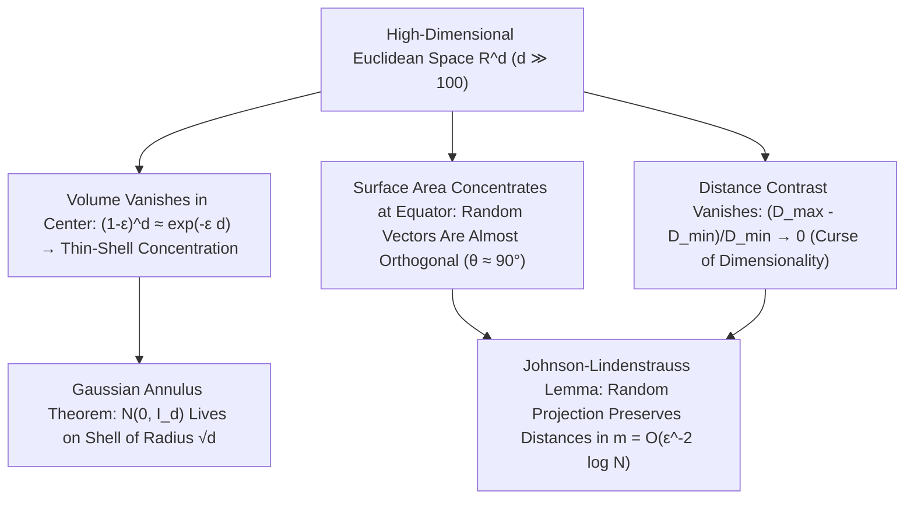

## 1. उच्च-आयामी गोले के आयतन का लोप और हाइपरक्यूब का 'नुकीले कोनों का विरोधाभास'

मानव मस्तिष्क का विकास द्वि-आयामी और त्रि-आयामी यूक्लिडीय समष्टि ($d=2, 3$) में जीवित रहने के लिए हुआ है। हम सहज रूप से अपने त्रि-आयामी ज्यामितीय अंतर्ज्ञान — कि एक अंतर्निहित गोला घन के अधिकांश आयतन को घेरता है, कि प्रसामान्य बंटन (normal distribution) मूलबिंदु पर अपने माध्य के पास केंद्रित होता है, या कि दो यादृच्छिक दिशाएँ विविध कोण बनाती हैं — को सैकड़ों, हज़ारों या लाखों आयामों वाले डेटा समष्टि ($\mathbb{R}^d, d \gg 100$) पर लागू कर देते हैं। किंतु आधुनिक गणित सिद्ध करता है कि जैसे ही आयाम $d$ बढ़ता है, हमारा निम्न-आयामी अंतर्ज्ञान केवल अशुद्ध ही नहीं होता, बल्कि <strong>$180^\circ$ उलट जाता है</strong>!

सबसे पहले $d$-आयामी समष्टि में $R$ त्रिज्या वाले गोले के आयतन सूत्र $V_d(R) = \frac{\pi^{d/2}}{\Gamma(d/2 + 1)}R^d$ पर विचार करें। चूँकि हर (denominator) में स्थित गामा फलन $(d/2e)^{d/2}$ की भाँति अति-घातांकीय (super-exponential) रूप से बढ़ता है, इसलिए इकाई गोले ($R=1$) का आयतन <strong>$d = 5$ पर अपने अधिकतम मान ($V_5 \approx 5.2638$)</strong> पर पहुँचता है और उसके बाद निरंतर घटता जाता है: जब $d \to \infty$, तो <strong>उच्च-आयामी इकाई गोले का आयतन शून्य की ओर अग्रसर होता है ($\lim_{d\to\infty} V_d(1) = 0$)</strong>! वहीं परिगत हाइपरक्यूब $[-1, 1]^d$ का आयतन $2^d$ के रूप में विस्फोटक रूप से बढ़ता है और केंद्र से इसके $2^d$ शीर्षों की दूरी $\sqrt{d}$ होती है। अर्थात् हाइपरक्यूब का लगभग संपूर्ण आयतन उसके $2^d$ नुकीले कोनों में सिमट जाता है; प्रसिद्ध <strong>गोला संकुलन विरोधाभास (Sphere Packing Paradox)</strong> में $[-1,1]^d$ के $2^d$ अष्टांशों में रखे $1/2$ त्रिज्या के गोलों को स्पर्श करने वाले केंद्रीय गोले की त्रिज्या $r_c = \frac{\sqrt{d}-1}{2}$ होती है, जो $d \ge 10$ होने पर $1$ से बड़ी हो जाती है — अर्थात् <strong>घन के भीतर बंद केंद्रीय गोला हाइपरक्यूब की दीवारों को भेदकर बाहर निकल जाता है</strong>!

$$
V_d(R) = \frac{\pi^{d/2}}{\Gamma\!\left(\frac{d}{2} + 1\right)} R^d, \qquad \lim_{d \to \infty} V_d(1) = 0, \qquad \frac{V_d\big((1-\varepsilon)R\big)}{V_d(R)} = (1 - \varepsilon)^d \le e^{-\varepsilon d} \xrightarrow{d\to\infty} 0
$$

---

## 2. माप संकेंद्रण (Concentration of Measure): खोखला संतरा और परस्पर लंबवत यादृच्छिक सदिश

उच्च-आयामी गोले के भीतर आयतन कहाँ स्थित होता है? चूँकि $(1-\varepsilon)R$ त्रिज्या वाले आंतरिक गोले और संपूर्ण गोले के आयतन का अनुपात $(1-\varepsilon)^d \le e^{-\varepsilon d}$ है, इसलिए $d = 1000$ आयामों में $\varepsilon = 0.01$ लेने पर भी भीतर की $99\%$ त्रिज्या में कुल आयतन का केवल $0.99^{1000} \approx 0.000043$ भाग ही आता है! दूसरे शब्दों में, <strong>उच्च-आयामी गोले का $99.995\%$ से अधिक आयतन सतह के ठीक नीचे $O(1/d)$ मोटाई के एक अत्यंत पतले छिलके (Thin Shell) में सिमटा होता है</strong>, जबकि गोले का भीतरी भाग लगभग पूरी तरह खाली होता है!

इसी प्रकार, गोले का पृष्ठीय क्षेत्रफल <strong>विषुवतीय संकेंद्रण (Equatorial Concentration)</strong> प्रदर्शित करता है: किसी भी उत्तरी ध्रुव $\mathbf{p}$ को स्थिर करने पर $S^{d-1}$ का लगभग संपूर्ण क्षेत्रफल विषुवत रेखा के $\pm O(1/\sqrt{d})$ चौड़ाई की पट्टी में केंद्रित होता है। इससे यह आश्चर्यजनक परिणाम निकलता है कि दो स्वतंत्र यादृच्छिक इकाई सदिशों $\mathbf{u}, \mathbf{v} \in S^{d-1}$ का अदिश गुणनफल $\langle \mathbf{u}, \mathbf{v} \rangle$ प्रसरण $1/d$ वाला बंटन रखता है ($\mathbb{P}(|\langle \mathbf{u}, \mathbf{v} \rangle| \ge \varepsilon) \le 2e^{-d\varepsilon^2/2}$): <strong>उच्च-आयामी समष्टि में कोई भी दो यादृच्छिक सदिश लगभग निश्चित रूप से परस्पर लंबवत ($	heta \approx 90^\circ$) होते हैं</strong>! यहाँ तक कि मानक गाउसीय बंटन $\mathbf{x} \sim \mathcal{N}(\mathbf{0}, I_d)$ भी मूलबिंदु $\mathbf{0}$ को छोड़कर <strong>गाउसीय वलय प्रमेय (Gaussian Annulus Theorem)</strong> के अनुसार $\sqrt{d} \pm O(1)$ त्रिज्या के पतले गोलीय खोल पर केंद्रित हो जाता है:

$$
\mathbb{P}\!\left( \big| \langle \mathbf{u}, \mathbf{v} \rangle \big| \ge \varepsilon \right) \le 2 \exp\!\left(-\frac{d \varepsilon^2}{2}\right), \qquad \|\mathbf{x}\|_2 = \sqrt{\sum_{i=1}^d x_i^2} = \sqrt{d} \pm \mathcal{O}(1) \quad (\mathbf{x} \sim \mathcal{N}(\mathbf{0}, I_d))
$$

---

## 3. आयामों का अभिशाप (Curse of Dimensionality) और दूरी वैषम्य का पतन

1957 में रिचर्ड बेलमैन द्वारा प्रतिपादित <strong>आयामों का अभिशाप (Curse of Dimensionality)</strong> नमूनों की घातांकीय आवश्यकता को दर्शाता है: $[0,1]^d$ में $\varepsilon = 0.1$ अंतराल के ग्रिड के लिए $N = 10^d$ बिंदुओं की आवश्यकता होती है ($d=100$ पर $10^{100}$ बिंदु)। इससे भी गंभीर बेयर आदि (Beyer et al., 1999) द्वारा सिद्ध <strong>दूरी वैषम्य का लोप</strong> है: जब $d \to \infty$, तो निकटतम पड़ोसी दूरी $D_{\min}$ और दूरतम दूरी $D_{\max}$ का सापेक्ष अंतर शून्य हो जाता है ($\lim_{d\to\infty} \frac{D_{\max} - D_{\min}}{D_{\min}} = 0$)। सभी बिंदु एक-दूसरे से लगभग समान दूरी पर हो जाते हैं, जिससे साधारण $k$-निकटतम पड़ोसी ($k$-NN) खोज विफल हो जाती है और <strong>हबनेस परिघटना (Hubness Phenomenon)</strong> जन्म लेती है।

---

## 4. समाधान: मैनिफोल्ड परिकल्पना और जॉनसन-लिंडनस्ट्रॉस (JL) यादृच्छिक प्रक्षेपण प्रमेयिका

फिर आधुनिक डीप लर्निंग, बड़े भाषा मॉडल (LLMs) और वेक्टर डेटाबेस हज़ारों आयामों में इतनी सफलतापूर्वक कैसे कार्य करते हैं? पहला कारण <strong>मैनिफोल्ड परिकल्पना (Manifold Hypothesis)</strong> है, जिसके अनुसार वास्तविक डेटा निम्न आंतरिक आयाम $d_{\text{int}} \ll d$ वाले उप-मैनिफोल्ड के पास स्थित होता है; और दूसरा कारण स्वयं माप संकेंद्रण का चमत्कार — <strong>जॉनसन-लिंडनस्ट्रॉस प्रमेयिका (Johnson-Lindenstrauss Lemma, 1984)</strong> है!

JL प्रमेयिका सिद्ध करती है कि $\mathbb{R}^d$ के $N$ बिंदुओं को एक यादृच्छिक गाउसीय आव्यूह द्वारा $m = O(\varepsilon^{-2} \log N)$ आयाम की उप-समष्टि में रैखिक रूप से प्रक्षेपित करने पर सभी पारस्परिक दूरियाँ $(1 \pm \varepsilon)$ गुणक के भीतर सुरक्षित रहती हैं — जहाँ लक्ष्य आयाम $m$ <strong>मूल आयाम $d$ से पूर्णतः स्वतंत्र है</strong>!

| ज्यामितीय एवं प्रायिकता गुण | निम्न-आयामी अंतर्ज्ञान ($d = 2, 3$) | उच्च-आयामी गणितीय वास्तविकता ($d \gg 100$) |
| :--- | :--- | :--- |
| <strong>गोले के भीतर आयतन वितरण</strong> | केंद्र और सतह के बीच समान रूप से वितरित | <strong>$>99.99\%$ सतह के नीचे $O(1/d)$ मोटाई के पतले खोल में केंद्रित</strong> |
| <strong>दो यादृच्छिक सदिशों के बीच कोण</strong> | $0^\circ$ से $180^\circ$ तक विस्तृत | <strong>$1 - 2e^{-d\varepsilon^2/2}$ प्रायिकता के साथ $90^\circ \pm O(1/\sqrt{d})$ पर केंद्रित (लंबवत)</strong> |
| <strong>मानक गाउसीय बंटन $\mathcal{N}(\mathbf{0}, I_d)$</strong> | माध्य मूलबिंदु $\mathbf{0}$ के पास सघन | <strong>मूलबिंदु रिक्त; द्रव्यमान $\sqrt{d} \pm O(1)$ त्रिज्या के खोल पर केंद्रित</strong> |
| <strong>दूरी वैषम्य $(D_{\max}-D_{\min})/D_{\min}$</strong> | निकटतम और दूरतम बिंदु स्पष्टतः भिन्न | <strong>$0$ की ओर अग्रसर (सभी बिंदु लगभग समदूरस्थ)</strong> |

$$
(1 - \varepsilon) \|\mathbf{x}_i - \mathbf{x}_j\|_2^2 \le \|f(\mathbf{x}_i) - f(\mathbf{x}_j)\|_2^2 \le (1 + \varepsilon) \|\mathbf{x}_i - \mathbf{x}_j\|_2^2, \qquad m = \mathcal{O}\!\left(\frac{\log N}{\varepsilon^2}\right)
$$

