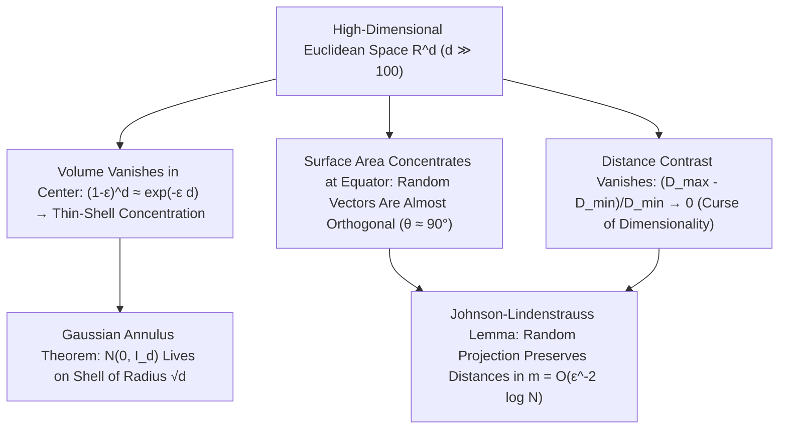

## 1. Hilangnya Volume Bola dan «Paradoks Sudut Runcing» Hiperkubus

Otak manusia berevolusi untuk memahami ruang Euklides dua dan tiga dimensi ($d=2, 3$). Kita sering memproyeksikan intuisi tiga dimensi — bahwa bola dalam mengisi sebagian besar ruang kubus, bahwa distribusi normal berkumpul di sekitar rata-rata di titik asal, atau bahwa dua arah acak membentuk sudut yang beragam — ke ruang data berdimensi ratusan, ribuan, hingga jutaan ($\mathbb{R}^d, d \gg 100$). Namun matematika modern membuktikan bahwa ketika dimensi $d$ membesar, intuisi dimensi rendah kita tidak sekadar meleset, melainkan <strong>berbalik $180^\circ$ secara total</strong>!

Mari kita tinjau rumus volume bola Euklides berjari-jari $R$ di dimensi $d$: $V_d(R) = \frac{\pi^{d/2}}{\Gamma(d/2 + 1)}R^d$. Karena fungsi Gamma pada penyebut tumbuh secara supereksponensial seperti $(d/2e)^{d/2}$, volume bola satuan ($R=1$) mencapai <strong>maksimum mutlak pada $d = 5$ ($V_5 \approx 5,2638$)</strong> lalu menyusut secara monoton: saat $d \to \infty$, <strong>volume bola satuan berdimensi tinggi menuju nol ($\lim_{d\to\infty} V_d(1) = 0$)</strong>! Sementara itu, volume hiperkubus luar $[-1, 1]^d$ meledak sebesar $2^d$ dan jarak dari pusat ke $2^d$ titik sudutnya adalah $\sqrt{d}$. Hampir seluruh volume hiperkubus terkonsentrasi di $2^d$ sudut runcingnya; bahkan dalam <strong>paradoks pengepakan bola (Sphere Packing Paradox)</strong>, bola pusat yang terjepit di antara $2^d$ bola sudut berjari-jari $1/2$ di dalam $[-1,1]^d$ memiliki jari-jari $r_c = \frac{\sqrt{d}-1}{2}$ yang melampaui $1$ saat $d \ge 10$: <strong>bola yang terkurung di tengah kubus justru menembus dinding hiperkubus ke luar</strong>!

$$
V_d(R) = \frac{\pi^{d/2}}{\Gamma\!\left(\frac{d}{2} + 1\right)} R^d, \qquad \lim_{d \to \infty} V_d(1) = 0, \qquad \frac{V_d\big((1-\varepsilon)R\big)}{V_d(R)} = (1 - \varepsilon)^d \le e^{-\varepsilon d} \xrightarrow{d\to\infty} 0
$$

---

## 2. Konsentrasi Ukuran (Concentration of Measure): Jeruk Berongga dan Vektor Acak Ortogonal

Di manakah letak volume di dalam bola berdimensi tinggi? Karena rasio volume bola dalam berjari-jari $(1-\varepsilon)R$ terhadap bola utuh adalah $(1-\varepsilon)^d \le e^{-\varepsilon d}$, pada dimensi $d = 1000$, bahkan untuk $\varepsilon = 0,01$, bagian $99\%$ jari-jari terdalam hanya memuat $0,99^{1000} \approx 0,000043$ dari total volume! Artinya, <strong>lebih dari $99,995\%$ volume bola berdimensi tinggi terperas di dalam lapisan kulit tipis (Thin Shell) setebal $O(1/d)$ tepat di bawah permukaan</strong>, sedangkan bagian dalamnya nyaris kosong melompong!

Demikian pula, luas permukaan hipersfera menunjukkan <strong>konsentrasi ekuatorial</strong> yang ekstrem: untuk kutub utara $\mathbf{p}$ mana pun, hampir seluruh luas permukaan $S^{d-1}$ terkonsentrasi di sabuk sempit selebar $\pm O(1/\sqrt{d})$ di sekitar khatulistiwa. Akibatnya, dua vektor satuan acak independen $\mathbf{u}, \mathbf{v} \in S^{d-1}$ memiliki hasil kali dalam $\langle \mathbf{u}, \mathbf{v} \rangle$ dengan varians $1/d$ ($\mathbb{P}(|\langle \mathbf{u}, \mathbf{v} \rangle| \ge \varepsilon) \le 2e^{-d\varepsilon^2/2}$): <strong>di dimensi tinggi, dua vektor acak hampir pasti saling tegak lurus ($	heta \approx 90^\circ$)</strong>! Bahkan distribusi Gaussian standar $\mathbf{x} \sim \mathcal{N}(\mathbf{0}, I_d)$ meninggalkan titik asalnya $\mathbf{0}$ dan menurut <strong>teorema cincin Gaussian (Gaussian Annulus Theorem)</strong> terkonsentrasi pada cangkang bola berjari-jari $\sqrt{d} \pm O(1)$:

$$
\mathbb{P}\!\left( \big| \langle \mathbf{u}, \mathbf{v} \rangle \big| \ge \varepsilon \right) \le 2 \exp\!\left(-\frac{d \varepsilon^2}{2}\right), \qquad \|\mathbf{x}\|_2 = \sqrt{\sum_{i=1}^d x_i^2} = \sqrt{d} \pm \mathcal{O}(1) \quad (\mathbf{x} \sim \mathcal{N}(\mathbf{0}, I_d))
$$

---

## 3. Kutukan Dimensi (Curse of Dimensionality) dan Runtuhnya Kontras Jarak

Dicetuskan oleh Richard Bellman pada tahun 1957, <strong>kutukan dimensi (Curse of Dimensionality)</strong> menggambarkan ledakan eksponensial sampel: kisi seragam berjarak $\varepsilon = 0,1$ pada $[0,1]^d$ membutuhkan $N = 10^d$ titik ($10^{100}$ titik pada $d=100$). Lebih parah lagi, Beyer dkk. (1999) membuktikan <strong>hilangnya kontras jarak</strong>: saat $d \to \infty$, selisih relatif antara jarak ke tetangga terdekat $D_{\min}$ dan tetangga terjauh $D_{\max}$ menuju nol ($\lim_{d\to\infty} \frac{D_{\max} - D_{\min}}{D_{\min}} = 0$). Semua titik menjadi nyaris berjarak sama, melumpuhkan pencarian $k$-tetangga terdekat ($k$-NN) naif dan memicu <strong>fenomena hubness</strong>.

---

## 4. Penyelamatan: Hipotesis Manifold dan Lema Proyeksi Acak Johnson-Lindenstrauss (JL)

Mengapa *deep learning*, model bahasa besar (LLM), dan basis data vektor tetap bekerja cemerlang dalam ribuan dimensi? Pertama, karena <strong>hipotesis manifold (Manifold Hypothesis)</strong>, di mana data dunia nyata berada di dekat sub-manifold berdimensi intrinsik rendah $d_{\text{int}} \ll d$; kedua, berkat keajaiban konsentrasi ukuran itu sendiri: <strong>lema Johnson-Lindenstrauss (1984)</strong>!

Lema JL membuktikan bahwa memproyeksikan $N$ titik di $\mathbb{R}^d$ secara linear menggunakan matriks Gaussian acak ke subruang berdimensi $m = O(\varepsilon^{-2} \log N)$ mampu mempertahankan seluruh jarak berpasangan dalam faktor $(1 \pm \varepsilon)$ — di mana $m$ <strong>sama sekali tidak bergantung pada dimensi awal $d$</strong>!

| Sifat Geometris & Probabilistik | Intuisi Dimensi Rendah ($d = 2, 3$) | Realitas Matematika Dimensi Tinggi ($d \gg 100$) |
| :--- | :--- | :--- |
| <strong>Distribusi Volume Bola</strong> | Merata antara pusat dan permukaan | <strong>$>99,99\%$ terkonsentrasi di kulit tipis setebal $O(1/d)$</strong> |
| <strong>Sudut Dua Vektor Acak</strong> | Tersebar luas dari $0^\circ$ hingga $180^\circ$ | <strong>Terkonsentrasi di $90^\circ \pm O(1/\sqrt{d})$ dengan peluang $1 - 2e^{-d\varepsilon^2/2}$</strong> |
| <strong>Gaussian Standar $\mathcal{N}(\mathbf{0}, I_d)$</strong> | Mengumpul di sekitar rata-rata $\mathbf{0}$ | <strong>Titik asal kosong; massa berada di cangkang berjari-jari $\sqrt{d} \pm O(1)$</strong> |
| <strong>Kontras $(D_{\max}-D_{\min})/D_{\min}$</strong> | Tetangga terdekat & terjauh sangat berbeda | <strong>Menuju $0$ (semua titik menjadi nyaris berjarak sama)</strong> |

$$
(1 - \varepsilon) \|\mathbf{x}_i - \mathbf{x}_j\|_2^2 \le \|f(\mathbf{x}_i) - f(\mathbf{x}_j)\|_2^2 \le (1 + \varepsilon) \|\mathbf{x}_i - \mathbf{x}_j\|_2^2, \qquad m = \mathcal{O}\!\left(\frac{\log N}{\varepsilon^2}\right)
$$

