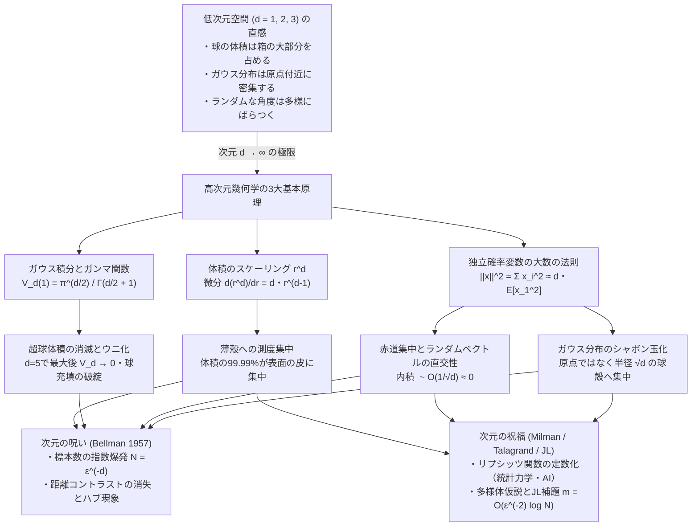
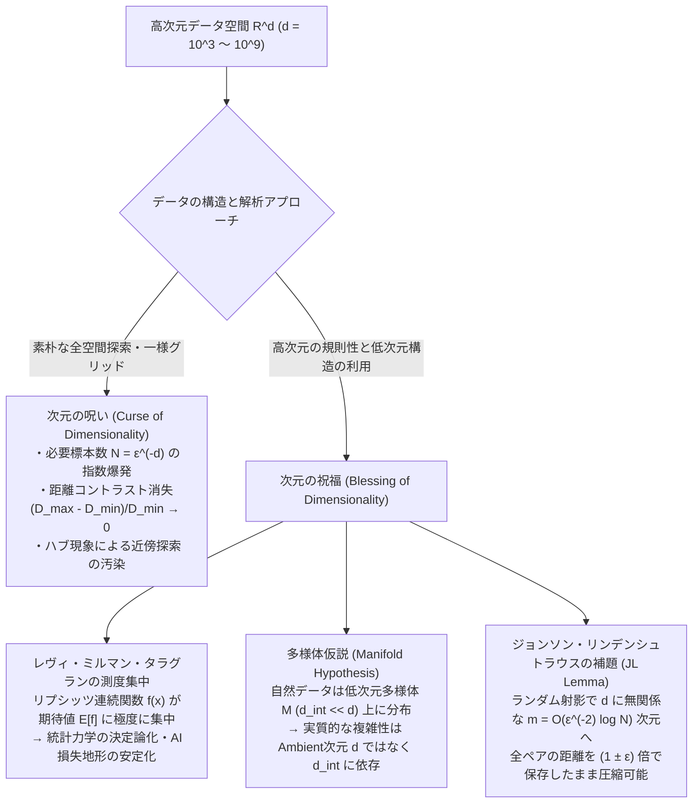

## 1. 導入：3次元の檻と「高次元空間」という異界

私たち人類の脳は、進化の過程で2次元の地表を歩き、3次元の空間（$\mathbb{R}^3$）で獲物を追い、石を投げるために最適化されてきた。そのため、私たちは「球」「立方体」「距離」「角度」「確率分布」といった幾何学的・確率的な概念について、きわめて強固な直感を持っている。たとえば、「箱の中に球を隙間なく詰めれば、箱の大部分は球で満たされる」「オレンジの可食部（果肉）は皮よりもずっと体積が大きい」「正規分布（ガウス分布）に従う乱数を発生させれば、平均値である原点の近くに最も多くの点がプロットされる」といった感覚は、3次元空間においては疑いようのない事実である。

しかし、現代の科学技術が扱う空間は3次元ではない。統計力学における気体分子の位相空間は $d \sim 10^{23}$ 次元であり、ゲノム解析や金融ポートフォリオ最適化では数千〜数万次元、そして現代の大規模言語モデル（LLM）や画像生成AIの埋め込み空間（Embedding Space）では $d = 768, 4096, 12288$ といった高次元ユークリッド空間 $\mathbb{R}^d$ が日常的に計算の舞台となっている。

著名な数学者・計算機科学者であるリチャード・ハミング（Richard Hamming）やヴィ Vitali Milman らが繰り返し警鐘を鳴らしたように、<strong>3次元で培われた幾何学的直感をそのまま高次元空間へ持ち込むことは、致命的な誤謬への最短経路である</strong>。次元 $d$ が $10, 100, 1000$ と増大するとき、私たちが慣れ親しんだユークリッド空間は、まるでSF小説のような異界へと変貌する。

高次元空間で起きる代表的な「5つの反直観的パラドックス」を挙げよう。

1. <strong>超球の体積消滅パラドックス</strong>：半径 $1$ の $d$ 次元単位球の体積 $V_d(1)$ は、$d=5$（約 $5.2638$）で最大値を記録した後、次元が増えるにつれて急速に減少し、$d \to \infty$ で <strong>$0$ へと収束する</strong>。
2. <strong>ウニ化する超立方体と「球充填パラドックス」</strong>：高次元の超立方体は、中心の小さな核から $2^d$ 本の巨大な棘（コーナー）が突き出た「ウニ」のような形状をしており、体積のほぼ $100\%$ が四隅の角に集中する。さらに、1辺 $2$ の超立方体 $[-1,1]^d$ の内部に $2^d$ 個の球を詰め、その真ん中の隙間に内接する中心球を置くと、<strong>$d \ge 10$ で中心球が外側の超立方体の壁を突き破って外部へはみ出す</strong>。
3. <strong>薄殻集中と赤道集中（測度集中現象）</strong>：高次元の球（高次元オレンジ）の体積の $99.99\%$ 以上は、表面からわずか $O(1/d)$ の厚さの「薄皮」の中に存在する。また、球の表面積のほぼすべては「赤道」のごく近傍に集中し、<strong>高次元空間でランダムに選んだ2つのベクトルはほぼ確実に直交（なす角 $\theta \approx 90^\circ$）する</strong>。
4. <strong>ガウス分布のシャボン玉定理（Gaussian Annulus Theorem）</strong>：原点 $\mathbf{0}$ に最大確率密度（モード）を持つ標準正規分布 $\mathcal{N}(\mathbf{0}, I_d)$ からサンプリングを行うと、原点の近くには点はまったく現れず、<strong>半径 $\sqrt{d}$ の薄い球殻（シャボン玉の表面）の上にほぼすべての確率質量が集中する</strong>。
5. <strong>次元の呪い（Curse of Dimensionality）と次元の祝福（Blessing of Dimensionality）</strong>：高次元ではあらゆる2点間の距離がほぼ等しくなり（距離コントラストの崩壊）、素朴な近傍探索が破綻する一方、同じ「測度集中」の性質のおかげで、何億次元ものデータをわずか数百次元へ距離を保ったまま線形射影できる（<strong>ジョンソン・リンデンシュトラウスの補題</strong>）。

本稿では、これら5つの不思議を単なる「数学トリビア」として紹介するのではなく、ガウス積分・ガンマ関数・確率不等式を用いて第一原理から厳密に導出し、それらが互いになぜ必然的な帰結として結びついているのか、そして現代の機械学習やデータサイエンスがいかにして「次元の呪い」を克服しているのかを体系的に解き明かす。

---

## 2. 超球の体積パラドックスと「ウニ化する超立方体」

### 2.1 ガウス積分による $d$ 次元球の体積公式の厳密導出

まず、すべての議論の出発点となる $d$ 次元ユークリッド空間 $\mathbb{R}^d$ における半径 $R$ の超球（$d$-ball）

$$B_d(R) = \left\{ \mathbf{x} = (x_1, x_2, \dots, x_d) \in \mathbb{R}^d \,\middle|\, \|\mathbf{x}\|_2 = \sqrt{\sum_{i=1}^d x_i^2} \le R \right\}$$

の体積 $V_d(R)$ と、その境界である $(d-1)$ 次元超球面（hypersphere）$S^{d-1}(R) = \partial B_d(R)$ の表面積 $A_{d-1}(R)$ を求めよう。多重積分の漸化式を1次元ずつ計算する方法もあるが、最も美しく本質的な導出法は、<strong>$d$ 次元ガウス積分を直交座標系と極座標系（球面座標系）の2通りで評価する方法</strong>である。

直交座標系において、関数 $f(\mathbf{x}) = \exp(-\|\mathbf{x}\|_2^2) = \exp\left(-\sum_{i=1}^d x_i^2\right)$ を $\mathbb{R}^d$ 全体で積分すると、各座標の1次元ガウス積分 $\int_{-\infty}^{\infty} e^{-x^2} dx = \sqrt{\pi}$ の積に完全に変数分離される。

$$I_d = \int_{\mathbb{R}^d} e^{-\|\mathbf{x}\|_2^2} \, d\mathbf{x} = \prod_{i=1}^d \left( \int_{-\infty}^{\infty} e^{-x_i^2} \, dx_i \right) = \left(\sqrt{\pi}\right)^d = \pi^{d/2}$$

一方、同じ積分 $I_d$ を原点からの距離 $r = \|\mathbf{x}\|_2$ の球殻（厚さ $dr$）ごとに積分してみよう。空間のスケール変換の性質から、半径 $r$ の球の体積は単位球の体積 $V_d(1)$ を用いて

$$V_d(r) = V_d(1) r^d$$

と表される。球の体積を半径 $r$ で微分すれば、半径 $r$ の球の表面積 $A_{d-1}(r)$ が得られるから、

$$A_{d-1}(r) = \frac{d}{dr} V_d(r) = d \cdot V_d(1) r^{d-1} = \omega_{d-1} r^{d-1} \qquad \left(\text{ただし } \omega_{d-1} \equiv A_{d-1}(1) = d \cdot V_d(1)\right)$$

である。したがって、ガウス積分 $I_d$ を動径 $r \in [0, \infty)$ について積分すると、

$$I_d = \int_0^\infty A_{d-1}(r) e^{-r^2} \, dr = d \cdot V_d(1) \int_0^\infty r^{d-1} e^{-r^2} \, dr$$

となる。ここで変数変換 $t = r^2$（すなわち $r = t^{1/2}, \, dr = \frac{1}{2} t^{-1/2} dt$）を施すと、オイラーのガンマ関数 $\Gamma(z) = \int_0^\infty t^{z-1} e^{-t} dt$ がそのまま現れる。

$$I_d = d \cdot V_d(1) \int_0^\infty t^{\frac{d-1}{2}} e^{-t} \left(\frac{1}{2} t^{-1/2} \, dt\right) = \frac{d}{2} V_d(1) \int_0^\infty t^{\frac{d}{2} - 1} e^{-t} \, dt = V_d(1) \cdot \frac{d}{2} \Gamma\left(\frac{d}{2}\right)$$

ガンマ関数の基本性質 $z\Gamma(z) = \Gamma(z+1)$ より $\frac{d}{2}\Gamma\left(\frac{d}{2}\right) = \Gamma\left(\frac{d}{2} + 1\right)$ であるから、直交座標系での結果 $I_d = \pi^{d/2}$ と等置することで、<strong>$d$ 次元球の体積公式と表面積公式</strong>がただちに得られる。

$$V_d(R) = \frac{\pi^{d/2}}{\Gamma\left(\frac{d}{2} + 1\right)} R^d, \qquad A_{d-1}(R) = \frac{2\pi^{d/2}}{\Gamma\left(\frac{d}{2}\right)} R^{d-1}$$

---

### 2.2 なぜ単位球の体積は $d=5$ で最大となり、その後 $0$ へ消滅するのか？

この美しい公式 $V_d(1) = \frac{\pi^{d/2}}{\Gamma(d/2 + 1)}$ に具体的な次元 $d$ を代入したとき、私たちの直感は最初の衝撃を受ける。ガンマ関数の性質から、2次元離れた球の体積の間には次の単純な漸化式が成り立つ。

$$V_d(1) = \frac{\pi^{d/2}}{\frac{d}{2}\Gamma\left(\frac{d}{2}\right)} = \frac{2\pi}{d} \cdot \frac{\pi^{(d-2)/2}}{\Gamma\left(\frac{d-2}{2} + 1\right)} = \frac{2\pi}{d} V_{d-2}(1)$$

この漸化式の係数 $\frac{2\pi}{d}$ に注目してほしい。円周率の2倍は $2\pi \approx 6.28318$ である。したがって、
- $d \le 6$ の間は、乗数 $\frac{2\pi}{d} > 1$ であるため、次元が2つ上がるごとに体積は増加する。
- $d \ge 7$ になると、乗数 $\frac{2\pi}{d} < 1$ に転じるため、次元が上がるたびに体積は縮小し始める。
- 偶数系列（$V_2 = \pi \approx 3.1416 \to V_4 = \frac{\pi^2}{2} \approx 4.9348 \to V_6 = \frac{\pi^3}{6} \approx 5.1677$）と奇数系列（$V_1 = 2 \to V_3 = \frac{4\pi}{3} \approx 4.1888 \to V_5 = \frac{8\pi^2}{15} \approx 5.2638 \to V_7 = \frac{16\pi^3}{105} \approx 4.7248$）を比較すると、<strong>整数次元における単位球の体積 $V_d(1)$ は $d = 5$ で最大値 $\frac{8\pi^2}{15} \approx 5.26379$ をとる</strong>（連続変数として微分すれば $d \approx 5.2569$ で極大となる）。また、単位球の表面積 $A_{d-1}(1) = d \cdot V_d(1)$ は $d = 7$（6次元球面 $S^6$）で最大値 $\frac{16\pi^3}{15} \approx 33.0734$ を記録した後、同じく $0$ へと減少する。

さらに $d \to \infty$ の極限における減衰速度を調べるため、スターリングの近似公式 $\Gamma(z+1) \sim \sqrt{2\pi z}\left(\frac{z}{e}\right)^z$ を $z = d/2$ に適用しよう。

$$V_d(1) \sim \frac{\pi^{d/2}}{\sqrt{\pi d} \left(\frac{d}{2e}\right)^{d/2}} = \frac{1}{\sqrt{\pi d}} \left( \frac{2\pi e}{d} \right)^{d/2}$$

分母に $d^{d/2}$ という超指数関数（階乗オーダー）の成長項があるため、分子の定数のべき乗 $(2\pi e)^{d/2} \approx (17.079)^{d/2}$ は $d > 2\pi e \approx 17.08$ を超えた瞬間から圧倒され、$V_d(1)$ は猛烈なスピードで $0$ へと崩壊する。

| 次元 $d$ | 単位球の体積 $V_d(1)$ | 単位球の表面積 $A_{d-1}(1)$ | 外接超立方体の体積 $2^d$ | 体積比 $V_d(1) / 2^d$ | 立方体の頂点距離 $\sqrt{d}$ | 体積が $1$ になる球の半径 $R_d$ |
| :--- | :--- | :--- | :--- | :--- | :--- | :--- |
| $1$ | $2.0000$ | $2.0000$ | $2$ | $1.0000$ ($100\%$) | $1.000$ | $0.500$ |
| $2$ | $\pi \approx 3.1416$ | $2\pi \approx 6.2832$ | $4$ | $0.7854$ ($78.5\%$) | $1.414$ | $0.564$ |
| $3$ | $\frac{4}{3}\pi \approx 4.1888$ | $4\pi \approx 12.5664$ | $8$ | $0.5236$ ($52.4\%$) | $1.732$ | $0.620$ |
| $4$ | $\frac{1}{2}\pi^2 \approx 4.9348$ | $2\pi^2 \approx 19.7392$ | $16$ | $0.3084$ ($30.8\%$) | $2.000$ | $0.671$ |
| <strong>$5$ (体積最大)</strong> | <strong>$\frac{8}{15}\pi^2 \approx 5.2638$</strong> | $\frac{8}{3}\pi^2 \approx 26.3189$ | $32$ | $0.1645$ ($16.5\%$) | $2.236$ | $0.717$ |
| $6$ | $\frac{1}{6}\pi^3 \approx 5.1677$ | $\pi^3 \approx 31.0063$ | $64$ | $0.0807$ ($8.07\%$) | $2.449$ | $0.761$ |
| <strong>$7$ (表面積最大)</strong> | $\frac{16}{105}\pi^3 \approx 4.7248$ | <strong>$\frac{16}{15}\pi^3 \approx 33.0734$</strong> | $128$ | $0.0369$ ($3.69\%$) | $2.646$ | $0.802$ |
| $10$ | $\frac{1}{120}\pi^5 \approx 2.5502$ | $\frac{1}{12}\pi^5 \approx 25.5016$ | $1,024$ | $2.49 \times 10^{-3}$ | $3.162$ | $0.911$ |
| $20$ | $\frac{1}{10!}\pi^{10} \approx 0.0258$ | $0.5161$ | $1.05 \times 10^6$ | $2.46 \times 10^{-8}$ | $4.472$ | $1.201$ |
| $50$ | $1.73 \times 10^{-13}$ | $8.65 \times 10^{-12}$ | $1.13 \times 10^{15}$ | $1.54 \times 10^{-28}$ | $7.071$ | $1.800$ |
| $100$ | $2.37 \times 10^{-40}$ | $2.37 \times 10^{-38}$ | $1.27 \times 10^{30}$ | $1.87 \times 10^{-70}$ | $10.000$ | $2.491$ |
| $1000$ | $10^{-1274}$ | $10^{-1271}$ | $1.07 \times 10^{301}$ | $10^{-1575}$ | $31.623$ | $7.669$ |

---

### 2.3 「ウニ化する超立方体」と球充填パラドックス（Sphere Packing Paradox）

ここで1つの重大な疑問が湧く。「単位球 $B_d(1)$ は、各座標が $[-1, 1]$ の範囲を動く超立方体 $[-1, 1]^d$ にぴったり内接している。外接する超立方体の体積は $2^d$ で無限大へ発散するのに、内接する球の体積 $V_d(1)$ が $0$ へ収束するとは、いったい幾何学的にどういうことなのか？」

その答えは、ピタゴラスの定理（$L_2$ ノルム）にある。超立方体 $[-1, 1]^d$ の原点から「面の中心」$(1, 0, \dots, 0)$ までの距離は常に $1$ であり、単位球はこの面の中心で超立方体の壁に接している。しかし、超立方体の「頂点（角）」$(\pm 1, \pm 1, \dots, \pm 1)$ までの距離は、

$$\|\mathbf{v}_{\text{corner}}\|_2 = \sqrt{1^2 + 1^2 + \dots + 1^2} = \sqrt{d}$$

である。たとえば $d = 100$ のとき、中心から壁までの距離は $1$ しかないのに、中心から四隅の頂点までの距離は $\sqrt{100} = 10$ もある。しかも、そのような頂点が $2^{100} \approx 1.27 \times 10^{30}$ 個も存在するのだ。

一方、単位球 $B_d(1)$ に含まれるための条件は $x_1^2 + x_2^2 + \dots + x_d^2 \le 1$ である。$d$ 個の非負の数の和が $1$ 以下になるためには、<strong>ほとんどの座標 $x_i$ が同時に $\pm \frac{1}{\sqrt{d}}$ 以下のきわめて小さな値にとどまらなければならない</strong>。その結果、高次元の超立方体 $[-1,1]^d$ を単位球を基準にして眺めると、真ん中に半径 $1$ の極小の芯があり、そこから長さ $\sqrt{d}$ の細長い棘（スパイク）が $2^d$ 本も四方八方へ突き出した「ウニ（Sea Urchin）」のような形をしている。超立方体の体積 $2^d$ のほぼ $100\%$ は、この $2^d$ 本の棘（コーナー領域）の中に詰まっているのである。

この「コーナーの巨大さ」を最も劇的に示す思考実験が、<strong>ハミング・ミルマンの球充填パラドックス（Hypercube Sphere Packing Paradox）</strong>である。

1辺の長さが $2$ の超立方体 $[-1, 1]^d$ を考えよう。この超立方体は、各座標の符号によって $2^d$ 個の「1辺 $1$ の小立方体（たとえば $[0, 1]^d$ など）」に分割される。
1. 各小立方体の中心 $(\pm \frac{1}{2}, \pm \frac{1}{2}, \dots, \pm \frac{1}{2})$ に、半径 $\frac{1}{2}$ の球を1つずつ置く。すると、合計 $2^d$ 個の球が、互いに隣り合う球と接し、かつ外側の超立方体 $[-1, 1]^d$ の壁にぴったり内接して配置される。
2. 次に、これら $2^d$ 個の球に囲まれた原点 $\mathbf{0} = (0, 0, \dots, 0)$ の隙間に、周囲の $2^d$ 個の球すべてに外接する「中心球」を1つ配置する。この中心球の半径 $r_d$ はいくらになるだろうか？

原点から各小立方体の中心 $(\pm \frac{1}{2}, \dots, \pm \frac{1}{2})$ までの距離は、ピタゴラスの定理より

$$D_{\text{center}} = \sqrt{\sum_{i=1}^d \left(\frac{1}{2}\right)^2} = \frac{\sqrt{d}}{2}$$

である。周囲の球の半径は $\frac{1}{2}$ だから、それらに接する中心球の半径 $r_d$ は、

$$r_d = D_{\text{center}} - \frac{1}{2} = \frac{\sqrt{d} - 1}{2}$$

となる。この式に次元 $d$ を順番に代入してみると、信じがたい現象が起きる。

- <strong>$d = 2$（平面）</strong>：$r_2 = \frac{\sqrt{2}-1}{2} \approx 0.2071$。4つの円の真ん中の隙間に収まる小さな円である。
- <strong>$d = 3$（3次元空間）</strong>：$r_3 = \frac{\sqrt{3}-1}{2} \approx 0.3660$。8個の球の隙間に収まる小さな球である。
- <strong>$d = 4$（4次元空間）</strong>：$r_4 = \frac{\sqrt{4}-1}{2} = 0.5$。なんと、<strong>隙間に置いたはずの中心球が、周囲を取り囲む16個の球と同じ大きさになる</strong>。
- <strong>$d = 9$（9次元空間）</strong>：$r_9 = \frac{\sqrt{9}-1}{2} = 1.0$。周囲の $2^9 = 512$ 個の球の「内側」に閉じ込められているはずの中心球が、半径 $1.0$ に達し、<strong>外側の超立方体 $[-1, 1]^9$ の壁面に内側から接触する</strong>。
- <strong>$d \ge 10$（10次元以上）</strong>：$r_{10} = \frac{\sqrt{10}-1}{2} \approx 1.0811 > 1$。ついに<strong>周囲の球の隙間にあるはずの中心球が、外側の超立方体 $[-1, 1]^d$ の壁を突き破って箱の外部へはみ出す</strong>！さらに $d > (2+\sqrt{d})^2$ どころか $d$ が増えれば $r_d$ は $\frac{\sqrt{d}}{2}$ で無限に巨大化し、もはや中心球の体積の方が箱全体の体積よりも大きくなる次元さえ現れる。

なぜ、箱の中に収まっている $2^d$ 個の球に「囲まれた」中心球が、箱の外へはみ出すことができるのか？それは、$2^d$ 個の球が配置されているのが対角線方向（コーナー方向 $(\pm 1, \pm 1, \dots, \pm 1)$）であるのに対し、超立方体の壁が最も原点に近いのは軸方向 $(\pm 1, 0, \dots, 0)$ だからである。高次元では対角線方向のスペースが軸方向に比べて $\sqrt{d}$ 倍も広大であるため、対角線方向に置かれた球たちの間をすり抜けて、軸方向の壁（距離 $1$）を軽々と突破してしまうのである。

---

## 3. 測度集中現象（Concentration of Measure）の3つの顔

高次元空間における体積や確率分布の振る舞いを支配する最も根源的な法則が、<strong>測度集中現象（Concentration of Measure Phenomenon）</strong>である。直観的に言えば、「高次元空間において対称性を持つ図形や確率分布を考えると、その体積（確率質量）のほぼ $100\%$ が、ごく薄い特定の領域に極端に集中する」という現象である。ここでは、その最も重要な3つの現れを導出しよう。

### 3.1 薄殻への集中（Thin-Shell Concentration）：高次元オレンジは「皮」しかない

半径 $1$ の $d$ 次元球 $B_d(1)$ を「高次元のオレンジ」に見立てよう。表面から厚さ $\varepsilon \in (0, 1)$ だけの薄い皮（球殻 $1-\varepsilon \le \|\mathbf{x}\|_2 \le 1$）をむいたとき、残る内側の果肉部分（半径 $1-\varepsilon$ の球 $B_d(1-\varepsilon)$）の体積は全体の何割を占めるだろうか？

先ほど確認した通り、$d$ 次元球の体積は半径の $d$ 乗に比例する（$V_d(R) = V_d(1) R^d$）。したがって、単位球全体の体積に対する果肉部分の体積の比率は、複雑なガンマ関数や $\pi$ がすべて約分されて消え、驚くほど単純な式になる。

$$\frac{V_d(1-\varepsilon)}{V_d(1)} = \frac{V_d(1)(1-\varepsilon)^d}{V_d(1)} = (1-\varepsilon)^d$$

よって、表面の厚さ $\varepsilon$ の「皮（球殻）」が占める体積の割合は、基本不等式 $1 - \varepsilon \le e^{-\varepsilon}$ を用いて次のように評価できる。

$$\frac{\operatorname{Vol}\left(\{\mathbf{x} \in B_d(1) : 1-\varepsilon \le \|\mathbf{x}\|_2 \le 1\}\right)}{V_d(1)} = 1 - (1-\varepsilon)^d \ge 1 - e^{-\varepsilon d}$$

この式が意味する事実は衝撃的である。たとえば皮の厚さを半径のわずか $1\%$（$\varepsilon = 0.01$）としよう。
- $d = 3$ の普通のオレンジでは、果肉の割合は $(0.99)^3 \approx 97.03\%$ であり、皮はわずか $3\%$ 弱にすぎない。
- $d = 100$ では、果肉の割合は $(0.99)^{100} \approx 36.6\%$ に減少し、厚さ $1\%$ の皮の中に $63.4\%$ の体積が集まる。
- $d = 1000$ では、果肉の割合は $(0.99)^{1000} \approx 0.00004317$（$0.0043\%$）となり、<strong>体積の $99.9957\%$ が表面わずか $1\%$ の薄皮の中に集中する</strong>！

逆に、「体積の $1-\delta$（たとえば $99\%$、$\delta = 0.01$）を含むためには、表面からどれだけの厚さ $\varepsilon$ があれば十分か？」を計算すると、$(1-\varepsilon)^d \approx e^{-\varepsilon d} = \delta$ より、

$$\varepsilon \approx \frac{\ln(1/\delta)}{d} = \mathcal{O}\left(\frac{1}{d}\right)$$

となる。つまり、高次元球の体積は、表面から厚さ $O(1/d)$ の極薄の殻（Thin Shell）の中にすべて吸い寄せられており、球の内部は実質的に空洞なのである。

---

### 3.2 赤道への集中と「ランダムベクトルの直交性」

体積が球の表面 $S^{d-1}$ に集中することがわかった。では、その球面 $S^{d-1}$ の上では、面積（一様測度）はどこに集中しているのだろうか？答えは<strong>「任意の北極に対する赤道の周囲」</strong>である。

単位球面 $S^{d-1} = \{\mathbf{u} \in \mathbb{R}^d : \|\mathbf{u}\|_2 = 1\}$ 上で一様ランダムに点 $\mathbf{u} = (u_1, u_2, \dots, u_d)$ を選ぶとする。球面の回転対称性から、特定の単位ベクトル（北極）を第1座標軸 $\mathbf{e}_1 = (1, 0, \dots, 0)$ に固定して一般性を失わない。このとき、$\mathbf{u}$ と北極 $\mathbf{e}_1$ の内積（なす角 $\theta$ の余弦）は

$$\langle \mathbf{u}, \mathbf{e}_1 \rangle = u_1 = \cos\theta$$

である。$u_1 = 0$（$\theta = 90^\circ$）となる超平面との交わりが「赤道」$S^{d-2}$ であり、$u_1 = t \in [-1, 1]$ における球面の断面は、半径 $\sqrt{1 - t^2}$ の $(d-2)$ 次元球面である。その表面積は $(\sqrt{1-t^2})^{d-2} = (1-t^2)^{\frac{d-2}{2}}$ に比例し、球面に沿った弧長要素 $ds = \frac{dt}{\sqrt{1-t^2}}$ を掛けることで、第1座標 $U_1$ の周辺確率密度関数 $f_{U_1}(t)$ が厳密に求まる。

$$f_{U_1}(t) = \frac{\Gamma\left(\frac{d}{2}\right)}{\sqrt{\pi}\,\Gamma\left(\frac{d-1}{2}\right)} \left(1 - t^2\right)^{\frac{d-3}{2}}, \qquad t \in [-1, 1]$$

この密度関数の期待値と分散は、対称性および球面条件 $\sum_{i=1}^d U_i^2 = 1$ からただちに計算できる。各座標 $U_i$ は同一分布に従うから、

$$1 = \mathbb{E}\left[\sum_{i=1}^d U_i^2\right] = d \cdot \mathbb{E}[U_1^2] \implies \mathbb{E}[U_1] = 0, \quad \operatorname{Var}(U_1) = \mathbb{E}[U_1^2] = \frac{1}{d}$$

すなわち、標準偏差は $\operatorname{Std}(U_1) = \frac{1}{\sqrt{d}}$ である！さらに不等式 $1 - t^2 \le e^{-t^2}$ を用いると、任意の $\varepsilon \in (0, 1)$ に対して、北極からの内積 $|U_1|$ が $\varepsilon$ 以上離れた「高緯度帯（北極・南極側）」に点が存在する確率（面積の割合）は、次の指数関数的テールバウンド（Sub-Gaussian Tail Bound）で抑えられる。

$$\mathbb{P}\left(|U_1| \ge \varepsilon\right) = \mathbb{P}\left(|\langle \mathbf{u}, \mathbf{v} \rangle| \ge \varepsilon\right) \le 2 \exp\left(-\frac{(d-1)\varepsilon^2}{2}\right)$$

また、変数変換 $Z = \sqrt{d}\, U_1$ を行うと、$\left(1 - \frac{z^2}{d}\right)^{\frac{d-3}{2}} \xrightarrow{d \to \infty} e^{-z^2/2}$ より、$\sqrt{d}\,\langle \mathbf{u}, \mathbf{v} \rangle \xrightarrow{d} \mathcal{N}(0, 1)$ と標準正規分布に法則収束する（<strong>ポアンカレの極限定理 / Maxwell-Boltzmann-Poincaré Limit</strong>）。

この数理から、2つの驚くべき結論が導かれる。

1. <strong>赤道への集中パラドックス</strong>：球面 $S^{d-1}$ の面積のほぼ $100\%$ は、赤道 $u_1 = 0$ から幅 $\pm O(1/\sqrt{d})$ の極めて細いベルト地帯に集中している。しかも、球面には特別な「北極」など存在しない。あなたがどの方向を北極に選ぼうとも、球面の面積のほぼすべてはその北極に対する赤道のすぐ近くに集まっている（すなわち、<strong>高次元球面のほぼすべての点は、あらゆる大円（赤道）のすぐ近くに同時に位置している</strong>）。
2. <strong>ランダムベクトルの準直交性（Quasi-Orthogonality）</strong>：高次元空間で独立かつ一様ランダムに2つの単位ベクトル $\mathbf{u}, \mathbf{v} \in S^{d-1}$ を選ぶと、それらの内積は $\langle \mathbf{u}, \mathbf{v} \rangle \approx \pm \frac{1}{\sqrt{d}} \to 0$ となり、なす角 $\theta = \arccos(\langle \mathbf{u}, \mathbf{v} \rangle)$ はほぼ確実に $90^\circ$（直交）になる。

さらに、この準直交性を応用してみよう。$d$ 次元空間において、厳密に直交するベクトル（$\langle \mathbf{u}_i, \mathbf{u}_j \rangle = 0$）は最大で $d$ 本しか取れない。しかし、「内積の絶対値が $\varepsilon$ 以下（$|\langle \mathbf{u}_i, \mathbf{u}_j \rangle| \le \varepsilon$）であるような『ほぼ直交する』ベクトル」なら、何本まで配置できるだろうか？
$N$ 本のベクトルをランダムに選んだとき、全 $\binom{N}{2} < \frac{N^2}{2}$ ペアのうち少なくとも1ペアの内積が $\varepsilon$ を超える確率は、ユニオンバウンド（ブールの不等式）より

$$\mathbb{P}\left(\exists i \ne j : |\langle \mathbf{u}_i, \mathbf{u}_j \rangle| \ge \varepsilon\right) \le \binom{N}{2} \cdot 2 \exp\left(-\frac{(d-1)\varepsilon^2}{2}\right) < N^2 \exp\left(-\frac{(d-1)\varepsilon^2}{2}\right)$$

である。右辺が $1$ 未満であれば、すべてのペアが同時に $|\langle \mathbf{u}_i, \mathbf{u}_j \rangle| < \varepsilon$ を満たす配置が確実に存在する（確率的手法）。その条件は、

$$N \sim \exp\left(\frac{(d-1)\varepsilon^2}{4}\right)$$

である！すなわち、<strong>$d$ 次元空間には、互いにほぼ直交するベクトルを次元数 $d$ の指数関数倍（$\sim e^{c d \varepsilon^2}$ 本）も詰め込むことができる</strong>。たとえば $d = 1000$ 次元空間であれば、互いに角度が $85^\circ \sim 95^\circ$ の範囲に収まる準直交ベクトルを何百万本、何億本も同時に配置できる。これこそが、現代の大規模言語モデル（LLM）がニューロン数 $d$ よりもはるかに多くの独立な概念（特徴量）を埋め込み空間に表現できる<strong>重ね合わせ仮説（Superposition Hypothesis; Anthropic / Elhage et al.）</strong>や、脳型計算モデルである<strong>超高次元計算（Hyperdimensional Computing: HDC）</strong>の数学的根拠そのものなのである。

---

### 3.3 ガウス分布のシャボン玉定理（Gaussian Annulus Theorem）

測度集中の3つ目の顔として、機械学習や統計学で最も頻繁に登場する $d$ 次元標準正規分布（ガウス分布）$\mathbf{x} \sim \mathcal{N}(\mathbf{0}, I_d)$ を考察しよう。その確率密度関数は、

$$p(\mathbf{x}) = \frac{1}{(2\pi)^{d/2}} \exp\left(-\frac{\|\mathbf{x}\|_2^2}{2}\right)$$

である。この密度関数 $p(\mathbf{x})$ が最大となる点（最頻値 / モード）は、明らかに原点 $\mathbf{x} = \mathbf{0}$ である。1次元や2次元の正規分布のグラフ（釣鐘型曲線）を見慣れている私たちは、「$\mathcal{N}(\mathbf{0}, I_d)$ からデータを生成すれば、原点 $\mathbf{0}$ の周りに最も高密度にデータが集まるはずだ」と信じ込んでいる。

しかし、高次元ではこの直感は完全に裏切られる。生成されたベクトル $\mathbf{x} = (x_1, \dots, x_d)$ の原点からのユークリッド距離の2乗 $\|\mathbf{x}\|_2^2 = \sum_{i=1}^d x_i^2$ は、独立な標準正規確率変数の2乗和であるから、自由度 $d$ のカイ二乗分布 $\chi^2_d$ に従う。
$\mathbb{E}[x_i^2] = 1, \, \operatorname{Var}(x_i^2) = \mathbb{E}[x_i^4] - (\mathbb{E}[x_i^2])^2 = 3 - 1 = 2$ より、

$$\mathbb{E}\left[\|\mathbf{x}\|_2^2\right] = d, \qquad \operatorname{Var}\left(\|\mathbf{x}\|_2^2\right) = 2d \implies \operatorname{Std}\left(\|\mathbf{x}\|_2^2\right) = \sqrt{2d}$$

である。ここで平方根をとって距離 $r = \|\mathbf{x}\|_2$ の期待値と分散を計算すると、ガンマ関数の漸近展開（またはテイラー展開 $\sqrt{d + \sqrt{2d} Z} \approx \sqrt{d} + \frac{1}{\sqrt{2}} Z$）より、

$$\mathbb{E}\left[\|\mathbf{x}\|_2\right] = \sqrt{2}\,\frac{\Gamma\left(\frac{d+1}{2}\right)}{\Gamma\left(\frac{d}{2}\right)} = \sqrt{d} - \frac{1}{4\sqrt{d}} + \mathcal{O}(d^{-3/2}), \qquad \operatorname{Var}\left(\|\mathbf{x}\|_2\right) = d - \left(\mathbb{E}[\|\mathbf{x}\|_2]\right)^2 \approx \frac{1}{2}$$

となる！注目すべきは、次元 $d$ が $100$ になろうが $10000$ になろうが、<strong>ユークリッドノルム $\|\mathbf{x}\|_2$ の標準偏差は次元 $d$ に依存せず、常に定数 $\frac{1}{\sqrt{2}} \approx 0.707$ のまま</strong>だという事実である。カイ二乗分布に対する Laurent-Massart の集中不等式（またはガウス空間上の1-リプシッツ関数に対する集中不等式）を適用すると、任意の $t > 0$ に対して、

$$\mathbb{P}\left( \big| \|\mathbf{x}\|_2 - \sqrt{d} \big| \ge t \right) \le 2 \exp\left(-\frac{t^2}{2}\right)$$

が成り立つ。これを<strong>ガウス円環定理（Gaussian Annulus Theorem）</strong>、あるいは<strong>ガウス分布のシャボン玉定理</strong>と呼ぶ。

なぜ、確率密度 $p(\mathbf{x})$ が最大であるはずの原点 $\mathbf{0}$ 付近には点がまったく存在せず、半径 $\sqrt{d}$、厚さ $O(1)$ の薄いシャボン玉（球殻）の上にほぼすべての点が集中するのだろうか？
理由は、動径方向の確率密度 $f_R(r)$ が「点ごとの確率密度 $p(r) \propto e^{-r^2/2}$」と「半径 $r$ の球の表面積 $A_{d-1}(r) \propto r^{d-1}$」の<strong>積</strong>で決まるからである。

$$f_R(r) \, dr = \underbrace{\frac{1}{(2\pi)^{d/2}} e^{-r^2/2}}_{\text{原点で最大・急激に減少}} \times \underbrace{\frac{2\pi^{d/2}}{\Gamma(d/2)} r^{d-1}}_{\text{原点で0・急激に増大}} dr = \frac{2^{1-d/2}}{\Gamma(d/2)} r^{d-1} e^{-r^2/2} \, dr$$

原点付近（$r \approx 0$）では密度 $e^{-r^2/2}$ は高いものの、そもそも空間の体積要素（表面積 $r^{d-1}$）が実質的に $0$ であるため、「密度 $\times$ 体積 $=$ 確率質量」は $0$ になってしまう。対数 $\ln\left(r^{d-1} e^{-r^2/2}\right) = (d-1)\ln r - \frac{r^2}{2}$ を $r$ で微分して $0$ と置けば、

$$\frac{d-1}{r} - r = 0 \implies r^* = \sqrt{d-1} \approx \sqrt{d}$$

において、減少する密度関数と増大する球面面積が劇的なバランスを取り、鋭いピークを形成することが一目でわかる。

この「ガウス分布のシャボン玉構造」は、生成AI（VAE、GAN、拡散モデルなど）の実務において極めて重要な意味を持つ。潜在空間 $\mathbf{z} \sim \mathcal{N}(\mathbf{0}, I_d)$ 上で2つのデータ点 $\mathbf{z}_1, \mathbf{z}_2$（ともにノルム $\approx \sqrt{d}$ の球殻上にある）を単純に線形補間（Linear Interpolation: $\mathbf{z}_{\text{mid}} = \frac{1}{2}(\mathbf{z}_1 + \mathbf{z}_2)$）すると、中点のノルムは直交性により

$$\|\mathbf{z}_{\text{mid}}\|_2 = \frac{1}{2}\sqrt{\|\mathbf{z}_1\|_2^2 + \|\mathbf{z}_2\|_2^2 + 2\langle \mathbf{z}_1, \mathbf{z}_2 \rangle} \approx \frac{1}{2}\sqrt{d + d + 0} = \sqrt{\frac{d}{2}} \approx 0.707 \sqrt{d}$$

へと落ち込んでしまう。この半径 $0.707\sqrt{d}$ の内部領域は、学習時にモデルが一度も見たことのない「確率質量ゼロの空洞（Dead Zone）」であるため、線形補間を行うと途中で画像がぼやけたり破綻したりする。これを防ぐために、現代の生成AIでは必ずシャボン玉の球殻（半径 $\sqrt{d}$）の上を大円に沿って移動する<strong>球面線形補間（SLERP: Spherical Linear Interpolation）</strong>

$$\operatorname{SLERP}(\mathbf{z}_1, \mathbf{z}_2; \alpha) = \frac{\sin((1-\alpha)\theta)}{\sin\theta}\mathbf{z}_1 + \frac{\sin(\alpha\theta)}{\sin\theta}\mathbf{z}_2$$

が用いられているのである。

---

## 4. 「次元の呪い（Curse of Dimensionality）」の数理的解剖

1957年、動的計画法（Dynamic Programming）の創始者であるリチャード・ベルマン（Richard Bellman）は、高次元空間における最適化問題の計算量が次元 $d$ に対して指数関数的に爆発する現象を<strong>「次元の呪い（Curse of Dimensionality）」</strong>と名付けた。今日、データサイエンスや機械学習において「次元の呪い」と呼ばれる現象は、単なる計算量の爆発にとどまらず、以下の3つの深刻な数理的病理を含んでいる。

### 4.1 標本複雑性の指数爆発とグリッドの希薄化

単位超立方体 $[0, 1]^d$ 上で未知の関数を近似したり、ヒストグラム（グリッド分割）によって確率密度を推定したいとしよう。各座標軸を間隔 $\varepsilon = 0.1$（10分割）の解像度で均等に区切る場合、必要なグリッド（小部屋）の総数 $N$ は、

$$N(\varepsilon, d) = \left(\frac{1}{\varepsilon}\right)^d = 10^d$$

となる。$d=1$ なら $10$ 個、$d=3$ なら $1,000$ 個のサンプルで各セルに1点ずつデータを配置できるが、$d=100$ 次元では $10^{100}$ 個（1グーゴル、観測可能な宇宙に存在する全原子数 $\approx 10^{80}$ の $10^{20}$ 倍）のデータ点がなければ、隣り合う点との距離を $0.1$ 以下に保つことすらできない。

言い換えれば、私たちが現実に入手できるデータ数 $n$（たとえば $n = 10^6$ や $10^9$）を高次元空間 $[0,1]^d$ に配置すると、空間のほぼすべての領域はデータ点が1つも存在しない広大な砂漠（空っぽの空間）となり、<strong>高次元空間におけるあらゆるデータセットは極端にスパース（疎）になる</strong>。ノンパラメトリック統計学（カーネル密度推定や局所回帰など）において、$s$ 階微分可能な関数を推定する際のミニマックス最適収束レート（平均二乗誤差 MSE）は

$$\operatorname{MSE}(n) = \mathcal{O}\left(n^{-\frac{2s}{2s + d}}\right)$$

であることが知られている（Stone, 1980）。分母の指数に次元 $d$ が入っているため、$d \gg 2s$ の高次元では、データ数 $n$ を何億倍に増やしても誤差はほとんど減少しない。

---

### 4.2 距離コントラストの崩壊（Beyer et al., 1999）

さらに深刻なのが、高次元空間における<strong>ユークリッド距離（および一般の $L_p$ 距離）の識別能力の喪失</strong>である。

計算機科学者の Kevin Beyer ら（1999）は、高次元データベースにおける最近傍探索（Nearest Neighbor Search）の有効性を解析し、次の基本定理を証明した。
クエリ点 $\mathbf{Q} \in \mathbb{R}^d$（簡単のため原点 $\mathbf{0}$ とする）と、独立同一分布に従う $N$ 個のデータ点 $\mathbf{X}_1, \mathbf{X}_2, \dots, \mathbf{X}_N \in \mathbb{R}^d$ を考える。クエリから最も近い点までの距離を $D_{\min}^{(d)} = \min_{1 \le i \le N} \|\mathbf{X}_i\|_p$、最も遠い点までの距離を $D_{\max}^{(d)} = \max_{1 \le i \le N} \|\mathbf{X}_i\|_p$ と定義しよう。

各データ点の各座標 $X_{i, j}$ ($j = 1, \dots, d$) が独立同一分布に従い、有限のモーメント（平均 $\mu_p = \mathbb{E}[|X_{i,j}|^p]$、分散 $\sigma_p^2 = \operatorname{Var}(|X_{i,j}|^p)$）を持つと仮定する。このとき、距離の $p$ 乗は

$$\left(\|\mathbf{X}_i\|_p\right)^p = \sum_{j=1}^d |X_{i, j}|^p$$

と書ける。大数の法則と中心極限定理により、次元 $d \to \infty$ のとき、距離の $p$ 乗の平均は $d \cdot \mu_p$ に比例して成長するのに対し、その標準偏差（ばらつき）は $\sqrt{d} \cdot \sigma_p$ にしか成長しない。したがって、

$$\frac{\left(\|\mathbf{X}_i\|_p\right)^p}{d} \xrightarrow{p} \mu_p \qquad (d \to \infty)$$

となり、すべてのデータ点のノルムが同一の定数へと確率収束する。この結果、最近傍距離 $D_{\min}^{(d)}$ と最遠傍距離 $D_{\max}^{(d)}$ の<strong>相対コントラスト（Relative Contrast）</strong>は、サンプル数 $N$ がどれほど大きくても $0$ へと収束する。

$$\lim_{d \to \infty} \frac{D_{\max}^{(d)} - D_{\min}^{(d)}}{D_{\min}^{(d)}} \xrightarrow{p} 0$$

さらに具体的に、$p=2$（ユークリッド距離）においてデルタ法（$\sqrt{d\mu_2 + \sqrt{d}\sigma_2 Z} = \sqrt{d\mu_2} + \frac{\sigma_2}{2\sqrt{\mu_2}} Z + o_p(1)$）を適用すれば、距離そのものの差 $D_{\max}^{(d)} - D_{\min}^{(d)} = \mathcal{O}_p(1)$ は定数オーダーにとどまるのに対し、分母の $D_{\min}^{(d)} = \Theta_p(\sqrt{d})$ は無限大へ増大する。

| 距離指標 $L_p$ ノルム | $D_{\min}^{(d)}$ の漸近オーダー | 絶対差 $D_{\max}^{(d)} - D_{\min}^{(d)}$ のオーダー | 相対コントラスト $\frac{D_{\max} - D_{\min}}{D_{\min}}$ | 高次元での幾何学的挙動 |
| :--- | :--- | :--- | :--- | :--- |
| $L_1$（マンハッタン距離） | $\Theta(d)$ | $\Theta(\sqrt{d})$（発散） | $\mathcal{O}(d^{-1/2}) \to 0$ | 絶対差は広がるが相対差は消失 |
| $L_2$（ユークリッド距離） | $\Theta(d^{1/2})$ | $\Theta(1)$（定数に収束） | $\mathcal{O}(d^{-1/2}) \to 0$ | すべての点が同一距離の球殻上に並ぶ |
| $L_p$（$p \ge 3$） | $\Theta(d^{1/p})$ | $\mathcal{O}(d^{1/p - 1/2}) \to 0$（収束） | $\mathcal{O}(d^{-1/2}) \to 0$ | 絶対差そのものも $0$ へ潰れる |
| $L_\infty$（チェビシェフ距離） | $\Theta(\ln d)$ または有界 | $\to 0$ | $\to 0$ | 最大座標のみで決まり識別力喪失 |

この定理（Aggarwal, Hinneburg, & Keim, 2001 による拡張を含む）が教えてくれるのは、<strong>「高次元空間で無造作に全特徴量のユークリッド距離を計算すると、一番近いデータ点も一番遠いデータ点もクエリからほぼ同じ距離になってしまい、『近い＝似ている』という $k$ 近傍法（$k$-NN）やクラスタリングの前提が崩壊する」</strong>という冷厳な事実である。また、表からわかるように、$p$ が小さいほど（たとえば $L_2$ より $L_1$ 距離、あるいは $0 < p < 1$ の分数ノルムの方が）距離の絶対差の減衰が遅いため、高次元データマイニングでは $L_2$ よりも $L_1$ やコサイン類似度が好まれる理論的理由もここにある。

---

### 4.3 ハブ現象（Hubness Phenomenon）の出現

高次元における距離集中が生み出すもう1つの奇妙な現象が、Radovanović ら（2010）によって体系化された<strong>ハブ現象（Hubness）</strong>である。

$N$ 個のデータ点からなる集合において、ある点 $\mathbf{x}$ が「他のいくつのデータ点の $k$ 近傍リスト（上位 $k$ 個の最も近い点）に登場するか」という回数を $N_k(\mathbf{x})$ と書こう。全データ点にわたる $N_k(\mathbf{x})$ の平均値は定義から常に $k$ である。低次元空間（$d=2, 3$）では、$N_k(\mathbf{x})$ の分布は平均 $k$ の周りに緩やかに分布する二項分布に近い形をしており、すべての点が公平に他者の近傍となる。

ところが、次元 $d$ が高くなると、$N_k(\mathbf{x})$ の分布は極端な右裾の重い分布（べき乗則に近い強い歪度を持つ分布）へと変形する。その結果、
- ごく少数の特定のデータ点（<strong>ハブ：Hubs</strong>）が、データセット内の何割ものデータ点にとっての「最近傍点」として繰り返し出現する。
- 逆に、大多数のデータ点（<strong>アンチハブ / 孤児：Orphans</strong>）は、誰の $k$ 近傍リストにも一度も入らない（$N_k(\mathbf{x}) = 0$）点として取り残される。

なぜこのような不平等が起きるのか？ガウス分布のシャボン玉定理を思い出してほしい。ほぼすべての点は半径 $\sqrt{d}$ の球殻上にあるが、確率的なゆらぎによって原点（分布の中心 $\boldsymbol{\mu}$）にほんのわずかだけ近い半径 $\sqrt{d} - c$ に位置した点 $\mathbf{x}_{\text{hub}}$ があるとしよう。高次元では任意の2点 $\mathbf{x}, \mathbf{y}$ はほぼ直交（$\langle \mathbf{x}, \mathbf{y} \rangle \approx 0$）しているため、2点間の距離の2乗は

$$\|\mathbf{x} - \mathbf{y}\|_2^2 = \|\mathbf{x}\|_2^2 + \|\mathbf{y}\|_2^2 - 2\langle \mathbf{x}, \mathbf{y} \rangle \approx \|\mathbf{x}\|_2^2 + \|\mathbf{y}\|_2^2$$

と、<strong>各点の原点からのノルムの2乗和だけでほぼ決まってしまう</strong>！したがって、自分自身のノルム $\|\mathbf{x}_{\text{hub}}\|_2$ が平均よりほんの少し小さいというだけで、その点は<strong>空間内のあらゆる方向の点 $\mathbf{y}$ に対して一斉に距離が短くなり</strong>、すべての点の最近傍枠を独占してしまうのである。このハブ現象は、音楽推薦システムや画像検索、LLMの埋め込みベクトル検索において「特定の無関係なアイテムがどんなクエリに対しても常に上位にヒットしてしまう」という実務上のバグの直接の原因となっており、コサイン正規化や Centered Norm 正規化（局所スケーリング）が必要とされる理由である。

---

## 5. 呪いから祝福へ：なぜ現代AI・機械学習は高次元で機能するのか？

ここまでの議論を読むと、「高次元空間では体積は消え、距離は意味を失い、標本数は指数爆発する。ならば、何千・何万次元もの特徴量を扱う現代のディープラーニングや大規模言語モデル（LLM）は、なぜこれほど見事に機能しているのか？」という疑問が生じるはずだ。

著名な数学者デヴィッド・ドノホ（David Donoho, 2000）は、ベルマンの言葉に対抗して<strong>「次元の祝福（Blessing of Dimensionality）」</strong>という概念を提唱した。実は、高次元空間が持つ「測度集中」という性質は、素朴なグリッド探索を破壊する一方で、高次元システムの挙動を驚くほど規則的かつ予測可能なものに安定化させ、次元削減を可能にする最大の武器でもあったのである。

---

### 5.1 レヴィ・ミルマン・タラグランの測度集中原理（リプシッツ関数の定数化）

測度集中現象を現代数学の礎へと昇華させたのは、ポール・レヴィ（Paul Lévy）、ヴィタリ・ミルマン（Vitali Milman）、そしてミシェル・タラグラン（Michel Talagrand, 2024年アーベル賞受賞）である。

レヴィは球面上の等周不等式（Isoperimetric Inequality）から出発し、<strong>「高次元球面 $S^{d-1}$（またはガウス空間）上で定義された、急激には変化しない滑らかな関数（リプシッツ連続関数）は、球面のほぼいたるところで一定の値（中央値または平均値）をとる」</strong>という驚くべき定理を導いた。

関数 $f: S^{d-1} \to \mathbb{R}$ が定数 $L > 0$ に関して $L$-リプシッツ連続であるとは、任意の $\mathbf{x}, \mathbf{y} \in S^{d-1}$ に対して

$$|f(\mathbf{x}) - f(\mathbf{y})| \le L \|\mathbf{x} - \mathbf{y}\|_2$$

が成り立つことをいう。このとき、一様ランダムな $\mathbf{x} \in S^{d-1}$ に対して、$f(\mathbf{x})$ がその期待値 $\mathbb{E}[f]$（または中央値 $M_f$）から $t$ 以上外れる確率は、次の<strong>レヴィの集中不等式</strong>で抑えられる。

$$\mathbb{P}\left( \big| f(\mathbf{x}) - \mathbb{E}[f(\mathbf{x})] \big| \ge t \right) \le 2 \exp\left( -\frac{(d-1) t^2}{2 L^2} \right)$$

また、標準ガウスベクトル $\mathbf{x} \sim \mathcal{N}(\mathbf{0}, I_d)$ に対する $L$-リプシッツ関数 $f: \mathbb{R}^d \to \mathbb{R}$ については、次元に依存しない普遍的な<strong>ガウス集中不等式（Tsirelson-Ibragimov-Sudakov の不等式）</strong>

$$\mathbb{P}\left( \big| f(\mathbf{x}) - \mathbb{E}[f(\mathbf{x})] \big| \ge t \right) \le 2 \exp\left( -\frac{t^2}{2 L^2} \right)$$

が成り立つ（球面上のリプシッツ関数を半径 $\sqrt{d}$ でスケール変換したものがこれに対応する）。

この定理の物理的・工学的意義は計り知れない。
1. <strong>統計力学の基礎づけ</strong>：部屋の中の空気分子1個1個の位置と速度はランダムに激しく変動しているが、系全体のマクロな物理量（温度、圧力、エントロピーなど）は $d \sim 10^{23}$ 変数の滑らかな対称関数である。レヴィ＝タラグランの測度集中により、マクロな物理量が平均値から少しでも外れる確率は $\exp(-10^{23})$ という事実上のゼロになるため、熱力学の法則は揺らぎのない決定論的法則として振る舞う。
2. <strong>深層学習の損失地形（Loss Landscape）の安定性</strong>：数百万〜数千億パラメータを持つニューラルネットワークにおいて、「なぜ局所最適解（Bad Local Minima）に捕まって学習が止まらないのか？」という長年の謎があった。高次元ランダム行列理論（スピングラス理論の Auffinger-Ben Arous-Černý 定理）と測度集中により、超高次元空間の臨界点（勾配 $\nabla \mathcal{L} = \mathbf{0}$ となる点）において、損失が高い点ではヘッセ行列が必ず負の固有値を持ち（すなわち局所最小値ではなく<strong>鞍点：Saddle Point</strong>になり）、真の局所最小値はすべて大域的最小値にごく近い狭いエネルギー帯（薄殻）の上に集中することが証明されている。高次元だからこそ、勾配降下法は逃げ道（負の曲率方向）を常に見つけることができるのである。

---

### 5.2 多様体仮説（Manifold Hypothesis）と本質的次元

機械学習が高次元で成功する第2の理由は、<strong>現実世界の高次元データは空間 $\mathbb{R}^d$ に一様ランダムに分布してなどいない</strong>という事実である。

たとえば、$1000 \times 1000$ ピクセルのカラー画像は、RGB各チャンネルを並べると $d = 3,000,000$（300万）次元空間の1点である。もし空間 $[0, 1]^{3000000}$ から一様ランダムに1点をサンプリングすれば、得られる画像は99.9999...%の確率で「砂嵐（ホワイトノイズ）」であり、猫や人間の顔や風景写真が偶然現れる確率は事実上ゼロである。

自然画像、人間の音声、自然言語の文章、タンパク質の立体構造といった実世界の意味あるデータは、300万次元の外囲空間（Ambient Space）$\mathbb{R}^d$ の中に埋め込まれた、はるかに次元の低い<strong>非線形多様体（Manifold）$\mathcal{M}$</strong> の上（またはそのごく近傍）にのみ集中して存在している。これを<strong>多様体仮説（Manifold Hypothesis）</strong>と呼び、多様体 $\mathcal{M}$ が持つ自由度の数を<strong>本質的次元（Intrinsic Dimension: $d_{\text{int}}$）</strong>と呼ぶ。

経験的な計測によれば、高解像度の顔画像データセットやMNIST/ImageNetなどの画像空間であっても、その本質的次元 $d_{\text{int}}$ は外囲次元 $d = 10^4 \sim 10^6$ に対してわずか $d_{\text{int}} \approx 10 \sim 50$ 程度にすぎない。そして、多様体上の学習や近傍探索における標本複雑性は、外囲次元 $d$ ではなく<strong>本質的次元 $d_{\text{int}}$ によってのみ支配される</strong>（$\operatorname{MSE} \sim n^{-2s/(2s + d_{\text{int}})}$）ことが理論的に証明されている（Bickel & Li, 2007; Narayanan & Mitter, 2010）。ディープラーニングの表現学習やオートエンコーダ、拡散モデルとは、まさにこの外囲空間 $\mathbb{R}^d$ の広大な虚空を切り捨て、低次元多様体 $\mathcal{M}$ の座標系を自動的に学習する機構にほかならない。

---

### 5.3 ジョンソン・リンデンシュトラウスの補題（Johnson-Lindenstrauss Lemma）

そして、高次元幾何学の「測度集中」がもたらす最も劇的なアルゴリズム的恩恵が、1984年にウィリアム・ジョンソン（William B. Johnson）とヨラム・リンデンシュトラウス（Joram Lindenstrauss）が証明した<strong>ジョンソン・リンデンシュトラウスの補題（JL Lemma）</strong>である。

> <strong>定理（Johnson-Lindenstrauss Lemma, 1984）</strong>
> 任意の許容誤差 $\varepsilon \in (0, 1)$ と、$d$ 次元ユークリッド空間 $\mathbb{R}^d$ 内の任意の $N$ 個の点集合 $X = \{\mathbf{x}_1, \mathbf{x}_2, \dots, \mathbf{x}_N\} \subset \mathbb{R}^d$ が与えられたとする。このとき、射影先の次元 $m$ を
>
> $$m \ge \frac{4 \ln N}{\varepsilon^2 / 2 - \varepsilon^3 / 3} = \mathcal{O}\left(\frac{\ln N}{\varepsilon^2}\right)$$
>
> を満たす整数にとれば、ある線形写像 $f: \mathbb{R}^d \to \mathbb{R}^m$ が存在し、すべての点ペア $\mathbf{x}_i, \mathbf{x}_j \in X$ に対して、2点間の距離の2乗が誤差 $(1 \pm \varepsilon)$ 倍の範囲で厳密に保存される。
>
> $$(1 - \varepsilon) \|\mathbf{x}_i - \mathbf{x}_j\|_2^2 \le \|f(\mathbf{x}_i) - f(\mathbf{x}_j)\|_2^2 \le (1 + \varepsilon) \|\mathbf{x}_i - \mathbf{x}_j\|_2^2$$

この定理の衝撃的なポイントを2つ確認しよう。
1. <strong>元の次元 $d$ に一切依存しない！</strong>：公式 $m = \mathcal{O}(\varepsilon^{-2} \ln N)$ のどこを見ても、元の空間の次元 $d$ が存在しない。元のデータが $d = 10,000$ 次元であろうが、$d = 10^{100}$ 次元であろうが、あるいは無限次元ヒルベルト空間であろうが、圧縮後の次元 $m$ はデータ数 $N$ の<strong>対数 $\ln N$</strong> だけで決まる！たとえば $N = 1,000,000$（100万点）のデータセットを誤差 $\varepsilon = 0.1$ 程度で保持したい場合、元の次元 $d$ が1億次元であっても、わずか $m \approx \text{数千}$ 次元に線形射影するだけで全ペアの幾何構造が保たれる。
2. <strong>写像 $f$ はデータを見ずに「ランダムな行列」を掛けるだけで作れる！</strong>：主成分分析（PCA）のように巨大な共分散行列の固有値分解を計算する必要すらなく、各成分を独立に標準正規分布 $R_{k, l} \sim \mathcal{N}(0, 1)$（あるいは $\pm 1$ のベルヌーイ乱数、Achlioptas 2003）から生成した $m \times d$ ランダム行列 $R$ を用意し、
   $$f(\mathbf{x}) = \frac{1}{\sqrt{m}} R \mathbf{x}$$
   と<strong>ランダム射影（Random Projection）</strong>するだけで、高い確率で上式が成立する。

なぜ、ただのデタラメな乱数行列 $R$ を掛けるだけで、全ペアの距離が正確に保存されるのだろうか？その証明は、私たちが第3節で導出した<strong>「ガウス分布のシャボン玉定理（測度集中）」そのもの</strong>である。

<strong>【JL補題の簡潔な証明スケッチ】</strong>
任意の2点の差ベクトルを正規化した単位ベクトルを $\mathbf{u} = \frac{\mathbf{x}_i - \mathbf{x}_j}{\|\mathbf{x}_i - \mathbf{x}_j\|_2} \in S^{d-1}$ とおく。線形性より、$\|f(\mathbf{u})\|_2^2 \in [1-\varepsilon, 1+\varepsilon]$ が示せればよい。
ランダム行列 $R$ の第 $k$ 行ベクトルを $\mathbf{r}_k \sim \mathcal{N}(\mathbf{0}, I_d)$（$k = 1, \dots, m$）とすると、$\|\mathbf{u}\|_2 = 1$ より、内積 $Z_k = \langle \mathbf{r}_k, \mathbf{u} \rangle$ は独立な1次元標準正規分布 $\mathcal{N}(0, 1)$ に従う（正規分布の回転不変性）。したがって、射影後のノルムの2乗は

$$\|f(\mathbf{u})\|_2^2 = \frac{1}{m} \sum_{k=1}^m \langle \mathbf{r}_k, \mathbf{u} \rangle^2 = \frac{1}{m} \sum_{k=1}^m Z_k^2 \sim \frac{1}{m} \chi^2_m$$

となり、期待値は $\mathbb{E}[\|f(\mathbf{u})\|_2^2] = \frac{1}{m} \cdot m = 1$ である。第3.3節で見たカイ二乗分布の測度集中不等式（薄殻集中）により、1つのペア $(i, j)$ について $\|f(\mathbf{u})\|_2^2$ が $1 \pm \varepsilon$ の範囲から外れる確率は、

$$\mathbb{P}\left( \big| \|f(\mathbf{u})\|_2^2 - 1 \big| > \varepsilon \right) \le 2 \exp\left( -m \left(\frac{\varepsilon^2}{4} - \frac{\varepsilon^3}{6}\right) \right)$$

と、射影先の次元 $m$ に関して指数関数的に減衰する！
データ点集合 $X$ には全部で $\binom{N}{2} = \frac{N(N-1)}{2} < \frac{N^2}{2}$ 個のペアが存在する。ユニオンバウンド（ブールの不等式）をとれば、少なくとも1つのペアで距離の歪みが $\varepsilon$ を超えてしまう「失敗確率」$P_{\text{fail}}$ は、

$$P_{\text{fail}} \le \binom{N}{2} \cdot 2 \exp\left( -m \left(\frac{\varepsilon^2}{4} - \frac{\varepsilon^3}{6}\right) \right) < N^2 \exp\left( -m \left(\frac{\varepsilon^2}{4} - \frac{\varepsilon^3}{6}\right) \right) = \exp\left( 2 \ln N - m \left(\frac{\varepsilon^2}{4} - \frac{\varepsilon^3}{6}\right) \right)$$

となる。したがって、$m > \frac{4 \ln N}{\varepsilon^2/2 - \varepsilon^3/3}$ と選べば、指数の肩が負となって $P_{\text{fail}} < 1$（さらには $m$ を定数倍するだけで $P_{\text{fail}} \ll 0.001$）となり、全ペアの距離が同時に保存される！（証明終）

ここに、高次元数学の最も美しい円環構造がある。第3節・第4節で私たちの3次元的直感を粉砕し、距離のコントラストを奪った<strong>「測度集中（カイ二乗分布の薄殻集中）」こそが、そのままジョンソン・リンデンシュトラウスの補題を成立させる原動力となり、超高次元データを低次元へと救い出す鍵になっている</strong>のである。さらにこの原理は、エマニュエル・キャンデス（Emmanuel Candès）、テレンス・タオ（Terence Tao）、デヴィッド・ドノホらが築き上げた<strong>圧縮センシング（Compressed Sensing）</strong>——スパースな信号であればナイキスト周波数をはるかに下回る少数のランダム測定から元の高次元信号を完全復元できるという理論（MRIの高速撮像などに実用化）——へと直結している。

| 次元削減・表現手法 | アプローチの分類 | 計算コストと特徴 | 保存する幾何学的構造 | 主な応用領域 |
| :--- | :--- | :--- | :--- | :--- |
| <strong>ランダム射影 (JL補題)</strong> | 線形・データ非依存 | 超高速（乱数行列の積のみ）・$m = O(\varepsilon^{-2}\ln N)$ | 全ペアの大域的ユークリッド距離 | 高速近傍探索 (LSH)・圧縮センシング・ストリーミング解析 |
| <strong>主成分分析 (PCA / SVD)</strong> | 線形・データ依存 | 共分散行列の固有値分解・分散最大化部分空間への直交射影 | 分散（全ペア二乗距離の和）の最適線形近似 | ノイズ除去・特徴圧縮・探索的データ解析 |
| <strong>t-SNE / UMAP</strong> | 非線形・近傍グラフベース | 高次元での局所距離（確率分布や単体複体）を低次元で再現 | 多様体上の局所的な近傍関係・クラスタ構造 | シングルセルRNA解析・LLM埋め込みの2D/3D可視化 |
| <strong>Autoencoder / VAE / 拡散モデル</strong> | 非線形・深層学習ベース | ニューラルネットワークによる多様体 $\mathcal{M}$ の座標付けと生成 | 多様体の本質的次元 $d_{\text{int}}$ と意味的連続性 | 画像生成・異常検知・潜在空間補間（SLERP） |

---

## 6. 結論：直感を超えた先にある数学の視座

高次元空間の世界を旅して、私たちは何を見たのか。最後に全体の論理的なつながりを振り返ろう。

1. $d$ 次元空間では、半径 $r$ の球の体積が $r^d$ に比例するため、その微分である表面積は $d \cdot r^{d-1}$ となり、<strong>体積のほぼすべてが表面から厚さ $O(1/d)$ の薄皮（Thin Shell）へ吸い寄せられる</strong>。
2. 一方、直交座標系におけるピタゴラスの定理 $\|\mathbf{x}\|_2 = \sqrt{\sum_{i=1}^d x_i^2}$ により、超立方体 $[-1,1]^d$ の頂点は原点から $\sqrt{d}$ の彼方へ伸びていく。そのため、<strong>単位球の体積は $d=5$ をピークに $0$ へ消滅し、超立方体の体積のほぼすべては $2^d$ 個の四隅の棘（コーナー）へ集中し、$d \ge 10$ では球充填の中心球が箱の壁を突き破る</strong>。
3. 球面上では面積のほぼすべてが赤道の周囲 $\pm O(1/\sqrt{d})$ に集中し、<strong>ランダムに選んだ2つのベクトルはほぼ確実に直交する</strong>。これにより、次元数 $d$ に対して指数関数的に多くの「準直交ベクトル」を配置することが可能となり、AIの分散表現や重ね合わせ（Superposition）の土台となる。
4. 確率密度が原点で最大となる標準ガウス分布 $\mathcal{N}(\mathbf{0}, I_d)$ すら、球の表面積 $r^{d-1}$ との掛け算によって、原点付近の確率質量はゼロとなり、<strong>半径 $\sqrt{d}$、厚さ $O(1)$ のシャボン玉（球殻）の上に極端に集中する</strong>。
5. この測度集中は、一様グリッド探索の破綻・距離コントラストの消失・ハブ現象という<strong>「次元の呪い」</strong>を引き起こす一方で、リプシッツ連続関数の定数化（統計力学や深層学習の安定性）や、元の次元 $d$ に依存せず $O(\varepsilon^{-2} \ln N)$ 次元へ距離を保存して圧縮できる<strong>ジョンソン・リンデンシュトラウスの補題</strong>という<strong>「次元の祝福」</strong>をもたらす。

3次元の世界に閉じ込められた私たちの肉眼は、100次元や1万次元の球を直接「見る」ことは決してできない。しかし、ガウス積分、大数の法則、そして測度集中不等式という<strong>数学の眼（レンズ）</strong>を通すとき、私たちは3次元の錯覚を脱ぎ捨て、高次元空間の鮮やかな幾何学的秩序を手に取るように理解し、自在に設計することができるのである。

---

## 参考文献・さらなる学習のために

- Bellman, R. (1957). *Dynamic Programming*. Princeton University Press.
- Johnson, W. B., & Lindenstrauss, J. (1984). "Extensions of Lipschitz mappings into a Hilbert space." *Contemporary Mathematics*, 26, 189–206.
- Milman, V. D., & Schechtman, G. (1986). *Asymptotic Theory of Finite Dimensional Normed Spaces*. Lecture Notes in Mathematics, Vol. 1200, Springer.
- Talagrand, M. (1995). "Concentration of measure and isoperimetric inequalities in product spaces." *Publications Mathématiques de l'IHÉS*, 81, 73–205.
- Beyer, K., Goldstein, J., Ramakrishnan, R., & Shaft, U. (1999). "When is 'nearest neighbor' meaningful?" In *Proceedings of ICDT '99* (pp. 217–235).
- Donoho, D. L. (2000). "High-dimensional data analysis: The curses and blessings of dimensionality." *AMS Math Challenges Lecture*, 1–32.
- Ledoux, M. (2001). *The Concentration of Measure Phenomenon*. American Mathematical Society.
- Radovanović, M., Nanopoulos, A., & Ivanović, M. (2010). "Hubs in space: Popular nearest neighbors in high-dimensional data." *Journal of Machine Learning Research*, 11, 2487–2531.
- Vershynin, R. (2018). *High-Dimensional Probability: An Introduction with Applications in Data Science*. Cambridge University Press.
- Blum, A., Hopcroft, J., & Kannan, R. (2020). *Foundations of Data Science*. Cambridge University Press. (特に Chapter 2: High-Dimensional Space)
