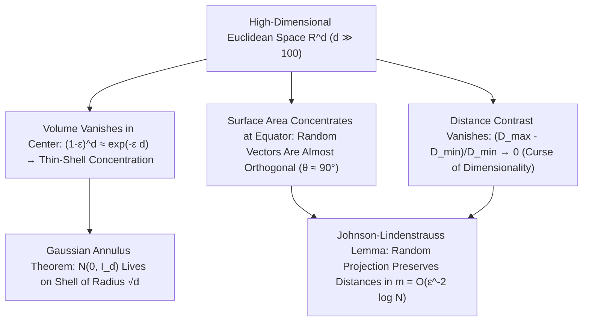

## 1. 고차원 구의 부피 소멸과 초입방체(Hypercube)의 '모서리 역설'

인간의 뇌는 진화 과정에서 2차원 평면과 3차원 유클리드 공간($d=2, 3$)을 인식하도록 최적화되었습니다. 우리는 흔히 3차원에서의 기하학적 직관—"구(sphere)는 외접 정육면체 공간의 상당 부분을 채운다", "정규분포의 표본은 평균점인 원점 근처에 가장 많이 모인다", "무작위로 뽑은 두 방향은 다양한 각도를 이룬다"—을 수백, 수천, 수백만 차원의 데이터 공간($\mathbb{R}^d, d \gg 100$)에 그대로 투영하곤 합니다. 그러나 현대 수학과 확률론은 차원 $d$가 커질 때 저차원 직관이 단순히 부정확해지는 수준을 넘어 <strong>$180^\circ$ 정반대로 뒤집힌다</strong>는 사실을 증명합니다!

먼저 반지름 $R$인 $d$차원 유클리드 구의 부피 공식 $V_d(R) = \frac{\pi^{d/2}}{\Gamma(d/2 + 1)}R^d$를 살펴봅시다. 가우스 적분 $\int_{\mathbb{R}^d} e^{-\|\mathbf{x}\|^2}d\mathbf{x} = \pi^{d/2}$를 구면좌표계로 분해하여 유도되는 이 공식에서, 분모의 감마 함수 $\Gamma(d/2+1) \sim (d/2e)^{d/2}$는 분자의 지수함수 $\pi^{d/2}$보다 훨씬 빠른 초지수적(factorial) 속도로 증가합니다. 그 결과 단위구($R=1$)의 부피는 <strong>$d = 5$에서 최댓값($V_5 \approx 5.2638$)</strong>을 찍은 뒤 단조 감소하여, $d \to \infty$일 때 <strong>고차원 단위구의 부피는 정확히 $0$으로 수렴합니다($\lim_{d\to\infty} V_d(1) = 0$)</strong>! 반면 외접 초입방체 $[-1, 1]^d$의 부피는 $2^d$로 폭발하며 원점에서 꼭짓점까지의 거리는 $\sqrt{d}$로 늘어납니다. 즉 고차원 초입방체의 부피는 거의 전부가 중심에서 멀리 떨어진 $2^d$개의 뾰족한 모서리(corners)에 몰려 있으며, 심지어 $[-1,1]^d$의 $2^d$개 사분면에 반지름 $1/2$인 구를 채우고 정중앙에 내접시킨 구의 반지름 $r_c = \frac{\sqrt{d}-1}{2}$는 $d \ge 10$이 되면 <strong>초입방체 바깥으로 뚫고 튀어나가는 기현상(Sphere Packing Paradox)</strong>까지 발생합니다!

$$
V_d(R) = \frac{\pi^{d/2}}{\Gamma\!\left(\frac{d}{2} + 1\right)} R^d, \qquad \lim_{d \to \infty} V_d(1) = 0, \qquad \frac{V_d\big((1-\varepsilon)R\big)}{V_d(R)} = (1 - \varepsilon)^d \le e^{-\varepsilon d} \xrightarrow{d\to\infty} 0
$$

---

## 2. 측도 집중(Concentration of Measure): 속이 빈 오렌지와 직교하는 무작위 벡터

그렇다면 고차원 구 내부에서 부피는 어디에 분포할까요? 반지름을 $(1-\varepsilon)$배 축소한 내부 구와 전체 구의 부피비는 $(1-\varepsilon)^d \le e^{-\varepsilon d}$이므로, $d = 1000$차원 공간에서는 $\varepsilon = 0.01$만 잡아도 반지름 $99\%$ 내부 코어의 부피 비율이 $0.99^{1000} \approx 0.000043$에 불과합니다! 즉 <strong>고차원 구 부피의 $99.995\%$ 이상은 표면 바로 아래 두께 $O(1/d)$인 종잇장처럼 얇은 껍질(Thin Shell)에 압축되어 있으며</strong>, 구의 내부는 사실상 완전히 텅 비어 있습니다!

마찬가지로 구면 위의 면적 측도는 <strong>적도 집중(Equatorial Concentration)</strong> 현상을 보입니다. 임의의 북극 벡터 $\mathbf{p}$를 잡으면 구면 표면적의 거의 전부가 적도면으로부터 $\pm O(1/\sqrt{d})$ 이내의 좁은 띠에 집중됩니다. 이로부터 놀라운 정리가 도출됩니다. 고차원 구면에서 독립적으로 무작위 추출한 두 단위벡터 $\mathbf{u}, \mathbf{v} \in S^{d-1}$의 내적 $\langle \mathbf{u}, \mathbf{v} \rangle$은 분산 $1/d$인 점근적 정규분포를 따르며($\mathbb{P}(|\langle \mathbf{u}, \mathbf{v} \rangle| \ge \varepsilon) \le 2e^{-d\varepsilon^2/2}$), 따라서 <strong>고차원 공간에서 무작위로 뽑은 두 벡터는 거의 확실하게 서로 직교($\theta \approx 90^\circ$)합니다</strong>! 나아가 고차원 표준 정규분포 $\mathbf{x} \sim \mathcal{N}(\mathbf{0}, I_d)$조차 평균인 원점 $\mathbf{0}$ 근처에는 표본이 전혀 존재하지 않으며, <strong>가우스 고리 정리(Gaussian Annulus Theorem)</strong>에 의해 반지름 $\sqrt{d}$, 두께 $O(1)$인 얇은 구면 껍질 위에만 표본이 집중됩니다:

$$
\mathbb{P}\!\left( \big| \langle \mathbf{u}, \mathbf{v} \rangle \big| \ge \varepsilon \right) \le 2 \exp\!\left(-\frac{d \varepsilon^2}{2}\right), \qquad \|\mathbf{x}\|_2 = \sqrt{\sum_{i=1}^d x_i^2} = \sqrt{d} \pm \mathcal{O}(1) \quad (\mathbf{x} \sim \mathcal{N}(\mathbf{0}, I_d))
$$

---

## 3. 차원의 저주(Curse of Dimensionality)와 거리 대비(Contrast)의 붕괴

1957년 리처드 벨먼(Richard Bellman)이 동적 계획법에서 처음 명명한 <strong>차원의 저주(Curse of Dimensionality)</strong>는 기계학습과 데이터 과학에 치명적인 난제를 안겨줍니다. 단위 초입방체 $[0,1]^d$를 간격 $\varepsilon = 0.1$로 균일하게 격자 탐색하려면 $N = 10^d$개의 표본이 필요한데, $d=100$이면 $10^{100}$개로 우주 전체의 원자 수($10^{80}$)를 아득히초과합니다. 더욱이 베이어(Beyer et al., 1999)가 증명한 <strong>거리 대비 소멸 정리</strong>에 따르면, 차원 $d \to \infty$일 때 임의의 질의점으로부터 최근접 점까지의 거리 $D_{\min}$와 최원접 점까지의 거리 $D_{\max}$는 $\lim_{d\to\infty} \frac{D_{\max} - D_{\min}}{D_{\min}} = 0$을 만족합니다! 모든 점 사이의 거리가 사실상 똑같아지면서 단순 유클리드 거리 기반의 $k$-최근접 이웃($k$-NN) 탐색이 무력화되고, 소수의 이상치 점이 모든 점의 최근접 이웃을 독점하는 <strong>허브 현상(Hubness Phenomenon)</strong>이 나타납니다.

---

## 4. 구원의 열쇠: 다양체 가설과 존슨-린덴슈트라우스(JL) 무작위 사영 보조정리

이토록 기괴한 고차원 공간에서 현대 딥러닝과 거대언어모델(LLM)은 어떻게 수천 차원의 임베딩을 성공적으로 다룰 수 있을까요? 첫째는 실제 세계의 유의미한 데이터(이미지, 음성, 텍스트)가 전체 $\mathbb{R}^d$를 균일하게 채우는 것이 아니라 내재적 차원 $d_{\text{int}} \ll d$인 저차원 부분 다양체 근처에 놓여 있다는 <strong>다양체 가설(Manifold Hypothesis)</strong> 덕분이며, 둘째는 역설적이게도 측도 집중 현상 자체가 선물한 기적인 <strong>존슨-린덴슈트라우스 보조정리(Johnson-Lindenstrauss Lemma, 1984)</strong> 덕분입니다!

JL 보조정리는 고차원 무작위 벡터들의 직교성과 노름 집중성 덕분에, 임의의 고차원 공간 $\mathbb{R}^d$에 있는 $N$개의 점을 무작위 가우스 행렬 $R \in \mathbb{R}^{m \times d}$를 통해 목표 차원 $m = O(\varepsilon^{-2} \log N)$으로 선형 사영하기만 해도 모든 점 쌍 사이의 거리가 $(1 \pm \varepsilon)$ 오차 범위 내에서 완벽히 보존됨을 보장합니다! 목표 차원 $m = O(\varepsilon^{-2}\log N)$이 <strong>원래 차원 $d$와 완전히 무관하다</strong>는 이 정리는 압축 센싱(Compressed Sensing), 지역 민감 해싱(LSH), 고속 벡터 검색의 수학적 토대를 이룹니다.

| 기하학적·확률적 속성 | 저차원 직관 ($d = 2, 3$) | 고차원 공간의 실제 수학적 법칙 ($d \gg 100$) |
| :--- | :--- | :--- |
| <strong>구 내부의 부피 분포</strong> | 중심부와 표면 사이에 고르게 분포 | <strong>$>99.99\%$가 표면 아래 두께 $O(1/d)$인 얇은 껍질에 집중 (내부는 빈 공간)</strong> |
| <strong>두 무작위 단위벡터의 사이각</strong> | $0^\circ \sim 180^\circ$에 걸쳐 다양하게 분포 | <strong>확률 $1 - 2e^{-d\varepsilon^2/2}$로 $90^\circ \pm O(1/\sqrt{d})$에 집중 (거의 직교)</strong> |
| <strong>표준 가우스 분포 $\mathcal{N}(\mathbf{0}, I_d)$</strong> | 평균인 원점 $\mathbf{0}$ 주변에 표본 밀집 | <strong>원점 근처엔 표본이 없으며 반지름 $\sqrt{d} \pm O(1)$ 구면 껍질에 집중</strong> |
| <strong>거리 대비 $(D_{\max}-D_{\min})/D_{\min}$</strong> | 가장 가까운 점과 먼 점의 거리 차이 뚜렷 | <strong>$0$으로 수렴 (모든 점 쌍의 거리가 균일해져 단순 $k$-NN 붕괴)</strong> |

$$
(1 - \varepsilon) \|\mathbf{x}_i - \mathbf{x}_j\|_2^2 \le \|f(\mathbf{x}_i) - f(\mathbf{x}_j)\|_2^2 \le (1 + \varepsilon) \|\mathbf{x}_i - \mathbf{x}_j\|_2^2, \qquad m = \mathcal{O}\!\left(\frac{\log N}{\varepsilon^2}\right)
$$

