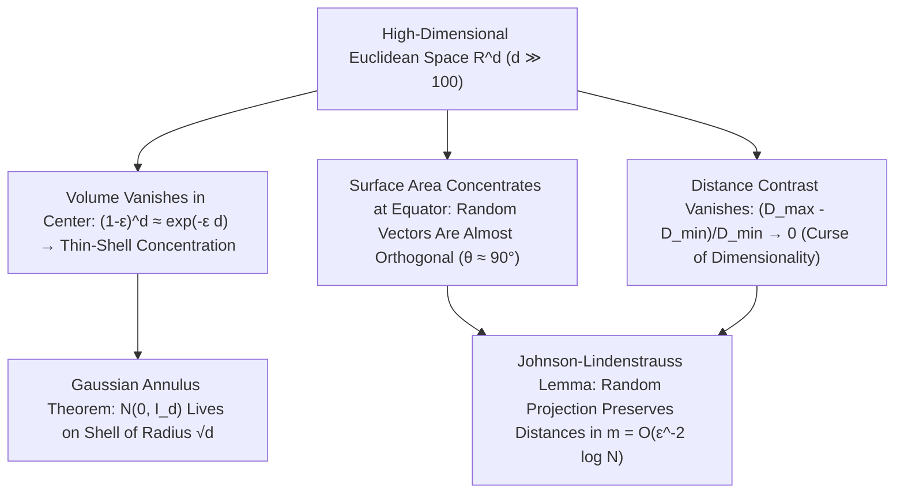

## 1. O desaparecimento do volume da esfera e o «paradoxo das pontas» do hipercubo

Nosso cérebro evoluiu para lidar com espaços euclidianos de duas e três dimensões ($d=2, 3$). Costumamos extrapolar nossas intuições tridimensionais — que uma esfera inscrita ocupa a maior parte de um cubo, que uma distribuição normal se concentra perto de sua média na origem ou que duas direções sorteadas ao acaso formam ângulos variados — para espaços de dados de cem, mil ou um milhão de dimensões ($\mathbb{R}^d, d \gg 100$). Contudo, a matemática moderna prova que, à medida que a dimensão $d$ cresce, nossa intuição geométrica não apenas perde precisão, mas <strong>se inverte completamente em $180^\circ$</strong>!

Examinemos primeiro o volume de uma bola euclidiana de raio $R$ em dimensão $d$: $V_d(R) = \frac{\pi^{d/2}}{\Gamma(d/2 + 1)}R^d$. Como a função Gama no denominador cresce de forma superexponencial como $(d/2e)^{d/2}$, o volume da bola unitária ($R=1$) atinge seu <strong>máximo absoluto em $d = 5$ ($V_5 \approx 5,2638$)</strong> e depois decresce monotonamente: quando $d \to \infty$, <strong>o volume da bola unitária tende exatamente a zero ($\lim_{d\to\infty} V_d(1) = 0$)</strong>! Enquanto isso, o volume do hipercubo circunscrito $[-1, 1]^d$ explode como $2^d$ e a distância do centro aos seus $2^d$ vértices é $\sqrt{d}$. Quase todo o volume do hipercubo está concentrado em seus $2^d$ cantos pontiagudos; no famoso <strong>paradoxo do empacotamento de esferas</strong>, a esfera central tangente às $2^d$ esferas de raio $1/2$ inscritas nos ortantes de $[-1,1]^d$ tem raio $r_c = \frac{\sqrt{d}-1}{2}$, que ultrapassa $1$ para $d \ge 10$: <strong>a esfera presa no centro do cubo atravessa as paredes do hipercubo para fora!</strong>

$$
V_d(R) = \frac{\pi^{d/2}}{\Gamma\!\left(\frac{d}{2} + 1\right)} R^d, \qquad \lim_{d \to \infty} V_d(1) = 0, \qquad \frac{V_d\big((1-\varepsilon)R\big)}{V_d(R)} = (1 - \varepsilon)^d \le e^{-\varepsilon d} \xrightarrow{d\to\infty} 0
$$

---

## 2. Concentração da medida: laranjas ocas e vetores aleatórios ortogonais

Onde está o volume dentro de uma bola de alta dimensão? Como a razão de volume entre uma bola interna de raio $(1-\varepsilon)R$ e a bola inteira é $(1-\varepsilon)^d \le e^{-\varepsilon d}$, em dimensão $d = 1000$, mesmo para $\varepsilon = 0,01$, os $99\%$ internos do raio contêm apenas $0,99^{1000} \approx 0,000043$ do volume! Ou seja, <strong>mais de $99,995\%$ do volume de uma esfera de alta dimensão está comprimido em uma casca finíssima (Thin Shell) de espessura $O(1/d)$ logo abaixo da superfície</strong>, enquanto o interior é praticamente vazio!

Da mesma forma, a área superficial exibe uma impressionante <strong>concentração equatorial</strong>: fixado qualquer polo norte $\mathbf{p}$, quase toda a área de $S^{d-1}$ concentra-se em uma faixa de largura $\pm O(1/\sqrt{d})$ ao redor do equador. Disso decorre que dois vetores unitários independentes sorteados ao acaso $\mathbf{u}, \mathbf{v} \in S^{d-1}$ têm produto interno $\langle \mathbf{u}, \mathbf{v} \rangle$ com variância $1/d$ ($\mathbb{P}(|\langle \mathbf{u}, \mathbf{v} \rangle| \ge \varepsilon) \le 2e^{-d\varepsilon^2/2}$): <strong>em alta dimensão, dois vetores aleatórios quaisquer são quase certamente ortogonais ($	heta \approx 90^\circ$)</strong>! Até mesmo a distribuição normal padrão $\mathbf{x} \sim \mathcal{N}(\mathbf{0}, I_d)$ abandona sua moda na origem $\mathbf{0}$ e, pelo <strong>teorema do anel gaussiano (Gaussian Annulus Theorem)</strong>, concentra-se em uma casca esférica de raio $\sqrt{d} \pm O(1)$:

$$
\mathbb{P}\!\left( \big| \langle \mathbf{u}, \mathbf{v} \rangle \big| \ge \varepsilon \right) \le 2 \exp\!\left(-\frac{d \varepsilon^2}{2}\right), \qquad \|\mathbf{x}\|_2 = \sqrt{\sum_{i=1}^d x_i^2} = \sqrt{d} \pm \mathcal{O}(1) \quad (\mathbf{x} \sim \mathcal{N}(\mathbf{0}, I_d))
$$

---

## 3. A maldição da dimensionalidade e o colapso do contraste de distâncias

Formulada por Richard Bellman em 1957, a <strong>maldição da dimensionalidade (Curse of Dimensionality)</strong> traduz a explosão exponencial da amostragem: uma grade de passo $\varepsilon = 0,1$ em $[0,1]^d$ exige $N = 10^d$ pontos ($10^{100}$ em dimensão $100$). Pior ainda, Beyer et al. (1999) demonstraram o <strong>colapso do contraste de distâncias</strong>: quando $d \to \infty$, a diferença relativa entre a distância ao vizinho mais próximo $D_{\min}$ e ao mais distante $D_{\max}$ tende a zero ($\lim_{d\to\infty} \frac{D_{\max} - D_{\min}}{D_{\min}} = 0$). Todos os pontos tornam-se quase equidistantes, invalidando a busca ingênua de $k$ vizinhos mais próximos ($k$-NN) e gerando o <strong>fenômeno de hubness</strong>.

---

## 4. O resgate: hipótese da variedade e o lema de Johnson-Lindenstrauss (JL)

Por que, então, o aprendizado profundo, os grandes modelos de linguagem (LLMs) e os bancos de dados vetoriais funcionam tão bem em milhares de dimensões? Primeiro, pela <strong>hipótese da variedade (Manifold Hypothesis)</strong>, segundo a qual os dados reais residem perto de uma subvariedade de baixa dimensão intrínseca $d_{\text{int}} \ll d$; segundo, graças ao próprio milagre da concentração da medida: o <strong>lema de Johnson-Lindenstrauss (1984)</strong>!

O lema JL prova que, projetando linearmente $N$ pontos de $\mathbb{R}^d$ por meio de uma matriz aleatória gaussiana para um subespaço de dimensão $m = O(\varepsilon^{-2} \log N)$, todas as distâncias mútuas são preservadas dentro de um fator $(1 \pm \varepsilon)$, onde $m$ é <strong>totalmente independente da dimensão original $d$</strong>!

| Propriedade geométrica e probabilística | Intuição em baixa dimensão ($d = 2, 3$) | Realidade matemática em alta dimensão ($d \gg 100$) |
| :--- | :--- | :--- |
| <strong>Distribuição de volume na esfera</strong> | Distribuído entre o centro e a superfície | <strong>$>99,99\%$ concentrado em uma casca superficial de espessura $O(1/d)$</strong> |
| <strong>Ângulo entre dois vetores aleatórios</strong> | Ampla distribuição entre $0^\circ$ e $180^\circ$ | <strong>Concentrado em $90^\circ \pm O(1/\sqrt{d})$ com probabilidade $1 - 2e^{-d\varepsilon^2/2}$</strong> |
| <strong>Normal padrão $\mathcal{N}(\mathbf{0}, I_d)$</strong> | Agrupada ao redor da média $\mathbf{0}$ | <strong>Origem vazia; massa concentrada na casca de raio $\sqrt{d} \pm O(1)$</strong> |
| <strong>Contraste $(D_{\max}-D_{\min})/D_{\min}$</strong> | Vizinho próximo e distante bem distintos | <strong>Tende a $0$ (todos os pontos tornam-se quase equidistantes)</strong> |

$$
(1 - \varepsilon) \|\mathbf{x}_i - \mathbf{x}_j\|_2^2 \le \|f(\mathbf{x}_i) - f(\mathbf{x}_j)\|_2^2 \le (1 + \varepsilon) \|\mathbf{x}_i - \mathbf{x}_j\|_2^2, \qquad m = \mathcal{O}\!\left(\frac{\log N}{\varepsilon^2}\right)
$$

