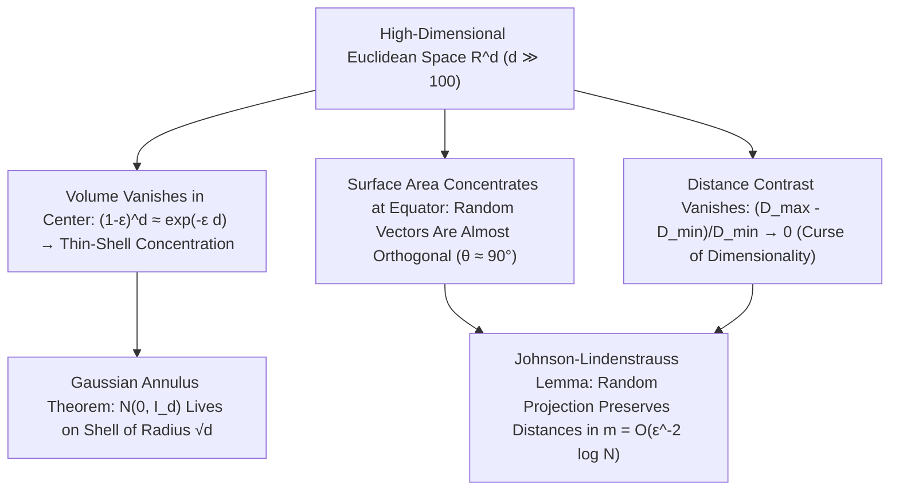

## 1. Исчезновение объема многомерного шара и «парадокс шипов» гиперкуба

Человеческий мозг эволюционировал для ориентации в двух- и трехмерном евклидовом пространстве ($d=2, 3$). Мы привыкли переносить трехмерную геометрическую интуицию — что вписанный шар занимает большую часть куба, что нормальное распределение сосредоточено вблизи среднего значения в начале координат, а два случайных вектора образуют самые разные углы — на пространства данных из сотен, тысяч и миллионов измерений ($\mathbb{R}^d, d \gg 100$). Однако современная математика доказывает: с ростом размерности $d$ наша интуиция не просто дает погрешность, а <strong>переворачивается на $180^\circ$ с точностью до наоборот</strong>!

Рассмотрим сначала объем $d$-мерного евклидова шара радиуса $R$: $V_d(R) = \frac{\pi^{d/2}}{\Gamma(d/2 + 1)}R^d$. Поскольку гамма-функция в знаменателе растет сверхэкспоненциально как $(d/2e)^{d/2}$, объем единичного шара ($R=1$) достигает <strong>абсолютного максимума при $d = 5$ ($V_5 \approx 5{,}2638$)</strong>, а затем монотонно убывает: при $d \to \infty$ <strong>объем многомерного единичного шара строго стремится к нулю ($\lim_{d\to\infty} V_d(1) = 0$)</strong>! В то же время объем описанного гиперкуба $[-1, 1]^d$ растет как $2^d$, а расстояние от центра до каждой из его $2^d$ вершин равно $\sqrt{d}$. Почти весь объем гиперкуба сосредоточен в его $2^d$ далеких острых углах; более того, в знаменитом <strong>парадоксе упаковки шаров</strong> центральный шар, зажатый между $2^d$ угловыми шарами радиуса $1/2$ внутри $[-1,1]^d$, имеет радиус $r_c = \frac{\sqrt{d}-1}{2}$, который при $d \ge 10$ превышает $1$: <strong>запертый внутри куба центральный шар прорывает стенки гиперкуба и выходит наружу</strong>!

$$
V_d(R) = \frac{\pi^{d/2}}{\Gamma\!\left(\frac{d}{2} + 1\right)} R^d, \qquad \lim_{d \to \infty} V_d(1) = 0, \qquad \frac{V_d\big((1-\varepsilon)R\big)}{V_d(R)} = (1 - \varepsilon)^d \le e^{-\varepsilon d} \xrightarrow{d\to\infty} 0
$$

---

## 2. Концентрация меры: полый апельсин и ортогональные случайные векторы

Где же сосредоточен объем внутри многомерного шара? Поскольку отношение объема внутреннего шара радиуса $(1-\varepsilon)R$ к полному объему равно $(1-\varepsilon)^d \le e^{-\varepsilon d}$, в размерности $d = 1000$ даже при $\varepsilon = 0{,}01$ внутренние $99\%$ радиуса содержат лишь $0{,}99^{1000} \approx 0{,}000043$ объема! Иными словами, <strong>более $99{,}995\%$ объема многомерного шара сжато в тончайшей поверхностной кожуре (Thin Shell) толщиной $O(1/d)$</strong>, а внутри шар практически пуст!

Аналогично, площадь поверхности сферы обнаруживает поразительную <strong>экваториальную концентрацию</strong>: при любом выбранном северном полюсе $\mathbf{p}$ почти вся площадь сферы $S^{d-1}$ лежит в узком поясе шириной $\pm O(1/\sqrt{d})$ вокруг экватора. Отсюда следует, что два независимых случайных единичных вектора $\mathbf{u}, \mathbf{v} \in S^{d-1}$ имеют скалярное произведение $\langle \mathbf{u}, \mathbf{v} \rangle$ с дисперсией $1/d$ ($\mathbb{P}(|\langle \mathbf{u}, \mathbf{v} \rangle| \ge \varepsilon) \le 2e^{-d\varepsilon^2/2}$): <strong>в пространстве высокой размерности любые два случайных вектора почти наверное ортогональны ($	heta \approx 90^\circ$)</strong>! Даже многомерное стандартное нормальное распределение $\mathbf{x} \sim \mathcal{N}(\mathbf{0}, I_d)$ покидает моду в начале координат $\mathbf{0}$ и согласно <strong>теореме о гауссовом кольце (Gaussian Annulus Theorem)</strong> концентрируется на тонкой сферической оболочке радиуса $\sqrt{d} \pm O(1)$:

$$
\mathbb{P}\!\left( \big| \langle \mathbf{u}, \mathbf{v} \rangle \big| \ge \varepsilon \right) \le 2 \exp\!\left(-\frac{d \varepsilon^2}{2}\right), \qquad \|\mathbf{x}\|_2 = \sqrt{\sum_{i=1}^d x_i^2} = \sqrt{d} \pm \mathcal{O}(1) \quad (\mathbf{x} \sim \mathcal{N}(\mathbf{0}, I_d))
$$

---

## 3. Проклятие размерности и коллапс контраста расстояний

Сформулированное Ричардом Беллманом в 1957 году <strong>проклятие размерности (Curse of Dimensionality)</strong> отражает экспоненциальный взрыв выборки: равномерная сетка с шагом $\varepsilon = 0{,}1$ в $[0,1]^d$ требует $N = 10^d$ точек ($10^{100}$ при $d=100$). Еще опаснее доказанное Байером и др. (Beyer et al., 1999) <strong>исчезновение контраста расстояний</strong>: при $d \to \infty$ относительная разница между расстоянием до ближайшего соседа $D_{\min}$ и до самого далекого соседа $D_{\max}$ стремится к нулю ($\lim_{d\to\infty} \frac{D_{\max} - D_{\min}}{D_{\min}} = 0$). Все точки оказываются почти равноудаленными друг от друга, что разрушает наивный поиск $k$ ближайших соседей ($k$-NN) и порождает <strong>феномен хабов (Hubness)</strong>.

---

## 4. Спасение: гипотеза о многообразии и лемма Джонсона — Линденштрауса (JL)

Почему же глубокое обучение, большие языковые модели (LLM) и векторные базы данных успешно работают в пространствах тысяч измерений? Во-первых, благодаря <strong>гипотезе о многообразии (Manifold Hypothesis)</strong>, согласно которой реальные данные сосредоточены вблизи маломерного подмногообразия внутренней размерности $d_{\text{int}} \ll d$; во-вторых, благодаря чуду самой концентрации меры — <strong>лемме Джонсона — Линденштрауса (1984)</strong>!

Лемма JL доказывает, что линейная случайная проекция $N$ точек из $\mathbb{R}^d$ с помощью случайной гауссовой матрицы в подпространство размерности $m = O(\varepsilon^{-2} \log N)$ сохраняет все попарные расстояния с точностью до $(1 \pm \varepsilon)$, причем целевая размерность $m$ <strong>совершенно не зависит от исходной размерности $d$</strong>!

| Геометрическое и вероятностное свойство | Интуиция в малой размерности ($d = 2, 3$) | Математическая реальность при $d \gg 100$ |
| :--- | :--- | :--- |
| <strong>Распределение объема внутри шара</strong> | Распределен между центром и поверхностью | <strong>$>99{,}99\%$ сжато в тонкой корке толщиной $O(1/d)$ у поверхности</strong> |
| <strong>Угол между двумя случайными векторами</strong> | Широко распределен от $0^\circ$ до $180^\circ$ | <strong>С вероятностью $1 - 2e^{-d\varepsilon^2/2}$ равен $90^\circ \pm O(1/\sqrt{d})$ (ортогональность)</strong> |
| <strong>Стандартный гауссиан $\mathcal{N}(\mathbf{0}, I_d)$</strong> | Сгущается вокруг среднего $\mathbf{0}$ | <strong>Вблизи нуля пусто; масса лежит на сфере радиуса $\sqrt{d} \pm O(1)$</strong> |
| <strong>Контраст $(D_{\max}-D_{\min})/D_{\min}$</strong> | Ближний и дальний соседи четко различимы | <strong>Стремится к $0$ (все точки становятся почти равноудаленными)</strong> |

$$
(1 - \varepsilon) \|\mathbf{x}_i - \mathbf{x}_j\|_2^2 \le \|f(\mathbf{x}_i) - f(\mathbf{x}_j)\|_2^2 \le (1 + \varepsilon) \|\mathbf{x}_i - \mathbf{x}_j\|_2^2, \qquad m = \mathcal{O}\!\left(\frac{\log N}{\varepsilon^2}\right)
$$

