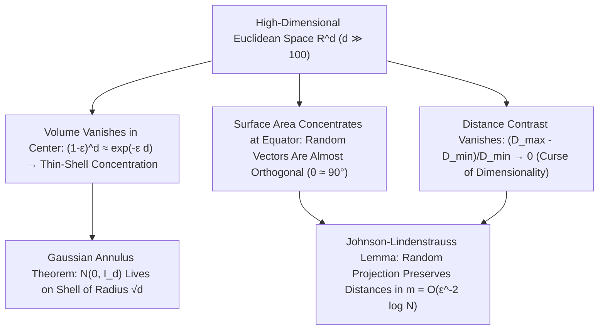

## 1. 高维球体积消失之谜与超立方体的“尖角悖论”

人类的大脑在漫长的生物演化中，完全是为了适应二维平面与三维欧几里得空间（$d=2, 3$）而塑造的。我们习惯于把三维空间中的几何直觉——比如“球体填充了立方体的大部分空间”、“正态分布的概率密度集中在均值中心附近”、“随机抽取的两个方向夹角千差万别”——直接推广到百维、千维乃至百万维的数据空间（$\mathbb{R}^d, d \gg 100$）。然而，现代数学与概率论证明：当维数 $d$ 增大时，低维几何直觉不仅会出现偏差，而且会<strong>发生 $180^\circ$ 的彻底反转</strong>！

首先考察半径为 $R$ 的 $d$ 维欧氏球体体积公式 $V_d(R) = \frac{\pi^{d/2}}{\Gamma(d/2 + 1)}R^d$。利用高斯积分 $\int_{\mathbb{R}^d} e^{-\|\mathbf{x}\|^2}d\mathbf{x} = \pi^{d/2}$ 在球坐标下分解，分母中的伽马函数 $\Gamma(d/2+1) \sim (d/2e)^{d/2}$ 按超指数阶增长，远快于分子的指数项 $\pi^{d/2}$。令人震惊的结论出现了：单位球（$R=1$）的体积在 <strong>$d = 5$ 时达到最大值（$V_5 \approx 5.2638$）</strong>，随后便单调递减，当 $d \to \infty$ 时，<strong>单位高维球的体积严格趋于零（$\lim_{d\to\infty} V_d(1) = 0$）</strong>！与此同时，外切超立方体 $[-1, 1]^d$ 的体积却按 $2^d$ 指数爆炸，中心与顶点的欧氏距离为 $\sqrt{d}$。这意味着高维超立方体的绝大部分体积都集中在远离中心的 $2^d$ 个狭长“尖角”之中；甚至在著名的<strong>高维球堆积悖论</strong>中，在 $[-1,1]^d$ 的 $2^d$ 个象限各放一个半径 $1/2$ 的小球，夹在正中央与它们同时相切的中心内球半径为 $r_c = \frac{\sqrt{d}-1}{2}$——当 $d=9$ 时中心球刚好碰到超立方体表面，而当 $d \ge 10$ 时，<strong>被关在立方体内部的中心球竟然突破立方体边界刺到了外部空间</strong>！

$$
V_d(R) = \frac{\pi^{d/2}}{\Gamma\!\left(\frac{d}{2} + 1\right)} R^d, \qquad \lim_{d \to \infty} V_d(1) = 0, \qquad \frac{V_d\big((1-\varepsilon)R\big)}{V_d(R)} = (1 - \varepsilon)^d \le e^{-\varepsilon d} \xrightarrow{d\to\infty} 0
$$

---

## 2. 测度集中现象（Concentration of Measure）：空心的橙子与正交的随机向量

如果观察一个高维球体内部，它的体积分布在哪里？由于缩放因子为 $(1-\varepsilon)$ 的内球体积与整个球体积之比为 $(1-\varepsilon)^d \le e^{-\varepsilon d}$，在 $d = 1000$ 维空间中，即使取 $\varepsilon = 0.01$，内部 $99\%$ 半径的球芯所占体积也仅有 $0.99^{1000} \approx 0.000043$！也就是说，<strong>高维球体 $99.995\%$ 以上的体积都密集挤压在表面下方厚度仅为 $O(1/d)$ 的一层极薄的“果皮”薄壳（Thin Shell）上</strong>，球体内部几乎完全是空的！

同样地，球面上的测度呈现出惊人的<strong>赤道集中（Equatorial Concentration）</strong>：任意固定一个北极方向 $\mathbf{p}$，球面上绝大部分面积都集中在距离赤道平面 $\pm O(1/\sqrt{d})$ 的狭窄带内。由此直接导出一个反直觉定理：在高维空间中独立均匀随机抽取两个单位向量 $\mathbf{u}, \mathbf{v} \in S^{d-1}$，它们的内积 $\langle \mathbf{u}, \mathbf{v} \rangle$ 服从方差为 $1/d$ 的渐近正态分布，$\mathbb{P}(|\langle \mathbf{u}, \mathbf{v} \rangle| \ge \varepsilon) \le 2e^{-d\varepsilon^2/2}$。因此，<strong>高维空间中任意两个随机向量几乎必然相互正交（夹角 $\theta \approx 90^\circ$）</strong>！甚至连高维标准高斯分布 $\mathbf{x} \sim \mathcal{N}(\mathbf{0}, I_d)$ 也不再聚集于原点均值（原点虽然概率密度最高，但体积微元 $r^{d-1}dr$ 为零），而是由<strong>高斯环定理（Gaussian Annulus Theorem）</strong>严格锁定在半径为 $\sqrt{d}$、宽度为 $O(1)$ 的薄球壳上：

$$
\mathbb{P}\!\left( \big| \langle \mathbf{u}, \mathbf{v} \rangle \big| \ge \varepsilon \right) \le 2 \exp\!\left(-\frac{d \varepsilon^2}{2}\right), \qquad \|\mathbf{x}\|_2 = \sqrt{\sum_{i=1}^d x_i^2} = \sqrt{d} \pm \mathcal{O}(1) \quad (\mathbf{x} \sim \mathcal{N}(\mathbf{0}, I_d))
$$

---

## 3. 维数灾难（Curse of Dimensionality）与距离对比度的崩溃

1957年，理查德·贝尔曼（Richard Bellman）在动态规划研究中首次提出<strong>维数灾难（Curse of Dimensionality）</strong>。要在单位超立方体 $[0,1]^d$ 中维持分辨率为 $\varepsilon = 0.1$ 的均匀网格采样，所需样本数 $N = (1/\varepsilon)^d = 10^d$ 在 $d=100$ 时就高达 $10^{100}$（超过可观测宇宙的原子总数 $10^{80}$）。更致命的是贝耶尔（Beyer et al., 1999）证明的<strong>距离对比度消失定理</strong>：当维数 $d \to \infty$ 时，任意查询点到最近邻点的距离 $D_{\min}$ 与到最远点的距离 $D_{\max}$ 的相对差值满足 $\lim_{d\to\infty} \frac{D_{\max} - D_{\min}}{D_{\min}} = 0$！所有数据点之间的距离变得几乎完全相等，导致基于欧氏距离的 $k$-近邻（$k$-NN）搜索和高斯核密度估计彻底失效，并衍生出少数点垄断所有近邻关系的<strong>中心点现象（Hubness Phenomenon）</strong>。

---

## 4. 救赎之路：流形假说与约翰逊-林登施特劳斯（JL）随机投影引理

既然高维空间如此险恶，为什么现代深度学习、大语言模型（LLM）和向量数据库仍能在数千维嵌入空间中游刃有余？原因有二：第一是<strong>流形假说（Manifold Hypothesis）</strong>，即真实世界有意义的图像、语音和自然语言数据并非均匀散布在整个 $\mathbb{R}^d$ 中，而是高度集中在内在维数 $d_{\text{int}} \ll d$ 的低维非线性流形附近；第二则是高维测度集中本身带来的奇迹——<strong>约翰逊-林登施特劳斯引理（Johnson-Lindenstrauss Lemma, 1984）</strong>！

JL引理证明：正是因为高维随机向量高度正交且模长极其稳定，我们只需用一个随机高斯矩阵 $R \in \mathbb{R}^{m \times d}$ 将任意高维空间 $\mathbb{R}^d$ 中的 $N$ 个点线性投影到目标维数 $m = O(\varepsilon^{-2} \log N)$ 的子空间中，就能以极高概率保证所有点对之间的距离畸变不超过 $(1 \pm \varepsilon)$！注意公式 $m = O(\varepsilon^{-2}\log N)$ 中<strong>完全不包含原始空间维数 $d$</strong>！这不仅构成了压缩感知（Compressed Sensing）、局部敏感哈希（LSH）与近似最近邻检索（ANN）的数学基石，也揭示了高维几何既打破人类直觉又赋予现代人工智能强大表征能力的双面魅力。

| 几何与概率属性 | 低维空间直觉 ($d = 2, 3$) | 高维空间真实物理与数学规律 ($d \gg 100$) |
| :--- | :--- | :--- |
| <strong>球体内部体积分布</strong> | 均匀分布在球心与表面之间 | <strong>$>99.99\%$ 集中在表面厚度 $O(1/d)$ 的薄壳上（内部全空）</strong> |
| <strong>两个独立随机向量的夹角</strong> | 在 $0^\circ$ 到 $180^\circ$ 之间广泛分布 | <strong>以 $1 - 2e^{-d\varepsilon^2/2}$ 概率严格集中在 $90^\circ \pm O(1/\sqrt{d})$（正交）</strong> |
| <strong>标准高斯分布 $\mathcal{N}(\mathbf{0}, I_d)$</strong> | 样本密集聚集在均值原点 $\mathbf{0}$ 附近 | <strong>原点附近几乎无样本，集中在半径 $\sqrt{d} \pm O(1)$ 的薄球壳上</strong> |
| <strong>点对距离对比度 $(D_{\max}-D_{\min})/D_{\min}$</strong> | 最近邻与最远邻距离差异显著 | <strong>趋近于 $0$（所有点彼此等距，朴素 $k$-NN 失效）</strong> |

$$
(1 - \varepsilon) \|\mathbf{x}_i - \mathbf{x}_j\|_2^2 \le \|f(\mathbf{x}_i) - f(\mathbf{x}_j)\|_2^2 \le (1 + \varepsilon) \|\mathbf{x}_i - \mathbf{x}_j\|_2^2, \qquad m = \mathcal{O}\!\left(\frac{\log N}{\varepsilon^2}\right)
$$

