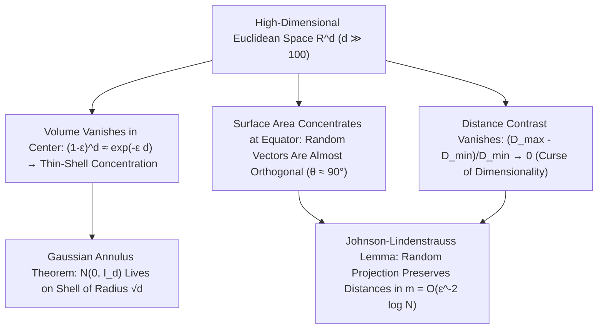

## 1. 高維球體積消失之謎與超立方體的「尖角悖論」

人類的大腦在漫長的生物演化中，完全是為了適應二維平面與三維歐幾里得空間（$d=2, 3$）而塑造的。我們習慣於把三維空間中的幾何直覺——比如「球體填充了立方體的大部分空間」、「常態分佈的機率密度集中在平均值中心附近」、「隨機抽取的兩個方向夾角千差萬別」——直接推廣到百維、千維乃至百萬維的資料空間（$\mathbb{R}^d, d \gg 100$）。然而，現代數學與機率論證明：當維數 $d$ 增大時，低維幾何直覺不僅會出現偏差，而且會<strong>發生 $180^\circ$ 的徹底反轉</strong>！

首先考察半徑為 $R$ 的 $d$ 維歐氏球體體積公式 $V_d(R) = \frac{\pi^{d/2}}{\Gamma(d/2 + 1)}R^d$。利用高斯積分 $\int_{\mathbb{R}^d} e^{-\|\mathbf{x}\|^2}d\mathbf{x} = \pi^{d/2}$ 在球座標下分解，分母中的伽瑪函數 $\Gamma(d/2+1) \sim (d/2e)^{d/2}$ 按超指數階增長，遠快於分子的指數項 $\pi^{d/2}$。令人震驚的結論出現了：單位球（$R=1$）的體積在 <strong>$d = 5$ 時達到最大值（$V_5 \approx 5.2638$）</strong>，隨後便單調遞減，當 $d \to \infty$ 時，<strong>單位高維球的體積嚴格趨於零（$\lim_{d\to\infty} V_d(1) = 0$）</strong>！與此同時，外切超立方體 $[-1, 1]^d$ 的體積卻按 $2^d$ 指數爆炸，中心與頂點的歐氏距離為 $\sqrt{d}$。這意味著高維超立方體的絕大部分體積都集中在遠離中心的 $2^d$ 個狹長「尖角」之中；甚至在著名的<strong>高維球堆積悖論</strong>中，在 $[-1,1]^d$ 的 $2^d$ 個象限各放一個半徑 $1/2$ 的小球，夾在正中央與它們同時相切的中心內球半徑為 $r_c = \frac{\sqrt{d}-1}{2}$——當 $d=9$ 時中心球剛好碰到超立方體表面，而當 $d \ge 10$ 時，<strong>被關在立方體內部的中心球竟然突破立方體邊界刺到了外部空間</strong>！

$$
V_d(R) = \frac{\pi^{d/2}}{\Gamma\!\left(\frac{d}{2} + 1\right)} R^d, \qquad \lim_{d \to \infty} V_d(1) = 0, \qquad \frac{V_d\big((1-\varepsilon)R\big)}{V_d(R)} = (1 - \varepsilon)^d \le e^{-\varepsilon d} \xrightarrow{d\to\infty} 0
$$

---

## 2. 測度集中現象（Concentration of Measure）：空心的柳橙與正交的隨機向量

如果觀察一個高維球體內部，它的體積分佈在哪裡？由於縮放因子為 $(1-\varepsilon)$ 的內球體積與整個球體積之比為 $(1-\varepsilon)^d \le e^{-\varepsilon d}$，在 $d = 1000$ 維空間中，即使取 $\varepsilon = 0.01$，內部 $99\%$ 半徑的球芯所佔體積也僅有 $0.99^{1000} \approx 0.000043$！也就是說，<strong>高維球體 $99.995\%$ 以上的體積都密集擠壓在表面下方厚度僅為 $O(1/d)$ 的一層極薄的「果皮」薄殼（Thin Shell）上</strong>，球體內部幾乎完全是空的！

同樣地，球面上的測度呈現出驚人的<strong>赤道集中（Equatorial Concentration）</strong>：任意固定一個北極方向 $\mathbf{p}$，球面上絕大部分面積都集中在距離赤道平面 $\pm O(1/\sqrt{d})$ 的狹窄帶內。由此直接導出一個反直覺定理：在高維空間中獨立均勻隨機抽取兩個單位向量 $\mathbf{u}, \mathbf{v} \in S^{d-1}$，它們的內積 $\langle \mathbf{u}, \mathbf{v} \rangle$ 服從變異數為 $1/d$ 的漸近常態分佈，$\mathbb{P}(|\langle \mathbf{u}, \mathbf{v} \rangle| \ge \varepsilon) \le 2e^{-d\varepsilon^2/2}$。因此，<strong>高維空間中任意兩個隨機向量幾乎必然相互正交（夾角 $\theta \approx 90^\circ$）</strong>！甚至連高維標準高斯分佈 $\mathbf{x} \sim \mathcal{N}(\mathbf{0}, I_d)$ 也不再聚集於原點平均值（原點雖然機率密度最高，但體積微元 $r^{d-1}dr$ 為零），而是由<strong>高斯環定理（Gaussian Annulus Theorem）</strong>嚴格鎖定在半徑為 $\sqrt{d}$、寬度為 $O(1)$ 的薄球殼上：

$$
\mathbb{P}\!\left( \big| \langle \mathbf{u}, \mathbf{v} \rangle \big| \ge \varepsilon \right) \le 2 \exp\!\left(-\frac{d \varepsilon^2}{2}\right), \qquad \|\mathbf{x}\|_2 = \sqrt{\sum_{i=1}^d x_i^2} = \sqrt{d} \pm \mathcal{O}(1) \quad (\mathbf{x} \sim \mathcal{N}(\mathbf{0}, I_d))
$$

---

## 3. 維數災難（Curse of Dimensionality）與距離對比度的崩潰

1957年，理查·貝爾曼（Richard Bellman）在動態規劃研究中首次提出<strong>維數災難（Curse of Dimensionality）</strong>。要在單位超立方體 $[0,1]^d$ 中維持解析度為 $\varepsilon = 0.1$ 的均勻網格採樣，所需樣本數 $N = (1/\varepsilon)^d = 10^d$ 在 $d=100$ 時就高達 $10^{100}$（超過可觀測宇宙的原子總數 $10^{80}$）。更致命的是貝耶爾（Beyer et al., 1999）證明的<strong>距離對比度消失定理</strong>：當維數 $d \to \infty$ 時，任意查詢點到最近鄰點的距離 $D_{\min}$ 與到最遠點的距離 $D_{\max}$ 的相對差值滿足 $\lim_{d\to\infty} \frac{D_{\max} - D_{\min}}{D_{\min}} = 0$！所有資料點之間的距離變得幾乎完全相等，導致基於歐氏距離的 $k$-近鄰（$k$-NN）搜尋和高斯核密度估計徹底失效，並衍生出少數點壟斷所有近鄰關係的<strong>中心點現象（Hubness Phenomenon）</strong>。

---

## 4. 救贖之路：流形假說與強森-林登施特勞斯（JL）隨機投影引理

既然高維空間如此險惡，為什麼現代深度學習、大型語言模型（LLM）和向量資料庫仍能在數千維嵌入空間中游刃有餘？原因有二：第一是<strong>流形假說（Manifold Hypothesis）</strong>，即真實世界有意義的影像、語音和自然語言資料並非均勻散佈在整個 $\mathbb{R}^d$ 中，而是高度集中在內在維數 $d_{\text{int}} \ll d$ 的低維非線性流形附近；第二則是高維測度集中本身帶來的奇蹟——<strong>強森-林登施特勞斯引理（Johnson-Lindenstrauss Lemma, 1984）</strong>！

JL引理證明：正是因為高維隨機向量高度正交且模長極其穩定，我們只需用一個隨機高斯矩陣 $R \in \mathbb{R}^{m \times d}$ 將任意高維空間 $\mathbb{R}^d$ 中的 $N$ 個點線性投影到目標維數 $m = O(\varepsilon^{-2} \log N)$ 的子空間中，就能以極高機率保證所有點對之間的距離畸變不超過 $(1 \pm \varepsilon)$！注意公式 $m = O(\varepsilon^{-2}\log N)$ 中<strong>完全不包含原始空間維數 $d$</strong>！這不僅構成了壓縮感知（Compressed Sensing）、局部敏感雜湊（LSH）與近似最近鄰檢索（ANN）的數學基石，也揭示了高維幾何既打破人類直覺又賦予現代人工智慧強大表徵能力的雙面魅力。

| 幾何與機率屬性 | 低維空間直覺 ($d = 2, 3$) | 高維空間真實物理與數學規律 ($d \gg 100$) |
| :--- | :--- | :--- |
| <strong>球體內部體積分佈</strong> | 均勻分佈在球心與表面之間 | <strong>$>99.99\%$ 集中在表面厚度 $O(1/d)$ 的薄殼上（內部全空）</strong> |
| <strong>兩個獨立隨機向量的夾角</strong> | 在 $0^\circ$ 到 $180^\circ$ 之間廣泛分佈 | <strong>以 $1 - 2e^{-d\varepsilon^2/2}$ 機率嚴格集中在 $90^\circ \pm O(1/\sqrt{d})$（正交）</strong> |
| <strong>標準高斯分佈 $\mathcal{N}(\mathbf{0}, I_d)$</strong> | 樣本密集聚集在平均值原點 $\mathbf{0}$ 附近 | <strong>原點附近幾乎無樣本，集中在半徑 $\sqrt{d} \pm O(1)$ 的薄球殼上</strong> |
| <strong>點對距離對比度 $(D_{\max}-D_{\min})/D_{\min}$</strong> | 最近鄰與最遠鄰距離差異顯著 | <strong>趨近於 $0$（所有點彼此等距，樸素 $k$-NN 失效）</strong> |

$$
(1 - \varepsilon) \|\mathbf{x}_i - \mathbf{x}_j\|_2^2 \le \|f(\mathbf{x}_i) - f(\mathbf{x}_j)\|_2^2 \le (1 + \varepsilon) \|\mathbf{x}_i - \mathbf{x}_j\|_2^2, \qquad m = \mathcal{O}\!\left(\frac{\log N}{\varepsilon^2}\right)
$$

