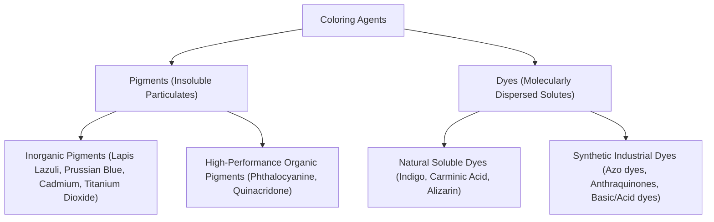
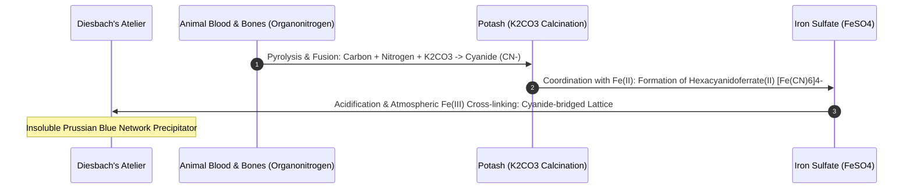
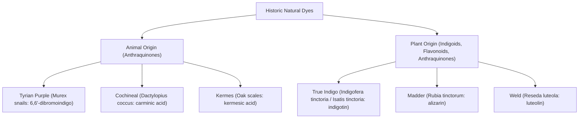
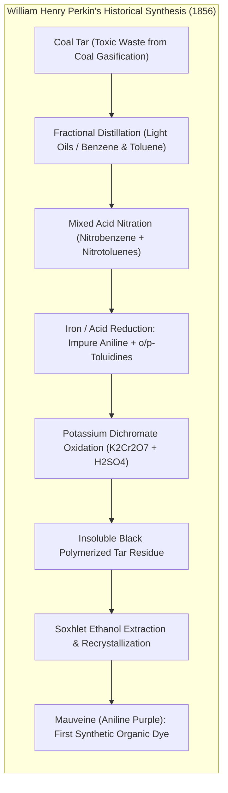
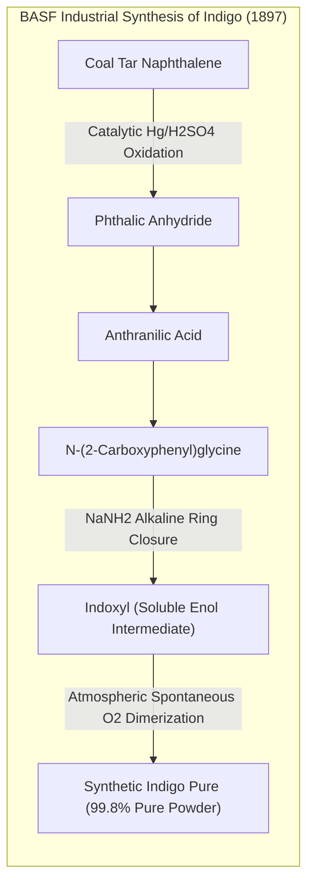
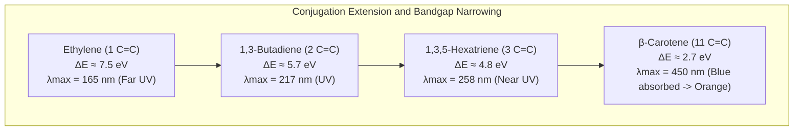
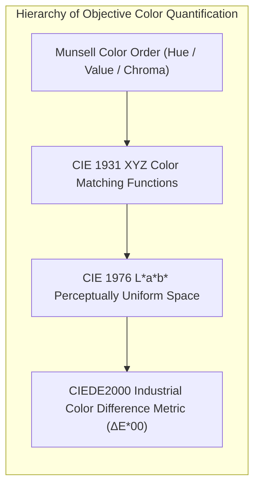
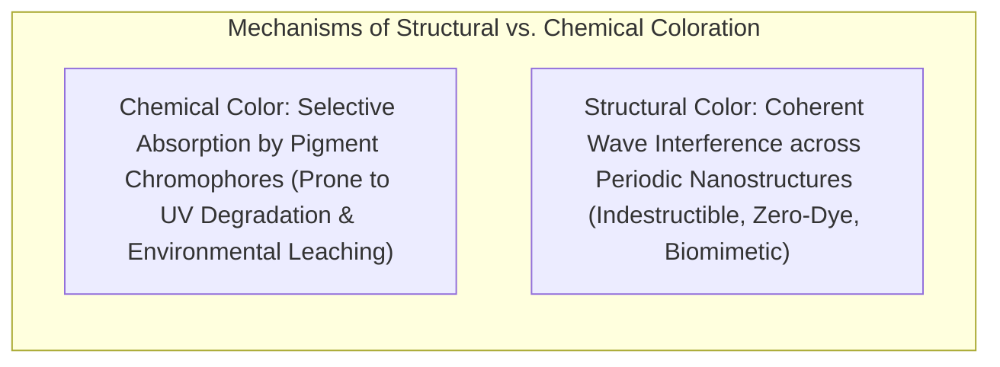

Human civilization is intimately defined by its quest to capture, fix, and manipulate color. From Upper Paleolithic hunter-gatherers grinding red iron oxides (ochre) and charcoal in subterranean caves, to Renaissance masters expending sums exceeding the price of gold for genuine Afghan lapis lazuli, to an eighteen-year-old student named William Henry Perkin accidentally transforming coal-tar sludge into vibrant purple and igniting the global chemical industry in 1856—the history of color is the history of material science, geopolitical empire, and quantum physics.

Why do certain molecules appear intensely colored while others are transparent? Why does genuine ultramarine retain its luminous azure across seven centuries of cathedral frescoes, while early synthetic lakes fade under diffuse sunlight within decades? The answers lie at the intersection of electromagnetic radiation, molecular symmetry, transition metal ligand field splitting, conjugated $\pi$-electron systems, and quantum mechanical charge transfer.

This article provides an exhaustive, mathematically rigorous, and historically contextualized analysis of the science of pigments and dyes. We explore the solid-state chemistry of ancient inorganic minerals, the coordination geometry of natural mordants, the organic synthetic explosion of the nineteenth century, and the molecular orbital physics governing photon absorption and modern photonic structural color.

---

## 1. The Physical Chemistry of Color: Light, Matter, and Electronic Transitions

Color is not an intrinsic property of matter; rather, it is a perceptual psychophysical sensation resulting from the interaction between electromagnetic radiation, the electronic energy states of molecules or crystalline solids, and the photoreceptor mosaic of the human retina.

### 1.1 The Electromagnetic Visible Spectrum and Photon Energy

Human vision is mediated by three classes of retinal cone photoreceptors (Short, Medium, and Long wavelength-sensitive opsins), restricting visual perception to an electromagnetic bandwidth spanning approximately $380\,\text{nm}$ to $780\,\text{nm}$. The energy of an individual photon is governed by the Planck-Einstein relation:

$$E = h \nu = \frac{h c}{\lambda}$$

where $h \approx 6.626 \times 10^{-34}\,\text{J}\cdot\text{s}$ is Planck's constant, $c \approx 2.998 \times 10^8\,\text{m/s}$ is the vacuum velocity of light, $\nu$ is optical frequency, and $\lambda$ is wavelength.

Converting into electron-volts ($\text{eV}$), visual photon energies range from $1.65\,\text{eV}$ at the deep red limit ($\lambda \approx 750\,\text{nm}$) to $3.10\,\text{eV}$ at the extreme violet boundary ($\lambda \approx 400\,\text{nm}$). When polychromatic white light illuminates a condensed material, an incident photon is selectively absorbed if and only if its energy matches the quantized difference between an occupied ground electronic orbital and an unoccupied higher-energy orbital:

$$\Delta E = E_{\text{excited}} - E_{\text{ground}} = h \nu$$

```mermaid
graph LR
    subgraph SPECTRA ["Photophysical Mechanics of Color Perception"]
        direction TB
        W["Polychromatic White Light (380 - 780 nm)"] --> S["Material Medium (Pigment / Dye)"]
        S -->|Resonant Electronic Absorption (ΔE = hν)| A["Absorbed Wavelength Band"]
        S -->|Scattering, Reflection, or Transmission| R["Transmitted / Reflected Spectral Power"]
        R --> E["Retinal S/M/L Cones Phototransduction"]
        E --> P["Perceived Complementary Hue"]
    end
```

### 1.2 The Geometric Logic of Complementary Colors

The hue perceived by human trichromats corresponds to the <strong>complementary color</strong> of the absorbed spectral energy band. When a specific spectral band is excised from broadband white light by resonant electronic excitation, the brain synthesizes the remaining transmitted or scattered photons into an antagonistic chromatic sensation.

| Absorbed Spectral Band (nm) | Absorbed Spectral Color | Perceived Subtractive Hue (Complement) | Primary Underlying Electronic Mechanism |
|---|---|---|---|
| <strong>$400 - 435$</strong> | Violet | Yellow-Green | Extended $\pi \to \pi^*$ conjugated polyenes |
| <strong>$435 - 480$</strong> | Blue | Yellow | Ligand-to-metal charge transfer (LMCT) |
| <strong>$480 - 490$</strong> | Greenish Blue | Orange | Metal-to-ligand charge transfer (MLCT) |
| <strong>$490 - 500$</strong> | Bluish Green | Red | Semiconductor bandgap interband transition |
| <strong>$500 - 560$</strong> | Green | Red-Purple / Magenta | Azo-linked aromatic resonance systems |
| <strong>$560 - 580$</strong> | Yellow-Green | Violet / Purple | Triphenylmethane delocalized carbocations |
| <strong>$580 - 595$</strong> | Yellow | Blue | Intervalence charge transfer (IVCT) |
| <strong>$595 - 650$</strong> | Orange | Greenish Blue / Cyan | Phthalocyanine macrocyclic $18\pi$-aromatics |
| <strong>$650 - 750$</strong> | Red | Cyan / Pure Blue | Radical anion caged molecular transitions |

### 1.3 Fundamental Thermodynamic Distinction: Pigments vs. Dyes

In the nomenclature of physical chemistry and materials science, colorants are partitioned into two distinct thermodynamic and interfacial classes:



1. <strong>Pigments</strong>: Solid particulate colorants that are <strong>virtually insoluble</strong> in the application vehicle (water, drying oils, polymeric resins, organic solvents). They exist as crystalline or amorphous submicron grains dispersed mechanically. Pigment binding relies on a binder/vehicle (e.g., linseed oil in oil paint, gum arabic in watercolor, acrylic polymer emulsion). Their macroscopic opacity (hiding power) is governed by the refractive index mismatch between particle ($n_p$) and medium ($n_m$) via Rayleigh and Mie scattering:
   $$I_{\text{scatter}} \propto \left( \frac{n_p - n_m}{n_m} \right)^2$$
   High refractive index minerals (such as titanium dioxide rutile, $n = 2.73$) exhibit extraordinary scattering and opacity, while low index particles (such as chalk, $n = 1.55$) become nearly translucent in oil ($n = 1.48$).
2. <strong>Dyes</strong>: Intensely colored molecular compounds that <strong>dissolve molecularly</strong> in the carrier liquid (water or polar organic solvents). Dyes penetrate the porous amorphous domains of substrates (textile fibers, paper, leather) and form direct physicochemical bonds with substrate macromolecules—including ionic salt linkages, intermolecular hydrogen bonds, coordination covalent bonds (via mordants), or covalent cross-links (reactive dyes).

---

## 2. Inorganic Mineral Pigments: Solid-State Physics and Ancient Metallurgy

Before the advent of synthetic organic synthesis, human artists and architects derived permanent chromatic expressions from geological minerals. The electronic processes producing color in these inorganic crystals fundamentally differ from organic chromophores.

### 2.1 The Radical Mystery of Lapis Lazuli and Natural Ultramarine

Throughout the European Middle Ages and Renaissance, the most coveted and exorbitantly expensive pigment was <strong>natural ultramarine</strong> (derived from the Latin *ultramarinus*, meaning "beyond the sea"). Mined exclusively from the remote, high-altitude metamorphic deposits of the Sar-e-Sang mines in Badakhshan (modern Afghanistan), lapis lazuli was prized more highly than pure bullion.

```
       O3Si - O - AlO3
      /               \
  (Na+)8  [ S3•- ]   (AlO3 - O - SiO3)
      \               /
       O3Al - O - SiO3
```

#### The Sodalite Cage and the Trisulfur Radical Anion

For centuries, mineralogists were baffled by the vibrant blue of lapis lazuli, as the parent mineral lazurite contains no classical transition metals like copper or cobalt. Lazurite is a member of the sodalite feldspathoid group, possessing an idealized chemical formula:

$$(Na, Ca)_8 [(S, SO_4, Cl)_2 | (AlSiO_4)_6]$$

The crystal framework consists of an aluminosilicate three-dimensional network forming interconnected truncated octahedra (known as $\beta$-cages or sodalite cages). Deep inside these sub-nanometer cages, trapped isolated <strong>trisulfur radical anions ($S_3^{\bullet-}$)</strong> reside as guest chromophores.

Unlike typical diamagnetic sulfur allotropes, the $S_3^{\bullet-}$ radical possesses 19 valence electrons with an open-shell configuration. Molecular orbital theory and spectroscopic measurements demonstrate that the $C_{2v}$ symmetric $S_3^{\bullet-}$ anion undergoes a spin-allowed electronic excitation from its $^2B_1$ ground state to the excited $^2A_2$ state. This transition manifests as an intense, narrow absorption band centered at:

$$\lambda_{\max} \approx 600\,\text{nm} \quad (\approx 2.07\,\text{eV})$$

Because yellow-orange photons ($590 - 620\,\text{nm}$) are extinguished through this orbital transition with molar extinction coefficients exceeding $10^4\,\text{L}/(\text{mol}\cdot\text{cm})$, only pure, luminous blue photons ($450 - 480\,\text{nm}$) escape via elastic scattering. The rigid aluminosilicate cage isolates the $S_3^{\bullet-}$ radicals from ambient oxygen and moisture, endowing natural ultramarine with near-infinite photostability across millennia.

#### The Cennini Pastello Extraction Process

Crude lapis lazuli contains substantial crystalline contaminants: golden pyrite ($FeS_2$) and white calcite ($CaCO_3$). Simply milling the raw stone yields an unappealing, chalky grayish-blue paste. To separate the lazurite microcrystals, 14th-century artists employed the <strong>pastello extraction</strong>, documented by Cennino Cennini:

1. Finely ground mineral powder is kneaded into a hydrophobic dough composed of pine rosin, beeswax, and mastic gum.
2. The paste is aged for weeks, allowing the non-polar resinous matrix to wet and encapsulate the hydrophobic surfaces of pyrite and calcite.
3. The dough is immersed in a warm, dilute alkaline lye solution (potassium carbonate, $K_2CO_3$) and methodically massaged by hand.
4. The hydrophilic lazurite particles, possessing polarized surface charges, decouple from the resinous binder and disperse into the aqueous lye, forming a rich blue suspension that settles to the vessel floor.
5. Successive washings yield decreasing purities: the initial extractions yield *ultramarine ash*, while the primary fraction produces the divine *ultramarine fra' Angelico*.

### 2.2 The Toxic Spectrum: Lead White, Vermilion, and the Arsenical Greens

The quest for chromatic intensity historically exacted a lethal biological toll. Artists, alchemists, and laborers operated in constant contact with neurotoxic, teratogenic, and carcinogenic heavy-metal compounds.

#### Lead White ($2PbCO_3 \cdot Pb(OH)_2$) and the Dutch Stack Process

From classical antiquity until the mid-20th century, the unmatched monarch of white pigments was <strong>lead white</strong> (basic lead carbonate). Synthesized via the ancient "Dutch stack method", perforated lead coils were placed inside earthenware pots containing dilute acetic acid (vinegar). These pots were buried beneath deep strata of fermenting horse manure:

$$\text{Microbial Fermentation:} \quad \text{Biomass} + O_2 \longrightarrow CO_2 + H_2O + \Delta H_{\text{thermal}} \; (T \approx 60^\circ\text{C})$$

$$2Pb + O_2 + 2CH_3COOH \longrightarrow 2Pb(CH_3COO)_2 + 2H_2O$$

$$3Pb(CH_3COO)_2 + 4H_2O + 2CO_2 \longrightarrow 2PbCO_3 \cdot Pb(OH)_2 \downarrow + 6CH_3COOH$$

The high refractive index ($n = 2.01$) paired with its unique chemical saponification with free fatty acids in drying linseed oil formed insoluble lead soaps. These soaps conferred buttery brushability, extraordinary mechanical elasticity, and rapid thixotropic drying to oil paint films. However, chronic lead absorption caused saturnism: neurotoxic encephalopathy, lead colic, dropped-wrist paralysis, and severe cognitive decline among painters.

#### Vermilion / Cinnabar ($\alpha-HgS$)

Cinnabar, the natural mineral form of mercury(II) sulfide, crystallizes in a hexagonal lattice. It is a direct-bandgap semiconductor with a bandgap energy:

$$E_g \approx 2.10\,\text{eV} \quad (\lambda_{\text{threshold}} \approx 590\,\text{nm})$$

All incident photons with energies $h\nu \ge 2.10\,\text{eV}$ promote valence-band electrons across the forbidden gap into the conduction band, totally absorbing violet, blue, green, and yellow wavelengths. Photons with $\lambda > 590\,\text{nm}$ (red light) cannot induce electronic transitions and are reflected with near-perfect fidelity, generating a saturated crimson hue. Its synthetic analogue, *vermilion*, was prepared by alchemically fusing elemental mercury and sulfur in sealed retorts:

$$Hg + S \xrightarrow{\Delta} \beta-HgS \; (\text{black metacinnabar}) \xrightarrow{sublimation} \alpha-HgS \; (\text{red vermilion})$$

#### Arsenical Green Enigmas: Scheele's and Emerald Green

In the late 18th and early 19th centuries, the lack of brilliant, lightfast green pigments prompted inorganic chemists to synthesize copper-arsenic salts:
- <strong>Scheele's Green (1775, Carl Wilhelm Scheele)</strong>: Copper hydrogen arsenite, $CuHAsO_3$
- <strong>Emerald Green / Paris Green (1814, Wilhelm Sattler)</strong>: Copper acetoarsenite, $Cu(C_2H_3O_2)_2 \cdot 3Cu(AsO_2)_2$

These pigments were deployed rampantly in Victorian wallpapers, textiles, clothing, and interior paints. Under damp household conditions, common domestic molds (*Scopulariopsis brevicaulis*) biochemically methylated the inorganic arsenic salts to detoxify their local environment, volatilizing the lethal, garlic-scented gas <strong>trimethylarsine</strong>:

$$Cu(AsO_2)_2 + \text{fungal methylcobalamin} \longrightarrow (CH_3)_3As \uparrow$$

Inhaled chronically by inhabitants, this microbial biotransformation triggered endemic pulmonary hemorrhages, systemic organ failure, and infant mortality across 19th-century Europe.

---

## 3. Prussian Blue: The Accidental Birth of Coordination Chemistry

In 1704, in a Berlin laboratory, paint-maker Heinrich Diesbach attempted to produce a crimson Florentine red lake pigment by precipitating cochineal extract with potassium alum and potash (potassium carbonate). Lacking sufficient potash, he obtained an unpurified batch from the eccentric alchemist and physician Johann Konrad Dippel. Dippel's potash had been contaminated with "animal oil" (Dippel's oil), synthesized by destructive pyrolytic distillation of slaughterhouse blood, bones, and animal matter.

Upon introducing green vitriol (iron(II) sulfate, $FeSO_4$) to the alkaline brew, Diesbach did not obtain red. Instead, upon acidifying the pale precipitate, a miraculous, intensely saturated deep navy blue erupted in the vat. Diesbach and Dippel had accidentally synthesized <strong>Prussian blue</strong> (ferric ferrocyanide), the world's first modern synthetic coordination compound.



### 3.1 Crystalline Architecture: The Face-Centered Cubic Coordination Polymer

Prussian blue belongs to the class of cyanido-bridged coordination polymers. The insoluble crystalline phase possesses the stoichiometric formula:

$$Fe_4^{III}[Fe^{II}(CN)_6]_3 \cdot xH_2O \quad (x = 14 - 16)$$

Its crystallographic lattice forms a face-centered cubic (fcc) network belonging to the space group $Fm\bar{3}m$. Within this three-dimensional cage framework:
- Low-spin $Fe^{II}$ ($S = 0$) ions reside in regular octahedral coordination octahedra fully ligated by the <strong>carbon ends</strong> of six cyanido ligands: $[Fe^{II}(CN)_6]^{4-}$.
- High-spin $Fe^{III}$ ($S = 5/2$) ions occupy octahedral sites coordinated to the <strong>nitrogen ends</strong> of the cyanido groups and oxygen atoms of coordinating water molecules: $[Fe^{III}(NC)_6]$.

```
          CN                CN                CN
           |                 |                 |
--- Fe(II) - C ≡ N ---- Fe(III) ---- N ≡ C - Fe(II) ---
           |                 |                 |
          NC                NC                NC
```

### 3.2 Intervalence Charge Transfer (IVCT) Mechanics

The phenomenal color strength of Prussian blue does not arise from traditional crystal-field $d-d$ transitions (which are Laporte-forbidden and weak in intensity). Rather, it is the classic physical prototype of <strong>Intervalence Charge Transfer (IVCT)</strong>:

$$Fe_A^{II} - C \equiv N - Fe_B^{III} + h\nu_{\text{IVCT}} \longrightarrow Fe_A^{III} - C \equiv N - Fe_B^{II*}$$

In the electronic ground state, six $d$-electrons are paired in the low-spin $t_{2g}$ orbitals of the $C$-bonded $Fe(II)$ center ($t_{2g}^6 e_g^0$), while the $N$-bonded $Fe(III)$ center possesses five unpaired electrons ($t_{2g}^3 e_g^2$).

When a photon with an energy corresponding to $\lambda \approx 680\,\text{nm}$ (deep red, $\approx 1.82\,\text{eV}$) strikes the crystal, an electron is optically pumped from the $t_{2g}$ orbital of $Fe^{II}$ through the $\pi^*$ molecular orbital of the bridging $-C \equiv N-$ group directly into the unoccupied $e_g$ orbital of the adjacent $Fe^{III}$ center.

Because the transition dipole moment across this cyanide bridge is exceptionally large, the molar absorption extinction coefficient $\varepsilon$ exceeds $10,000\,\text{L}/(\text{mol}\cdot\text{cm})$. The complete, violent extinction of red wavelengths leaves only blue and violet light to be transmitted and backscattered, endowing Prussian blue with its profound optical depth.

### 3.3 Artistic and Industrial Disruptions: From Hokusai to Cyanotypes

Prussian blue demolished the commercial monopoly of Afghan lapis lazuli in Europe within a generation, costing less than one-tenth of ultramarine. By the early 19th century, it had permeated global trade routes:

- <strong>Edo Japan and Ukiyo-e</strong>: Smuggled through the port of Nagasaki despite Tokugawa seclusion decrees, Prussian blue (*Bero-ai*) revolutionized Japanese printmaking. Katsushika Hokusai seized upon its tonal range in his monumental series *Thirty-Six Views of Mount Fuji* (1831), most famously in *The Great Wave off Kanagawa*. Unlike unstable indigo vegetable extracts, Prussian blue allowed crisp, multilayered tonal gradations (*bokashi*) that transformed depictions of churning sea and sky.
- <strong>The Cyanotype Process (Sir John Herschel, 1842)</strong>: Photosensitive coatings of ammonium iron(III) citrate and potassium ferricyanide exposed to ultraviolet sunlight undergo reduction to form Prussian blue within paper fibers, establishing the technological foundation for architectural "blueprints" used throughout the 19th and 20th centuries.
- <strong>Modern Medicine</strong>: Prussian blue is recognized by the World Health Organization as an essential oral chelating drug for treating acute radioactive cesium ($^{137}Cs$) and toxic thallium ($Tl^+$) poisoning, utilizing its vacant interstitial lattice sites to trap monovalent cations through selective ion-exchange.

---

## 4. Natural Organic Dyes: Geopolitics, Extraction, and Coordination Mordants

While inorganic pigments decorated stone, plaster, and canvases, human garments required dyes: organic molecules capable of permeating hydrophilic protein (wool, silk) or cellulosic (cotton, linen) fiber matrices. Because most natural organic chromophores lack sufficient thermodynamic affinity for cellulose, ancient dyers relied on coordination chemistry via <strong>mordants</strong>.



### 4.1 Tyrian Purple: The Molluscan Photochemistry of Imperial Rome

In the ancient Mediterranean, the supreme symbol of imperial sovereignty, senatorial rank, and divine status was <strong>Tyrian purple</strong> (Imperial purple). Manufactured exclusively by Phoenician coastal workshops centered at Tyre and Sidon, the dye was literally worth several times its weight in pure gold.

#### The Photochemical Precursor Cascade

Tyrian purple is an indigoid derivative biosynthesized by predatory marine gastropods belonging to the family Muricidae, primarily the banded dye-murex (*Hexaplex trunculus*) and the spiny dye-murex (*Bolinus brandaris*).

The snails do not store the pigment directly; doing so would precipitate solid insoluble dye inside their tissues. Instead, the hypobranchial gland secretes a colorless, water-soluble biological precursor: <strong>tyrindoxyl sulfate</strong> (an indoxyl esterified with sulfuric acid). The chemical metamorphosis requires a multistep biochemical and photochemical cascade:

1. <strong>Enzymatic Cleavage</strong>: Upon tissue rupture or extraction, the endogenous enzyme *purpurase* (a specialized aryl sulfatase) cleaves the sulfate ester, producing free tyrindoxyl:
   $$\text{Tyrindoxyl Sulfate} + H_2O \xrightarrow{\text{purpurase}} \text{Tyrindoxyl} + HSO_4^-$$
2. <strong>Spontaneous Autoxidation</strong>: In the presence of atmospheric oxygen, tyrindoxyl autoxidizes to form yellow mercaptan and sulfoxide intermediates (tyriverdin).
3. <strong>Photolytic Cleavage and Dimerization</strong>: Under sunlight exposure, ultraviolet photons trigger the photolytic elimination of dimethyl sulfide and induce oxidative dimerization:

$$2 \; \text{Intermediate} \xrightarrow{h\nu, \, O_2} 6,6'\text{-Dibromoindigotin} \; (C_{16}H_8Br_2N_2O_2)$$

```
          Br               O                H
           \             //               /
            C == C ----- C == C --------- N
           /      \     /      \        /
         //        C -- C        C == C //
        |  Benzene |    | Benzene |    |
         \        C -- C        C == C \
           \     /      \      /        \
            N --- C == C ----- C == O     \
           /               \              Br
          H                 H
```

To extract a single gram of pure crystalline $6,6'$-dibromoindigo, ancient dye-masters crushed up to 10,000 living murex mollusks. The resulting stinking middens of decaying snail flesh littered Mediterranean coastlines, while Roman sumptuary laws strictly forbade ordinary citizens from wearing purple garments on pain of death for high treason.

### 4.2 Cochineal and the Spanish Empire's Secret Treasure

Following the Spanish conquest of the Aztec Empire in 1521, Hernán Cortés dispatched samples of an intense, crimson dye back to King Charles V. Derived from parasitic scale insects (*Dactylopius coccus*) cultivated on prickly pear cactuses (*Opuntia*), <strong>cochineal</strong> yielded scarlet reds twelve times more concentrated and brilliant than European madder or kermes.

#### Carminic Acid and Aluminum Coordination Chelation

The active pigment in cochineal is <strong>carminic acid</strong> ($C_{22}H_{20}O_{13}$), a polyhydroxyanthraquinone linked to a $\beta$-D-glucopyranosyl moiety.

```
       O    OH
      // \  /
     C    Al(III)  <--- Bidentate Chelate Formation
    / \  / \
   C   C    O
  ||   ||
```

In aqueous isolation, carminic acid appears as a dull, fugitive orange-red with minimal affinity for animal wool fibers. To convert carminic acid into an insoluble, lightfast pigment or dye, dyers utilized <strong>mordant coordination</strong>. By boiling unwashed wool with alum ($KAl(SO_4)_2 \cdot 12H_2O$) and potassium hydrogen tartrate (cream of tartar), aluminum trivalent ions ($Al^{3+}$) bond to carboxylate and amino residues of the wool's keratin peptides:

$$\text{Keratin-COO}^- + Al^{3+} \longrightarrow [\text{Keratin-COO}-Al]^{2+}$$

When the mordanted wool is immersed in a cochineal vat, the deprotonated phenolic hydroxyl and carbonyl oxygen atoms of carminic acid coordinate into the vacant coordination sphere of the fiber-bound $Al^{3+}$, forming a multidentate <strong>chelate ring complex (crimson lake)</strong>:

- <strong>Bathochromic Shift</strong>: The coordination of electron-withdrawing $Al^{3+}$ ions polarizes the anthraquinone $\pi$-electron cloud, narrowing the HOMO-LUMO gap and shifting the absorption maximum from yellow-orange to green ($520 - 550\,\text{nm}$), producing an intense crimson-scarlet.
- <strong>Immobilization</strong>: The resulting neutral, highly hydrophobic macro-complex precipitates within the interstitial fibrils of the wool, preventing aqueous extraction during washing.

Cochineal became the Spanish Empire's third most valuable export from the Americas, surpassed only by silver and gold. The cultivation of cochineal in Oaxaca was guarded under threat of capital punishment for exporting living insects, funding the Spanish Habsburg military machine throughout the 16th and 17th centuries.

---

## 5. The 1856 Synthetic Dye Revolution: Perkin's Mauveine and the Rise of Modern Chemistry

Until 1856, all colors gracing human textiles, paintings, and tapestries originated in the biosphere or geological crust. That millennia-old reality ended during the Easter vacation of 1856 in a crude attic laboratory in Cable Street, East London.

### 5.1 The Serendipitous Synthesis of Mauveine

Eighteen-year-old student <strong>William Henry Perkin</strong>, serving as an unpaid honorary assistant to August Wilhelm von Hofmann at the Royal College of Chemistry, set out to achieve the total chemical synthesis of <strong>quinine</strong>, the sole effective treatment for malaria.

At that time, structural organic chemistry did not yet exist; August Kekulé had not yet deduced the ring structure of benzene. Chemists worked purely with empirical compositional formulas. Hofmann hypothesized that quinine ($C_{20}H_{24}N_2O_2$) might be synthesized by simple oxidative dimerization of allyltoluidine ($C_{10}H_{13}N$) derived from industrial coal tar:

$$2 C_{10}H_{13}N + 3[O] \xrightarrow{?} C_{20}H_{24}N_2O_2 + 2H_2O$$

Perkin reacted aniline sulfate with potassium dichromate ($K_2Cr_2O_7$) in dilute aqueous solution. Instead of pristine, colorless crystals of pharmaceutical quinine, the reaction vessel yielded an intractable, repulsive, insoluble black-brown coal tar sludge.



Rather than discarding the messy failure, Perkin's scientific curiosity drove him to extract the dried sludge with boiling alcohol. The solvent turned an electrifying, luminous violet-purple. Perkin introduced a swatch of white silk into the ethanol tincture; the silk bound the color tenaciously. Unlike natural vegetal dyes, the dyed silk showed no signs of fading under intense sunlight, and resisted washing with lye soap.

### 5.2 The Molecular Architecture of Mauveine Phenazinium Salts

Perkin's crude aniline was profoundly impure; derived from poorly rectified coal-tar distillates, it contained substantial quantities of *ortho*-toluidine ($o$-methylaniline) and *para*-toluidine ($p$-methylaniline). Had Perkin used pure synthetic aniline, the reaction would have yielded nothing more than insoluble polyaniline aniline black!

Modern chromatographic and mass spectrometric analyses have revealed that mauveine is an isomeric mixture of complex four-ring <strong>7-amino-5-phenyl-3-(phenylamino)phenazin-5-ium</strong> salts:

```
            NH2
           /
      N == C ----- C == N
     //     \   //     \
    C        C - N+       C ----- NH - Ph
    | Benzene |  | Benzene |
    C        C - C        C
     \     //    \     //
      C == C       C == C
                     |
                     Ph
```

- <strong>Mauveine A</strong>: $C_{26}H_{23}N_4^+ \cdot X^-$ (derived from 1 molecule of aniline, 2 molecules of $o$-toluidine, and 1 molecule of $p$-toluidine)
- <strong>Mauveine B</strong>: $C_{27}H_{25}N_4^+ \cdot X^-$ (derived from 1 molecule of aniline, 1 molecule of $o$-toluidine, and 2 molecules of $p$-toluidine)

The central aromatic phenazinium core maintains a delocalized positive charge stabilized by resonance across four nitrogen atoms and conjugated peripheral phenyl rings. This extended charge delocalization induces a primary electronic absorption band centered precisely at:

$$\lambda_{\max} \approx 542\,\text{nm}$$

Extinguishing green wavelengths, mauveine transmits vibrant complementary violet photons ($420 - 450\,\text{nm}$) and red photons ($630 - 700\,\text{nm}$), creating its iconic electric violet sheen.

### 5.3 Industrialization and the Birth of Industrial R&D

Recognizing the economic implications, Perkin filed British Patent No. 1984 in August 1856, resigned from university at age 18, borrowed capital from his father, and established the world's first industrial synthetic dye manufactory at Greenford Green near Harrow.

To manufacture mauveine at scale, Perkin had to invent chemical process engineering:
1. Scaling up the nitration of benzene using fuming nitric and sulfuric acids in cast-iron retorts without triggering catastrophic thermal explosions.
2. Developing large-scale reduction of nitrobenzene to aniline using scrap iron filings and acetic acid (the Béchamp reduction).
3. Developing synthetic mordants to allow mauveine to adhere not just to luxury animal silk, but to bulk vegetable cotton.

When Empress Eugénie of France and Queen Victoria adopted mauve dresses in 1858-1860, European society plunged into "mauve measles". Perkin retired an independently wealthy multimillionaire at age 36 to devote the remainder of his life to pure chemical research.

---

## 6. The Rise of the German Chemical Cartels and Synthetic Indigo

While Perkin ignited the spark in Great Britain, the center of gravity of the synthetic color revolution rapidly migrated to Germany. In the unified German Empire after 1871, a unique structural synergy emerged between state-funded universities, doctoral research institutes, and aggressive corporate syndicates: BASF (Badische Anilin- & Soda-Fabrik), Bayer, Hoechst, and Agfa.

### 6.1 The Azo Dye Revolution and Diazo Coupling

In 1858, German chemist Peter Griess discovered the <strong>diazotization reaction</strong>, which by the 1870s evolved into the most versatile chemical reaction in color history: <strong>diazo coupling</strong>.

```mermaid
graph LR
    subgraph AZO ["Mechanics of Azo Dye Formation"]
        direction TB
        A["Aromatic Amine (Ar-NH2)"] -->|NaNO2 + HCl (0 - 5 °C)| D["Electrophilic Diazonium Ion [Ar-N≡N]+"]
        D -->|Electrophilic Aromatic Substitution| C["Coupling Component: Phenol / Naphthol (Ar'-OH)"]
        C --> P["Azo Dye Conjugated Network: Ar - N = N - Ar'"]
    end
```

#### Chemical Synthesis Steps

1. An aromatic primary amine is treated with nitrous acid (generated *in situ* from sodium nitrite and hydrochloric acid) under strict ice-bath cooling ($0 - 5^\circ\text{C}$) to prevent thermal decomposition into phenols and nitrogen gas:
   $$Ar - NH_2 + NaNO_2 + 2HCl \longrightarrow [Ar - N^+ \equiv N] Cl^- + NaCl + 2H_2O$$
2. The resonance-stabilized <strong>diazonium cation</strong> acts as a gentle, highly selective electrophile. In alkaline solution, it attacks an electron-rich aromatic coupling partner (such as 2-naphthol or an aniline derivative) via electrophilic aromatic substitution:
   $$[Ar - N^+ \equiv N] Cl^- + H - Ar' \longrightarrow Ar - N = N - Ar' + HCl$$

The resulting <strong>azo bridge ($-N=N-$)</strong> links the two aromatic systems into a coplanar, extensively conjugated $\pi$-electron system. By systematically varying substituents:
- Electron-donating auxochromes ($-OH, -N(CH_3)_2$)
- Electron-withdrawing groups ($-NO_2, -SO_3Na, -CN$)

Chemists gained the ability to synthesize any desired hue across the entire visible spectrum on demand, with exceptional thermodynamic stability and water solubility. Today, over 60% of all industrially manufactured colorants are azo compounds.

### 6.2 The Industrial Fall of King Indigo: Adolf von Baeyer and BASF

The ultimate Everest of synthetic organic chemistry was the total synthesis of natural <strong>indigo</strong>, the world's most widely consumed dye, underpinning denim textiles, naval uniforms, and global apparel.

#### Structural Elucidation by Adolf von Baeyer

Beginning his investigations in 1865, organic luminary Adolf von Baeyer spent 18 years deducing the true molecular structure of indigo. In 1883, he unveiled its symmetrical, bis-indole architecture:

$$(E)\text{-2-(3-oxoindolin-2-ylidene)indolin-3-one} \quad (C_{16}H_{10}N_2O_2)$$

The molecule adopts a rigid, planar *trans*-conformation stabilized by twin intramolecular hydrogen bonds between the carbonyl oxygen ($C=O$) of one subunit and the secondary amine proton ($-NH-$) of the opposing indole ring.

```
       O ·············· H - N
      //                 \
     C == C ----------- C == C
    /      \           /      \
  //        N - H ·········· O   \
 |  Benzene  |       |  Benzene   |
  \        /         \        //
    C == C ----------- C == C
```

#### BASF's High-Stakes Gamble

Establishing laboratory synthesis was trivial compared to competing with the vast colonial indigo plantations of British India, which cultivated over 600,000 hectares of *Indigofera tinctoria*.

Between 1880 and 1897, BASF invested approximately <strong>18 million gold marks</strong>—a sum exceeding the entire equity capital of the corporation—into research and chemical engineering infrastructure to commercialize synthetic indigo.

The technical breakthrough arrived through the <strong>Heumann-Pfleger synthesis</strong> utilizing naphthalene derived from coal tar:
1. Oxidation of toxic naphthalene to phthalic anhydride using a discovered mercury catalyst.
2. Conversion of phthalic anhydride to anthranilic acid.
3. Condensation of anthranilic acid with chloroacetic acid to form $N$-(2-carboxyphenyl)glycine.
4. Anhydrous alkaline fusion with sodium amide ($NaNH_2$) to close the ring, producing indoxyl.
5. Direct aeration of indoxyl solutions: dissolved oxygen spontaneously oxidizes and dimerizes indoxyl into insoluble synthetic indigo powder:
   $$2 \, \text{Indoxyl} + O_2 \longrightarrow \text{Indigotin} \downarrow + 2H_2O$$



When BASF launched "Indigo Pure BASF" in 1897, its purity, absolute consistency, and plummeting production cost precipitated the collapse of the British colonial indigo trade. Within fifteen years, Indian exports crashed by over 95%, bankrupting thousands of zamindars and colonial merchants. The center of geopolitical economic power shifted permanently from tropical agricultural plantations to the automated reactor halls of European chemical manufacturing.

---

## 7. The Quantum Mechanics of Color: Molecular Orbitals and Frontier Transitions

The empirical correlations established by 19th-century dyers were unified into an overarching predictive science with the maturation of 20th-century quantum mechanics and molecular orbital (MO) theory.

### 7.1 Frontier Molecular Orbital (FMO) Theory and the HOMO-LUMO Gap

In an organic colorant, light absorption occurs via the promotion of a $\pi$-electron from the <strong>Highest Occupied Molecular Orbital (HOMO)</strong> to the <strong>Lowest Unoccupied Molecular Orbital (LUMO)</strong>.

In an isolated ethylene molecule ($H_2C=CH_2$), the $\pi \to \pi^*$ transition requires far-ultraviolet radiation:

$$\Delta E = E_{\text{LUMO}} - E_{\text{HOMO}} \approx 7.5\,\text{eV} \quad (\lambda_{\max} \approx 165\,\text{nm})$$

However, when multiple double and single bonds alternate in a conjugated carbon backbone, the atomic $p_z$ orbitals overlap laterally along the entire length of the system. According to Hückel molecular orbital theory, this linear combination of atomic orbitals (LCAO) splits the discrete energy levels into a continuum of bonding ($\pi$) and antibonding ($\pi^*$) molecular orbitals:



As the number of conjugated bonds $N$ increases:
1. The energy level of the HOMO ascends.
2. The energy level of the LUMO descends.
3. The optical gap $\Delta E = E_{\text{LUMO}} - E_{\text{HOMO}}$ contracts monotonically.

When conjugation extends across approximately 7 to 11 conjugated bonds (as in $\beta$-carotene or lycopene), the excitation threshold drops below $3.1\,\text{eV}$, bringing the absorption spectrum into the visible wavelength regime.

### 7.2 Kuhn's Free Electron Molecular Orbital (FEMO) Model

To model the absorption of extended polymethine dyes and polyenes quantitatively, Swiss physical chemist Hans Kuhn developed the <strong>Free Electron Molecular Orbital (FEMO)</strong> model. The model treats the delocalized $\pi$-electrons as an ideal one-dimensional Fermi gas trapped in an infinite potential well of length $L$.

Solving the stationary 1D Schrödinger equation:

$$-\frac{\hbar^2}{2 m_e} \frac{d^2 \psi_n(x)}{dx^2} = E_n \psi_n(x)$$

yields quantized energy eigenvalues:

$$E_n = \frac{n^2 h^2}{8 m_e L^2} \quad (n = 1, 2, 3, \dots)$$

where $m_e$ is the electron mass and $h$ is Planck's constant.

For a conjugated chain possessing $2k$ delocalized $\pi$-electrons, Pauli's exclusion principle dictates that in the electronic ground state, electrons pair up to fill the $k$ lowest orbital levels ($n = 1$ to $n = k$). Consequently:
- The <strong>HOMO</strong> corresponds to quantum state $n = k$.
- The <strong>LUMO</strong> corresponds to quantum state $n = k + 1$.

The lowest-energy optical transition corresponds to the promotion of an electron from level $k$ to level $k + 1$:

$$\Delta E = E_{k+1} - E_k = \frac{h^2}{8 m_e L^2} \left[ (k+1)^2 - k^2 \right] = \frac{h^2 (2k + 1)}{8 m_e L^2}$$

Approximating the chain length $L$ in terms of average carbon-carbon bond lengths $d_{C-C} \approx 0.140\,\text{nm}$ as $L \approx 2k \cdot d_{C-C}$, we find:

$$\Delta E \approx \frac{h^2 (2k + 1)}{8 m_e (2k \cdot d_{C-C})^2} \approx \frac{h^2}{32 m_e d_{C-C}^2} \cdot \frac{1}{k}$$

The transition wavelength is thus directly proportional to the number of conjugated electron pairs:

$$\lambda = \frac{h c}{\Delta E} \propto k$$

This linear dependence of absorption wavelength upon conjugation length accounts for the observed bathochromic shifts throughout synthetic organic dye chemistry. In contemporary industrial dye development, Time-Dependent Density Functional Theory (TD-DFT) extends this classical model to predict excitation energies with sub-0.05 eV precision, incorporating solvent dielectric screening and vibronic coupling.

---

## 8. Modern Color Science: Phthalocyanines, Colorimetry, and Next-Generation Photonics

In the 20th and 21st centuries, the science of color expanded from textile vats into aerospace coatings, microelectronics, analytical colorimetry, and sustainable biomimetic photonics.

### 8.1 Copper Phthalocyanine: The Indestructible Chromophore

In 1928, an anomalous blue crystalline contamination was observed in an industrial autoclave at Scottish Dyes Ltd. during the synthesis of phthalimide from phthalic anhydride and ammonia in an iron vessel. The contaminant was identified as <strong>iron phthalocyanine</strong>. Shortly thereafter, Reginald Linstead synthesized its copper analogue: <strong>copper phthalocyanine (CuPc / Monastral Blue)</strong>.

```
            N
          // \
     N = C     C = N
    /     \   /     \
   C == N - Cu - N == C
    \     /   \     /
     N = C     C = N
          \ //
            N
```

#### Structural Perfection and Photochemical Invulnerability

Phthalocyanine is a synthetic macrocyclic tetrapyrrole analogue related to biological porphyrins (heme, chlorophyll). A central divalent copper ion ($Cu^{2+}$) is held in planar, square-planar coordination by four isoindole nitrogen atoms.

The perimeter forms a cyclic conjugated <strong>$18\pi$-electron aromatic system</strong> strictly obeying Hückel's $(4n + 2)$ aromaticity rule ($n = 4$). This electronic geometry renders CuPc chemically inert and thermodynamically indestructible:
- It sublimes without decomposition at temperatures above $550^\circ\text{C}$ in vacuum.
- It resists dissolution in concentrated boiling hydrochloric acid, molten alkalis, and concentrated sulfuric acid.
- It displays near-zero photo-oxidation under decades of ultraviolet radiation.

Today, copper phthalocyanine and its chlorinated/brominated derivatives (phthalocyanine greens) serve as the standard cyan component in four-color process printing (CMYK), automotive finishes, and the hole-transporting semiconductor layer in organic photovoltaic (OPV) solar cells.

### 8.2 Colorimetry: Mathematical Standardization of Human Chromatic Perception

To transform color from an intuitive, subjective sensation into an unambiguous industrial engineering metric, the Commission Internationale de l'Éclairage (CIE) established standardized mathematical color spaces.



The gold standard for industrial quality control in polymers, textiles, and coatings is the **CIE $L^*a^*b^*$ (CIELAB) uniform color space**:
- $L^*$: Lightness axis ($0 = \text{absolute black}$, $100 = \text{diffuse white}$).
- $a^*$: Red-green opponent chromatic axis (positive values = red, negative values = green).
- $b^*$: Yellow-blue opponent chromatic axis (positive values = yellow, negative values = blue).

The total chromatic divergence between two material specimens is expressed as the Euclidean color distance $\Delta E_{ab}^*$:

$$\Delta E_{ab}^* = \sqrt{(\Delta L^*)^2 + (\Delta a^*)^2 + (\Delta b^*)^2}$$

In modern automated manufacturing, the advanced **CIEDE2000 formula ($\Delta E_{00}^*$)** is mandated, correcting for human visual non-linearities in chroma saturation, hue angles, and lightness discrimination thresholds.

### 8.3 Digital Displays: Quantum Dots and OLED Electroluminescence

The medium of color display has shifted from reflection off dyed fabrics to direct emission from electronic displays:

1. <strong>Colloidal Quantum Dots (QDs)</strong>: Nanometer-sized semiconductor nanocrystals (such as cadmium-free Indium Phosphide, $InP$). Because crystal diameters ($2 - 6\,\text{nm}$) are smaller than the natural exciton Bohr radius, spatial confinement splits continuous valence and conduction bands into discrete atomic-like energy levels:
   $$E_{\text{gap}}(r) = E_{\text{bulk}} + \frac{\hbar^2 \pi^2}{2 m^* r^2}$$
   By precisely tuning the physical nanoparticle radius $r$, chemical engineers tune optical photoluminescence across pure saturated primaries with ultra-narrow full-width at half-maximum (FWHM $< 30\,\text{nm}$), enabling digital displays to span over 90% of the Rec. 2020 color gamut.
2. <strong>Organic Light-Emitting Diodes (OLEDs)</strong>: Electroluminescent $\pi$-conjugated molecules and metal complexes. Modern displays leverage Thermally Activated Delayed Fluorescence (TADF) and cyclometalated iridium(III) phosphorescent dopants to harvest both singlet (25%) and triplet (75%) excitons, achieving theoretical 100% internal quantum efficiency (IQE) for ultra-thin active-matrix screens.

### 8.4 The Ecological Frontier: Structural Color and Zero-Pigment Biomimetics

Despite two centuries of organic synthesis, industrial dyeing remains ecologically costly. Textile dyeing and finishing operations generate approximately 20% of global industrial water pollution, discharging aromatic amine toxins, heavy metal complexes, and non-biodegradable synthetic microfibers into aquatic ecosystems.

To transcend chemical toxicity, materials scientists are turning to nature's ultimate color solution: <strong>structural color</strong>.



The iridescent azure of the tropical *Morpho* butterfly wing or the metallic luster of the *Pollia condensata* marble berry does not employ a single molecule of blue pigment. Instead, their surfaces are micro-architected with periodic, sub-micron photonic crystals and alternating lamellae:

- Incident light waves undergo Fresnel reflections at periodic dielectric interfaces.
- The path difference between reflected waves satisfies Bragg's law of constructive interference:
  $$m \lambda = 2 d \sqrt{n_{\text{eff}}^2 - \sin^2 \theta}$$
- Only a narrow wavelength band interferes constructively, while all other spectral components cancel through destructive phase interference.

By self-assembling bio-compatible cellulose nanocrystals (CNC) or recycled silica spheres into periodic chiral nematic structures, chemical engineers are manufacturing vibrant, iridescent paints, cosmetics, and fabrics that contain zero toxic chemical dyes, never fade under ultraviolet exposure, and are completely biodegradable.

---

## 9. Conclusion: The Chromatic Odyssey of Human Knowledge

The history of color is the story of human intellect transforming nature into culture. It began in the Pleistocene dark with handprints stenciled in charcoal and iron oxide, traveled through the ancient caravan routes of lapis lazuli and the blood-soaked snail vats of Tyre, navigated the high-stakes imperial monopolies of Spanish cochineal, exploded in the soot-stained coal-tar laboratories of nineteenth-century London and Frankfurt, and culminated in the quantum mechanical engineering of single photons and photonic nanocrystals.

Color is far more than an aesthetic adornment of the physical world. It is the visible imprint of the quantum structure of matter—a perpetual dance between electrons seeking equilibrium and photons illuminating the cosmos. As we engineer the sustainable, non-toxic colors of the twenty-first century, we continue an unbroken ten-thousand-year quest: the endless, triumphant human endeavor to paint our reality with the light of understanding.