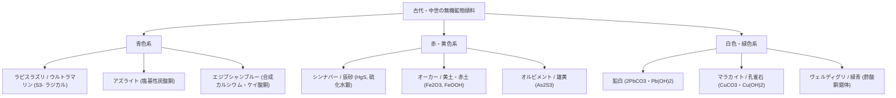
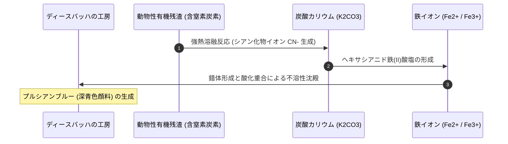
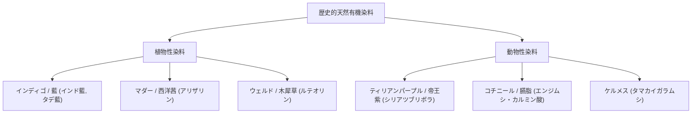
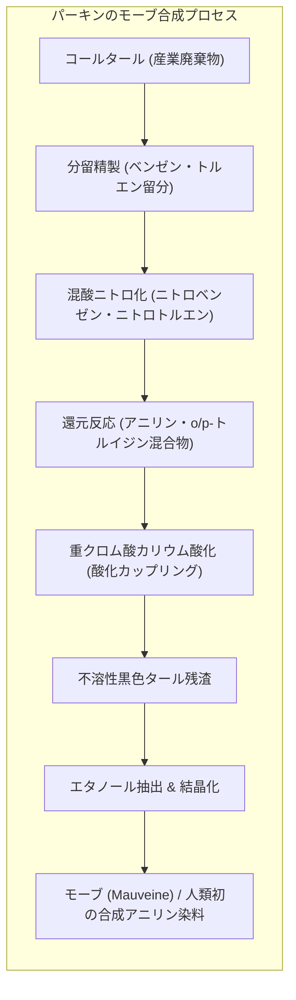
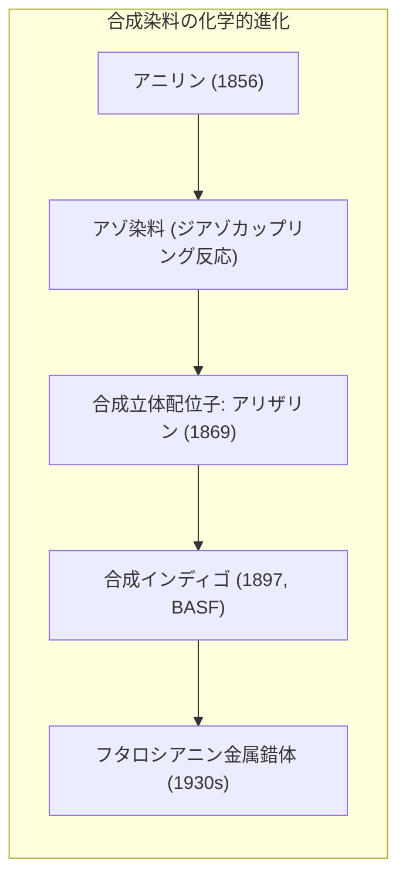
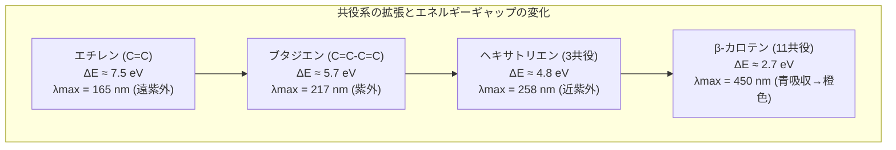
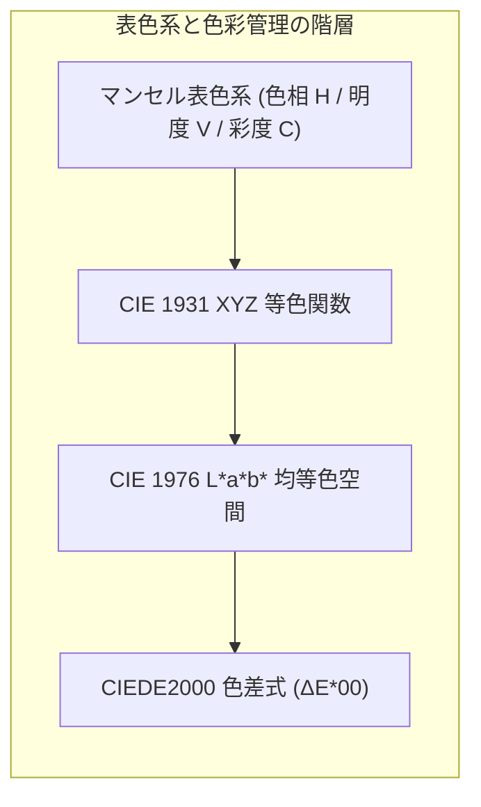

人類の歴史は、光と物質が織りなす「色」を捉え、定着させ、再現しようとする飽くなき欲望の軌跡でもあります。洞窟の暗がりで赤色酸化鉄（オーカー）と木炭を手にした旧石器時代の狩猟採集民から、ラピスラズリの粉末に金を惜しまなかったルネサンスの巨匠たち、そしてコールタールの廃棄物から鮮烈な紫色を偶然に合成して近代有機化学産業を誕生させた18歳のウィリアム・ヘンリー・パーキンに至るまで、色彩の探求は常に科学、経済、芸術、そして地政学の最前線を牽引してきました。

しかし、なぜ物質は色を持つのでしょうか。なぜある粉末は鮮烈なウルトラマリンブルーを放ち、別の分子は日光によって容易に褪色してしまうのでしょうか。その答えは、電子の量子力学的振る舞い、遷移金属イオンの配位子場分裂、有機分子の共役 $\pi$ 電子系におけるフロンティア軌道遷移、そして結晶格子内の原子価間電荷移動（IVCT）という高度な物理化学の領域に存在します。

本稿では、無機顔料と有機染料の科学的本質を解き明かし、古代の天然色素から19世紀の合成染料革命、そして現代のディスプレイ材料や構造色に至る色彩の全歴史を、学術的・定量的に包括して徹底解説します。

---

## 1. 色彩の物理化学的本質：光・物質・電子の相互作用

私たちが「物質の色」として知覚している現象は、物質固有の属性ではなく、電磁波である光と物質中の電子系との相互作用、そして人間の視覚系の受容特性が結びついた結果です。

### 1.1 可視光スペクトルと光子エネルギー

人間の網膜に存在する錐体細胞（S, M, L錐体）が応答する波長領域（可視光）は、おおむね $380\,\text{nm}$ から $780\,\text{nm}$ の範囲にあります。プランク・アインシュタインの式により、波長 $\lambda$ の光子が持つエネルギー $E$ は次式で記述されます：

$$E = h \nu = \frac{h c}{\lambda}$$

ここで、$h \approx 6.626 \times 10^{-34}\,\text{J}\cdot\text{s}$（プランク定数）、$c \approx 2.998 \times 10^8\,\text{m/s}$（真空中の光速）です。電子ボルト（$\text{eV}$）単位で表すと、可視光の光子エネルギーは長波長の赤色（$750\,\text{nm} \approx 1.65\,\text{eV}$）から短波長の紫色（$400\,\text{nm} \approx 3.10\,\text{eV}$）の間に位置します。

物質が白色光（連続スペクトルを持つ電磁波）に照射されたとき、物質中の電子が基底状態から励起状態へ遷移するエネルギー差 $\Delta E$ がこの $1.65\,\text{eV} \sim 3.10\,\text{eV}$ の範囲にあると、対応する特定の波長の光が選択的に吸収されます。

```mermaid
graph LR
    subgraph LIGHT ["光と色の物理的相互作用"]
        direction TB
        WL["白色連続光 (380 - 780 nm)"] --> MAT["物質（顔料・染料分子）"]
        MAT -->|選択的吸収 (ΔE = hν)| ABS["特定波長成分の吸収（電子励起）"]
        MAT -->|透過・散乱・反射| REM["残余スペクトル（補色関係）"]
        REM --> EYE["ヒト視覚（S/M/L錐体細胞刺激）"]
        EYE --> PERC["知覚される色彩 (Color Perception)"]
    end
```

### 1.2 吸収スペクトルと補色の幾何学

反射光または透過光として観察される色は、吸収された光の<strong>補色（Complementary Color）</strong>となります。

| 吸収される光の波長帯 (nm) | 吸収される光の色 | 観察される物質の色（補色） | 代表的な電子遷移機構 |
|---|---|---|---|
| <strong>$400 - 435$</strong> | 紫 (Violet) | 黄緑 (Yellow-Green) | $\pi \to \pi^*$ 遷移（共役系） |
| <strong>$435 - 480$</strong> | 青 (Blue) | 黄 (Yellow) | 金属錯体の $d-d$ 遷移 |
| <strong>$480 - 490$</strong> | 青緑 (Greenish Blue) | 橙 (Orange) | 電荷移動錯体 (CT) |
| <strong>$490 - 500$</strong> | 緑青 (Bluish Green) | 赤 (Red) | リガンド場遷移 |
| <strong>$500 - 560$</strong> | 緑 (Green) | 赤紫 / マゼンタ (Purple/Magenta) | アゾ系共役二重結合 |
| <strong>$560 - 580$</strong> | 黄緑 (Yellow-Green) | 紫 (Violet) | トリフェニルメタン骨格 |
| <strong>$580 - 595$</strong> | 黄 (Yellow) | 青 (Blue) | 原子価間電荷移動 (IVCT) |
| <strong>$595 - 650$</strong> | 橙 (Orange) | 緑青 (Greenish Blue) | フタロシアニン環 |
| <strong>$650 - 750$</strong> | 赤 (Red) | 青緑 (Cyan) | 多核遷移金属クラスター |

### 1.3 顔料（Pigment）と染料（Dye）の定義的差異

色彩工学および化学において、着色剤は<strong>顔料</strong>と<strong>染料</strong>の二つに厳密に区分されます。

1. <strong>顔料（Pigment）</strong>: 媒体（水、油、溶剤、樹脂）に対して<strong>実質的に不溶</strong>な微粒子状の粉末。ビヒクル（固着剤・展色剤）と混合され、基材の表面に物理的塗膜として接着します。耐光性、耐候性、隠蔽力（不透明度）に優れ、絵画、塗料、印刷インク、プラスチック着色に用いられます。
2. <strong>染料（Dye）</strong>: 媒体（通常は水または有機溶媒）に対して<strong>分子状に溶解</strong>する有色化合物。繊維や皮革などの基材内部に浸透し、イオン結合、水素結合、配位結合、ファンデルワールス力、あるいは共有結合によって直接または媒染剤を介して基質分子と強固に結合します。透明性が高く、繊維製品の染色に不可欠です。

---

## 2. 古代・中世の無機顔料：鉱物結晶と錯体化学

近代化学が成立する以前、人類が利用できた永続的な青、赤、黄、緑の多くは、希少な鉱物を粉砕・精製した無機顔料でした。



### 2.1 ラピスラズリと天然ウルトラマリンの謎

中世からルネサンス期にかけて、金よりも高価とされたのが「真の青」こと<strong>ウルトラマリン（Ultramarine, 海を越えてきたもの）</strong>でした。この顔料は、アフガニスタンのバダフシャーン地方でのみ採掘された半貴石ラピスラズリ（主成分：ソーダライト族鉱物ラズライト）を極めて過酷な精製工程を経て抽出したものです。

#### 分子構造と発色機構

ラズライトの結晶化学式は一般に次のように表されます：

$$(Na,Ca)_8[(S,SO_4,Cl)_2 | (AlSiO_4)_6]$$

長石類に似たアルミノケイ酸塩の三次元ケージ状骨格（ゼオライト型ソーダライトケージ）の内部に、特異な<strong>三硫黄ラジカルアニオン（$S_3^{\bullet-}$）</strong>が閉じ込められています。

通常の無機化合物において青色は遷移金属の $d-d$ 遷移に起因することが大半ですが、ウルトラマリンの深い青は、このフリーラジカルアニオン $S_3^{\bullet-}$ 内部での軌道間電子遷移によるものです。$S_3^{\bullet-}$ の基底状態 $^2B_1$ から励起状態 $^2A_2$ への電子遷移吸収帯が波長 $\lambda_{\max} \approx 600\,\text{nm}$（黄〜橙色光）に鋭いピークを持ちます。この黄色光の強烈な吸収の結果、純粋な青色光（$450\,\text{nm}$）のみが散乱・反射され、比類なき至高の青を生み出すのです。

#### パスチッロ法による過酷な抽出

ラピスラズリ原石には不純物として黄鉄鉱（パイライト $FeS_2$）や方解石（カルサイト $CaCO_3$）が大量に含まれており、単に原石を粉砕するだけでは灰色がかった鈍い青にしかなりません。

14世紀の画家チェンニーノ・チェンニーニの『絵画術の書』に記録された「パスチッロ法（Pastello process）」では、微粉砕した鉱石を松脂、蜜蝋、マスチックガムと練り合わせて団子状の練り塊を作り、これを希薄な灰汁（炭酸カリウム水溶液）の中で手で揉み出します。疎水性の高い黄鉄鉱や方解石は樹脂塊に保持され、親水性の高いラズライト微粒子のみが水中に懸濁して沈降します。この抽出を何度も繰り返すことで、純度最高のウルトラマリンが極微量のみ得られたのです。

### 2.2 毒と美の歴史：鉛白、辰砂、オルピメント、シェーレグリーン

古代から近代に至る顔料の歴史は、息をのむような美しい色彩と致死的な毒性が表裏一体となった歴史でもありました。

#### 鉛白（Lead White）

古代ギリシャ・ローマ時代から20世紀初頭まで、絵画の白といえば塩基性炭酸鉛からなる<strong>鉛白</strong>（$2PbCO_3 \cdot Pb(OH)_2$）でした。金属鉛の板を酢酸の蒸気と馬糞（発酵熱と高濃度の二酸化炭素源）の中に数ヶ月間放置する「オランダ法（Dutch Process）」によって製造されました：

$$2Pb + O_2 + 2CH_3COOH \to 2Pb(CH_3COO)_2 + 2H_2O$$

$$3Pb(CH_3COO)_2 + 4H_2O + 2CO_2 \to 2PbCO_3 \cdot Pb(OH)_2 \downarrow + 6CH_3COOH$$

鉛白は乾性油（アマニ油）との親和性が極めて高く、適度な屈折率（$n \approx 2.01$）によって優美な透明感と堅牢な塗膜網目を形成しました。しかし、慢性的な鉛中毒（疝痛、神経麻痺、脳症）を引き起こし、多くの画家や化粧に用いた貴族たちの健康を蝕みました。

#### 辰砂（Cinnabar）と朱（Vermilion）

鮮烈な朱色をもたらした辰砂の主成分は硫化水銀（$\alpha-HgS$）です。バンドギャップ約 $2.1\,\text{eV}$ を持つ直接遷移型半導体であり、緑色から紫外にかけての波長を完全に吸収するため、極めてシャープな赤色反射スペクトルを示します。中国では不老不死の丹薬の原料とされながら、水銀中毒による無数の死者を出しました。

#### ヒ素系顔料：シェーレグリーンとパリスグリーン

18世紀後半から19世紀にかけて、有機化学成立前夜の化学者たちが合成したヒ素化合物が鮮やかな緑色として大流行しました。
- <strong>シェーレグリーン（Scheele's Green, 1775年合成）</strong>: 亜ヒ酸水素銅（$CuHAsO_3$）
- <strong>パリスグリーン（エメラルドグリーン, 1814年合成）</strong>: アセト亜ヒ酸銅（$Cu(C_2H_3O_2)_2 \cdot 3Cu(AsO_2)_2$）

壁紙、布地、ドレス、玩具にまで使われたこれらの顔料は、高湿度の環境下でカビ（*Scopulariopsis brevicaulis* など）が作用することにより、揮発性の猛毒ガスである<strong>トリメチルアルシン（$(CH_3)_3As$）</strong>を放出し、原因不明の集団衰弱死やナポレオン・ボナパルトの幽閉先での毒殺疑惑にまつわる議論を引き起こしました。

---

## 3. プルシアンブルーの偶然の発見と配位化学の夜明け

1704年、ベルリンの塗料職人ハインリヒ・ディースバッハ（Heinrich Diesbach）は、コチニールから赤いレーキ顔料（フローレンス・レイク）を作ろうとしていました。しかし、材料のアルカリ灰（炭酸カリウム）が不足したため、同じ工房の錬金術師ヨハン・コンラート・ディッペルから、動物の血液や肉片を蒸留した後の廃カリウム塩を譲り受けました。

この混合液に硫酸鉄（緑礬 $FeSO_4$）を投入した瞬間、予想された赤ではなく、沈殿は深遠で鮮烈な濃紺へと変化したのです。これが人類初の近代合成無機顔料、<strong>プルシアンブルー（Prussian Blue, 紺青 / ベルリンブルー）</strong>の誕生でした。



### 3.1 錯体構造と原子価間電荷移動（IVCT）

プルシアンブルーの化学構造は長年にわたり謎でしたが、現代のX線結晶構造解析により、三次元のシアノ架橋面心立方（fcc）骨格を持つ配位高分子であることが判明しています。

可溶性プルシアンブルーの理想化学式は $KFe^{III}[Fe^{II}(CN)_6] \cdot xH_2O$、不溶性プルシアンブルーは次式で表されます：

$$Fe_4^{III}[Fe^{II}(CN)_6]_3 \cdot xH_2O \quad (x = 14 \sim 16)$$

この結晶格子内において：
- 低スピン状態の $Fe^{II}$ イオンは、シアニド配位子の炭素原子側（$C$端）に正八面体配位されています（$[Fe^{II}(CN)_6]^{4-}$）。
- 高スピン状態の $Fe^{III}$ イオンは、シアニド配位子の窒素原子側（$N$端）に水分子とともに正八面体配位されています（$[Fe^{III}(NC)_6]$）。

```
      CN           CN           CN
       |            |            |
-- Fe(II) - C ≡ N - Fe(III) - N ≡ C - Fe(II) --
       |            |            |
      NC           NC           NC
```

#### 光励起による電子移動

プルシアンブルーの濃密な青色は、通常の $d-d$ 遷移（ラポルテ禁制）によるものではなく、<strong>光誘起原子価間電荷移動（Intervalence Charge Transfer, IVCT）</strong>という量子力学的機構によって生じます：

$$Fe_A^{II} - C \equiv N - Fe_B^{III} + h\nu \longrightarrow Fe_A^{III} - C \equiv N - Fe_B^{II*}$$

基底状態において $Fe^{II}$（$t_{2g}^6$）にある電子が、波長約 $680\,\text{nm}$（赤色光）の光子を吸収することで、シアニド架橋軌道を介して隣接する $Fe^{III}$（$t_{2g}^3 e_g^2$）の空軌道へと瞬時に移動します。

赤色光の吸収断面積が極めて大きいため、透過・散乱される光は純度の高い濃青色となり、わずかな量でも圧倒的な着色力を発揮します。

### 3.2 葛飾北斎・ゴッホとプルシアンブルーの衝撃

プルシアンブルーの登場は世界の美術界を激震させました。ヨーロッパでは高価なラピスラズリの代替として瞬く間に普及し、18世紀後半には鎖国下の日本へと長崎経由で密輸入されました（「ベロ藍」）。

葛飾北斎は『富嶽三十六景』（特に有名な「神奈川沖浪裏」）においてベロ藍の大胆な濃淡グラデーション（ぼかし）を多用し、藍染め用の植物性タデアイでは不可能だった鮮烈で立体的な海洋の動態を描き出しました。この浮世絵が19世紀後半のヨーロッパに渡り、フィンセント・ファン・ゴッホをはじめとする印象派・ポスト印象派の画家たちに計り知れないインスピレーションを与えるという、色彩の世界的環流が成立したのです。

---

## 4. 天然有機染料とグローバル交易ネットワーク

無機顔料が絵画や建造物の着色を担う一方、日常の衣服や布地を鮮やかに彩ったのは動植物から抽出される有機染料でした。しかし、水溶性の染料分子を繊維に定着させるには、高度な界面化学と錯体配位の知識（媒染技術）が必要でした。



### 4.1 ティリアンパープル（帝王紫）と地中海の覇権

古代地中海世界において、皇帝や高位聖職者のみが着用を許された最高権力の象徴が<strong>ティリアンパープル（Tyrian Purple）</strong>でした。

#### 抽出と光化学反応

この染料は、地中海に生息する肉食性巻貝であるシリアツブリボラ（*Bolinus brandaris*）やヒメヨウラクガイの鰓下腺（hypobranchial gland）から分泌される粘液前駆体から得られます。採取した直後の分泌物は無色から淡黄色の液体（チラチンなどのインドキシル誘導体）ですが、日光（紫外線）と空気中の酸素に晒されることで劇的な光化学反応を起こします：

1. 鰓下腺酵素（プルプラーゼ）による前駆体の加水分解：インドキシルエステルがインドキシル誘導体へと変換。
2. 光照射下での酸化二量化および臭素化置換基の再配置：

$$2 \text{前駆体} \xrightarrow{h\nu, \, O_2} 6,6'\text{-ジブロモインディゴ} \; (C_{16}H_8Br_2N_2O_2)$$

わずか $1\,\text{g}$ の純粋な $6,6'$-ジブロモインディゴを得るために、およそ10,000個もの巻貝を破壊・浸漬する必要がありました。そのためフェニキア人の都市テュロスはこの染料の独占生産によって莫大な富を築き上げ、ローマ帝国では一般市民が紫色の衣服を着用することは反逆罪とみなされたほどでした。

### 4.2 コチニール（エンジムシ）とスペイン帝国の銀に次ぐ財源

新大陸の征服者（コンキスタドール）がアステカ帝国から持ち帰った最大の富の一つは、金銀に匹敵する価値を持った深紅の染料、<strong>コチニール（Cochineal）</strong>でした。

#### アントラキノン系骨格とキレート媒染

コチニールは、ウチワサボテンに寄生するカイガラムシ科の昆虫（*Dactylopius coccus*）の乾燥した雌の体から抽出されます。その主色素は水溶性のアントラキノングルコシドである<strong>カルミン酸（Carminic acid, $C_{22}H_{20}O_{13}$）</strong>です。

カルミン酸単独では繊維に対して弱い染着性しか示さず、色調も濁った橙褐色に留まります。しかし、アルミニウムイオン（$Al^{3+}$）やスズイオン（$Sn^{4+}$）などの金属塩（媒染剤）を添加すると、アントラキノン環の隣接するフェノール性水酸基およびカルボキシル基が金属カチオンを強力にキレート配位します。

```
        O    OH
       // \  /
      C    Al(III)  <--- キレート架橋による配位高分子化
     / \  /     C   C    O
   ||   ||
```

この金属錯体形成（レーキ化）により：
- 配位子から金属への電荷移動および共役系の平面固定化が生じ、吸収極大が長波長シフト（深色効果）して鮮烈な深紅（スカーレット〜クリムゾン）を発現。
- 不溶性のキレート錯体粒子が羊毛や絹のペプチド鎖と強固に絡み合い、比類なき耐洗濯性と耐光性を獲得します。

スペイン帝国はこのコチニールの生産地と製法を国家最高機密として厳重に防衛し、ヨーロッパの宮廷、枢機卿の衣服、英国陸軍の象徴である「赤いコート（Redcoats）」を染め上げる染料として世界経済を支配しました。

---

## 5. 1856年パーキンのモーブ合成：近代有機化学工業の爆発

19世紀半ばまで、すべての着色剤は自然界の鉱物、植物、動物の恵みに依存していました。しかし1856年のイースター休暇、ロンドンの粗末な自宅実験室において、近代産業史を根本から塗り替える決定的な偶然が起きました。

### 5.1 キニーネ合成の失敗から生まれた紫の奇跡

当時18歳の学生であった<strong>ウィリアム・ヘンリー・パーキン（William Henry Perkin）</strong>は、王立化学学校の指導教授アウグスト・ヴィルヘルム・フォン・ホフマンの示唆を受け、マラリアの特効薬であった天然アルカロイド「キニーネ」の人工合成に挑戦していました。

当時の不完全な分子式知識に基づき、パーキンは石炭ガス製造の産業廃棄物であったコールタールから得られるアリルアニリンを酸化すれば、簡単な脱水素反応でキニーネが得られると仮定しました：

$$2 C_{10}H_{13}N + 3[O] \xrightarrow{?} C_{20}H_{24}N_2O_2 + 2H_2O$$

パーキンはアニリン硫酸塩に二クロム酸カリウム（$K_2Cr_2O_7$）を投入して酸化反応を行いました。しかし得られたのは無色透明のキニーネ結晶ではなく、フラスコの底にこびりついた不快な黒褐色のヘドロ状タール物質でした。

通常の実験者であれば失敗として廃棄するところでしたが、パーキンはこのタールをエタノールで洗浄してみました。すると、溶液は目を見張るような息をのむほど鮮やかな赤紫色へと変化したのです。このアルコール溶液に絹布を浸すと、布地は美しい紫色に染まり、日光に晒しても石鹸で洗っても一切色落ちしませんでした。



### 5.2 モーブ（Mauveine）の化学構造

パーキンが手にした粗製アニリンには、当時の精製技術の限界から大量のオルト-トルイジン（$o$-toluidine）およびパラ-トルイジン（$p$-toluidine）が不純物として混入していました。実は、このトルイジン不純物こそが奇跡の鍵だったのです。高純度のアニリン単体ではモーブは決して生成しません。

現代の分析化学により同定されたモーブの主成分は、フェナジニウム環を基本骨格とする複雑な四環系芳香族化合物の混合物です：
- <strong>モーブA（Mauveine A）</strong>: $C_{26}H_{23}N_4^+ \cdot X^-$
- <strong>モーブB（Mauveine B）</strong>: $C_{27}H_{25}N_4^+ \cdot X^-$

正電荷が共鳴によって複数の窒素原子およびベンゼン環全体に非局在化しており、これが可視光の $540\,\text{nm}$（緑色光）を強烈に吸収し、鮮烈な紫色光を反射します。

### 5.3 工業化の決断と化学産業コンプレックスの誕生

パーキンは大学を中退し、父親と兄の出資を得てロンドン近郊のハローに世界初の合成染料工場を建設しました。これは単なる新製品の発売に留まらず、原材料の調達、スケールアップ装置の設計（耐酸性反応釜）、染色プロセスの標準化までをゼロから構築した、<strong>「研究開発型ハイテク産業」の史上初のモデルケース</strong>でした。

フランスの皇后ウジェニーや英国のヴィクトリア女王がモーブで染められたドレスを着用したことで、1860年代のヨーロッパは「モーブ熱（Mauve Measles）」と呼ばれる社会現象に包まれました。パーキンの成功は、廃棄物同然だったコールタールが莫大な富を生む「化学の金鉱」であることを世界に証明したのです。

---

## 6. ドイツの覇権と合成インディゴ：天然農園の崩壊

パーキンの成功に触発されたヨーロッパ各国の化学者たちは、コールタール誘導体からの新色開発に狂奔しました。特に1870年代以降、この分野の主導権を握ったのは、大学と企業が密接に連携したドイツ帝国でした（BASF、バイエル、ヘキスト、アグファ）。



### 6.1 アゾ染料とジアゾカップリングの威力

1858年、ペーター・グリース（Peter Griess）によって<strong>ジアゾ化反応</strong>が発見され、1870年代に<strong>アゾカップリング反応</strong>が確立されると、合成染料の世界は爆発的な多様化を遂げました。

芳香族第一級アミンを亜硝酸ナトリウムと塩酸で処理してジアゾニウム塩を生成し、これをフェノール類や芳香族アミンとアルカリ性または弱酸性下で反応させます：

$$Ar - NH_2 + NaNO_2 + 2HCl \xrightarrow{0-5^\circ\text{C}} [Ar - N^+ \equiv N] Cl^- + NaCl + 2H_2O$$

$$[Ar - N^+ \equiv N] Cl^- + H - Ar' \longrightarrow Ar - N = N - Ar' + HCl$$

生成する<strong>アゾ基（$-N=N-$）</strong>は極めて強力な発色団であり、二つの芳香族環 $Ar$ と $Ar'$ を結んで巨大な共役 $\pi$ 電子ネットワークを構築します。置換基（$-OH, -NH_2, -SO_3Na, -NO_2$ など）の電子的性質（電子供与性・電子求引性）を系統的に変化させることで、黄色、橙色、赤色、茶色、黒色に至るあらゆる色彩を自由自在に分子設計できるようになったのです。

現在でも、工業的に生産される合成染料の約60%以上がアゾ系染料で占められています。

### 6.2 合成インディゴの工業化と地政学的激変

合成染料化学における究極の目標は、世界中で最も大量に消費されていた天然染料の王様、<strong>インディゴ（藍）</strong>の全合成でした。

#### アドルフ・フォン・バイヤーの構造決定

有機化学の巨人アドルフ・フォン・バイヤー（Adolf von Baeyer）は、1865年からインディゴの研究を開始し、1883年にその平面二量体構造を完全に解明しました：

```
       O              H
       \            /
        C == C -- C == C
       /      \ /      \
     //        N        \
    |   ベンゼン |   ベンゼン |
     \        / \      //
       N == C -- C == C
      /                \
     H                  O
```

二つのインドール環が中央の炭素-炭素二重結合（$C=C$）で結ばれ、カルボニル基（$C=O$）とアミノ基（$-NH-$）が分子内で強固な水素結合を形成したトランス配置をとっています。

#### BASFの17年に及ぶ執念と巨大投資

構造が判明しても、経済的に天然藍と競争できる工業合成プロセスの確立は困難を極めました。ドイツの化学大手BASFは、1880年から1897年にかけて約1,800万金マルク（当時のBASFの全資本金を上回る額）という天文学的な研究開発費を投じました。

カール・ヘイマン（Karl Heumann）のフェニルグリシン法やナフタレンを原料とするフタル酸経由のプロセスが、接触酸化用触媒（水銀法）の発見によってついに商業的に完成しました：

1. ナフタレンの酸化 $\to$ 無水フタル酸
2. アントラニル酸 $\to$ $N$-(2-カルボキシフェニル)グリシン
3. アルカリ溶融によるインドキシルの生成
4. 空気酸化によるインディゴの二量化析出

1897年、BASFが「インディゴ・ピュア（Indigo Pure）」を発売すると、その圧倒的な均一性と低価格により、イギリス領インド帝国が数世紀にわたり独占してきた広大なインディゴ農園（約60万ヘクタール）はわずか10年余りで完全に壊滅しました。数百万人の小作農が職を失い、世界の農業・植民地貿易構造は巨大化学工場へと不可逆的にシフトしたのです。

---

## 7. 発色機構の分子軌道論と量子化学

なぜ特定の有機分子が光を吸収し、色を放つのか。この問いに対する定量的かつ理論的な説明は、20世紀の量子力学と分子軌道法（MO理論）の確立によって初めて可能となりました。

### 7.1 発色団（Chromophore）と助色団（Auxochrome）

1876年、オットー・ウィット（Otto Witt）は経験則として発色団説を提唱しました。現代の電子論において、これらは次のように定義されます：

1. <strong>発色団（Chromophore）</strong>: 不飽和結合を有し、比較的容易に励起可能な $\pi$ 電子を持つ官能基。
   - 例: アゾ基（$-N=N-$）、ニトロ基（$-NO_2$）、カルボニル基（$>C=O$）、エチレン基（$>C=C<$）、キノイド環。
2. <strong>助色団（Auxochrome）</strong>: それ自体は可視光を吸収しないが、共役系に直接結合することで非共有電子対（ローンペア）を提供し、吸収帯を長波長シフト（深色効果: Bathochromic shift）させ、吸収強度を増大（濃色効果: Hyperchromic shift）させる官能基。
   - 電子供与性助色団: $-N(CH_3)_2, -NH_2, -OH, -OCH_3$
   - 電子求引性助色団: $-NO_2, -CN, -SO_3^-$

### 7.2 共役系とHOMO-LUMOギャップの縮小

有機分子において、可視光吸収の本質は最高被占軌道（<strong>HOMO</strong>: Highest Occupied Molecular Orbital）から最低空軌道（<strong>LUMO</strong>: Lowest Unoccupied Molecular Orbital）への $\pi \to \pi^*$ 電子遷移です。

エチレン（二重結合1個）の吸収極大波長 $\lambda_{\max}$ は $165\,\text{nm}$（遠紫外線領域）にあり、HOMO-LUMOエネルギーギャップ $\Delta E$ は約 $7.5\,\text{eV}$ と非常に広大です。しかし、二重結合と単結合が交互に連なる共役系（Conjugated System）が伸長すると、$\pi$ 分子軌道が互いに重なり合って非局在化します。



二重結合の数 $N$ が増加するにつれて、$\pi$ 軌道のエネルギー準位は密になり、HOMO準位は上昇し、LUMO準位は低下します。その結果、エネルギーギャップ $\Delta E = E_{\text{LUMO}} - E_{\text{HOMO}}$ は単調に減少し、必要な励起光の波長 $\lambda = \frac{hc}{\Delta E}$ は長波長側（可視光領域）へとシフトしていきます。

### 7.3 クーンの一次元自由電子モデル（FEMOモデル）による定量的アプローチ

ハンス・クーン（Hans Kuhn）は、長鎖ポリメチン色素やカロテノイドの電子吸収スペクトルを説明するため、共役 $\pi$ 電子を一次元の一次元無限井戸型ポテンシャル（箱の中の粒子）に閉じ込められたフェルミ粒子ガスとして扱う「自由電子分子軌道法（FEMO）」を提案しました。

長さ $L$ の一次元箱の中に閉じ込められた質量 $m_e$ の電子のエネルギー準位 $E_n$ は、シュレーディンガー方程式の解として次式で与えられます：

$$E_n = \frac{n^2 h^2}{8 m_e L^2} \quad (n = 1, 2, 3, \dots)$$

共役系に $2k$ 個の $\pi$ 電子が存在する場合、パウリの排他律により、基底状態では $n = 1$ から $n = k$ までの準位にそれぞれ2個ずつの電子がスピン逆向きで収容されます（$n = k$ がHOMO、$n = k+1$ がLUMO）。

したがって、最も長波長の光吸収に対応する HOMO $\to$ LUMO 遷移エネルギー $\Delta E$ は：

$$\Delta E = E_{k+1} - E_k = \frac{h^2}{8 m_e L^2} \left[ (k+1)^2 - k^2 \right] = \frac{h^2 (2k + 1)}{8 m_e L^2}$$

共役系の炭素骨格の長さを結合長 $d_C$（約 $0.14\,\text{nm}$）を用いて $L \approx 2k \cdot d_C$ と近似すると：

$$\Delta E \propto \frac{2k+1}{(2k)^2} \approx \frac{1}{2k}$$

すなわち、共役鎖の長さ $L$（電子数 $2k$）に反比例して励起エネルギー $\Delta E$ が減少し、吸収波長 $\lambda$ は共役長とともに長波長化することが定量的に示されます。現代の量子化学では、密度汎関数法（TD-DFT）を用いることで、溶媒効果や立体配座を考慮したミリ電子ボルト精度の励起スペクトル予測が可能となっています。

---

## 8. 現代の色彩科学：フタロシアニンからディスプレイ・環境調和へ

20世紀から21世紀にかけて、色彩の科学は衣料用染料の枠組みを超え、エレクトロニクス、エネルギー変換、そして環境持続可能性の中心課題へと進化を遂げました。

### 8.1 フタロシアニン青とキナクリドン赤：最高峰の高性能有機顔料

1928年にスコットランドで偶然発見された<strong>銅フタロシアニン（Copper Phthalocyanine, CuPc / フタロシアニンブルー）</strong>は、人工顔料の最高傑作と称されます。

#### 構造と驚異的堅牢性

フタロシアニンは、生体内のヘム（ヘモグロビン）やクロロフィル（葉緑素）と極めて類似したポルフィリン類似の大環状共役化合物です。中央に銅イオン（$Cu^{2+}$）が4つのイソインドール窒素原子によって四角平面型に強固に配位されています。

```
            N
          // \
     N - C     C - N
    /     \   /     \
   C == N - Cu - N == C
    \     /   \     /
     N - C     C - N
          \ //
            N
```

この閉じた環状 $18\pi$ 電子共役系（ヒュッケル則を満たす芳香族性）は熱力学的に極めて安定であり、$500^\circ\text{C}$ の高温に耐え、濃硫酸に溶解しても分解せず、苛烈な直射日光下でも数十年間にわたり一切退色しません。現代の印刷インキ（シアン色版）、自動車塗料、有機太陽電池のホール輸送材料として全世界で不可欠な存在となっています。

### 8.2 色彩の標準化と表色系：人間の感覚を数値化する

色彩を産業製品として正確に管理・通信するため、国際照明委員会（CIE）は光度測定と心理物理学に基づいた表色系を確立しました。



特に産業界で標準として使用されるのが**CIE $L^*a^*b^*$ 均等色空間**です：
- $L^*$: 明度（0 = 完全な黒、100 = 拡散反射白色）
- $a^*$: 赤-緑軸（正の値 = 赤、負の値 = 緑）
- $b^*$: 黄-青軸（正の値 = 黄、負の値 = 青）

二つの製品間の色差 $\Delta E_{ab}^*$ はユークリッド距離として定義されます：

$$\Delta E_{ab}^* = \sqrt{(\Delta L^*)^2 + (\Delta a^*)^2 + (\Delta b^*)^2}$$

現在では人間の目の非線形感度補正を取り入れた**CIEDE2000（$\Delta E_{00}^*$）**式が塗料やアパレルの合否判定規格（Pass/Fail基準）として採用されています。

### 8.3 現代ディスプレイ：量子ドットと有機ELの発光化学

現代のデジタル社会において、色を見る場所はカンバスや布地から画面へと移行しました。
1. <strong>量子ドット（Quantum Dots, QD）</strong>: カドミウムフリーのリン化インジウム（$InP$）などのナノメートル級半導体結晶。量子閉じ込め効果により、結晶粒径を $2\,\text{nm}$（青）から $6\,\text{nm}$（赤）へナノスケールで制御するだけで、半値幅（FWHM）が極めて狭い単色高純度の光を発光させることができます。
2. <strong>有機EL（OLED）</strong>: 電流励起によって発光する有機 $\pi$ 共役分子。リン光材料や熱活性化遅延蛍光（TADF）分子を用いることで、励起子生成比率（一重項25%：三重項75%）の壁を打破し、内部量子効率100%を達成しています。

### 8.4 サステナビリティの課題と「構造色」の未来

化学合成染料・顔料は人類に無限の色彩美をもたらした一方で、重大な環境負荷を残してきました。アゾ染料の中には発がん性芳香族アミンを遊離するものがあり、染色排水による河川汚染や重金属（クロム、カドミウム、鉛）の蓄積は深刻なエコロジー問題です。

これに対し、近年脚光を浴びているのが<strong>構造色（Structural Color）</strong>です。モルフォ蝶の翅、クジャクの羽、オパールなどに見られる色彩は、色素の吸収によるものではなく、サブミクロン周期の微細ナノ構造（多層膜干渉、フォトニック結晶）による光の強め合い干渉によって生まれます。

色素を一切使用せず、セルロースナノファイバーや生分解性ポリマーの自己組織化ナノ構造によって鮮烈な発色を作り出す技術は、「褪色せず、毒性を持たず、完全にリサイクル可能な究極のクリーンカラー」として、次世代の持続可能社会を塗り替える希望となっています。

---

## 9. 結論：人類の叡智が紡いだ色彩のタペストリー

旧石器時代の洞窟壁画の赭石（オーカー）から始まった人類の色彩の旅は、鉱物を砕く古代の錬金術、地中海や新大陸を駆け巡った染料交易、19世紀の試験管から立ち上がった近代化学工業、そして電子の波動関数を制御する現代の量子ナノテクノロジーへと至りました。

色彩とは、単なる視覚的な装飾ではありません。それは物質の本質を理解し、分子を精密に設計し、光の量子と対話してきた人類の知性の結晶です。私たちが身の回りの鮮やかな色彩に目を向けるとき、そこには数千年をかけて科学者、職人、芸術家たちが積み重ねてきた情熱と叡智の壮大なパノラマが息づいているのです。