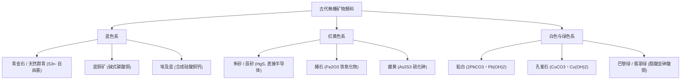
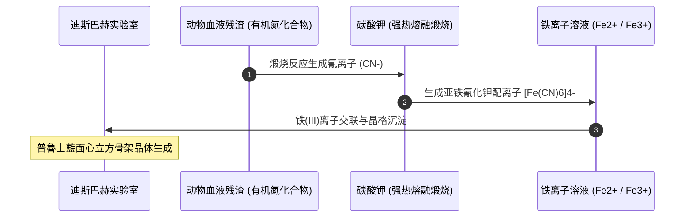
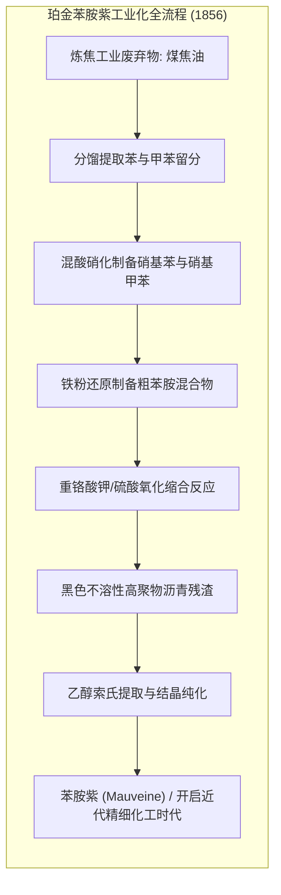

人类文明的演进史，从某种意义上说就是一部不断捕捉、提纯与创造色彩的历史。从旧石器时代洞穴中用赭石（氧化铁）与木炭绘制岩画的远古猎人，到文艺复兴时期按重量不惜等金购买阿富汗青金石的湿壁画巨匠，再到1856年18岁的英国青年威廉·亨利·珀金（William Henry Perkin）在合成抗疟药奎宁失败时意外从煤焦油中提炼出第一种合成染料“苯胺紫”（Mauveine）并催生近代有机化学工业——对色彩的追寻始终是连接物质科学、地缘政治与人类精神创造力的核心纽带。

为什么某些分子呈现出摄人心魄的鲜艳色彩，而另一些分子却透明无色？为什么天然群青历经七个世纪的教堂风霜依然湛蓝如初，而早期的植物色淀在日光下数月便褪色无踪？答案深植于现代物理化学的宏伟框架之中：电磁波与电子能階的共振吸收、过渡金属晶體場分裂、有机共軛 $\pi$ 电子体系中的前線軌域跃迁，以及無機配位聚合物中的光致价间電荷轉移（IVCT）。

本文将对顏料与染料的科学机制进行系统而定量的剖析，贯通矿物物理学、配位化学、有机合成史与量子光学，全面重构人类色彩文明的宏大图景。

---

## 1. 色彩的物理化学本质：光、物质与電子躍遷

人类视觉系统感知到的色彩，并非物体本身的绝对属性，而是入射电磁波与物质中电子能态发生量子力學相互作用，随后由人眼视网膜感光细胞进行神经转导与大脑综合处理的结果。

### 1.1 可见光譜与光子能量

人眼视网膜拥有三种视锥细胞（S、M、L），能够响应的电磁辐射波长范围大约在 $380\,\text{nm}$ 至 $780\,\text{nm}$ 之间。根据普朗克-爱因斯坦关系式，单光子的能量 $E$ 与波长 $\lambda$ 呈反比关系：

$$E = h \nu = \frac{hc}{\lambda}$$

其中 $h \approx 6.626 \times 10^{-34}\,\text{J}\cdot\text{s}$（普朗克常数），$c \approx 2.998 \times 10^8\,\text{m/s}$（真空中光速）。可见光波段的光子能量介于 $1.65\,\text{eV}$（深红光，$\lambda \approx 750\,\text{nm}$）与 $3.10\,\text{eV}$（紫光，$\lambda \approx 400\,\text{nm}$）之间。

当复色白光照射物质时，若物质分子或晶体中存在能量差为 $\Delta E$ 的基态与激发态，且 $\Delta E$ 恰好落在 $1.65 - 3.10\,\text{eV}$ 区间内，对应特定波长 $\lambda = \frac{hc}{\Delta E}$ 的光子将被共振吸收，促使电子发生轨道跃迁。

```mermaid
graph LR
    subgraph OPTICS ["光与物质的相互作用机制"]
        direction TB
        W["复色白光 (380 - 780 nm)"] --> M["着色介质 (顏料/染料分子)"]
        M -->|共振吸收 (ΔE = hν)| A["特定波长光子被吸收 (電子躍遷)"]
        M -->|散射/反射/透射| R["剩余互补光譜成分"]
        R --> E["人眼视网膜S/M/L视锥细胞"]
        E --> P["大脑感知互補色 (Perceived Color)"]
    end
```

### 1.2 互補色几何原理与吸收光譜对应

人眼看到的反射色或透射色，是物质吸收光譜的<strong>互補色（Complementary Color）</strong>：

| 被吸收的光譜带 (nm) | 吸收的光譜色 | 人眼观察到的颜色（互補色） | 典型电子激发物理机制 |
|---|---|---|---|
| <strong>$400 - 435$</strong> | 紫色 | 黄绿色 | 共軛多烯 $\pi \to \pi^*$ 跃迁 |
| <strong>$435 - 480$</strong> | 蓝色 | 黄色 | 配体到金属電荷轉移 (LMCT) |
| <strong>$480 - 490$</strong> | 绿蓝色 | 橙色 | 金属到配体電荷轉移 (MLCT) |
| <strong>$490 - 500$</strong> | 蓝绿色 | 红色 | 半导体禁带直接带隙跃迁 (如朱砂) |
| <strong>$500 - 560$</strong> | 绿色 | 品红 / 紫红 | 偶氮共軛共振体系跃迁 |
| <strong>$560 - 580$</strong> | 黄绿色 | 紫色 | 三苯甲烷碳正离子离域跃迁 |
| <strong>$580 - 595$</strong> | 黄色 | 蓝色 | 价间電荷轉移 (IVCT, 如普魯士藍) |
| <strong>$595 - 650$</strong> | 橙色 | 青色 / 天蓝 | 酞菁大环 $18\pi$ 芳香共振跃迁 |
| <strong>$650 - 750$</strong> | 红色 | 纯青色 | 自由基阴离子限域能階跃迁 (如群青) |

### 1.3 顏料（Pigment）与染料（Dye）的严格界面热力学区分

在材料科学中，着色剂被明确分为顏料与染料两大家族：

1. <strong>顏料（Pigment）</strong>：在分散介质（水、油脂、有机溶剂、高分子树脂）中<strong>几乎完全不溶解</strong>的固体微颗粒。顏料以亚微米级结晶或无定形颗粒的形式存在，通过黏合剂（如干性亚麻仁油、阿拉伯树胶、丙烯酸乳液）以物理方式包覆并附着在基底表面。其遮盖力取决于颗粒与基质间的折射率差值。
2. <strong>染料（Dye）</strong>：在溶剂中呈现<strong>分子级真溶解</strong>的有色化合物。染料分子能够渗透进纺织纤维（羊毛、蚕丝、棉、麻）或皮革的多孔结构内部，依靠离子键、氢键、配位键、范德华力或共价反应直接与基质高分子牢固结合。

---

## 2. 古代無機矿物顏料：晶体结构与配位场论

在近代化学合成出现前，永恒的色彩主要来自稀有的天然地质矿物。



### 2.1 青金石与天然群青：方鈉石笼中的三硫自由基阴离子

中世纪与文艺复兴时期，圣母玛利亚斗篷上那抹神圣高贵的“真蓝”——<strong>天然群青（Ultramarine）</strong>，其原料来自阿富汗巴达赫尚偏远高山的青金石矿。

青金石的主要着色矿物是天蓝石（Lazurite），化学式为：

$$(Na, Ca)_8 [(S, SO_4, Cl)_2 | (AlSiO_4)_6]$$

天蓝石具有类似沸石的硅铝酸盐三维骨架结构（方鈉石 $\beta$ 笼）。笼状结构内部捕获了极其罕见且活性的<strong>三硫自由基阴离子（$S_3^{\bullet-}$）</strong>。

$S_3^{\bullet-}$ 拥有19个价电子，属于非闭壳层开壳自由基。分子軌域理论表明，其处于 $C_{2v}$ 对称性环境中，电子从 $^2B_1$ 基态跃迁到激发态 $^2A_2$，在波长 $\lambda_{\max} \approx 600\,\text{nm}$（黄橙光）处产生强烈的吸收峰。由于强力吸收了黄光，唯有纯净高饱和度的纯蓝光（$450 - 480\,\text{nm}$）被反射逃逸。刚性的刚性硅铝酸盐骨架如同分子监狱，阻隔了外界水汽与氧气的进攻，赋予了天然群青历经数千年而不褪色的非凡稳定性。

### 2.2 毒性美学：鉛白与砷酸铜绿

色彩的探索历史上常伴随着致命的代价。

1. <strong>鉛白（$2PbCO_3 \cdot Pb(OH)_2$）</strong>：通过“荷兰堆积法”合成，将金属铅卷置于盛有醋酸的陶罐中，并深埋在发酵马粪堆下数月。马粪发酵产生的热量（$60^\circ\text{C}$）与大量 $CO_2$ 气体促使醋酸铅水解生成碱式碳酸铅。鉛白与亚麻仁油结合生成的铅皂赋予油画极佳的流平性与弹性，但也导致无数画家与使用铅粉化妆的贵族罹患严重的铅中毒脑病与肌肉萎缩。
2. <strong>舍勒绿与巴黎绿</strong>：18世纪末合成的铜砷盐（$CuHAsO_3$ 与 $Cu(C_2H_3O_2)_2 \cdot 3Cu(AsO_2)_2$）色彩极其明艳鲜翠，迅速风靡维多利亚时代的壁纸与礼服。然而在潮湿环境中，室内霉菌（如短帚霉）将其生物甲基化，持续释放出剧毒气体<strong>三甲基胂（$(CH_3)_3As$）</strong>，引发了广泛的中毒悲剧。

---

## 3. 普魯士藍：第一种近代合成顏料与价间電荷轉移

1704年，柏林顏料制造商海因里希·迪斯巴赫（Heinrich Diesbach）试图制备胭脂紅淀顏料。由于缺乏纯净碳酸钾，他向炼金术士康拉德·迪佩尔借用了蒸馏动物血液残渣后剩余的受污染钾盐。当他在混合液中加入硫酸亚铁（绿矾 $FeSO_4$）时，生成的沉淀在酸化后瞬间爆发为一种浓重深邃的深蓝色——这就是<strong>普魯士藍（Prussian Blue）</strong>。



### 3.1 晶体结构与价间電荷轉移（IVCT）

不溶性普魯士藍的化学式为：

$$Fe_4^{III}[Fe^{II}(CN)_6]_3 \cdot xH_2O \quad (x = 14 \sim 16)$$

它构成了面心立方（fcc）立体配位网格。晶格中：
- 低自旋 $Fe^{II}$ 离子处于由6个氰基碳端围绕的正八面体配位场中（$[Fe^{II}(CN)_6]^{4-}$）。
- 高自旋 $Fe^{III}$ 离子处于由氰基氮端和水分子围绕的正八面体配位场中（$[Fe^{III}(NC)_6]$）。

普魯士藍的深邃蓝色并非源于禁阻的晶體場 $d-d$ 跃迁，而是<strong>光致价间電荷轉移（IVCT）</strong>的经典范例：

$$Fe_A^{II} - C \equiv N - Fe_B^{III} + h\nu \longrightarrow Fe_A^{III} - C \equiv N - Fe_B^{II*}$$

吸收约 $680\,\text{nm}$ 的红光光子后，基态 $Fe^{II}$（$t_{2g}^6$）的电子通过氰基 $\pi^*$ 桥联轨道瞬间跃迁到邻近 $Fe^{III}$（$t_{2g}^3 e_g^2$）的空轨道。这种超强電荷轉移吸收完全抹杀了红光波段，仅透过浓烈的宝蓝色光。

普魯士藍的发现彻底颠覆了全球艺术与工业格局。日本江户时代的浮世绘大师葛饰北斋在《富岳三十六景》（如《神奈川冲浪里》）中大量运用进口的“柏林蓝”，创造出深邃波澜的海洋层次；而约翰·赫歇尔在1842年发明的氰化照相法（蓝晒印相法），更使普魯士藍成为工程建筑“蓝图”的技术基石。

---

## 4. 天然有机染料：地缘政治、骨螺紫与胭脂紅配位

在工业合成染料诞生前，衣物的色彩来自自然界动植物的萃取。为了克服天然染料对棉麻纤维着色牢度差的缺陷，古代染色技术大量运用了金属离子“媒染”配位化学。

### 4.1 骨螺紫（帝王紫）的光化学奥秘

古代地中海世界中，象征最高皇权与神职尊贵的<strong>骨螺紫（Tyrian Purple）</strong>由腓尼基人垄断生产。这种染料萃取自肉食性海螺（如染料骨螺 *Bolinus brandaris*）的下鳃腺分泌物。

刚挤出的分泌物本是无色的水溶性前驱体（硫茚哚酯）。在螺类自身分泌的“紫色素酶”水解及日光紫外线照射下，发生剧烈的氧化二聚光化学反应，最终转化为稳定的深紫色晶体——<strong>6,6'-二溴靛蓝（$6,6'\text{-dibromoindigo}$）</strong>：

$$2 \text{前驱体} \xrightarrow{h\nu, \, O_2} C_{16}H_8Br_2N_2O_2$$

生产区区1克纯染料需要捕捞并压碎上万只海螺，其高昂身价使其在罗马帝国成为非皇室成员穿戴即属叛逆重罪的禁忌之色。

### 4.2 胭脂紅与铝离子的螯合媒染

西班牙帝国征服阿兹特克帝国后获得的最具战略价值的财富之一，是在仙人掌上培育的胭脂虫（*Dactylopius coccus*）。

其主色素为<strong>胭脂紅酸（Carminic acid, $C_{22}H_{20}O_{13}$）</strong>。当羊毛或丝绸经过明矾（$KAl(SO_4)_2$）媒染处理后，$Al^{3+}$ 离子与羊毛纤维的羧基结合，随后与胭脂紅酸邻位酚羟基和羰基氧形成多齿<strong>螯合配位环（色淀复合体）</strong>。

这一配位作用显著拉低了分子前線軌域能階差，产生深色效应，显现出极其饱满鲜艳的绯红色，并使色素分子牢固锚定在纤维内部，造就了横扫欧洲宫廷与英国“红衫军”军服的传奇深红。

---

## 5. 1856年合成染料革命：珀金与煤焦油奇迹

1856年复活节，18岁的英国皇家化学学院学生<strong>威廉·亨利·珀金</strong>在伦敦自建的阁楼简陋实验室中，试图用煤焦油提取物合成抗疟疾特效药奎宁。

珀金假想通过重铬酸钾氧化烯丙基甲苯胺即可合成奎宁。实验结束后，烧瓶底部未见无色奎宁结晶，唯有一团粘稠污秽的黑色焦油沉淀。当他用乙醇洗涤这团废渣时，溶液绽放出前所未有的明亮电光紫。这种提取物能够极其牢固地将丝绸染成鲜艳的紫色，且在日光暴晒与碱皂洗涤下毫不褪色——这就是人类历史上第一种人工合成染料<strong>苯胺紫（Mauveine）</strong>。



现代化学分析证明，粗苯胺中混入的邻/对位甲苯胺杂质是反应成败的核心。苯胺紫是复杂的四环吩嗪鎓盐混合物（主要是 Mauveine A 与 Mauveine B）。

珀金毅然退学建厂，攻克了高危混酸硝化反应的工业放大难题，开创了现代“企业研究与开发（R&D）”模式。维多利亚女王与法国欧仁妮皇后在盛大国宴上身着苯胺紫礼服，在整个欧洲掀起了狂热的“苯胺紫热”，向世界宣告了合成化学产业黄金时代的来临。

---

## 6. 量子化学视角：共軛体系、前線軌域与自由电子模型

为什么有机分子的长共軛链能引发颜色变化？这在量子力學发展后得到了严密的数学诠释。

### 6.1 HOMO-LUMO 能隙与共軛扩展

有机分子吸收可见光的实质是 $\pi \to \pi^*$ 轨道跃迁。根据休克尔分子軌域理论（HMO），当碳原子形成交替的单双键共軛体系时，$p_z$ 轨道发生大范围侧面重叠。

随着共軛双键数量 $N$ 的增加，分子的最高占据分子軌域（HOMO）能階上升，最低未占分子軌域（LUMO）能階下降，能隙 $\Delta E = E_{\text{LUMO}} - E_{\text{HOMO}}$ 逐渐缩窄。当共軛体系延伸至约7到11个双键（如胡萝卜素）时，$\Delta E$ 降入可见光区域（$< 3.1\,\text{eV}$），分子便展现出强烈的色彩。

### 6.2 库恩一维自由电子分子軌域模型（FEMO）

物理学家汉斯·库恩（Hans Kuhn）提出将共軛多烯中的离域 $\pi$ 电子近似为一维无限深位能阱中的电子气。长为 $L$ 的一维位能阱中电子本征能階为：

$$E_n = \frac{n^2 h^2}{8 m_e L^2}$$

若分子中含有 $2k$ 个 $\pi$ 电子，在基态下充满前 $k$ 个能階（HOMO 为 $n = k$），最低跃迁对应 $k \to k+1$（LUMO 为 $n = k+1$）：

$$\Delta E = E_{k+1} - E_k = \frac{h^2 (2k + 1)}{8 m_e L^2}$$

由于位能阱长度 $L \approx 2k \cdot d_{C-C}$（$d_{C-C}$ 为共軛键平均键长），代入得：

$$\Delta E \propto \frac{1}{k} \quad \implies \quad \lambda_{\max} \propto k$$

这以极其简洁优美的量子力學形式定量证明了：<strong>吸收波长与共軛体系扩展长度成正比</strong>。

---

## 7. 现代色彩科学前沿：从稳定酞菁到結構色革命

进入20世纪与21世纪，色彩科学向微电子顯示与绿色可持续领域全面升华：

1. <strong>铜酞菁（CuPc）</strong>：1928年偶然发现的具有 $18\pi$ 芳香共振体系的大环配合物。中央 $Cu^{2+}$ 离子与四个异吲哚氮原子平面配位，能在 $550^\circ\text{C}$ 高温下升华而不分解，在浓硫酸中依然稳定，成为当今CMYK打印青色墨水与汽车涂料无可替代的核心基石。
2. <strong>色度学标准化</strong>：CIE $L^*a^*b^*$ 均匀色空间与 CIEDE2000 色差公式使色彩从主观心理感受转变为纳米国标工程参数。
3. <strong>量子点与OLED顯示</strong>：利用磷化铟（InP）量子点的量子限域效应控制纳米晶体粒径（2-6 nm）发射极窄半峰宽纯色光；结合热活化延迟荧光（TADF）实现100%电致发光内部量子效率。
4. <strong>生物仿生結構色</strong>：借鉴大蓝闪蝶与孔雀羽毛的亚微米光子晶体布拉格干涉效应（$m \lambda = 2d \sqrt{n^2 - \sin^2 \theta}$），利用无毒纤维素纳米晶体自组装构建永不褪色、无需化学染料的绿色結構色材料。

色彩是物质量子本质的生动展现。从远古洞穴的微光到现代纳米光子学，人类对色彩的探索永无止境，并将继续用智慧的光芒装点现实世界。