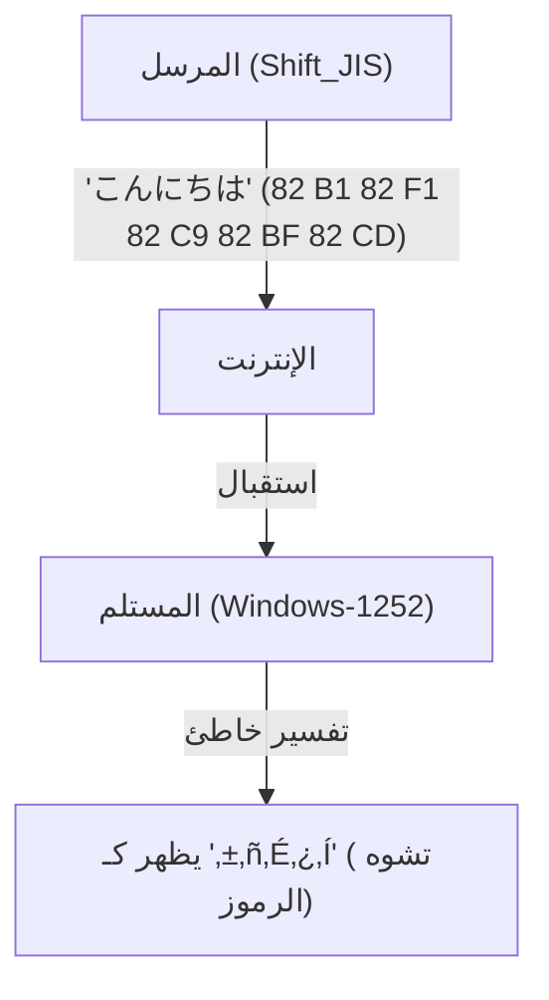
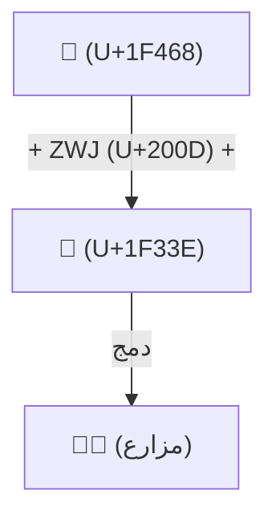

# تاريخ اليونيكود: كيف وحدت المعركة ضد تشوه الرموز أحرف العالم

عندما كان العالم الرقمي لا يزال في فجر عصر المعلومات النصية، كانت الأحرف التي يمكن لأجهزة الكمبيوتر التعامل معها محدودة للغاية. إن حقيقة أننا نستطيع اليوم قراءة وكتابة اليابانية والصينية والعربية على هواتفنا الذكية وأجهزة الكمبيوتر الشخصية بشكل طبيعي، وحتى إرسال واستقبال رموز تعبيرية مثل "😂" حول العالم، ترجع إلى الأسلاف الذين واصلوا لسنوات طويلة محاربة عدو قوي يُعرف باسم "تشوه الرموز" (Mojibake)، وأقاموا معياراً مشتركاً للمحارف.

في هذه المقالة، سنتعمق في القصة الملحمية لـ "توحيد الأحرف" في تاريخ الحوسبة، بدءاً من ولادة ASCII، والفوضى العارمة التي سببتها الترميزات المحلية في مختلف البلدان، والولادة الطموحة لليونيكود (Unicode)، والتصميم العبقري لـ UTF-8 على يد كين تومسون وروب بايك، ومشكلة الأزواج البديلة (Surrogate pairs)، وصولاً إلى توحيد معايير الإيموجي (Emoji).

## 1. البداية مع ASCII (قيود الـ 7 بت)

لكي يتعامل الكمبيوتر مع الأحرف، فإنه يحتاج إلى "ترميز أحرف" يربط الأحرف بالقيم العددية. تم وضع **ASCII (الشيفرة القياسية الأمريكية لتبادل المعلومات)** في الولايات المتحدة في الستينيات، وكان المعيار الأساسي لذلك.

استخدم ASCII سبعة بتات (0 إلى 127) لتحديد الحروف الأبجدية الكبيرة والصغيرة، والأرقام، والرموز الأساسية، وأحرف التحكم. كان هذا كافياً للاستخدام في البلدان الناطقة باللغة الإنجليزية، ولكنه كان عاجزاً تماماً أمام حقيقة أن "هناك عدداً لا يحصى من اللغات في العالم بخلاف الإنجليزية". مع وجود 128 مساحة فقط، لم يتمكن ASCII حتى من تمثيل الأحرف ذات علامات التشكيل في اللغات الأوروبية (مثل é و ñ).

## 2. برج بابل: عصر الترميزات المحلية و"تشوه الرموز"

مع انتشار الكمبيوتر، وسّعت بلدان مختلفة ASCII من 7 إلى 8 بتات باستخدام قيم البايت الإضافية من 128 إلى 255، أو طورت ترميزات خاصة متعددة البايتات.

- **عائلة ISO-8859**: مجموعة من ترميزات الـ 8 بت المصممة للغات الأوروبية (مثل ISO-8859-1 و Latin-1).
- **Shift_JIS (SJIS)**: طريقة مستخدمة على نطاق واسع في أجهزة الكمبيوتر الشخصية اليابانية (خاصة في MS-DOS و Windows) تمزج بين أحرف البايت الواحد (مثل كاتاكانا نصف العرض) وأحرف البايت المزدوج (الكانجي والهيراغانا).
- **EUC-JP**: ترميز ياباني يُستخدم غالباً في أنظمة UNIX.
- **GB2312 / Big5**: ترميزات للمناطق الناطقة بالصينية.

سمح هذا بتمثيل اللغات الوطنية على أجهزة الكمبيوتر، لكنه أدى إلى مشكلة رئيسية جديدة: ظاهرة حيث **"عند تبادل البيانات بين ترميزات أحرف مختلفة، يتم تفسيرها كأحرف مختلفة تماماً"**. هذا هو ما يُعرف بالسمعة السيئة باسم **تشوه الرموز (Mojibake)**.

مثلاً، يؤدي فك ترميز بايتات Shift_JIS باعتبارها Windows-1252 إلى الرموز الظاهرة في المخطط. لا يتطابق Windows-1252 مع ISO-8859-1: يمثّل `0x82` الرمز `‚` في الأول، لكنه محرف تحكم في الثاني. لإعادة إنتاج التشوه يجب التمييز بين البايتات الفعلية وفاك الترميز المستخدم. وقد عقّدت هذه الاختلافات التدويل (i18n).

## 3. ولادة اليونيكود: جميع الأحرف في رمز واحد

من أجل كسر هذا الوضع الفوضوي، في أواخر الثمانينيات، اجتمع مهندسون من شركات مثل Apple و Xerox (جو بيكر، ولي كولينز، ومارك ديفيس وغيرهم) وأطلقوا مشروعاً طموحاً. كان هذا هو **اليونيكود (Unicode)**.

كانت رؤيتهم بسيطة وطموحة: "تضمين جميع الأحرف والرموز في العالم، وحتى الأحرف التاريخية من الماضي، في مجموعة أحرف موحدة واحدة (Character Set)".

استخدم اليونيكود في البداية فضاء محارف من 16 بتاً. تطلبت إضافة الكتابات التاريخية ومحارف أخرى، منها المزيد من الرموز الأيديوغرافية، توسيع هذا الفضاء. يمتد نطاق نقاط الترميز الحالي من `U+0000` إلى `U+10FFFF` ويضم 1,114,112 موضعاً. هذا فضاء ترميز، وليس عدد المحارف المسندة؛ فهو يتضمن مواضع غير مسندة ونطاق البدائل. ولا تزال محارف جديدة تُضاف.

## 4. التصميم العبقري لـ UTF-8: كين تومسون وروب بايك

حتى مع وجود "قاموس أحرف" ضخم مثل اليونيكود، ظلت هناك مشكلة كيفية حفظه وتوصيله كسلسلة من البايتات على أجهزة الكمبيوتر (طريقة الترميز).

يمثل UCS-2 نطاقه المدعوم بوحدة ترميز واحدة من 16 بتاً، بينما يستخدم UTF-16 وحدة واحدة أو وحدتين. تتضمن تمثيلات محارف نطاق ASCII غالباً `0x00` (بايتات NUL). تمريرها مباشرة إلى دوال سلاسل C المنتهية بـ NUL قد يقطع السلسلة مبكراً ويسبب أخطاء، لكنه لا يؤدي بالضرورة إلى تعطل البرنامج.

عمل على هذا الحل أحد منشئي UNIX، **كين تومسون (Ken Thompson)**، ومطور Plan 9، **روب بايك (Rob Pike)**. بحسب رواية بايك، رسما مخطط UTF-8 على مفرش فردي في مطعم عام 1992 ثم نفذاه في Plan 9.

يُقال إن تصميم UTF-8 هو أحد أجمل الاختراقات (hacks) في تاريخ علوم الكمبيوتر.
- **التوافق مع ASCII على مستوى البايت**: تحتفظ محارف ASCII (0–127) بتمثيلها ذي البايت الواحد. لكن دوال C الحالية لا تفهم تلقائياً عد محارف اليونيكود أو حدودها.
- **ترميز متغير الطول**: يغير الطول من بايت واحد إلى 4 بايتات اعتماداً على الحرف (تستغرق اليابانية في الغالب 3 بايتات).
- **التزامن الذاتي**: تختلف أنماط بايتات البداية (`0xxxxxxx` و`110xxxxx` و`1110xxxx` و`11110xxx`) عن نمط الاستمرار `10xxxxxx`. يساعد ذلك، في UTF-8 الصحيح، على إيجاد حد المحرف التالي عند بدء القراءة داخل تسلسل. لا يعني هذا إمكان فك بايت الاستمرار كمحرف جديد، وتظل التسلسلات غير الصحيحة بحاجة إلى تحقق.

أسهمت هذه الخصائص في الاستخدام الواسع لـ UTF-8 على الويب الحديث.

## 5. مشكلة الأزواج البديلة وفجر الإيموجي (Emoji)

يمثل UTF-16 نقطة ترميز في مستوى تكميلي بوحدتي ترميز من 16 بتاً، تسمّيان زوجاً بديلاً. تحسب الخاصية `length` في سلاسل JavaScript وحدات ترميز UTF-16، ولذلك فإن `"😂".length` تساوي 2. هذه نتيجة مطابقة للمواصفة، لكن افتراض أنها تحسب المحارف المرئية قد يسبب أخطاء. وفي تسلسلات الإيموجي التي تتضمن ZWJ قد يختلف أيضاً عدد نقاط الترميز عن عدد المحارف المرئية.

أضاف Unicode 6.0، الصادر عام 2010، كثيراً من الإيموجي المستخدمة لدى مشغلي الهواتف اليابانيين Docomo وau وSoftBank. وكانت بعض الرموز المستخدمة كإيموجي مرمّزة في إصدارات أقدم، لذلك لم تظهر كل الإيموجي لأول مرة في الإصدار 6.0.

مع إدخال الإيموجي، تجاوز اليونيكود كونه مجرد "أحرف" وتطور إلى لغة بصرية عالمية تنقل المشاعر والمفاهيم. بالإضافة إلى ذلك، تم تباعاً إضافة مواصفات معقدة لتعكس التنوع الحديث، مثل القدرة على تغيير لون البشرة (Skin Tone Modifier)، وآلية الجمع بين عدة رموز تعبيرية لإنشاء رمز واحد (ZWJ: Zero Width Joiner).

## الخاتمة: أساس يربط المعرفة البشرية بالمستقبل

يرمّز معيار اليونيكود محارف ورموزاً كثيرة، منها الهيروغليفية المصرية والكتابة المسمارية وكتابات لغات الأقليات والإيموجي. أما اتحاد اليونيكود فهو المنظمة التي تحافظ على المعيار وتطوره.

تطور ترميز المحارف من مواضع ASCII البالغ عددها 128 إلى نظام مشترك لكتابات العالم المتنوعة. لم تُرمّز كل المحارف بعد؛ فإضافة المحارف وتحسين التطبيقات مستمران.

وراء رمز "😂" الذي نرسله بشكل عرضي، تكمن دراما عقود من "المعركة ضد تشوه الرموز" التي خاضها هؤلاء المهندسون.

## المراجع

- [Unicode FAQ: UTF-8, UTF-16, UTF-32 & BOM](https://www.unicode.org/faq/utf_bom.html)
- [Rob Pike: UTF-8 history](https://www.cl.cam.ac.uk/~mgk25/ucs/utf-8-history.txt)
