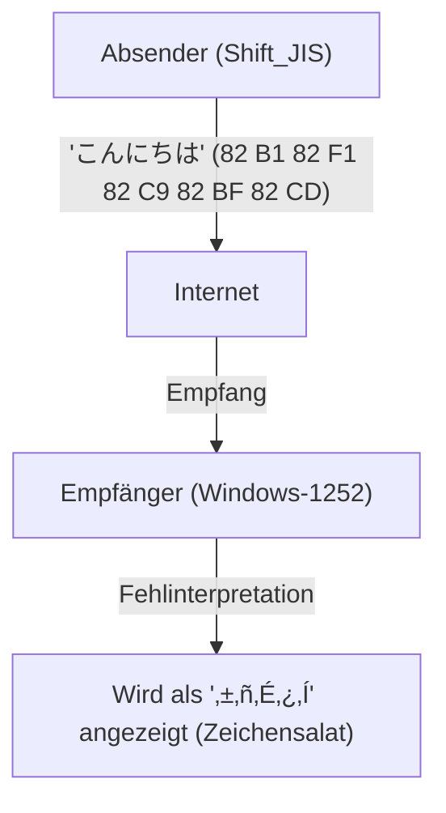
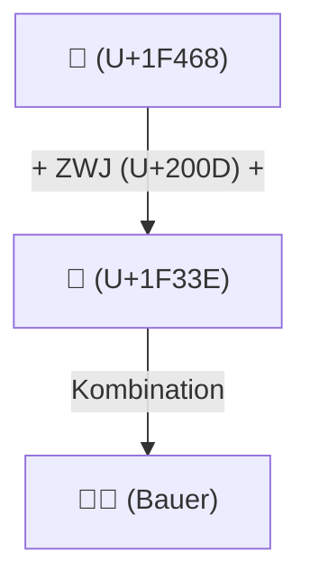

# Die Geschichte von Unicode: Wie der Kampf gegen Zeichensalat die Schriften der Welt vereinte

Als die digitale Welt noch in den Kindertagen der Textinformation steckte, waren die Zeichen, die Computer verarbeiten konnten, sehr begrenzt. Dass wir heute auf unseren Smartphones und PCs wie selbstverständlich Japanisch, Chinesisch oder Arabisch lesen und schreiben, und sogar Emojis wie „😂“ in die ganze Welt senden können, verdanken wir unseren Vorgängern, die jahrelang gegen den übermächtigen Feind „Zeichensalat“ (Mojibake) kämpften und einen gemeinsamen Zeichenstandard schufen.

In diesem Artikel tauchen wir tief in die epische Geschichte der „Zeichenvereinheitlichung“ in der Computergeschichte ein: beginnend mit der Geburt von ASCII, über das durch lokale Kodierungen der verschiedenen Länder verursachte große Chaos, die ambitionierte Entstehung von Unicode, das geniale Design von UTF-8 durch Ken Thompson und Rob Pike, das Problem der Surrogate Pairs bis hin zur Standardisierung von Emojis.

## 1. Der Ursprung: ASCII (Die 7-Bit-Einschränkung)

Damit Computer Zeichen verarbeiten können, benötigen sie einen „Zeichencode“, der Zeichen bestimmten Zahlen zuordnet. Der in den 1960er Jahren in den USA festgelegte **ASCII (American Standard Code for Information Interchange)** war die grundlegendste Norm dafür.

ASCII definierte Groß- und Kleinbuchstaben, Zahlen, grundlegende Symbole sowie Steuerzeichen unter Verwendung von 7 Bit (0 bis 127). Für den Gebrauch im englischsprachigen Raum war dies ausreichend, aber gegenüber der Tatsache, dass „es auf der Welt unzählige Sprachen außer Englisch gibt“, war es völlig machtlos. Mit seinem Rahmen von nur 128 Plätzen konnte ASCII nicht einmal die akzentuierten Buchstaben europäischer Sprachen (wie é oder ñ) darstellen.

## 2. Der Turm zu Babel: Die Ära der lokalen Kodierungen und des „Zeichensalats“

Mit der weltweiten Verbreitung von Computern erweiterten verschiedene Länder das 7-Bit-ASCII auf 8 Bit und nutzten die zusätzlichen Bytewerte 128 bis 255 oder entwickelten eigene Mehrbyte-Kodierungen.

- **ISO-8859-Familie**: Eine für europäische Sprachen entwickelte Gruppe von 8-Bit-Kodierungen (wie ISO-8859-1 und Latin-1).
- **Shift_JIS (SJIS)**: Ein auf japanischen PCs (insbesondere MS-DOS und Windows) weit verbreitetes System, das 1-Byte-Zeichen (wie Half-Width-Katakana) und 2-Byte-Zeichen (Kanji, Hiragana) mischte.
- **EUC-JP**: Eine häufig auf UNIX-Systemen verwendete japanische Kodierung.
- **GB2312 / Big5**: Kodierungen für den chinesischsprachigen Raum.

Dadurch wurde es zwar möglich, die jeweilige Landessprache auf Computern darzustellen, jedoch trat ein neues großes Problem auf. Das Phänomen, dass **„beim Austausch von Daten zwischen verschiedenen Zeichencodes diese als völlig andere Zeichen interpretiert werden“**. Dies ist das berüchtigte **Mojibake (Zeichensalat)**.

Wer Shift_JIS-Bytes fälschlich als Windows-1252 dekodiert, erhält die Zeichenfolge aus dem Diagramm. Windows-1252 und ISO-8859-1 sind nicht identisch: `0x82` steht im ersten für `‚`, im zweiten jedoch für ein Steuerzeichen. Zur Reproduktion von Zeichensalat muss man die tatsächlichen Bytes vom verwendeten Dekoder unterscheiden. Solche Unterschiede erschweren die Internationalisierung (i18n).

## 3. Die Geburt von Unicode: Alle Zeichen in einem Code

Um diese chaotische Situation zu überwinden, versammelten sich Ende der 1980er Jahre Ingenieure von Unternehmen wie Apple und Xerox (darunter Joe Becker, Lee Collins, Mark Davis) und starteten ein ambitioniertes Projekt. Das war **Unicode**.

Ihre Vision war einfach, aber ehrgeizig: „Alle Zeichen, Symbole und sogar historische Zeichen aus der Vergangenheit der ganzen Welt in einem einzigen, einheitlichen Zeichensatz (Character Set) unterzubringen.“

Unicode verwendete anfangs einen 16-Bit-Zeichenraum. Historische Schriften und zusätzliche Zeichen, darunter weitere Ideogramme, erforderten eine Erweiterung. Der heutige Codepunktbereich reicht von `U+0000` bis `U+10FFFF` und umfasst 1.114.112 Positionen. Das ist ein Coderaum, keine Anzahl zugewiesener Zeichen: Er enthält auch unzugewiesene Positionen und den Surrogatbereich. Neue Zeichen kommen weiterhin hinzu.

## 4. Das geniale Design von UTF-8: Ken Thompson und Rob Pike

Selbst nachdem Unicode als riesiges „Zeichenwörterbuch“ geschaffen war, blieb das Problem, wie dieses auf Computern als Bytefolge gespeichert und übertragen werden sollte (die Kodierungsmethode).

UCS-2 stellt seinen unterstützten Bereich mit einer 16-Bit-Codeeinheit dar; UTF-16 verwendet eine oder zwei. Darstellungen von ASCII-Zeichen enthalten häufig `0x00` (NUL-Bytes). Werden diese Bytes direkt an C-Funktionen für NUL-terminierte Zeichenketten übergeben, kann die Zeichenkette vorzeitig enden und Fehler verursachen; ein Absturz ist nicht zwangsläufig die Folge.

An der Lösung arbeiteten UNIX-Mitentwickler **Ken Thompson** und Plan-9-Entwickler **Rob Pike**. Laut Pikes Bericht skizzierten sie 1992 den Entwurf von UTF-8 auf einem Tischset in einem Restaurant und implementierten ihn in Plan 9.

Das Design von UTF-8 gilt als einer der schönsten Hacks in der Geschichte der Informatik.
- **Byte-Kompatibilität mit ASCII**: ASCII-Zeichen (0–127) behalten ihre Darstellung mit einem Byte. Vorhandene C-Funktionen verstehen dadurch aber nicht automatisch Unicode-Zeichenanzahlen oder Zeichengrenzen.
- **Kodierung mit variabler Länge**: Die Länge variiert je nach Zeichen von 1 bis 4 Bytes (Japanisch besteht z. B. meist aus 3 Bytes).
- **Selbstsynchronisation**: Die Muster führender Bytes (`0xxxxxxx`, `110xxxxx`, `1110xxxx`, `11110xxx`) unterscheiden sich vom Fortsetzungsmuster `10xxxxxx`. In gültigem UTF-8 hilft das, beim Einstieg innerhalb einer Sequenz die nächste Zeichengrenze zu finden. Ein Fortsetzungsbyte lässt sich dadurch nicht als neues Zeichen dekodieren; ungültige Sequenzen müssen weiterhin geprüft werden.

Diese Eigenschaften haben zur weiten Verbreitung von UTF-8 im heutigen Web beigetragen.

## 5. Das Problem der Surrogate Pairs und die Dämmerung der Emojis

UTF-16 stellt einen Codepunkt einer ergänzenden Ebene mit zwei 16-Bit-Codeeinheiten dar, einem Surrogatpaar. Die JavaScript-Eigenschaft `length` zählt UTF-16-Codeeinheiten; deshalb ist `"😂".length` gleich 2. Das entspricht der Spezifikation. Fehler entstehen, wenn dieser Wert als Anzahl sichtbarer Zeichen interpretiert wird. Bei ZWJ-Emoji-Sequenzen kann auch die Codepunktzahl von der Zahl sichtbarer Zeichen abweichen.

Unicode 6.0, veröffentlicht 2010, fügte viele Emojis der japanischen Mobilfunkanbieter Docomo, au und SoftBank hinzu. Einige als Emoji verwendete Symbole waren bereits früher kodiert; nicht jedes Emoji wurde erstmals in Version 6.0 aufgenommen.

Mit der Einführung von Emojis ging Unicode über den bloßen Rahmen von „Zeichen“ hinaus und entwickelte sich zu einer universellen visuellen Sprache, um Emotionen und Konzepte zu vermitteln. Darüber hinaus wurden nach und nach komplexe Spezifikationen hinzugefügt, um die heutige Vielfalt (Diversity) widerzuspiegeln, wie etwa Modifikatoren für die Hautfarbe (Skin Tone Modifier) oder die Möglichkeit, mehrere Emojis zu einem einzigen zu kombinieren (ZWJ: Zero Width Joiner).

## Fazit: Das Fundament, das das Wissen der Menschheit mit der Zukunft verbindet

Der Unicode-Standard kodiert zahlreiche Zeichen und Symbole, darunter ägyptische Hieroglyphen, Keilschrift, Schriften von Minderheitensprachen und Emojis. Das Unicode-Konsortium ist die Organisation, die diesen Standard pflegt und weiterentwickelt.

Die Zeichenkodierung hat sich von den 128 ASCII-Codepositionen zu einem gemeinsamen System für die vielfältigen Schriften der Welt entwickelt. Noch sind nicht alle Zeichen kodiert; die Aufnahme weiterer Zeichen und die Verbesserung der Implementierungen gehen weiter.

Hinter dem „😂“, das wir so beiläufig versenden, verbirgt sich das jahrzehntelange Drama der Ingenieure in ihrem „Kampf gegen den Zeichensalat“.

## Quellen

- [Unicode FAQ: UTF-8, UTF-16, UTF-32 & BOM](https://www.unicode.org/faq/utf_bom.html)
- [Rob Pike: UTF-8 history](https://www.cl.cam.ac.uk/~mgk25/ucs/utf-8-history.txt)
