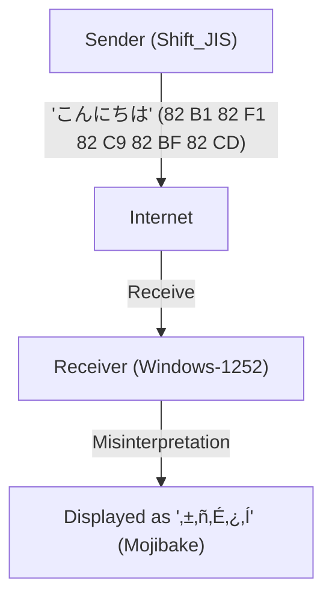
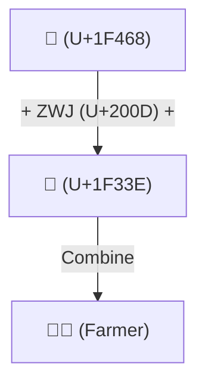

# History of Unicode: How the Battle Against Mojibake Unified the World's Characters

Back when the digital world was in the dawn of text information, the characters that computers could handle were extremely limited. The reason we can now casually read and write Japanese, Chinese, and Arabic on our smartphones and PCs, and even send and receive emojis like "😂" globally, is because our predecessors fought a long battle against the formidable enemy known as "Mojibake" (character corruption) and established a common character standard.

This article delves deep into the epic story of "character unification" in computer history, starting from the birth of ASCII, the massive confusion caused by local encodings of various countries, the ambitious birth of Unicode, the genius design of UTF-8 by Ken Thompson and Rob Pike, the surrogate pair problem, and up to the standardization of Emoji.

## 1. ASCII as the Origin (The 7-bit Constraint)

For computers to handle characters, a "character encoding" that maps characters to numerical values is necessary. The **ASCII (American Standard Code for Information Interchange)**, established in the United States in the 1960s, was the most fundamental standard for this.

ASCII used 7 bits (0 to 127) to define uppercase and lowercase alphabets, numbers, basic symbols, and control characters. While this was sufficient for use in the English-speaking world, it was completely powerless against the fact that "there are countless languages in the world other than English." With only 128 slots, ASCII could not even represent characters with accent marks used in European languages (such as é and ñ).

## 2. The Tower of Babel: The Era of Local Encodings and "Mojibake"

As computers spread around the world, countries extended 7-bit ASCII to 8 bits, using the additional byte values 128 through 255, or developed their own multibyte encodings.

- **ISO-8859 series**: A group of 8-bit encodings designed for European languages (like ISO-8859-1 and Latin-1).
- **Shift_JIS (SJIS)**: A method widely popularized in Japanese personal computers (especially MS-DOS and Windows) that mixes 1-byte characters (like half-width Katakana) and 2-byte characters (Kanji and Hiragana).
- **EUC-JP**: A Japanese encoding commonly used in UNIX-like systems.
- **GB2312 / Big5**: Encodings for the Chinese-speaking world.

This allowed each country's language to be represented on computers, but it created a new, massive problem. That was the phenomenon where **"when data is exchanged between different character encodings, it is interpreted as completely different characters."** This is the infamous **Mojibake**.

For example, decoding Shift_JIS bytes as Windows-1252 produces the different sequence of symbols shown in the diagram. Windows-1252 and ISO-8859-1 are not identical: the byte `0x82` represents `‚` in Windows-1252 but a control character in ISO-8859-1. Reproducing mojibake requires distinguishing the actual bytes from the decoder used. Such differences have complicated internationalization (i18n).

## 3. The Birth of Unicode: All Characters in a Single Code

To break through this chaotic situation, in the late 1980s, engineers from Apple, Xerox, and others (such as Joe Becker, Lee Collins, and Mark Davis) gathered and launched an ambitious project. That was **Unicode**.

Their vision was simple and ambitious: "To fit all characters, symbols, and even historical characters of the world into a single, unified Character Set."

Early Unicode used a 16-bit character space. Encoding historical scripts and additional characters, including further ideographs, required expansion. The current code-point range is `U+0000` through `U+10FFFF`, containing 1,114,112 positions. This is a code space, not the number of assigned characters: it includes unassigned positions and the surrogate range. New characters continue to be added.

## 4. The Genius Design of UTF-8: Ken Thompson and Rob Pike

Even with the creation of the massive "dictionary of characters" that is Unicode, the problem remained of how to store and transmit them as byte sequences on computers (the encoding method).

UCS-2 represents its supported range using one 16-bit code unit, whereas UTF-16 uses one or two 16-bit code units. Representations of ASCII-range characters commonly contain `0x00` (NUL bytes). Passing those bytes directly to existing NUL-terminated C string functions can cause premature termination and related errors; it does not necessarily cause a crash.

The developers who tackled this problem were UNIX co-creator **Ken Thompson** and Plan 9 developer **Rob Pike**. According to Pike's account, they sketched the design of UTF-8 on a diner placemat in 1992 and implemented it in Plan 9.

The design of UTF-8 is hailed as one of the most beautiful hacks in the history of computer science.
- **Byte-level compatibility with ASCII**: ASCII characters (0-127) retain their one-byte representations. Existing C functions do not, however, automatically understand Unicode character counts or character boundaries.
- **Variable-length encoding**: The length changes from 1 byte to 4 bytes depending on the character (Japanese and others are mainly 3 bytes).
- **Self-synchronization**: Leading-byte patterns (`0xxxxxxx`, `110xxxxx`, `1110xxxx`, `11110xxx`) are distinguishable from the continuation-byte pattern `10xxxxxx`. In valid UTF-8, this helps a decoder locate the next character boundary after starting within a sequence. A continuation byte cannot simply be decoded as a new character, and invalid byte sequences still require validation.

These properties have helped UTF-8 become widely used on the modern web.

## 5. The Surrogate Pair Problem and the Dawn of Emoji

UTF-16 represents a supplementary-plane code point using a pair of 16-bit code units, called a surrogate pair. JavaScript string `length` counts UTF-16 code units, so `"😂".length` is 2. That result follows the specification, but assuming that it counts visible characters can cause bugs. For ZWJ emoji sequences, the number of code points can also differ from the number of visible characters.

Unicode 6.0, released in 2010, added many **emoji** used by Japanese mobile carriers such as Docomo, au, and SoftBank. Some symbols used as emoji had already been encoded in earlier versions, so not every emoji first entered Unicode in version 6.0.

With the introduction of Emoji, Unicode evolved beyond the bounds of mere "characters" into a universal visual language for conveying emotions and concepts. Furthermore, complex specifications are continuously being added to reflect modern diversity, such as the ability to change skin colors (Skin Tone Modifier) and the mechanism to combine multiple emojis into one (ZWJ: Zero Width Joiner).

## Conclusion: A Foundation Connecting Human Knowledge to the Future

Today's Unicode Standard encodes many characters and symbols, including Egyptian hieroglyphs, cuneiform, minority-language scripts, and emoji. The Unicode Consortium is the organization that maintains and develops the standard.

Character encoding has developed from ASCII's 128 code positions toward a shared system for the world's diverse scripts. Not every character has already been encoded: the encoding of additional characters and improvements to implementations continue.

Behind the "😂" we casually send, hides the drama of these engineers' decades-long "battle against Mojibake."

## References

- [Unicode FAQ: UTF-8, UTF-16, UTF-32 & BOM](https://www.unicode.org/faq/utf_bom.html)
- [Rob Pike: UTF-8 history](https://www.cl.cam.ac.uk/~mgk25/ucs/utf-8-history.txt)
