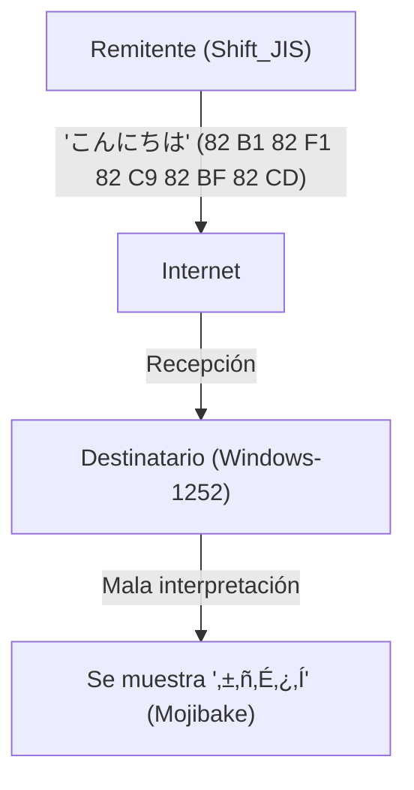
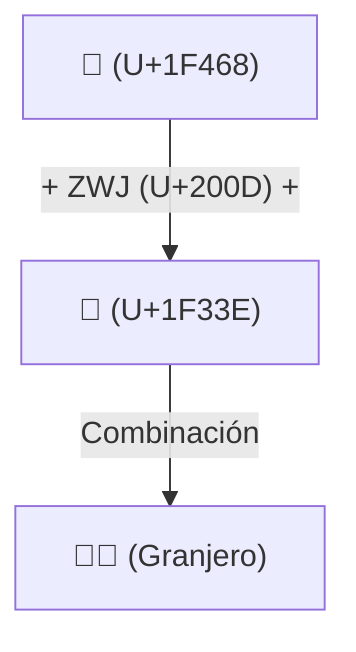

# La historia de Unicode: Cómo la batalla contra el Mojibake unificó los caracteres del mundo

Cuando el mundo digital aún estaba en los albores de la información textual, los caracteres que las computadoras podían manejar eran muy limitados. El hecho de que hoy en día podamos leer y escribir en japonés, chino o árabe en nuestros teléfonos inteligentes y PC con total normalidad, e incluso enviar y recibir emojis como "😂" en todo el mundo, se debe a que nuestros predecesores lucharon durante mucho tiempo contra el formidable enemigo llamado "Mojibake" (texto corrupto o caracteres extraños) y establecieron un estándar de caracteres común.

En este artículo, profundizaremos en la épica historia de la "unificación de caracteres" en la historia de la computación, comenzando con el nacimiento de ASCII, el gran caos causado por las codificaciones locales de varios países, el ambicioso nacimiento de Unicode, el diseño genial de UTF-8 por Ken Thompson y Rob Pike, el problema de los pares subrogados y, finalmente, la estandarización de los emojis (Emoji).

## 1. El origen: ASCII (La restricción de 7 bits)

Para que las computadoras manejen texto, necesitan una "codificación de caracteres" (character code) que asigne caracteres a valores numéricos. **ASCII (American Standard Code for Information Interchange)**, establecido en los Estados Unidos en la década de 1960, fue el estándar más fundamental.

ASCII utilizaba 7 bits (del 0 al 127) para definir letras mayúsculas y minúsculas del alfabeto, números, símbolos básicos y caracteres de control. Esto era suficiente para su uso en países de habla inglesa, pero era completamente inútil frente al hecho de que "hay innumerables idiomas aparte del inglés en el mundo". Con un espacio de solo 128 posiciones, ASCII ni siquiera podía representar caracteres con acentos de lenguajes europeos (como é o ñ).

## 2. La Torre de Babel: La era de las codificaciones locales y el "Mojibake"

A medida que las computadoras se extendían por el mundo, los países ampliaron el ASCII de 7 bits a 8 bits, aprovechando los valores de byte adicionales de 128 a 255, o desarrollaron sus propias codificaciones multibyte.

- **Serie ISO-8859**: Grupos de codificación de 8 bits diseñados para lenguajes europeos (como ISO-8859-1 y Latin-1).
- **Shift_JIS (SJIS)**: Un sistema ampliamente adoptado en las computadoras japonesas (especialmente MS-DOS y Windows) que mezclaba caracteres de 1 byte (como el katakana de ancho medio) y caracteres de 2 bytes (kanji e hiragana).
- **EUC-JP**: Una codificación japonesa utilizada frecuentemente en sistemas tipo UNIX.
- **GB2312 / Big5**: Codificaciones para la región de habla china.

Esto permitió representar sus propios idiomas en las computadoras, pero generó un nuevo y gran problema. El fenómeno en el que **"si se intercambian datos entre diferentes codificaciones de caracteres, se interpretan como caracteres completamente distintos"**. Este es el infame **Mojibake** (texto ilegible).

Por ejemplo, decodificar bytes Shift_JIS como Windows-1252 produce los símbolos del diagrama. Windows-1252 e ISO-8859-1 no son idénticos: `0x82` representa `‚` en Windows-1252, pero es un carácter de control en ISO-8859-1. Para reproducir el mojibake hay que distinguir los bytes reales del decodificador utilizado. Estas diferencias han complicado la internacionalización (i18n).

## 3. El nacimiento de Unicode: Todos los caracteres en un solo código

Para superar esta situación caótica, a finales de la década de 1980, ingenieros de empresas como Apple y Xerox (Joe Becker, Lee Collins, Mark Davis, entre otros) se reunieron y lanzaron un ambicioso proyecto. Eso es **Unicode**.

Su visión era simple y ambiciosa. El objetivo era "albergar todos los caracteres y símbolos del mundo, e incluso caracteres históricos del pasado, en un único conjunto de caracteres (Character Set) unificado".

El Unicode inicial utilizaba un espacio de caracteres de 16 bits. La incorporación de escrituras históricas y otros caracteres, incluidos más ideogramas, requirió ampliarlo. El intervalo actual de puntos de código va de `U+0000` a `U+10FFFF`: 1.114.112 posiciones. Es un espacio de códigos, no el número de caracteres asignados; incluye posiciones sin asignar y el intervalo de los sustitutos. Se siguen añadiendo caracteres.

## 4. El diseño genial de UTF-8: Ken Thompson y Rob Pike

Incluso después de crear el gigantesco "diccionario de caracteres" que es Unicode, quedaba el problema de cómo guardar y transmitir esto como secuencias de bytes en las computadoras (sistema de codificación).

UCS-2 representa su intervalo admitido con una unidad de código de 16 bits; UTF-16 utiliza una o dos. La representación de caracteres del intervalo ASCII suele incluir `0x00` (bytes NUL). Pasar esos bytes directamente a funciones de cadenas C terminadas en NUL puede truncar la cadena y causar errores; no implica necesariamente que el programa se bloquee.

Participaron en esta solución el cocreador de UNIX **Ken Thompson** y el desarrollador de Plan 9 **Rob Pike**. Según el relato de Pike, en 1992 esbozaron el diseño de UTF-8 en un mantel individual de un restaurante y lo implementaron en Plan 9.

Se dice que el diseño de UTF-8 es uno de los hacks más hermosos en la historia de las ciencias de la computación.
- **Compatibilidad con ASCII a nivel de bytes**: Los caracteres ASCII (0–127) conservan su representación de un byte. Sin embargo, las funciones C existentes no entienden automáticamente los límites ni el recuento de caracteres Unicode.
- **Codificación de longitud variable**: Cambia la longitud de 1 a 4 bytes dependiendo del carácter (el japonés, por ejemplo, utiliza principalmente 3 bytes).
- **Autosincronización**: Los patrones de bytes iniciales (`0xxxxxxx`, `110xxxxx`, `1110xxxx`, `11110xxx`) se distinguen del patrón de continuación `10xxxxxx`. En UTF-8 válido, esto permite localizar el siguiente límite de carácter al empezar dentro de una secuencia. No permite interpretar un byte de continuación como un carácter nuevo, y las secuencias inválidas siguen requiriendo validación.

Estas propiedades han contribuido al amplio uso de UTF-8 en la web moderna.

## 5. El problema de los pares subrogados y el amanecer de los emojis (Emoji)

UTF-16 representa un punto de código de un plano suplementario mediante dos unidades de código de 16 bits, llamadas par sustituto. La propiedad `length` de las cadenas JavaScript cuenta unidades de código UTF-16, de modo que `"😂".length` es 2. Esto cumple la especificación; asumir que cuenta caracteres visibles puede causar errores. En secuencias emoji con ZWJ, el número de puntos de código también puede diferir del número de caracteres visibles.

Unicode 6.0, publicado en 2010, añadió muchos emojis utilizados por las operadoras japonesas Docomo, au y SoftBank. Algunos símbolos que se usan como emoji ya estaban codificados en versiones anteriores; no todos los emojis aparecieron por primera vez en la versión 6.0.

Con la introducción de los emojis, Unicode trascendió los límites de ser meros "caracteres" y evolucionó hasta convertirse en un lenguaje visual universal para transmitir emociones y conceptos. Además, continuamente se añaden especificaciones complejas para reflejar la diversidad moderna, como los modificadores de tono de piel (Skin Tone Modifier) y el mecanismo para combinar varios emojis en uno solo (ZWJ: Zero Width Joiner).

## Conclusión: La base que conecta el conocimiento humano con el futuro

El Estándar Unicode codifica numerosos caracteres y símbolos, como jeroglíficos egipcios, escritura cuneiforme, escrituras de lenguas minoritarias y emojis. El Consorcio Unicode es la organización que mantiene y desarrolla el estándar.

La codificación de caracteres ha evolucionado desde las 128 posiciones de ASCII hacia un sistema compartido para las diversas escrituras del mundo. No todos los caracteres están ya codificados: la incorporación de caracteres y las mejoras de las implementaciones continúan.

Detrás de ese "😂" que enviamos de forma casual, se esconde el drama de la "batalla contra el mojibake" librada por los ingenieros durante décadas.

## Referencias

- [Unicode FAQ: UTF-8, UTF-16, UTF-32 & BOM](https://www.unicode.org/faq/utf_bom.html)
- [Rob Pike: UTF-8 history](https://www.cl.cam.ac.uk/~mgk25/ucs/utf-8-history.txt)
