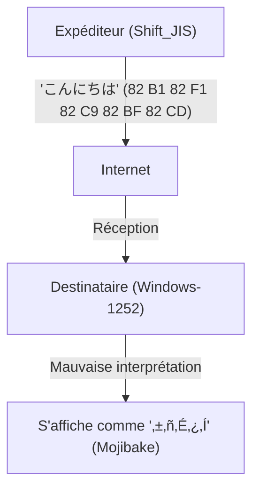
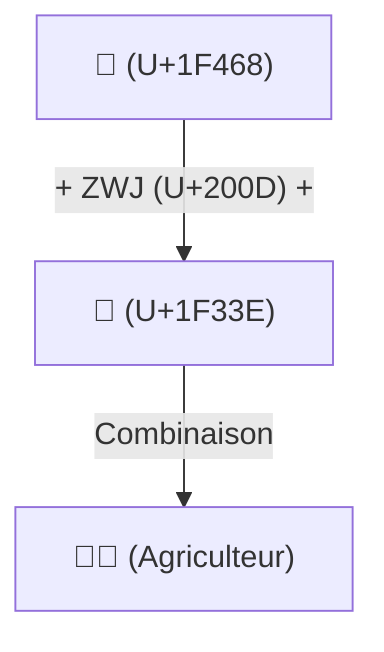

# Histoire d'Unicode : Comment la lutte contre le Mojibake a unifié les caractères du monde

Lorsque le monde numérique n'en était qu'aux prémices de l'information textuelle, les caractères que les ordinateurs pouvaient manipuler étaient extrêmement limités. Si nous pouvons aujourd'hui lire et écrire naturellement en japonais, chinois ou arabe sur nos smartphones et PC, et même envoyer ou recevoir des emojis comme « 😂 » partout dans le monde, c'est parce que nos prédécesseurs ont combattu pendant de nombreuses années un formidable ennemi appelé « Mojibake » (caractères corrompus) et ont établi un standard commun de caractères.

Cet article plonge au cœur de l'histoire épique de « l'unification des caractères » dans l'histoire de l'informatique : de la naissance de l'ASCII et du chaos massif causé par les encodages locaux de chaque pays, à la naissance ambitieuse d'Unicode, la conception géniale de l'UTF-8 par Ken Thompson et Rob Pike, le problème des paires de substitution, jusqu'à la standardisation des emojis.

## 1. L'origine : L'ASCII (La limite des 7 bits)

Pour qu'un ordinateur puisse traiter des caractères, il a besoin d'un « encodage de caractères » qui associe un caractère à une valeur numérique. L'**ASCII (American Standard Code for Information Interchange)**, établi aux États-Unis dans les années 1960, a été la norme la plus fondamentale pour cela.

L'ASCII utilisait 7 bits (0 à 127) pour définir les lettres majuscules et minuscules de l'alphabet, les chiffres, les symboles de base et les caractères de contrôle. Bien que cela fût suffisant pour une utilisation dans le monde anglophone, c'était totalement impuissant face au fait qu'« il existe d'innombrables langues autres que l'anglais dans le monde ». Avec seulement 128 espaces disponibles, l'ASCII ne pouvait même pas représenter les caractères accentués des langues européennes (comme é ou ñ).

## 2. La Tour de Babel : L'ère des encodages locaux et du « Mojibake »

Avec la diffusion des ordinateurs, différents pays ont étendu l’ASCII de 7 à 8 bits, en utilisant les valeurs d’octet supplémentaires de 128 à 255, ou ont développé leurs propres encodages multioctets.

- **Famille ISO-8859** : Groupes d'encodages 8 bits conçus pour les langues européennes (comme ISO-8859-1 et Latin-1).
- **Shift_JIS (SJIS)** : Une méthode largement répandue sur les PC japonais (notamment MS-DOS et Windows) qui mélangeait des caractères sur un octet (comme les katakanas demi-chasse) et sur deux octets (kanjis et hiraganas).
- **EUC-JP** : Encodage japonais souvent utilisé dans les systèmes UNIX.
- **GB2312 / Big5** : Encodages de la sphère sinophone.

Bien que cela ait permis de représenter les langues nationales sur des ordinateurs, un nouveau problème majeur est apparu. Il s'agit du phénomène où **« l'échange de données entre différents encodages de caractères entraîne leur interprétation comme des caractères totalement différents »**. C'est le tristement célèbre **Mojibake**.

Par exemple, décoder des octets Shift_JIS en Windows-1252 produit les symboles du schéma. Windows-1252 et ISO-8859-1 ne sont pas identiques : `0x82` représente `‚` dans le premier, mais un caractère de contrôle dans le second. Reproduire le mojibake exige de distinguer les octets réels du décodeur utilisé. Ces différences ont compliqué l’internationalisation (i18n).

## 3. La naissance d'Unicode : Tous les caractères dans un seul code

Pour surmonter cette situation chaotique, des ingénieurs d'entreprises comme Apple et Xerox (Joe Becker, Lee Collins, Mark Davis, etc.) se sont rassemblés à la fin des années 1980 pour lancer un projet grandiose. C'est **Unicode**.

Leur vision était à la fois simple et ambitieuse. Il s'agissait de « rassembler tous les caractères du monde, les symboles, et même les caractères historiques du passé dans un seul et unique jeu de caractères unifié (Character Set) ».

Unicode utilisait initialement un espace de caractères de 16 bits. L’ajout d’écritures historiques et d’autres caractères, dont des idéogrammes supplémentaires, a nécessité une extension. La plage actuelle va de `U+0000` à `U+10FFFF`, soit 1 114 112 positions. C’est un espace de codes, pas le nombre de caractères attribués : il inclut les positions non attribuées et la plage des substituts. De nouveaux caractères continuent d’être ajoutés.

## 4. La conception géniale de l'UTF-8 : Ken Thompson et Rob Pike

Même avec la création de cet immense « dictionnaire de caractères » qu'est Unicode, il restait le problème de savoir comment l'enregistrer et le transmettre sous forme de séquence d'octets sur un ordinateur (méthode d'encodage).

UCS-2 représente sa plage prise en charge par une unité de code de 16 bits, tandis qu’UTF-16 utilise une ou deux unités. La représentation des caractères ASCII contient couramment `0x00` (octets NUL). Transmettre directement ces octets à des fonctions C de chaînes terminées par NUL peut tronquer la chaîne et provoquer des erreurs ; cela n’entraîne pas nécessairement un plantage.

Les développeurs qui ont travaillé à cette solution étaient le cocréateur d’UNIX **Ken Thompson** et le développeur de Plan 9 **Rob Pike**. Selon le récit de Pike, ils ont esquissé UTF-8 sur un set de table de restaurant en 1992, puis l’ont implémenté dans Plan 9.

La conception de l'UTF-8 est considérée comme l'un des plus beaux hacks de l'histoire de l'informatique.
- **Compatibilité avec ASCII au niveau des octets** : Les caractères ASCII (0–127) conservent leur représentation sur un octet. Les fonctions C existantes ne comprennent toutefois pas automatiquement le comptage ou les limites des caractères Unicode.
- **Encodage à longueur variable** : La longueur varie de 1 à 4 octets selon le caractère (le japonais utilise principalement 3 octets).
- **Auto-synchronisation** : Les motifs des octets initiaux (`0xxxxxxx`, `110xxxxx`, `1110xxxx`, `11110xxx`) se distinguent du motif de continuation `10xxxxxx`. Dans un UTF-8 valide, cela aide à retrouver la prochaine limite de caractère lorsqu’on commence au milieu d’une séquence. Un octet de continuation ne peut pas être décodé comme un nouveau caractère ; les séquences invalides doivent toujours être validées.

Ces propriétés ont contribué à la large utilisation d’UTF-8 sur le Web moderne.

## 5. Le problème des paires de substitution et l'aube des emojis

UTF-16 représente un point de code d’un plan supplémentaire par deux unités de code de 16 bits, appelées paire de substitution. La propriété `length` des chaînes JavaScript compte les unités de code UTF-16 ; `"😂".length` vaut donc 2. Ce résultat respecte la spécification, mais supposer qu’il compte les caractères visibles peut entraîner des bugs. Pour les séquences emoji avec ZWJ, le nombre de points de code peut lui aussi différer du nombre de caractères visibles.

Unicode 6.0, publié en 2010, a ajouté de nombreux emojis utilisés par les opérateurs japonais Docomo, au et SoftBank. Certains symboles utilisés comme emojis étaient déjà codés dans des versions antérieures : tous les emojis ne sont donc pas apparus pour la première fois en version 6.0.

Avec l'introduction des emojis, Unicode a dépassé le simple cadre des « caractères » pour évoluer vers un langage visuel universel permettant de transmettre des émotions et des concepts. De plus, pour refléter la diversité du monde moderne, des spécifications complexes ont été ajoutées l'une après l'autre, comme la modification de la couleur de peau (Skin Tone Modifier) ou le mécanisme de combinaison de plusieurs emojis pour en créer un nouveau (ZWJ : Zero Width Joiner).

## Conclusion : Une fondation pour relier le savoir de l'humanité à l'avenir

Le standard Unicode code de nombreux caractères et symboles, dont les hiéroglyphes égyptiens, le cunéiforme, des écritures de langues minoritaires et les emojis. Le consortium Unicode est l’organisation qui maintient et développe ce standard.

L’encodage des caractères a évolué des 128 positions d’ASCII vers un système commun aux diverses écritures du monde. Tous les caractères ne sont pas encore codés : l’ajout de caractères et l’amélioration des implémentations se poursuivent.

Derrière ce simple « 😂 » que nous envoyons avec insouciance se cache tout le drame de cette « lutte contre le Mojibake » menée par les ingénieurs pendant plusieurs décennies.

## Références

- [Unicode FAQ: UTF-8, UTF-16, UTF-32 & BOM](https://www.unicode.org/faq/utf_bom.html)
- [Rob Pike: UTF-8 history](https://www.cl.cam.ac.uk/~mgk25/ucs/utf-8-history.txt)
