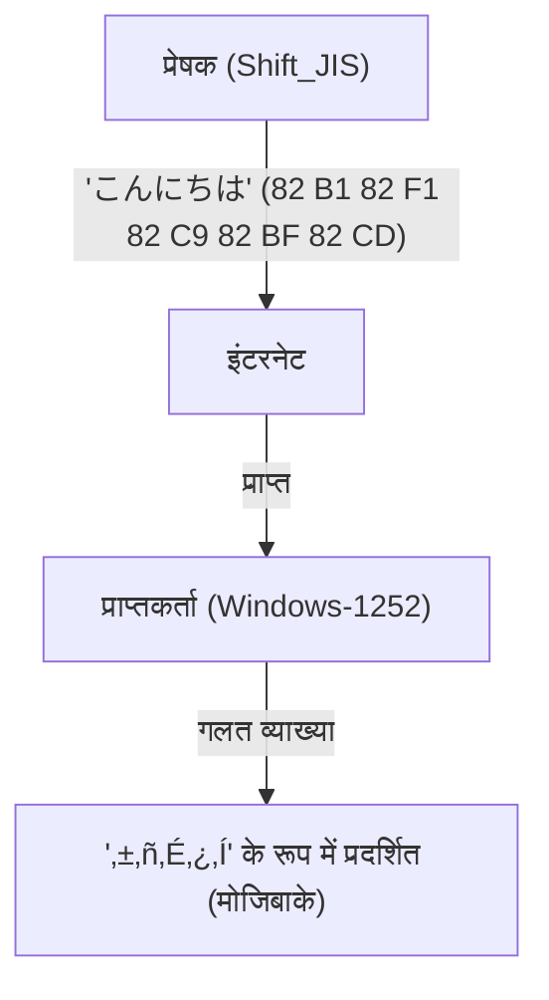
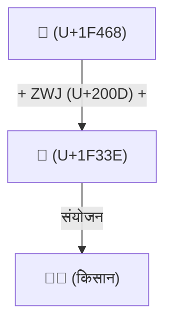

# यूनिकोड का इतिहास: मोजिबाके (Mojibake) के खिलाफ लड़ाई ने दुनिया भर के वर्णों को कैसे एकजुट किया

डिजिटल दुनिया के शुरुआती दिनों में जब टेक्स्ट जानकारी अभी अपनी शैशवावस्था में थी, कंप्यूटर जिन वर्णों को संभाल सकते थे वे बहुत सीमित थे। आज हम अपने स्मार्टफ़ोन और पीसी पर स्वाभाविक रूप से जापानी, चीनी और अरबी पढ़ और लिख सकते हैं, और यहाँ तक कि दुनिया भर में "😂" जैसे इमोजी भेज और प्राप्त कर सकते हैं। ऐसा इसलिए संभव हुआ क्योंकि हमारे पूर्वजों ने "मोजिबाके (Mojibake)" यानी कैरेक्टर करप्शन (character corruption) नामक एक दुर्जेय दुश्मन से सालों तक लड़ाई लड़ी, और एक साझा वर्ण मानक स्थापित किया।

इस लेख में, हम कंप्यूटर इतिहास में "वर्णों के एकीकरण" की महाकाव्य कहानी की गहराई में जाएँगे। यह ASCII के जन्म से शुरू होकर विभिन्न देशों की स्थानीय एन्कोडिंग के कारण हुई अराजकता, यूनिकोड की महत्वाकांक्षी शुरुआत, केन थॉम्पसन और रॉब पाइक द्वारा UTF-8 की शानदार डिज़ाइन, सरोगेट पेयर (surrogate pair) की समस्या, और अंत में इमोजी (Emoji) के मानकीकरण तक जाती है।

## 1. मूल बिंदु के रूप में ASCII (7-बिट की सीमा)

कंप्यूटरों के लिए वर्णों को संभालने के लिए, एक "कैरेक्टर कोड (character code)" की आवश्यकता होती है जो वर्णों को संख्याओं में मैप करता है। 1960 के दशक में अमेरिका में स्थापित **ASCII (अमेरिकन स्टैंडर्ड कोड फॉर इंफॉर्मेशन इंटरचेंज)** इसका सबसे बुनियादी मानक था।

ASCII ने 7 बिट्स (0 से 127) का उपयोग करके अपरकेस और लोअरकेस अंग्रेजी अक्षर, संख्याएँ, बुनियादी प्रतीक और नियंत्रण वर्णों (control characters) को परिभाषित किया। यह अंग्रेजी भाषी दुनिया में उपयोग के लिए पर्याप्त था, लेकिन "दुनिया में अंग्रेजी के अलावा अनगिनत भाषाएँ हैं" इस तथ्य के सामने पूरी तरह से असहाय था। केवल 128 स्लॉट वाले ASCII में यूरोपीय भाषाओं के उच्चारण चिह्नों वाले वर्णों (जैसे é या ñ) को भी प्रदर्शित नहीं किया जा सकता था।

## 2. बैबल की मीनार: स्थानीय एन्कोडिंग और "मोजिबाके" का युग

कंप्यूटरों के प्रसार के साथ विभिन्न देशों ने 7-बिट ASCII को 8 बिट तक बढ़ाकर अतिरिक्त बाइट मान 128 से 255 का उपयोग किया, या अपनी बहु-बाइट एन्कोडिंग विकसित की।

- **ISO-8859 सीरीज़**: यूरोपीय भाषाओं के लिए डिज़ाइन किए गए 8-बिट एन्कोडिंग समूह (ISO-8859-1, Latin-1, आदि)।
- **Shift_JIS (SJIS)**: एक ऐसी प्रणाली जो 1-बाइट वर्णों (हाफ-विड्थ काताकाना, आदि) और 2-बाइट वर्णों (कांजी और हीरागाना) को मिलाती है, और जापानी पीसी (विशेष रूप से MS-DOS और Windows) में व्यापक रूप से उपयोग की गई।
- **EUC-JP**: जापानी एन्कोडिंग जो आमतौर पर UNIX सिस्टम पर उपयोग की जाती थी।
- **GB2312 / Big5**: चीनी भाषी क्षेत्रों की एन्कोडिंग।

हालांकि इससे कंप्यूटरों पर अपनी भाषाओं का प्रतिनिधित्व करना संभव हो गया, एक नई बड़ी समस्या पैदा हो गई। **"जब अलग-अलग कैरेक्टर कोड्स के बीच डेटा का आदान-प्रदान किया जाता है, तो इसकी पूरी तरह से अलग वर्णों के रूप में व्याख्या की जाती है।"** यही कुख्यात **मोजिबाके (Mojibake)** है।

उदाहरण के लिए, Shift_JIS बाइट्स को Windows-1252 मानकर डिकोड करने से आरेख के प्रतीक मिलते हैं। Windows-1252 और ISO-8859-1 समान नहीं हैं: `0x82` पहले में `‚` है, लेकिन दूसरे में नियंत्रण वर्ण है। मोजिबाके को पुनः उत्पन्न करने के लिए वास्तविक बाइट्स और इस्तेमाल किए गए डिकोडर में भेद करना आवश्यक है। ऐसे अंतर अंतर्राष्ट्रीयकरण (i18n) को जटिल बनाते हैं।

## 3. यूनिकोड का जन्म: एक कोड में सभी वर्ण

इस अराजक स्थिति को दूर करने के लिए, 1980 के दशक के उत्तरार्ध में Apple और Xerox (जो बेकर, ली कॉलिन्स, मार्क डेविस, आदि) के इंजीनियर एक साथ आए और एक महत्वाकांक्षी प्रोजेक्ट शुरू किया। वह **यूनिकोड (Unicode)** था।

उनका दृष्टिकोण सरल और महत्वाकांक्षी था: "दुनिया के सभी वर्णों, प्रतीकों और यहाँ तक कि ऐतिहासिक वर्णों को एक ही एकीकृत कैरेक्टर सेट (Character Set) में शामिल करना।"

आरंभिक यूनिकोड 16-बिट वर्ण स्थान का उपयोग करता था। ऐतिहासिक लिपियों और अतिरिक्त वर्णों, जिनमें और चित्रलिपीय वर्ण भी थे, को शामिल करने के लिए विस्तार आवश्यक हुआ। वर्तमान कोड पॉइंट सीमा `U+0000` से `U+10FFFF` तक है, जिसमें 1,114,112 स्थान हैं। यह कोड स्थान है, आवंटित वर्णों की संख्या नहीं; इसमें अनावंटित स्थान और सरोगेट क्षेत्र भी शामिल हैं। नए वर्ण जोड़े जाते रहते हैं।

## 4. UTF-8 की शानदार डिज़ाइन: केन थॉम्पसन और रॉब पाइक

यूनिकोड के विशाल "वर्णों के शब्दकोश" के बन जाने के बाद भी, यह समस्या बनी रही कि कंप्यूटर पर उन्हें बाइट्स (एन्कोडिंग विधि) के अनुक्रम के रूप में कैसे सहेजा और संप्रेषित किया जाए।

UCS-2 अपने समर्थित क्षेत्र को एक 16-बिट कोड यूनिट से दर्शाता है, जबकि UTF-16 एक या दो 16-बिट कोड यूनिट उपयोग करता है। ASCII क्षेत्र के वर्णों के निरूपण में प्रायः `0x00` (NUL बाइट्स) होते हैं। इन्हें सीधे NUL से समाप्त होने वाली C स्ट्रिंग के फ़ंक्शन को देने से स्ट्रिंग समय से पहले कट सकती है और त्रुटियाँ हो सकती हैं; प्रोग्राम का क्रैश होना अनिवार्य नहीं है।

इस समाधान पर काम करने वाले डेवलपर UNIX के सह-निर्माता **केन थॉम्पसन (Ken Thompson)** और Plan 9 के डेवलपर **रॉब पाइक (Rob Pike)** थे। पाइक के संस्मरण के अनुसार, उन्होंने 1992 में एक रेस्तराँ की प्लेसमैट पर UTF-8 की रूपरेखा बनाई और उसे Plan 9 में लागू किया।

UTF-8 की डिज़ाइन को कंप्यूटर विज्ञान के इतिहास में सबसे खूबसूरत हैक (hack) में से एक माना जाता है।
- **बाइट स्तर पर ASCII के साथ संगतता**: ASCII वर्ण (0–127) अपना एक-बाइट निरूपण बनाए रखते हैं। हालाँकि, मौजूदा C फ़ंक्शन स्वतः यूनिकोड वर्णों की गिनती या उनकी सीमाएँ नहीं समझने लगते।
- **वेरिएबल-लेंथ एन्कोडिंग**: वर्ण के आधार पर लंबाई 1 बाइट से 4 बाइट्स तक बदलती है (जापानी वर्ण मुख्य रूप से 3 बाइट्स लेते हैं)।
- **स्वयं-सिंक्रोनाइज़िंग (Self-synchronizing)**: शुरुआती बाइट के पैटर्न (`0xxxxxxx`, `110xxxxx`, `1110xxxx`, `11110xxx`) जारी रखने वाले बाइट के `10xxxxxx` पैटर्न से अलग होते हैं। वैध UTF-8 में यह अनुक्रम के बीच से शुरू करने पर अगले वर्ण की सीमा खोजने में सहायक है। जारी रखने वाले बाइट को नया वर्ण मानकर डिकोड नहीं किया जा सकता; अवैध अनुक्रमों की जाँच फिर भी आवश्यक है।

इन गुणों ने आधुनिक वेब पर UTF-8 के व्यापक उपयोग में योगदान दिया है।

## 5. सरोगेट पेयर समस्या और इमोजी (Emoji) का उदय

UTF-16 पूरक तल के एक कोड पॉइंट को दो 16-बिट कोड यूनिट के जोड़े, यानी सरोगेट पेयर, से दर्शाता है। JavaScript स्ट्रिंग की `length` UTF-16 कोड यूनिट गिनती है; इसलिए `"😂".length` का मान 2 है। यह विनिर्देश के अनुरूप है, लेकिन इसे दिखाई देने वाले वर्णों की गिनती मानने से बग हो सकते हैं। ZWJ इमोजी अनुक्रमों में कोड पॉइंट की संख्या भी दिखाई देने वाले वर्णों की संख्या से अलग हो सकती है।

2010 में जारी यूनिकोड 6.0 ने जापानी मोबाइल ऑपरेटरों Docomo, au और SoftBank में उपयोग होने वाले अनेक इमोजी जोड़े। इमोजी की तरह इस्तेमाल होने वाले कुछ प्रतीक पहले के संस्करणों में ही एन्कोड थे; सभी इमोजी पहली बार 6.0 में नहीं आए।

इमोजी की शुरुआत के साथ, यूनिकोड "वर्णों" की सीमा को पार कर गया और भावनाओं और अवधारणाओं को संप्रेषित करने वाली एक सार्वभौमिक दृश्य भाषा (visual language) में विकसित हो गया। इसके अलावा, आधुनिक विविधता (diversity) को दर्शाने के लिए स्किन टोन बदलने (Skin Tone Modifier) और कई इमोजी को जोड़कर एक नया इमोजी बनाने के तंत्र (ZWJ: Zero Width Joiner) जैसे जटिल विनिर्देश भी एक के बाद एक जोड़े गए हैं।

## निष्कर्ष: मानव ज्ञान को भविष्य से जोड़ने की नींव

यूनिकोड मानक मिस्र की चित्रलिपि, कीलाक्षर लिपि, अल्पसंख्यक भाषाओं की लिपियों और इमोजी सहित अनेक वर्णों व प्रतीकों को एन्कोड करता है। यूनिकोड कंसोर्टियम इस मानक का रखरखाव और विकास करने वाला संगठन है।

वर्ण एन्कोडिंग ASCII के 128 कोड स्थानों से दुनिया की विविध लिपियों के लिए साझा प्रणाली तक विकसित हुई है। सभी वर्ण अभी एन्कोड नहीं हुए हैं; नए वर्ण जोड़ने और कार्यान्वयन सुधारने का काम जारी है।

हम जिन "😂" इमोजी को यूं ही भेज देते हैं, उनके पीछे इन तकनीशियनों द्वारा लड़ी गई दशकों पुरानी "मोजिबाके के खिलाफ लड़ाई" का ड्रामा छिपा है।

## संदर्भ

- [Unicode FAQ: UTF-8, UTF-16, UTF-32 & BOM](https://www.unicode.org/faq/utf_bom.html)
- [Rob Pike: UTF-8 history](https://www.cl.cam.ac.uk/~mgk25/ucs/utf-8-history.txt)
