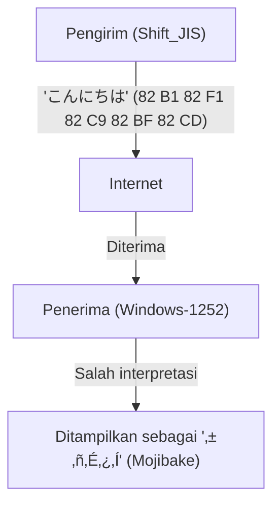
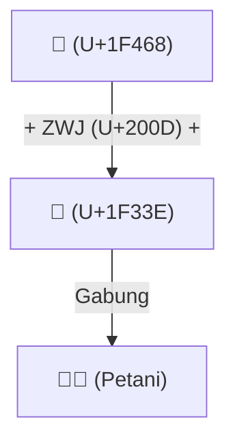

# Sejarah Unicode: Bagaimana Perjuangan Melawan Mojibake Menyatukan Karakter di Seluruh Dunia

Ketika dunia digital masih berada pada awal masa informasi teks, karakter yang dapat diproses oleh komputer sangatlah terbatas. Alasan mengapa saat ini kita dapat dengan mudah membaca dan menulis bahasa Jepang, Mandarin, atau Arab di ponsel pintar dan PC kita, bahkan mengirim dan menerima emoji seperti "😂" ke seluruh dunia, adalah karena para pendahulu kita berjuang bertahun-tahun melawan musuh tangguh yang disebut "teks berantakan (Mojibake)", dan membangun standar karakter bersama.

Dalam artikel ini, kita akan menggali lebih dalam kisah epik "penyatuan karakter" dalam sejarah komputer, mulai dari kelahiran ASCII, kekacauan besar yang disebabkan oleh penyandian lokal di berbagai negara, kelahiran ambisius Unicode, desain jenius UTF-8 oleh Ken Thompson dan Rob Pike, masalah surrogate pair, hingga standardisasi Emoji.

## 1. ASCII sebagai Titik Awal (Batasan 7-bit)

Agar komputer dapat memproses karakter, diperlukan "kode karakter" yang memetakan karakter ke nilai numerik. **ASCII (American Standard Code for Information Interchange)**, yang ditetapkan di Amerika Serikat pada tahun 1960-an, merupakan standar paling dasar untuk hal ini.

ASCII menggunakan 7 bit (0 hingga 127) untuk mendefinisikan huruf besar dan kecil dalam alfabet, angka, simbol dasar, dan karakter kontrol. Ini cukup untuk digunakan di negara-negara berbahasa Inggris, tetapi sama sekali tidak berdaya menghadapi fakta bahwa "ada banyak bahasa selain bahasa Inggris di dunia". Dengan hanya 128 slot, ASCII bahkan tidak dapat mewakili karakter dengan tanda aksen (seperti é atau ñ) dalam bahasa-bahasa Eropa.

## 2. Menara Babel: Era Penyandian Lokal dan "Mojibake"

Seiring penyebaran komputer, berbagai negara memperluas ASCII 7-bit menjadi 8-bit dengan memakai nilai byte tambahan 128 hingga 255, atau mengembangkan penyandian multibyte masing-masing.

- **Keluarga ISO-8859**: Kelompok penyandian 8-bit yang dirancang untuk bahasa-bahasa Eropa (seperti ISO-8859-1 dan Latin-1).
- **Shift_JIS (SJIS)**: Metode yang mencampur karakter 1-byte (seperti katakana half-width) dan karakter 2-byte (kanji, hiragana) yang menyebar luas di PC Jepang (terutama MS-DOS dan Windows).
- **EUC-JP**: Penyandian bahasa Jepang yang sering digunakan pada sistem berbasis UNIX.
- **GB2312 / Big5**: Penyandian untuk wilayah berbahasa Mandarin.

Hal ini memang memungkinkan setiap negara untuk merepresentasikan bahasanya sendiri di komputer, namun menimbulkan masalah besar yang baru. Yaitu fenomena di mana **"saat bertukar data antar kode karakter yang berbeda, data tersebut akan diinterpretasikan sebagai karakter yang sama sekali berbeda"**. Inilah yang dikenal sebagai **teks berantakan (Mojibake)** yang terkenal keburukannya.

Sebagai contoh, mendekode byte Shift_JIS sebagai Windows-1252 menghasilkan simbol pada diagram. Windows-1252 berbeda dari ISO-8859-1: `0x82` mewakili `‚` pada yang pertama, tetapi merupakan karakter kontrol pada yang kedua. Untuk mereproduksi mojibake, bedakan byte sebenarnya dari dekoder yang digunakan. Perbedaan seperti ini memperumit internasionalisasi (i18n).

## 3. Kelahiran Unicode: Semua Karakter dalam Satu Kode

Untuk mengatasi situasi yang kacau ini, para insinyur dari perusahaan seperti Apple dan Xerox (termasuk Joe Becker, Lee Collins, dan Mark Davis) berkumpul pada akhir 1980-an dan meluncurkan proyek yang ambisius. Itulah **Unicode**.

Visi mereka sederhana namun ambisius: "Memasukkan semua karakter, simbol di seluruh dunia, bahkan hingga karakter historis dari masa lalu ke dalam satu Set Karakter (Character Set) yang terpadu."

Unicode awal memakai ruang karakter 16-bit. Penambahan aksara historis dan karakter lain, termasuk ideograf tambahan, memerlukan perluasan. Rentang titik kode saat ini adalah `U+0000` hingga `U+10FFFF`, berisi 1.114.112 posisi. Ini adalah ruang kode, bukan jumlah karakter yang telah ditetapkan; termasuk posisi yang belum ditetapkan dan rentang surrogate. Karakter baru terus ditambahkan.

## 4. Desain Jenius UTF-8: Ken Thompson dan Rob Pike

Meskipun "kamus karakter" raksasa bernama Unicode telah dibuat, masih ada masalah tentang bagaimana menyimpannya dan mengomunikasikannya sebagai urutan byte di komputer (metode penyandian).

UCS-2 mewakili rentang yang didukungnya dengan satu unit kode 16-bit, sedangkan UTF-16 menggunakan satu atau dua unit kode 16-bit. Representasi karakter dalam rentang ASCII sering memuat `0x00` (byte NUL). Memasukkan byte itu langsung ke fungsi string C berterminasi NUL dapat memotong string terlalu awal dan menimbulkan kesalahan; tidak selalu menyebabkan crash.

Pengembang yang menangani masalah ini adalah salah satu pencipta UNIX, **Ken Thompson**, dan pengembang Plan 9, **Rob Pike**. Menurut penuturan Pike, mereka membuat sketsa UTF-8 di alas piring restoran pada 1992 dan mengimplementasikannya dalam Plan 9.

Desain UTF-8 disebut-sebut sebagai salah satu peretasan (hack) terindah dalam sejarah ilmu komputer.
- **Kompatibilitas ASCII pada tingkat byte**: Karakter ASCII (0–127) mempertahankan representasi satu byte. Namun, fungsi C yang sudah ada tidak otomatis memahami hitungan karakter Unicode atau batas karakternya.
- **Penyandian dengan panjang variabel**: Panjangnya bervariasi dari 1 hingga 4 byte tergantung pada karakternya (sebagai contoh, bahasa Jepang sebagian besar menggunakan 3 byte).
- **Sinkronisasi mandiri**: Pola byte awal (`0xxxxxxx`, `110xxxxx`, `1110xxxx`, `11110xxx`) berbeda dari pola byte lanjutan `10xxxxxx`. Dalam UTF-8 yang valid, hal ini membantu menemukan batas karakter berikutnya ketika pembacaan dimulai di tengah urutan. Byte lanjutan tidak dapat langsung didekode sebagai karakter baru, dan urutan tidak valid tetap perlu diperiksa.

Sifat-sifat ini membantu UTF-8 digunakan secara luas di web modern.

## 5. Masalah Surrogate Pair dan Fajar Emoji

UTF-16 mewakili satu titik kode pada bidang tambahan menggunakan dua unit kode 16-bit, yang disebut surrogate pair. Properti `length` pada string JavaScript menghitung unit kode UTF-16, sehingga `"😂".length` bernilai 2. Hasil ini sesuai spesifikasi; menganggapnya sebagai jumlah karakter yang terlihat dapat menyebabkan bug. Pada urutan emoji ZWJ, jumlah titik kode juga dapat berbeda dari jumlah karakter yang terlihat.

Unicode 6.0, dirilis pada 2010, menambahkan banyak emoji yang digunakan operator seluler Jepang Docomo, au, dan SoftBank. Beberapa simbol yang dipakai sebagai emoji sudah dikodekan dalam versi sebelumnya, sehingga tidak semua emoji pertama kali masuk pada versi 6.0.

Dengan hadirnya Emoji, Unicode berevolusi melampaui kerangka "karakter" menjadi bahasa visual universal untuk menyampaikan emosi dan konsep. Selain itu, spesifikasi yang kompleks juga terus ditambahkan untuk merepresentasikan keragaman (diversitas) modern, seperti pengubah warna kulit (Skin Tone Modifier) dan mekanisme untuk menggabungkan beberapa emoji menjadi satu emoji (ZWJ: Zero Width Joiner).

## Penutup: Fondasi untuk Menghubungkan Pengetahuan Umat Manusia ke Masa Depan

Standar Unicode mengodekan banyak karakter dan simbol, termasuk hieroglif Mesir, aksara paku, aksara bahasa minoritas, dan emoji. Konsorsium Unicode adalah organisasi yang memelihara dan mengembangkan standar itu.

Penyandian karakter berkembang dari 128 posisi kode ASCII menuju sistem bersama untuk beragam aksara dunia. Tidak semua karakter sudah dikodekan; penambahan karakter dan perbaikan implementasi terus berlangsung.

Di balik emoji "😂" yang kita kirimkan dengan santai, tersembunyi drama "perjuangan melawan teks berantakan (mojibake)" oleh para teknisi selama beberapa dekade.

## Referensi

- [Unicode FAQ: UTF-8, UTF-16, UTF-32 & BOM](https://www.unicode.org/faq/utf_bom.html)
- [Rob Pike: UTF-8 history](https://www.cl.cam.ac.uk/~mgk25/ucs/utf-8-history.txt)
