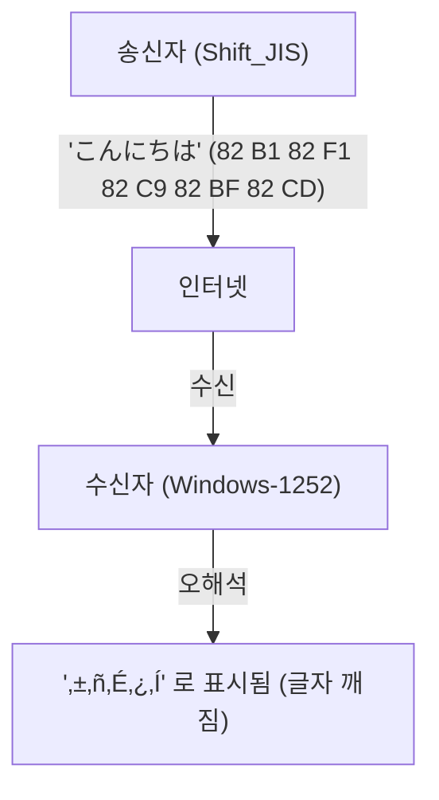
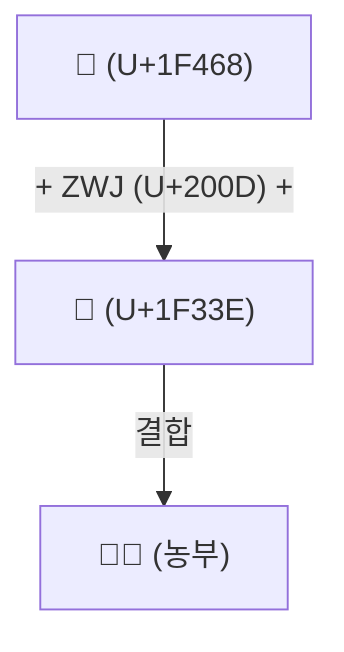

# 유니코드의 역사: 글자 깨짐과의 전쟁은 어떻게 세계의 문자를 통일했는가

디지털 세계가 텍스트 정보의 여명기에 있었을 무렵, 컴퓨터가 다룰 수 있는 문자는 매우 제한적이었습니다. 우리가 오늘날 스마트폰이나 PC에서 당연하다는 듯이 한국어, 일본어, 중국어, 아랍어를 읽고 쓰며, 나아가 '😂'와 같은 이모지를 전 세계로 주고받을 수 있는 것은, 선인들이 '글자 깨짐(Mojibake)'이라는 강적과 오랜 세월 싸워오며 공통의 문자 표준을 구축했기 때문입니다.

본 기사에서는 ASCII의 탄생부터 시작하여 각국의 로컬 인코딩이 야기한 대혼란, 유니코드의 야심 찬 탄생, 켄 톰슨과 롭 파이크에 의한 UTF-8의 천재적인 설계, 서로게이트 페어 문제, 그리고 이모지(Emoji)의 표준화에 이르기까지, 컴퓨터 역사상 장대한 '문자의 통일' 이야기를 깊이 파헤쳐 봅니다.

## 1. 원점으로서의 ASCII (7비트의 제약)

컴퓨터가 문자를 다루기 위해서는 문자를 수치에 대응시키는 '문자 코드'가 필요합니다. 1960년대 미국에서 제정된 **ASCII (American Standard Code for Information Interchange)**는 그 가장 기초가 되는 규격이었습니다.

ASCII는 7비트(0~127)를 사용하여 알파벳 대소문자, 숫자, 기본적인 기호, 그리고 제어 문자를 정의했습니다. 이는 영어권에서 사용하기에는 충분했지만, '세계에는 영어 이외의 언어가 무수히 많다'는 사실에 대해서는 완전히 무력했습니다. 단 128개의 빈칸만 가진 ASCII로는 유럽 언어의 악센트 기호가 붙은 문자(é나 ñ 등)조차 표현할 수 없었던 것입니다.

## 2. 바벨탑: 로컬 인코딩과 '글자 깨짐'의 시대

컴퓨터가 세계로 보급되면서 각국은 7비트 ASCII를 8비트로 확장해 추가 바이트 값 128~255를 사용하거나 독자적인 다중 바이트 인코딩을 개발했습니다.

- **ISO-8859 계열**: 유럽 언어를 위해 설계된 8비트 인코딩군 (ISO-8859-1이나 Latin-1 등).
- **Shift_JIS (SJIS)**: 일본의 PC(특히 MS-DOS나 Windows)에서 널리 보급된, 1바이트 문자(반각 가타카나 등)와 2바이트 문자(한자, 히라가나)를 혼재시키는 방식.
- **EUC-JP**: UNIX 계열 시스템에서 자주 사용된 일본어 인코딩.
- **GB2312 / Big5**: 중화권의 인코딩.

이로 인해 자국의 언어를 컴퓨터로 표현할 수는 있게 되었지만, 새로운 큰 문제가 발생했습니다. **"다른 문자 코드 간에 데이터를 주고받으면 전혀 다른 문자로 해석되어 버린다"**는 현상입니다. 이것이 바로 악명 높은 **글자 깨짐 (Mojibake)**입니다.

예를 들어 Shift_JIS 바이트를 Windows-1252로 잘못 디코딩하면 그림의 기호열이 나옵니다. Windows-1252와 ISO-8859-1은 같지 않습니다. `0x82`는 전자에서 `‚`를 나타내지만 후자에서는 제어 문자입니다. 글자 깨짐을 재현하려면 실제 바이트와 사용한 디코더를 구분해야 합니다. 이러한 차이는 국제화(i18n)를 복잡하게 해 왔습니다.

## 3. 유니코드의 탄생: 모든 문자를 하나의 코드로

이 혼돈스러운 상황을 타개하기 위해 1980년대 후반 Apple이나 Xerox 등의 엔지니어(조 베커, 리 콜린스, 마크 데이비스 등)가 집결하여 장대한 프로젝트를 출범시켰습니다. 그것이 바로 **유니코드(Unicode)**입니다.

그들의 비전은 단순하고도 야심 찼습니다. '전 세계의 모든 문자, 기호, 그리고 과거의 역사적 문자까지 단 하나의 통일된 문자 집합(Character Set)에 담는다'는 것이었습니다.

초기 유니코드는 16비트 문자 공간을 사용했습니다. 역사적 문자와 추가 한자 등을 수록하려면 확장이 필요했습니다. 현재 코드 포인트 범위는 `U+0000`부터 `U+10FFFF`까지로, 1,114,112개의 위치를 가집니다. 이는 등록된 문자 수가 아니라 미할당 위치와 서로게이트 영역까지 포함한 코드 공간입니다. 새로운 문자는 계속 추가되고 있습니다.

## 4. UTF-8의 천재적 설계: 켄 톰슨과 롭 파이크

유니코드라는 거대한 '문자 사전'이 생겼어도, 그것을 컴퓨터상에서 어떻게 바이트 열로 저장하고 통신할 것인가(인코딩 방식) 하는 문제가 남아 있었습니다.

UCS-2는 지원 범위의 문자를 하나의 16비트 코드 유닛으로 표현하고, UTF-16은 하나 또는 두 개의 16비트 코드 유닛을 사용합니다. ASCII 범위 문자의 표현에는 흔히 `0x00`(NUL 바이트)이 포함됩니다. 이를 NUL 종료 방식의 C 문자열 함수에 그대로 전달하면 문자열이 일찍 끝나는 등의 오류가 생길 수 있지만, 반드시 프로그램이 충돌하는 것은 아닙니다.

이 문제의 해결에 참여한 개발자는 UNIX 공동 창시자 **켄 톰슨(Ken Thompson)**과 Plan 9 개발자 **롭 파이크(Rob Pike)**입니다. 파이크의 회고에 따르면 두 사람은 1992년 식당의 식탁 매트에 UTF-8 설계를 스케치하고 Plan 9에 구현했습니다.

UTF-8의 설계는 컴퓨터 과학 역사상 가장 아름다운 해킹 중 하나로 불립니다.
- **ASCII와의 바이트 단위 호환성**: ASCII 문자(0~127)는 원래의 1바이트 표현을 유지합니다. 다만 기존 C 함수가 유니코드의 문자 수나 문자 경계를 자동으로 이해하게 되는 것은 아닙니다.
- **가변 길이 인코딩**: 문자에 따라 1바이트에서 4바이트까지 길이를 변경합니다(한국어나 일본어 등은 주로 3바이트).
- **자기 동기화(Self-synchronization)**: 시작 바이트 패턴(`0xxxxxxx`, `110xxxxx`, `1110xxxx`, `11110xxx`)은 후속 바이트의 `10xxxxxx`와 구분됩니다. 유효한 UTF-8에서는 시퀀스 중간에서 시작했을 때 다음 문자 경계를 찾는 데 도움이 됩니다. 후속 바이트를 새 문자로 디코딩할 수 있다는 뜻은 아니며, 잘못된 시퀀스는 여전히 검증해야 합니다.

이러한 특성은 UTF-8이 현대 웹에서 널리 사용되는 데 기여했습니다.

## 5. 서로게이트 페어 문제와 이모지(Emoji)의 새벽

UTF-16은 보충 평면의 코드 포인트 하나를 16비트 코드 유닛 두 개로 표현하며, 이를 서로게이트 페어라고 합니다. JavaScript 문자열의 `length`는 UTF-16 코드 유닛을 세므로 `"😂".length`는 2입니다. 이는 명세에 맞는 결과이며, 눈에 보이는 문자 수라고 가정하면 버그가 생길 수 있습니다. ZWJ 이모지 시퀀스에서는 코드 포인트 수도 보이는 문자 수와 다를 수 있습니다.

2010년에 발표된 유니코드 6.0은 일본 통신사 도코모, au, 소프트뱅크에서 사용하던 많은 이모지를 추가했습니다. 이모지로 쓰이는 일부 기호는 이전 버전에도 있었으므로 모든 이모지가 6.0에서 처음 채택된 것은 아닙니다.

이모지의 도입으로 유니코드는 단순한 '문자'의 틀을 넘어, 감정과 개념을 전달하는 세계 공통의 시각 언어로 진화했습니다. 나아가 피부색 변경(Skin Tone Modifier)이나 여러 이모지를 결합하여 하나의 이모지를 만드는 구조(ZWJ: Zero Width Joiner) 등, 현대의 다양성(Diversity)을 반영하기 위한 복잡한 사양도 차례차례 추가되고 있습니다.

## 맺음말: 인류의 지식을 미래로 잇는 기반

유니코드 표준에는 이집트 상형문자, 쐐기문자, 소수 언어의 문자 체계와 이모지 등 많은 문자와 기호가 수록되어 있습니다. 유니코드 컨소시엄은 이 표준을 유지하고 발전시키는 조직입니다.

문자 인코딩은 ASCII의 128개 코드 위치에서 세계의 다양한 문자 체계를 위한 공통 시스템으로 발전했습니다. 모든 문자가 이미 수록된 것은 아니며, 추가 문자의 인코딩과 구현 개선은 계속됩니다.

우리가 무심코 전송하는 '😂'의 이면에는 이러한 수십 년에 걸친 기술자들의 '글자 깨짐과의 전쟁' 드라마가 숨겨져 있는 것입니다.

## 참고 자료

- [Unicode FAQ: UTF-8, UTF-16, UTF-32 & BOM](https://www.unicode.org/faq/utf_bom.html)
- [Rob Pike: UTF-8 history](https://www.cl.cam.ac.uk/~mgk25/ucs/utf-8-history.txt)
