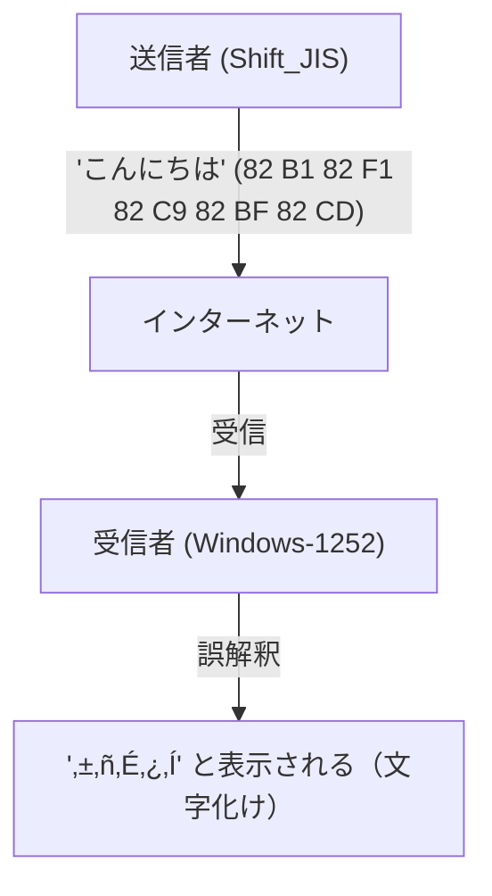
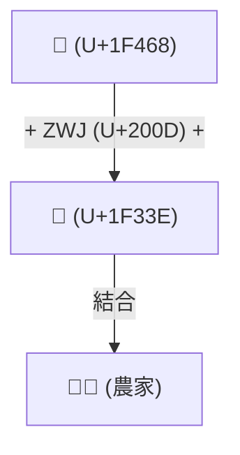

# Unicodeの歴史：文字化けとの戦いはいかに世界の文字を統一したか

デジタル世界がまだテキスト情報の黎明期にあった頃、コンピュータが扱える文字は非常に限定的でした。私たちが今日、スマートフォンやPCで当たり前のように日本語や中国語、アラビア語を読み書きし、さらには「😂」のような絵文字を世界中で送受信できるのは、先人たちが「文字化け（Mojibake）」という強敵と長年戦い続け、共通の文字標準を築いたからです。

本記事では、ASCIIの誕生から始まり、各国のローカルエンコーディングが引き起こした大混乱、Unicodeの野心的な誕生、ケン・トンプソンとロブ・パイクによるUTF-8の天才的設計、サロゲートペア問題、そして絵文字（Emoji）の標準化に至るまで、コンピュータ史における壮大な「文字の統一」の物語を深く掘り下げます。

## 1. 原点としてのASCII（7ビットの制約）

コンピュータが文字を扱うためには、文字を数値に対応付ける「文字コード」が必要です。1960年代にアメリカで制定された **ASCII (American Standard Code for Information Interchange)** は、その最も基礎となる規格でした。

ASCIIは7ビット（0〜127）を用いて、アルファベットの大文字・小文字、数字、基本的な記号、そして制御文字を定義しました。これは英語圏での使用には十分でしたが、「世界には英語以外の言語が無数にある」という事実に対しては完全に無力でした。わずか128個の枠しか持たないASCIIでは、ヨーロッパ言語のアクセント記号付き文字（éやñなど）すら表現できなかったのです。

## 2. バベルの塔：ローカルエンコーディングと「文字化け」の時代

コンピュータが世界中に普及するにつれ、各国は7ビットASCIIを8ビットへ拡張して128〜255の値も使う方式や、複数のバイトを組み合わせる独自のエンコーディング方式を開発しました。

- **ISO-8859系**: ヨーロッパ言語向けに設計された8ビットエンコーディング群（ISO-8859-1やLatin-1など）。
- **Shift_JIS (SJIS)**: 日本のパソコン（特にMS-DOSやWindows）で広く普及した、1バイト文字（半角カタカナなど）と2バイト文字（漢字・ひらがな）を混在させる方式。
- **EUC-JP**: UNIX系システムでよく使われた日本語エンコーディング。
- **GB2312 / Big5**: 中国語圏のエンコーディング。

これにより、自国の言語をコンピュータで表現できるようにはなりましたが、新たな大問題が発生しました。**「異なる文字コード間でデータをやり取りすると、全く別の文字として解釈されてしまう」** という現象です。これが悪名高き **文字化け (Mojibake)** です。

例えば、Shift_JISのバイト列をWindows-1252として誤って復号すると、図のように別の記号列として表示されます。Windows-1252とISO-8859-1は同一ではなく、この例の`0x82`はWindows-1252では`‚`、ISO-8859-1では制御文字です。文字化けを再現するときは、バイト列と実際に使った復号方式を区別する必要があります。こうした違いは、多言語対応（i18n）を複雑にしてきました。

## 3. Unicodeの誕生：すべての文字をひとつのコードで

この混沌とした状況を打開するため、1980年代後半にAppleやXeroxなどのエンジニア（ジョー・ベッカー、リー・コリンズ、マーク・デイヴィスら）が集結し、壮大なプロジェクトを立ち上げました。それが **Unicode** です。

彼らのビジョンはシンプルかつ野心的でした。「世界中のすべての文字、記号、そして過去の歴史的文字までを、たった一つの統一された文字集合（Character Set）に収める」というものです。

初期のUnicodeは16ビットの文字空間を前提としていました。しかし、歴史的文字や追加の漢字なども収録するには拡張が必要になりました。現在のコードポイントの範囲は`U+0000`から`U+10FFFF`までで、1,114,112個の位置を持ちます。これは登録済み文字数ではなく、未割り当ての位置やサロゲート用の領域も含む空間です。現在も新しい文字が追加され続けています。

## 4. UTF-8の天才的設計：ケン・トンプソンとロブ・パイク

Unicodeという巨大な「文字の辞書」ができても、それをコンピュータ上でどうバイト列として保存・通信するか（エンコーディング方式）という問題が残っていました。

UCS-2は16ビットのコード単位1個で扱える範囲を表し、UTF-16は1個または2個の16ビットコード単位を使います。これらでASCIIの範囲の文字を保存すると、多くの場合`0x00`（NULバイト）を含みます。NULを終端とする既存のC文字列関数にそのバイト列をそのまま渡すと、途中で文字列が終わったように解釈されるなどの問題が起こります。必ずクラッシュするという意味ではありません。

この問題に取り組んだのが、UNIXの共同開発者 **ケン・トンプソン (Ken Thompson)** と、Plan 9の開発者 **ロブ・パイク (Rob Pike)** です。Pikeの回想によれば、1992年、2人は食事中のプレースマットにUTF-8の設計を描き、Plan 9に実装しました。

UTF-8の設計は、コンピュータサイエンス史上最も美しいハックの一つと言われています。
- **ASCIIとのバイト単位の互換性**: ASCII文字（0-127）はそのまま1バイトで表現されます。ただし、既存のC関数がUnicodeの文字数計算や文字境界まで自動的に理解するわけではありません。
- **可変長エンコーディング**: 文字によって1バイトから4バイトまで長さを変えます（日本語などは主に3バイト）。
- **自己同期性**: 先頭バイトのパターン（`0xxxxxxx`、`110xxxxx`、`1110xxxx`、`11110xxx`）と、後続バイトの`10xxxxxx`を区別できます。有効なUTF-8列では、途中から次の文字境界を探し直す助けになります。途中の後続バイトをそのまま文字の先頭として復号できるわけではなく、不正なバイト列への検査も必要です。

こうした特徴により、UTF-8は現代のウェブで広く使われるエンコーディングになりました。

## 5. サロゲートペア問題と絵文字（Emoji）の夜明け

UTF-16では、補助平面の1コードポイントを2つの16ビットコード単位の組で表します。これが「サロゲートペア（代用対）」です。JavaScriptの文字列の`length`はUTF-16コード単位の数なので、`"😂".length`は2になります。これは仕様どおりの結果ですが、見た目の文字数と同じだと仮定すると不具合につながります。ZWJによる絵文字列では、コードポイント数と見た目の文字数も異なる場合があります。

そして2010年のUnicode 6.0では、日本の携帯電話キャリア（ドコモ、au、ソフトバンク）で使われていた多くの **絵文字（Emoji）** が追加されました。以前から符号化されていた、絵文字として使われる記号もあるため、すべての絵文字が6.0で初めて採用されたわけではありません。

絵文字の導入により、Unicodeは単なる「文字」の枠を超え、感情や概念を伝える世界共通の視覚言語へと進化しました。さらに、肌の色の変更（Skin Tone Modifier）や、複数の絵文字を結合して一つの絵文字を作る仕組み（ZWJ: Zero Width Joiner）など、現代の多様性（ダイバーシティ）を反映するための複雑な仕様も次々と追加されています。

## 結び：人類の知識を未来へつなぐ基盤

現在のUnicode標準には、古代エジプトのヒエログリフから、楔形文字、少数民族の言語、そして絵文字まで、多くの文字と記号が収録されています。Unicodeコンソーシアムは、この標準を維持・発展させる組織です。

ASCIIの128個の符号位置から、世界の多様な文字を共通の体系で扱う仕組みへ、文字コードの歴史は発展してきました。すべての文字が収録済みというわけではなく、新しい文字の符号化や実装の改善は今も続いています。

私たちが何気なく送信している「😂」の裏には、こうした数十年にわたる技術者たちの「文字化けとの戦い」のドラマが隠されているのです。

## 参考資料

- [Unicode FAQ: UTF-8, UTF-16, UTF-32 & BOM](https://www.unicode.org/faq/utf_bom.html)
- [Rob Pike: UTF-8 history](https://www.cl.cam.ac.uk/~mgk25/ucs/utf-8-history.txt)
