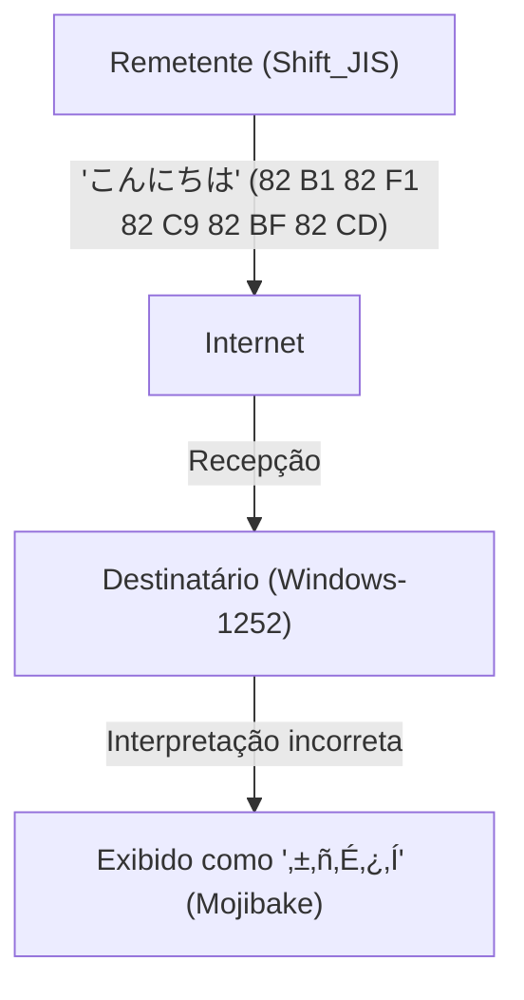
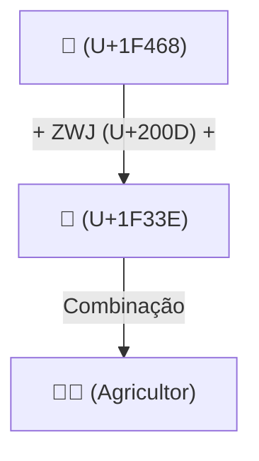

# A História do Unicode: Como a Batalha Contra o Mojibake Unificou os Caracteres do Mundo

Quando o mundo digital ainda estava nos primórdios da informação em texto, os caracteres que os computadores podiam manipular eram extremamente limitados. O fato de que hoje podemos ler e escrever naturalmente em japonês, chinês e árabe em nossos smartphones e PCs, e até mesmo enviar e receber emojis como "😂" em todo o mundo, deve-se aos nossos predecessores que lutaram durante anos contra o formidável inimigo chamado "Mojibake" (caracteres corrompidos), estabelecendo um padrão comum de caracteres.

Neste artigo, vamos explorar profundamente a épica história da "unificação de caracteres" na história da computação, começando com o nascimento do ASCII, a grande confusão causada pelas codificações locais em cada país, o ambicioso nascimento do Unicode, o genial design do UTF-8 por Ken Thompson e Rob Pike, o problema dos pares substitutos (surrogate pairs) e a padronização dos emojis.

## 1. A Origem: ASCII (A Restrição de 7 bits)

Para que um computador lide com caracteres, é necessário um "código de caracteres" (character code) que associe caracteres a valores numéricos. O **ASCII (American Standard Code for Information Interchange)**, criado nos Estados Unidos na década de 1960, foi o padrão mais fundamental para isso.

O ASCII usava 7 bits (0 a 127) para definir letras maiúsculas e minúsculas do alfabeto, números, símbolos básicos e caracteres de controle. Isso era suficiente para o uso em países de língua inglesa, mas era completamente inútil diante do fato de que "existem inúmeras línguas além do inglês no mundo". Com apenas 128 espaços disponíveis, o ASCII não conseguia nem mesmo representar caracteres acentuados de línguas europeias (como é ou ñ).

## 2. A Torre de Babel: Codificações Locais e a Era do "Mojibake"

À medida que os computadores se espalhavam pelo mundo, os países estenderam o ASCII de 7 bits para 8 bits, usando os valores de byte adicionais de 128 a 255, ou desenvolveram suas próprias codificações multibyte.

- **Série ISO-8859**: Um grupo de codificações de 8 bits projetado para línguas europeias (como ISO-8859-1 e Latin-1).
- **Shift_JIS (SJIS)**: Um esquema amplamente difundido em PCs japoneses (especialmente MS-DOS e Windows) que misturava caracteres de 1 byte (como katakana de meia largura) e caracteres de 2 bytes (kanji e hiragana).
- **EUC-JP**: Uma codificação japonesa frequentemente usada em sistemas UNIX.
- **GB2312 / Big5**: Codificações da esfera de língua chinesa.

Embora isso permitisse que cada país representasse sua própria língua no computador, gerou um novo e grande problema. O fenômeno em que **"a troca de dados entre diferentes códigos de caracteres faz com que sejam interpretados como caracteres completamente diferentes"**. Este é o infame **Mojibake** (caracteres corrompidos).

Por exemplo, decodificar bytes Shift_JIS como Windows-1252 produz os símbolos do diagrama. Windows-1252 e ISO-8859-1 não são idênticos: `0x82` representa `‚` no primeiro, mas é um caractere de controle no segundo. Para reproduzir o mojibake, é preciso distinguir os bytes reais do decodificador utilizado. Essas diferenças complicam a internacionalização (i18n).

## 3. O Nascimento do Unicode: Todos os Caracteres em um Único Código

Para romper com essa situação caótica, engenheiros de empresas como Apple e Xerox (Joe Becker, Lee Collins, Mark Davis, entre outros) se reuniram no final da década de 1980 e lançaram um projeto ambicioso. Esse projeto era o **Unicode**.

A visão deles era simples e ambiciosa: "Reunir todos os caracteres, símbolos e até mesmo caracteres históricos do passado de todo o mundo em um único conjunto de caracteres (Character Set) unificado".

O Unicode inicial usava um espaço de caracteres de 16 bits. A inclusão de escritas históricas e outros caracteres, como ideogramas adicionais, exigiu sua expansão. O intervalo atual de pontos de código vai de `U+0000` a `U+10FFFF`, com 1.114.112 posições. Isso é um espaço de códigos, não o número de caracteres atribuídos: inclui posições não atribuídas e o intervalo de substitutos. Novos caracteres continuam sendo adicionados.

## 4. O Design Genial do UTF-8: Ken Thompson e Rob Pike

Mesmo com a criação do enorme "dicionário de caracteres" que é o Unicode, restava o problema de como salvar e comunicar isso como sequências de bytes nos computadores (esquema de codificação).

O UCS-2 representa o intervalo que suporta com uma unidade de código de 16 bits; o UTF-16 usa uma ou duas unidades. A representação de caracteres do intervalo ASCII costuma conter `0x00` (bytes NUL). Passar esses bytes diretamente a funções C de strings terminadas em NUL pode causar truncamento e erros relacionados; não provoca necessariamente um travamento.

Participaram dessa solução o cocriador do UNIX **Ken Thompson** e o desenvolvedor do Plan 9 **Rob Pike**. Segundo o relato de Pike, eles esboçaram o projeto do UTF-8 em um jogo americano de restaurante em 1992 e o implementaram no Plan 9.

O design do UTF-8 é considerado um dos "hacks" mais belos da história da ciência da computação.
- **Compatibilidade com ASCII no nível de bytes**: Os caracteres ASCII (0–127) mantêm sua representação de um byte. As funções C existentes, porém, não passam a entender automaticamente a contagem de caracteres Unicode ou seus limites.
- **Codificação de comprimento variável**: O comprimento varia de 1 a 4 bytes, dependendo do caractere (o japonês, por exemplo, usa principalmente 3 bytes).
- **Autossincronização**: Os padrões dos bytes iniciais (`0xxxxxxx`, `110xxxxx`, `1110xxxx`, `11110xxx`) distinguem-se do padrão de continuação `10xxxxxx`. Em UTF-8 válido, isso ajuda a localizar o próximo limite de caractere ao começar dentro de uma sequência. Não permite decodificar um byte de continuação como um novo caractere; sequências inválidas ainda precisam ser validadas.

Essas propriedades contribuíram para o amplo uso do UTF-8 na web moderna.

## 5. O Problema dos Pares Substitutos e o Amanhecer dos Emojis

O UTF-16 representa um ponto de código de um plano suplementar por meio de duas unidades de código de 16 bits, chamadas de par substituto. A propriedade `length` das strings JavaScript conta unidades de código UTF-16; por isso, `"😂".length` é 2. Isso segue a especificação, mas supor que o valor conte caracteres visíveis pode causar bugs. Em sequências de emojis com ZWJ, a quantidade de pontos de código também pode diferir da quantidade de caracteres visíveis.

O Unicode 6.0, lançado em 2010, acrescentou muitos emojis usados pelas operadoras japonesas Docomo, au e SoftBank. Alguns símbolos usados como emojis já haviam sido codificados em versões anteriores; portanto, nem todos os emojis apareceram pela primeira vez na versão 6.0.

Com a introdução dos emojis, o Unicode foi além dos meros "caracteres", evoluindo para uma linguagem visual universal que transmite emoções e conceitos. Além disso, especificações complexas para refletir a diversidade moderna continuam a ser adicionadas, como modificadores de tom de pele (Skin Tone Modifier) e o mecanismo de combinar múltiplos emojis para criar um único emoji (ZWJ: Zero Width Joiner).

## Conclusão: A Fundação para Conectar o Conhecimento Humano ao Futuro

O Padrão Unicode codifica muitos caracteres e símbolos, como hieróglifos egípcios, escrita cuneiforme, escritas de línguas minoritárias e emojis. O Consórcio Unicode é a organização que mantém e desenvolve o padrão.

A codificação de caracteres evoluiu das 128 posições do ASCII para um sistema compartilhado pelas diversas escritas do mundo. Nem todos os caracteres já foram codificados: a inclusão de novos caracteres e as melhorias nas implementações continuam.

Por trás do "😂" que enviamos casualmente, esconde-se o drama dessas décadas de "batalha contra o Mojibake" travada pelos engenheiros.

## Referências

- [Unicode FAQ: UTF-8, UTF-16, UTF-32 & BOM](https://www.unicode.org/faq/utf_bom.html)
- [Rob Pike: UTF-8 history](https://www.cl.cam.ac.uk/~mgk25/ucs/utf-8-history.txt)
