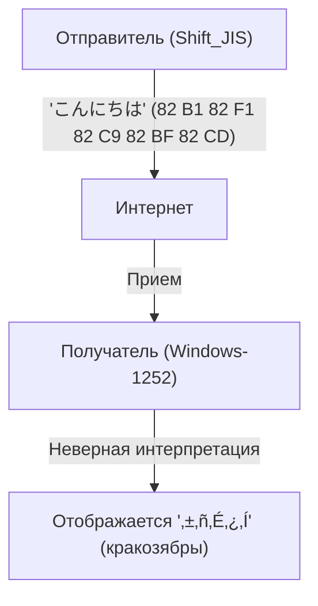
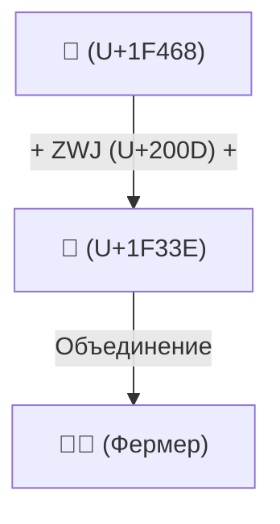

# История Unicode: Как борьба с кракозябрами объединила символы всего мира

В эпоху зарождения цифрового мира возможности компьютеров по обработке текста были крайне ограничены. Тот факт, что сегодня мы легко читаем и пишем на японском, китайском или арабском языках на наших смартфонах и ПК, а также отправляем по всему миру эмодзи вроде «😂», стал возможным благодаря тому, что наши предшественники вели долгую борьбу с грозным врагом — «кракозябрами» (Mojibake), создав общий стандарт символов.

В этой статье мы подробно рассмотрим грандиозную историю «объединения символов» в компьютерной истории: начиная с появления ASCII, через хаос, вызванный локальными кодировками разных стран, к амбициозному созданию Unicode, гениальному проектированию UTF-8 Кеном Томпсоном и Робом Пайком, проблеме суррогатных пар и вплоть до стандартизации эмодзи (Emoji).

## 1. ASCII как отправная точка (Ограничение в 7 бит)

Чтобы компьютеры могли работать с текстом, им нужна «кодировка», связывающая символы с числами. Самым базовым стандартом стал **ASCII (American Standard Code for Information Interchange)**, созданный в США в 1960-х годах.

ASCII использовал 7 бит (от 0 до 127) для определения заглавных и строчных букв латинского алфавита, цифр, основных знаков препинания и управляющих символов. Этого было достаточно для англоязычного мира, но абсолютно бесполезно перед лицом того факта, что в мире существует бесчисленное множество языков помимо английского. Имея всего 128 позиций, ASCII не мог отобразить даже буквы европейских языков с диакритическими знаками (например, é или ñ).

## 2. Вавилонская башня: Эпоха локальных кодировок и «кракозябр»

По мере распространения компьютеров разные страны расширяли 7-битный ASCII до 8 бит, используя дополнительные значения байта от 128 до 255, или разрабатывали собственные многобайтовые кодировки.

- **Семейство ISO-8859**: Группа 8-битных кодировок, разработанных для европейских языков (например, ISO-8859-1 или Latin-1).
- **Shift_JIS (SJIS)**: Широко распространенная на японских ПК (особенно в MS-DOS и Windows) система, смешивающая 1-байтовые (полуширинная катакана) и 2-байтовые символы (кандзи, хирагана).
- **EUC-JP**: Кодировка японского языка, часто используемая в UNIX-системах.
- **GB2312 / Big5**: Кодировки для китайского языка.

Благодаря этому стало возможным отображать родные языки на компьютерах, но возникла новая огромная проблема. Это явление, когда **«при обмене данными между разными кодировками они интерпретируются как совершенно другие символы»**. Это и есть пресловутые **кракозябры (Mojibake)**.

Например, декодирование байтов Shift_JIS как Windows-1252 даёт последовательность символов из диаграммы. Windows-1252 и ISO-8859-1 различаются: `0x82` означает `‚` в первой кодировке, но управляющий символ во второй. Для воспроизведения искажения нужно различать реальные байты и используемый декодер. Эти различия усложняют интернационализацию (i18n).

## 3. Рождение Unicode: Все символы в одном коде

Чтобы выйти из этого хаоса, в конце 1980-х годов инженеры из Apple, Xerox и других компаний (такие как Джо Беккер, Ли Коллинз, Марк Дэвис) объединились и запустили грандиозный проект. Так появился **Unicode**.

Их видение было простым, но амбициозным: «Собрать все буквы, символы со всего мира, а также исторические письменности прошлого в единый универсальный набор символов (Character Set)».

Изначально Unicode использовал 16-битное пространство символов. Для исторических письменностей и дополнительных символов, включая новые иероглифы, понадобилось расширение. Нынешний диапазон кодовых точек — от `U+0000` до `U+10FFFF`, то есть 1 114 112 позиций. Это кодовое пространство, а не число назначенных символов: оно включает неназначенные позиции и диапазон суррогатов. Новые символы продолжают добавляться.

## 4. Гениальный дизайн UTF-8: Кен Томпсон и Роб Пайк

Даже после создания огромного «словаря символов» Unicode, оставалась проблема того, как сохранять и передавать их в виде последовательности байтов на компьютерах (метод кодирования).

UCS-2 представляет поддерживаемый диапазон одной 16-битной кодовой единицей, а UTF-16 — одной или двумя. Представления символов диапазона ASCII часто содержат `0x00` (байты NUL). Прямая передача таких байтов функциям C для строк с завершающим NUL может преждевременно обрезать строку и вызвать ошибки, но не обязательно приводит к аварийному завершению программы.

Над решением работали один из создателей UNIX **Кен Томпсон (Ken Thompson)** и разработчик Plan 9 **Роб Пайк (Rob Pike)**. По воспоминаниям Пайка, в 1992 году они набросали проект UTF-8 на подкладке под тарелку в закусочной и реализовали его в Plan 9.

Дизайн UTF-8 считается одним из самых красивых хаков в истории информатики:
- **Побайтовая совместимость с ASCII**: Символы ASCII (0–127) сохраняют однобайтовое представление. Однако существующие функции C не начинают автоматически понимать подсчёт символов Unicode или их границы.
- **Кодирование переменной длины**: В зависимости от символа длина может составлять от 1 до 4 байт (японские символы в основном занимают 3 байта).
- **Самосинхронизация**: Шаблоны начальных байтов (`0xxxxxxx`, `110xxxxx`, `1110xxxx`, `11110xxx`) отличаются от шаблона продолжения `10xxxxxx`. В корректном UTF-8 это помогает найти следующую границу символа при начале чтения внутри последовательности. Байт продолжения нельзя просто декодировать как новый символ; некорректные последовательности всё равно требуют проверки.

Эти свойства способствовали широкому распространению UTF-8 в современном вебе.

## 5. Проблема суррогатных пар и рассвет эмодзи (Emoji)

UTF-16 представляет кодовую точку дополнительной плоскости двумя 16-битными кодовыми единицами — суррогатной парой. Свойство `length` строк JavaScript считает кодовые единицы UTF-16, поэтому `"😂".length` равно 2. Это соответствует спецификации; ошибки возможны, если считать это числом видимых символов. Для последовательностей эмодзи с ZWJ количество кодовых точек тоже может отличаться от количества видимых символов.

Unicode 6.0, выпущенный в 2010 году, добавил много эмодзи японских операторов Docomo, au и SoftBank. Некоторые используемые как эмодзи символы были закодированы раньше, поэтому не все эмодзи впервые появились в версии 6.0.

С внедрением эмодзи Unicode вышел за рамки просто «букв» и превратился во всемирный визуальный язык для передачи эмоций и концепций. Кроме того, для отражения современного разнообразия (diversity) постоянно добавляются сложные спецификации, такие как изменение цвета кожи (Skin Tone Modifier) или механизм объединения нескольких эмодзи в один (ZWJ: Zero Width Joiner).

## Заключение: Фундамент, передающий знания человечества в будущее

Стандарт Unicode кодирует множество символов, включая египетские иероглифы, клинопись, письменности языков меньшинств и эмодзи. Консорциум Unicode — организация, которая поддерживает и развивает этот стандарт.

Кодирование символов развивалось от 128 кодовых позиций ASCII к общей системе для разнообразных письменностей мира. Не все символы уже закодированы: добавление новых символов и совершенствование реализаций продолжаются.

За безобидным «😂», которое мы отправляем, скрывается драма этой многолетней «битвы с кракозябрами» инженеров.

## Источники

- [Unicode FAQ: UTF-8, UTF-16, UTF-32 & BOM](https://www.unicode.org/faq/utf_bom.html)
- [Rob Pike: UTF-8 history](https://www.cl.cam.ac.uk/~mgk25/ucs/utf-8-history.txt)
