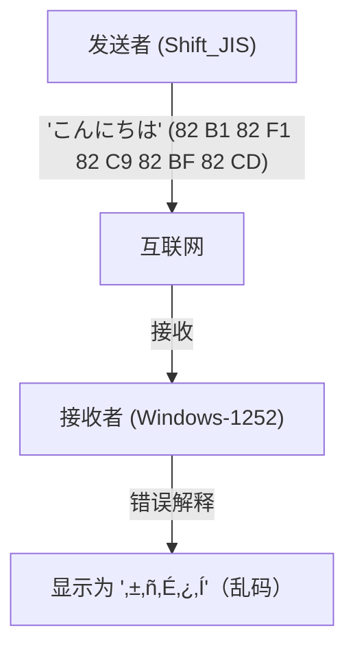
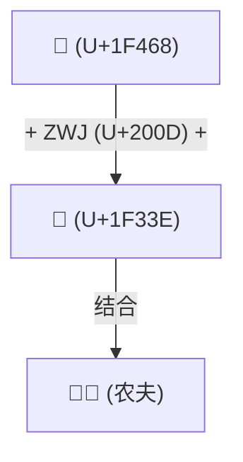

# Unicode的历史：与乱码的战争是如何统一世界文字的

在数字世界还处于文本信息黎明期的时代，计算机能处理的字符非常有限。我们今天之所以能在智能手机和PC上理所当然地读写日语、中文、阿拉伯语，甚至在全世界发送和接收像“😂”这样的Emoji表情，是因为先驱者们与名为“乱码（Mojibake）”的强敌进行了长期的斗争，建立了共同的字符标准。

本文将深入探讨计算机史上宏大的“文字统一”故事：从ASCII的诞生开始，讲述各国本地编码引发的大混乱、Unicode雄心勃勃的诞生、Ken Thompson和Rob Pike对UTF-8的天才设计、代理对（Surrogate Pair）问题，直到Emoji（表情符号）的标准化。

## 1. 作为原点的ASCII（7位的限制）

为了让计算机处理文字，必须有将文字映射到数值的“字符编码”。20世纪60年代在美国制定的 **ASCII (American Standard Code for Information Interchange)** 就是其中最基础的标准。

ASCII使用7位（0到127）定义了英文字母的大小写、数字、基本符号以及控制字符。这在英语国家使用是足够的，但面对“世界上有无数非英语语言”这一事实却完全无能为力。仅有128个位置的ASCII，甚至无法表示欧洲语言中带有重音符号的字母（如é或ñ）。

## 2. 巴别塔：本地编码与“乱码”时代

随着计算机在全球普及，各国将7位ASCII扩展为8位，使用新增的字节值128到255，或开发各自的多字节编码。

- **ISO-8859系列**: 为欧洲语言设计的8位编码群（如ISO-8859-1或Latin-1）。
- **Shift_JIS (SJIS)**: 在日本个人电脑（尤其是MS-DOS和Windows）上广泛普及的混合单字节字符（如半角片假名）和双字节字符（汉字、平假名）的编码方式。
- **EUC-JP**: UNIX类系统中常用的日语编码。
- **GB2312 / Big5**: 中文圈的编码。

虽然这让各国能够用计算机表示自己的语言，却引发了一个新的大问题：**“在不同字符编码之间传输数据时，会被解释成完全不同的字符”**。这就是臭名昭著的 **乱码 (Mojibake)**。

例如，将Shift_JIS字节误解码为Windows-1252，就会得到图中的符号序列。Windows-1252与ISO-8859-1并不相同：`0x82` 在前者中表示 `‚`，在后者中是控制字符。复现乱码时，应区分实际字节和所用的解码方式；这些差异也使国际化（i18n）更加复杂。

## 3. Unicode的诞生：用一个编码涵盖所有文字

为了打破这种混乱的局面，20世纪80年代后期，来自Apple、Xerox等公司的工程师们（如Joe Becker、Lee Collins、Mark Davis等）聚集在一起，启动了一个宏大的项目。这就是 **Unicode**。

他们的愿景简单而野心勃勃：“将世界上所有的文字、符号，甚至过去的古代历史文字，全部收录到一个统一的字符集（Character Set）中”。

早期Unicode使用16位字符空间，后来为了收录历史文字、更多汉字等而扩展。目前码点范围为 `U+0000` 至 `U+10FFFF`，共有1,114,112个位置。这是码空间，不是已分配字符的数量，其中包括未分配位置和代理项区域。新字符仍在不断加入。

## 4. UTF-8的天才设计：Ken Thompson与Rob Pike

即使有了Unicode这本巨大的“字符词典”，仍然存在一个问题：在计算机上如何将其作为字节序列进行保存和通信（编码方式）。

UCS-2使用一个16位代码单元表示其支持范围内的字符；UTF-16则使用一个或两个16位代码单元。ASCII范围字符的表示通常含有 `0x00`（NUL字节）。直接交给以NUL结尾的C字符串函数，可能导致字符串提前截断等错误，但不一定造成程序崩溃。

参与解决这一问题的是UNIX的共同创造者 **Ken Thompson** 与Plan 9开发者 **Rob Pike**。根据Pike的回忆，他们于1992年在餐馆的餐垫上勾画了UTF-8的设计，并将其实现于Plan 9。

UTF-8的设计被誉为计算机科学史上最优美的Hack之一。
- **字节层面兼容ASCII**: ASCII字符（0–127）保留原来的一字节表示。但现有C函数并不会自动理解Unicode字符计数或字符边界。
- **可变长度编码**: 根据字符的不同，长度在1到4个字节之间变化（中文和日文等主要使用3个字节）。
- **自同步特性**: 起始字节的模式（`0xxxxxxx`、`110xxxxx`、`1110xxxx`、`11110xxx`）与后续字节的 `10xxxxxx` 不同。在有效UTF-8中，这有助于从序列中间定位下一个字符边界；并不表示可将后续字节当作新字符解码，无效序列仍需验证。

这些特性推动了UTF-8在现代Web上的广泛应用。

## 5. 代理对问题与Emoji的黎明

UTF-16用一对16位代码单元（代理对）表示补充平面的一个码点。JavaScript字符串的 `length` 计算UTF-16代码单元，因此 `"😂".length` 为2。这符合规范；将其误认为可见字符数才可能导致错误。对ZWJ表情序列，码点数也可能与可见字符数不同。

2010年发布的Unicode 6.0加入了许多日本移动运营商（Docomo、au、SoftBank）使用的表情符号。一些后来用作表情的符号早已被编码，因此并非所有表情都首次出现在6.0中。

Emoji的引入，让Unicode超越了单纯“文字”的范畴，进化为传达情感和概念的世界通用视觉语言。此外，为了反映现代的多样性，它还陆续添加了复杂的规范，如改变肤色（Skin Tone Modifier），以及将多个Emoji结合成一个Emoji的机制（ZWJ: Zero Width Joiner）等。

## 结语：将人类知识传承到未来的基石

Unicode标准收录了古埃及圣书体、楔形文字、少数语言文字和表情符号等众多字符与符号。Unicode联盟是维护和发展这一标准的组织。

字符编码从ASCII的128个码位置发展到支持世界多种文字的共同体系。并非人类所有字符都已收录；新增字符的编码与实现改进仍在继续。

我们不经意间发送的一个“😂”，其背后隐藏的正是几十年来技术人员们“与乱码战斗”的戏剧性历程。

## 参考资料

- [Unicode FAQ: UTF-8, UTF-16, UTF-32 & BOM](https://www.unicode.org/faq/utf_bom.html)
- [Rob Pike: UTF-8 history](https://www.cl.cam.ac.uk/~mgk25/ucs/utf-8-history.txt)
