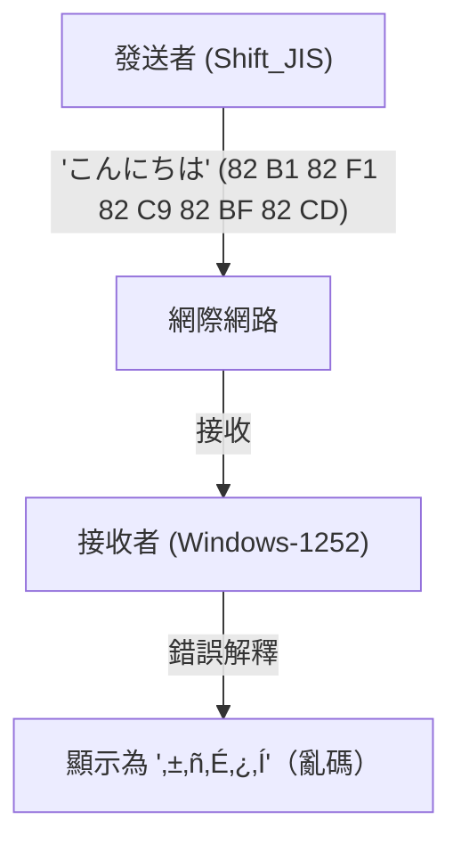
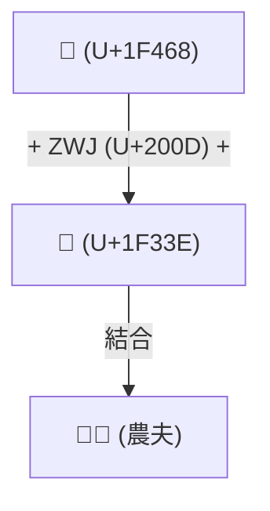

# Unicode的歷史：與亂碼的戰鬥如何統一了世界的文字

當數位世界還處於文字資訊的黎明期時，電腦能處理的文字非常有限。我們今天能理所當然地在智慧型手機和電腦上讀寫日文、中文、阿拉伯文，甚至在世界各地發送和接收像「😂」這樣的表情符號，都是因為前人們與「亂碼（Mojibake）」這個強敵進行了長年的戰鬥，並建立了共通的字元標準。

本文將從ASCII的誕生開始，深入探討各國在地化編碼所引起的大混亂、Unicode雄心勃勃的誕生、Ken Thompson與Rob Pike對UTF-8的天才設計、代理對（Surrogate Pair）問題，直到表情符號（Emoji）的標準化，為您揭開電腦史上宏大的「文字統一」故事。

## 1. 原點：ASCII（7位元的限制）

為了讓電腦處理文字，需要有將文字對應到數值的「字元編碼」。1960年代在美國制定的 **ASCII (American Standard Code for Information Interchange)**，是其中最基礎的標準。

ASCII使用7位元（0〜127）來定義英文字母的大寫與小寫、數字、基本符號以及控制字元。這對於英語圈的使用已經足夠，但面對「世界上有著無數非英語語言」的事實卻完全無能為力。僅有128個空間的ASCII，甚至無法表示歐洲語言中帶有重音符號的文字（如é或ñ）。

## 2. 巴別塔：在地化編碼與「亂碼」的時代

隨著電腦普及到世界各地，各國將7位元ASCII擴充為8位元，使用新增的位元組值128至255，或開發各自的多位元組編碼。

- **ISO-8859系列**: 專為歐洲語言設計的8位元編碼群（如ISO-8859-1和Latin-1等）。
- **Shift_JIS (SJIS)**: 在日本的個人電腦（尤其是MS-DOS和Windows）上廣泛普及，混合了單字節字元（如半形片假名）和雙字節字元（漢字、平假名）的方式。
- **EUC-JP**: UNIX系列系統中常用的日文編碼。
- **GB2312 / Big5**: 中文圈的編碼。

雖然這使得各國語言能夠在電腦上顯示，但也引發了新的大問題。那就是 **「在不同的字元編碼間交換資料時，會被解釋成完全不同的文字」** 的現象。這就是惡名昭彰的 **亂碼 (Mojibake)**。

例如，將Shift_JIS位元組誤以Windows-1252解碼，就會得到圖中的符號序列。Windows-1252與ISO-8859-1並不相同：`0x82` 在前者中表示 `‚`，在後者中則是控制字元。重現亂碼時，應區分實際位元組與使用的解碼方式；這些差異也讓國際化（i18n）更加複雜。

## 3. Unicode的誕生：用單一編碼涵蓋所有文字

為了解決這個混亂的局面，1980年代後期，來自Apple和Xerox等公司的工程師（Joe Becker、Lee Collins、Mark Davis等人）集結起來，發起了一個宏大的專案。那就是 **Unicode**。

他們的願景既簡單又充滿野心：「將世界上所有的文字、符號，甚至是過去的歷史文字，全部收錄在一個統一的字元集（Character Set）中。」

早期Unicode使用16位元字元空間，之後為收錄歷史文字、更多漢字等而擴充。目前碼位範圍為 `U+0000` 至 `U+10FFFF`，共有1,114,112個位置。這是編碼空間，不是已指派字元數，其中包含未指派位置與代理碼區域。新字元仍持續加入。

## 4. UTF-8的天才設計：Ken Thompson與Rob Pike

即使有了Unicode這本巨大的「文字辭典」，仍留下了一個問題：在電腦上該如何將其作為位元組序列來儲存和通訊（編碼方式）。

UCS-2以一個16位元編碼單元表示其支援範圍內的字元；UTF-16則使用一個或兩個16位元編碼單元。ASCII範圍字元的表示通常包含 `0x00`（NUL位元組）。直接交給以NUL結尾的C字串函式，可能造成字串提前截斷等錯誤，但不一定導致程式崩潰。

參與解決此問題的是UNIX共同創造者 **Ken Thompson** 與Plan 9開發者 **Rob Pike**。依據Pike的回憶，他們於1992年在餐館的餐墊上勾勒UTF-8的設計，並將它實作於Plan 9。

UTF-8的設計被認為是電腦科學史上最美麗的駭客技巧（hack）之一。
- **位元組層級相容ASCII**: ASCII字元（0–127）保留原本的單一位元組表示。但既有C函式不會自動理解Unicode字元計數或字元邊界。
- **可變長度編碼**: 根據文字的不同，長度從1個位元組到4個位元組不等（日文等主要為3個位元組）。
- **自我同步性**: 起始位元組模式（`0xxxxxxx`、`110xxxxx`、`1110xxxx`、`11110xxx`）與接續位元組的 `10xxxxxx` 不同。在有效UTF-8中，這有助於從序列中途找到下一個字元邊界；不表示可把接續位元組當作新字元解碼，無效序列仍須驗證。

這些特性促成了UTF-8在現代Web上的廣泛應用。

## 5. 代理對問題與表情符號（Emoji）的黎明

UTF-16以一對16位元編碼單元（代理對）表示輔助平面的一個碼位。JavaScript字串的 `length` 計算UTF-16編碼單元，因此 `"😂".length` 為2。這符合規範；誤認為它計算可見字元數，才可能造成錯誤。對ZWJ表情序列而言，碼位數也可能與可見字元數不同。

2010年發布的Unicode 6.0加入了許多日本行動通訊業者（Docomo、au、SoftBank）使用的表情符號。某些後來作為表情的符號早已被編碼，因此並非所有表情都首次出現在6.0中。

隨著表情符號的引入，Unicode超越了單純「文字」的範疇，進化為能夠傳達情感與概念的世界共通視覺語言。此外，為了反映現代的多樣性（Diversity），也陸續加入了更改膚色（Skin Tone Modifier）、以及結合多個表情符號來組成一個新表情符號的機制（ZWJ: Zero Width Joiner）等複雜的規格。

## 結語：將人類知識連結至未來的基礎

Unicode標準收錄了古埃及聖書體、楔形文字、少數語言文字與表情符號等眾多字元和符號。Unicode聯盟是維護及發展此標準的組織。

字元編碼從ASCII的128個碼位置，發展成支援世界多種文字的共同體系。並非所有人類字元都已收錄；新增字元的編碼與實作改善仍持續進行。

在我們漫不經心地發送著「😂」的背後，其實隱藏著這些技術人員數十年來與「亂碼戰鬥」的戲劇性故事。

## 參考資料

- [Unicode FAQ: UTF-8, UTF-16, UTF-32 & BOM](https://www.unicode.org/faq/utf_bom.html)
- [Rob Pike: UTF-8 history](https://www.cl.cam.ac.uk/~mgk25/ucs/utf-8-history.txt)
