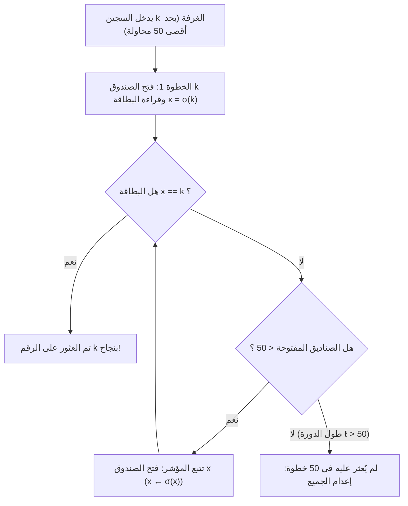
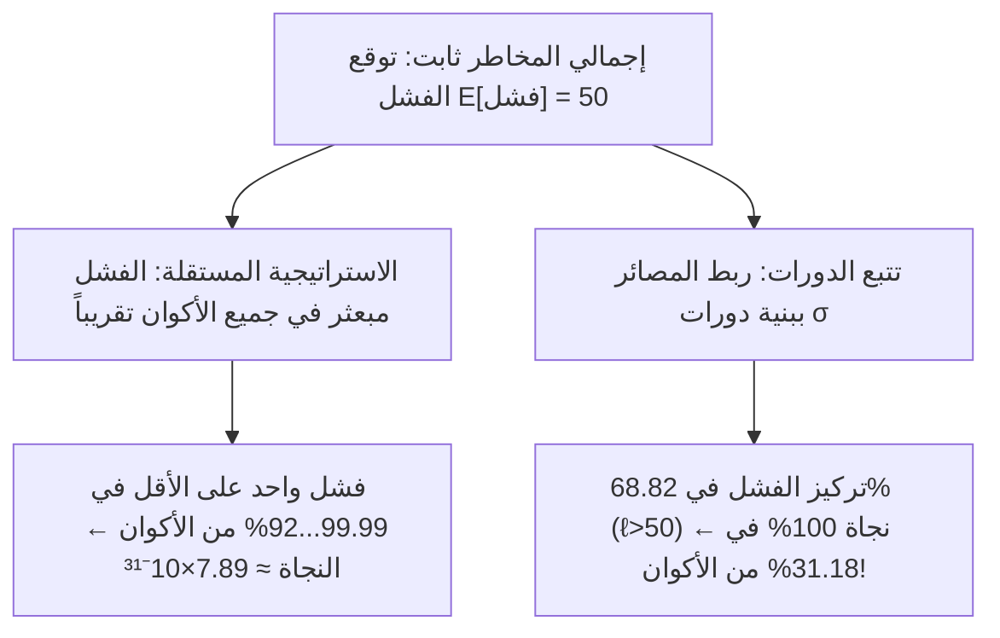

## مقدمة: أعظم معجزة مناقضة للحدس في نظرية الاحتمالات

في عام 2003، طرح عالم الحاسوب الدنماركي <strong>بيتر برو ميلترسن (Peter Bro Miltersen)</strong> لغزاً شهيراً يُعرف باسم <strong>مسألة السجناء المئة (100 Prisoners Problem)</strong>:
- يوجد $100$ سجين محكوم عليهم بالإعدام مرقمين من $1$ إلى $100$. في غرفة مغلقة يوجد $100$ صندوق تحتوي بداخلها على بطاقات مرقمة من $1$ إلى $100$ موزعة عشوائياً (تبديل $\sigma \in S_{100}$).
- <strong>القاعدة</strong>: يدخل كل سجين بمفرده بالتتابع ويحق له فتح <strong>$50$ صندوقاً كحد أقصى</strong> للعثور على رقمه. تُعاد الصناديق كما كانت بعد خروجه، و<strong>يُمنع منعاً باتاً أي تواصل بعد بدء اللعبة</strong> (لكن يُسمح بالاتفاق على خطة مسبقة).
- <strong>شرط النجاة</strong>: إذا نجح <strong>جميع السجناء المئة</strong> في إيجاد أرقامهم يُعفى عنهم جميعاً؛ أما إذا <strong>فشل سجين واحد فقط</strong> فيُعدم المئة جميعاً.

إذا فتح كل سجين $50$ صندوقاً عشوائياً (<strong>الاستراتيجية المستقلة</strong>)، فإن احتمال نجاح الفرد هو $1/2$، لكن احتمال نجاة الجميع معاً هو:

$$\mathbb{P}(\text{نجاة الجميع})_{\text{مستقل}} = \left(\frac{1}{2}\right)^{100} \approx 7.89 \times 10^{-31}$$

ومع ذلك، اكتشف <strong>سفين سكايوم (Sven Skyum)</strong> <strong>استراتيجية تتبع المؤشرات (Pointer-Following Strategy)</strong> التي ترفع احتمال نجاة الجميع إلى <strong>$31.18\%$</strong> دون نقل بت واحد من المعلومات!

---

## الفصل 1: تتبع المؤشرات وتفكيك الزمرة المتماثلة إلى دورات منفصلة

بالنسبة للسجين رقم $k \in \{1, \dots, 100\}$، تتلخص خطة سكايوم في:
1. <strong>الخطوة 1</strong>: افتح أولاً <strong>الصندوق رقم $k$</strong>.
2. <strong>الخطوة 2</strong>: إذا كانت البطاقة بداخله تحمل الرقم $x_1 = k$ فقد نجحت؛ وإذا كان $x_1 \neq k$، فافتح تالياً <strong>الصندوق رقم $x_1$</strong>.
3. <strong>الخطوة 3</strong>: اقرأ الرقم الجديد $x_2$ وافتح الصندوق رقم $x_2$، متتبعاً السلسلة $k \mapsto \sigma(k) \mapsto \sigma^2(k) \mapsto \cdots$ حتى تجد $k$ أو تستنفد $50$ محاولة.

لماذا تنجح هذه الطريقة؟ إن التقابل صندوق $\mapsto$ بطاقة هو تقابل ثنائي $\sigma$ في <strong>الزمرة المتماثلة $S_{2n}$</strong> ($2n=100$). وكل تبديل منتهٍ يتفكك بطريقة وحيدة إلى جداء <strong>دورات منفصلة (Disjoint Cycles)</strong>:

$$\sigma = C_1 \circ C_2 \circ \cdots \circ C_m, \qquad \sum_{i=1}^m |C_i| = 2n = 100$$

وبما أن $\sigma$ تقابل ثنائي، فإن الانطلاق من الصندوق $k$ يقود السجين حتماً حول الدورة المغلقة الوحيدة التي تحوي $k$ ليصل في نهايتها إلى $\sigma^{-1}(k)$ (الصندوق الذي يحوي البطاقة $k$). وعليه:
- ينجح السجين $k$ خلال $\le 50$ خطوة إذا وفقط إذا كان طول دورته $\ell \le 50$.
- <strong>ينجو السجناء المئة جميعاً إذا وفقط إذا خلا التبديل $\sigma \in S_{100}$ من أي دورة يزيد طولها على $50$ ($\ell > 50$)!</strong>

---

## الفصل 2: عدّ الدورات الطويلة والأعداد التوافقية ($1 - \ln 2$)

لعدد $2n$ من السجناء ($n = 50$)، لا يمكن للتبديل $\sigma \in S_{2n}$ أن يحوي <strong>أكثر من دورة واحدة بطول $\ell > n$</strong>، لأن دورتين منفصلتين بطول $> n$ تتطلبان $2n+2 > 2n$ عنصراً على الأقل. إذن الأحداث $E_\ell := \{\sigma \text{ يحوي دورة بطول } \ell\}$ للقيم $\ell = n+1, \dots, 2n$ <strong>متنافية مثنى مثنى</strong>! وعدد التباديل في $E_\ell$ هو:
1. اختيار $\ell$ عنصراً للدورة الطويلة: $\binom{2n}{\ell}$؛
2. ترتيبها في دورة دائرية واحدة: $(\ell - 1)!$؛
3. تبديل العناصر المتبقية وعددها $2n - \ell$: $(2n - \ell)!$.

بضرب المقادير تختصر المضاريب:

$$|E_\ell| = \binom{2n}{\ell} \cdot (\ell - 1)! \cdot (2n - \ell)! = \frac{(2n)!}{\ell! \, (2n - \ell)!} \cdot (\ell - 1)! \, (2n - \ell)! = \frac{(2n)!}{\ell}$$

وبالقسمة على $|S_{2n}| = (2n)!$ نجد <strong>$\mathbb{P}(E_\ell) = \frac{1}{\ell}$</strong>. وباستخدام <strong>الأعداد التوافقية</strong> $H_N = \sum_{k=1}^N \frac{1}{k}$، يكون احتمال النجاة الدقيق:

$$\boxed{P_{\text{success}}(2n) = 1 - \sum_{\ell = n+1}^{2n} \frac{1}{\ell} = 1 - \left(H_{2n} - H_n\right) \xrightarrow{n \to \infty} 1 - \int_1^2 \frac{dx}{x} = 1 - \ln 2 \approx 30.685\%}$$

وعند $2n = 100$ نحصل على $P_{\text{success}}(100) = 1 - (H_{100} - H_{50}) \approx \mathbf{31.1828\%}$!

---

## الفصل 3: اقتران المخاطر (Coupling) بدون نقل معلومات

| الخاصية | 1. الاستراتيجية المستقلة | 2. استراتيجية الدورات |
| :--- | :--- | :--- |
| <strong>نجاح الفرد $\mathbb{P}(A_k)$</strong> | $50.00\%$ | $50.00\%$ (مطابق) |
| <strong>توقع الناجين $\mathbb{E}[X]$</strong> | $50$ سجيناً | $50$ سجيناً (مطابق) |
| <strong>الارتباط الإحصائي</strong> | معدوم (استقلال) | <strong>مقترن بقوة عبر $\sigma$</strong> |
| <strong>نجاة الـ $100$ معاً</strong> | $(1/2)^{100} \approx 7.89 \times 10^{-31}$ | <strong>$1 - (H_{100} - H_{50}) \approx 31.18\%$</strong> |
| <strong>النهاية $n \to \infty$</strong> | $0$ | <strong>$1 - \ln 2 \approx 30.685\%$</strong> |

1. <strong>الاقتران (Coupling)</strong>: بما أن فشل شخص واحد يعادل في العقوبة فشل 51 شخصاً، تحشد استراتيجية الدورات جميع حالات الفشل داخل الـ $68.82\%$ من التباديل ذات الدورة $\ell > 50$، مما يترك <strong>$31.18\%$ من فضاء العينة خالياً تماماً من أي فشل</strong>!
2. <strong>التحصين ضد السجّان الخبيث</strong>: بالاتفاق مسبقاً على تقابل عشوائي سري $\tau \in S_{100}$، يضمن الترافق $\tau \sigma \tau^{-1}$ بقاء احتمال النجاة عند <strong>$31.18\%$</strong>.
