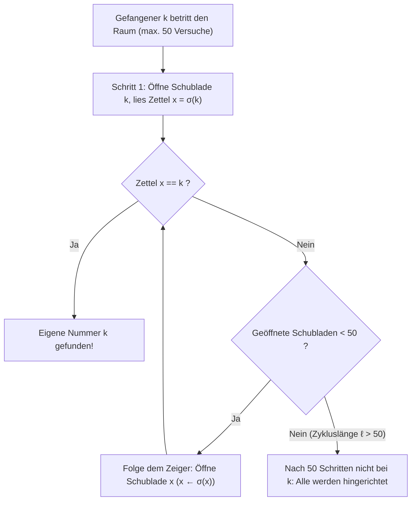
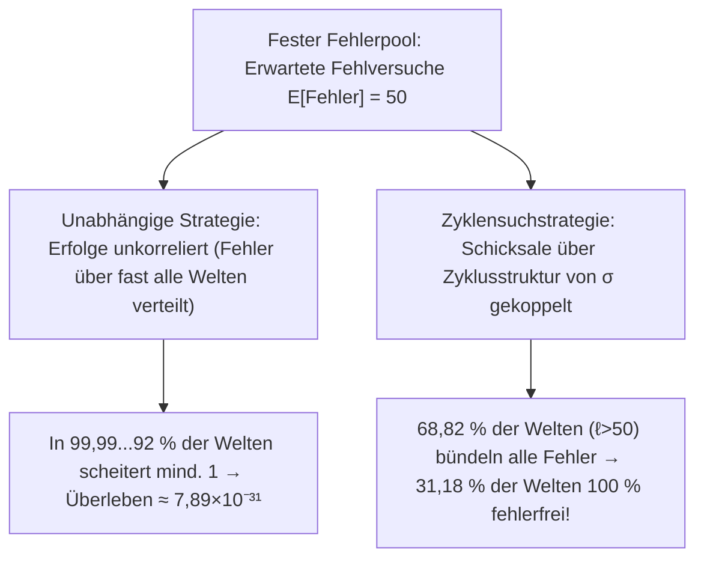

## Einleitung: Das kontraintuitivste Wunder der Wahrscheinlichkeitstheorie

2003 stellte der dänische Informatiker <strong>Peter Bro Miltersen</strong> das berühmte <strong>Problem der 100 Gefangenen</strong> vor:
- $100$ zum Tode verurteilte Gefangene tragen die Nummern $1$ bis $100$. In einem Raum stehen $100$ verschlossene Schubladen, in denen die Nummern $1$ bis $100$ zufällig verteilt liegen (eine Permutation $\sigma \in S_{100}$).
- <strong>Regel</strong>: Jeder Gefangene betritt einzeln den Raum und darf höchstens <strong>$50$ Schubladen</strong> öffnen, um seine eigene Nummer zu finden. Danach wird der Raum exakt in den Ausgangszustand versetzt; <strong>jede Kommunikation nach Spielbeginn ist ausgeschlossen</strong> (vorher darf eine Strategie vereinbart werden).
- <strong>Überlebensbedingung</strong>: Nur wenn <strong>alle $100$ Gefangenen</strong> ihre Nummer finden, werden alle begnadigt; scheitert auch nur <strong>ein Einziger</strong>, werden alle hingerichtet.

Öffnet jeder unabhängig $50$ zufällige Schubladen (<strong>unabhängige Strategie</strong>), hat jeder einzeln die Chance $1/2$, doch die gemeinsame Überlebenswahrscheinlichkeit beträgt:

$$\mathbb{P}(\text{alle überleben})_{\text{unabh.}} = \left(\frac{1}{2}\right)^{100} \approx 7{,}89 \times 10^{-31}$$

Dennoch fand Miltersens Kollege <strong>Sven Skyum</strong> die <strong>Zyklensuchstrategie (Pointer-Following Strategy)</strong>, die die Überlebenschance ohne ein einziges Bit Kommunikation auf <strong>$31{,}18\,\%$</strong> katapultiert!

---

## Kapitel 1: Die Zyklensuchstrategie und disjunkte Permutationszyklen

Skyums Strategie für Gefangenen Nummer $k \in \{1, \dots, 100\}$ lautet:
1. <strong>Schritt 1</strong>: Öffne zuerst <strong>Schublade Nr. $k$</strong>.
2. <strong>Schritt 2</strong>: Liegt darin der Zettel $x_1 = k$, bist du fertig. Falls $x_1 \neq k$, öffne als Nächstes <strong>Schublade Nr. $x_1$</strong>.
3. <strong>Schritt 3</strong>: Lies die neue Nummer $x_2$ und öffne Schublade Nr. $x_2$, d. h. folge der Kette $k \mapsto \sigma(k) \mapsto \sigma^2(k) \mapsto \cdots$, bis $k$ gefunden ist oder $50$ Versuche verbraucht sind.

Warum funktioniert das? Die Zuordnung Schublade $\mapsto$ Zettel ist eine Bijektion $\sigma$ in der <strong>symmetrischen Gruppe $S_{2n}$</strong> ($2n=100$). Jede endliche Permutation zerfällt eindeutig in <strong>disjunkte Zyklen</strong>:

$$\sigma = C_1 \circ C_2 \circ \cdots \circ C_m, \qquad \sum_{i=1}^m |C_i| = 2n = 100$$

Da $\sigma$ bijektiv ist, hat kein Zyklus Sackgassen: Wer bei Schublade $k$ startet, durchläuft den eindeutigen Zyklus, der $k$ enthält, und endet beim Vorgänger $\sigma^{-1}(k)$ (der Schublade, die den Zettel $k$ enthält). Daher gilt:
- Gefangener $k$ hat genau dann Erfolg, wenn sein Zyklus die Länge $\ell \le 50$ hat.
- <strong>Alle $100$ Gefangenen überleben genau dann, wenn die Permutation $\sigma \in S_{100}$ keinen einzigen Zyklus der Länge $\ell > 50$ besitzt!</strong>

---

## Kapitel 2: Abzählung langer Zyklen und harmonische Zahlen ($1 - \ln 2$)

Für $2n$ Gefangene ($n = 50$) kann eine Permutation $\sigma \in S_{2n}$ <strong>höchstens einen einzigen Zyklus der Länge $\ell > n$</strong> enthalten, da zwei disjunkte Zyklen mindestens $(n+1)+(n+1) = 2n+2 > 2n$ Elemente bräuchten. Die Ereignisse $E_\ell := \{\sigma \text{ enthält einen Zyklus der Länge } \ell\}$ für $\ell = n+1, \dots, 2n$ sind somit <strong>paarweise disjunkt</strong>! Die Anzahl solcher Permutationen ist:
1. Wähle $\ell$ Elemente für den langen Zyklus: $\binom{2n}{\ell}$ Möglichkeiten;
2. Ordne diese $\ell$ Elemente zu einem gerichteten Kreis an: $(\ell - 1)!$ Möglichkeiten;
3. Permutiere die übrigen $2n - \ell$ Elemente beliebig: $(2n - \ell)!$ Möglichkeiten.

Multiplikation kürzt fast alle Fakultäten weg:

$$|E_\ell| = \binom{2n}{\ell} \cdot (\ell - 1)! \cdot (2n - \ell)! = \frac{(2n)!}{\ell! \, (2n - \ell)!} \cdot (\ell - 1)! \, (2n - \ell)! = \frac{(2n)!}{\ell}$$

Division durch $|S_{2n}| = (2n)!$ ergibt exakt <strong>$\mathbb{P}(E_\ell) = \frac{1}{\ell}$</strong>. Mit den <strong>harmonischen Zahlen</strong> $H_N = \sum_{k=1}^N \frac{1}{k}$ folgt die exakte Überlebenswahrscheinlichkeit:

$$\boxed{P_{\text{success}}(2n) = 1 - \sum_{\ell = n+1}^{2n} \frac{1}{\ell} = 1 - \left(H_{2n} - H_n\right) \xrightarrow{n \to \infty} 1 - \int_1^2 \frac{dx}{x} = 1 - \ln 2 \approx 30{,}685\,\%}$$

Für $2n = 100$ erhält man $P_{\text{success}}(100) = 1 - (H_{100} - H_{50}) \approx \mathbf{31{,}1828\,\%}$!

---

## Kapitel 3: Risikokopplung statt Informationsübertragung

| Merkmal | 1. Unabhängige Strategie | 2. Zyklensuchstrategie |
| :--- | :--- | :--- |
| <strong>Einzelwahrscheinlichkeit $\mathbb{P}(A_k)$</strong> | $50{,}00\,\%$ | $50{,}00\,\%$ (identisch) |
| <strong>Erwartete Erfolge $\mathbb{E}[X]$</strong> | $50$ Gefangene | $50$ Gefangene (identisch) |
| <strong>Korrelation</strong> | Unabhängig | <strong>Stark positiv gekoppelt über $\sigma$</strong> |
| <strong>Überlebenschance aller $100$</strong> | $(1/2)^{100} \approx 7{,}89 \times 10^{-31}$ | <strong>$1 - (H_{100} - H_{50}) \approx 31{,}18\,\%$</strong> |
| <strong>Grenzwert $n \to \infty$</strong> | $0$ | <strong>$1 - \ln 2 \approx 30{,}685\,\%$</strong> |

1. <strong>Kopplung (Coupling)</strong>: Da 1 Fehlversuch genauso tödlich ist wie 51 Fehlversuche, bündelt die Zyklensuchstrategie alle Fehlversuche in den $68{,}82\,\%$ Permutationen mit einem langen Zyklus ($\ell > 50$), sodass volle <strong>$31{,}18\,\%$ des Wahrscheinlichkeitsraums komplett fehlerfrei bleiben</strong>!
2. <strong>Schutz gegen einen böswilligen Wärter</strong>: Vereinbaren die Gefangenen vorab eine geheime Zufallsbijektion $\tau \in S_{100}$, verwandelt die Konjugation $\tau \sigma \tau^{-1}$ jede manipulierte Anordnung wieder in eine gleichverteilte Zufallspermutation mit <strong>$31{,}18\,\%$</strong> Überlebenschance.
