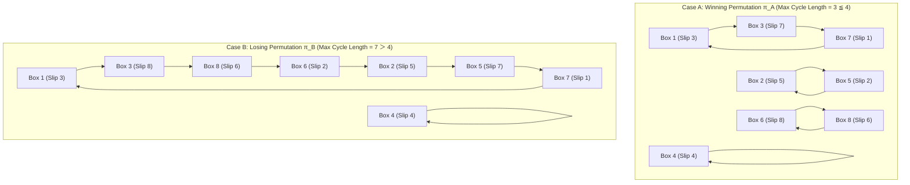

## 1. Introduction: The Chasm Between $2^{-100}$ and $31.18\%$

In 2003, Danish computer scientist <strong>Peter Bro Miltersen</strong> of Aarhus University included a seemingly impossible probability puzzle in a joint paper with Anna Gál presented at the International Colloquium on Automata, Languages, and Programming (ICALP 2003: *"The Cell Probe Complexity of Succinct Data Structures"*). Now universally celebrated as the <strong>100 Prisoners Problem</strong>, this puzzle—along with its astonishing optimal solution discovered by Miltersen's colleague <strong>Sven Skyum</strong>—stands as one of the most counterintuitive triumphs in modern combinatorics, probability theory, and information science.

Let us first state the exact mathematical rules of the problem.

### Formal Problem Statement

A prison warden offers a final chance of pardon to $2n = 100$ condemned prisoners, who are numbered $1, 2, \dots, 100$. The rules of the game are strictly enforced as follows:

1. <strong>The Permutation of Boxes and Slips</strong>: In an isolated room stand $100$ closed wooden boxes (or drawers), labeled externally with the integers $1, 2, \dots, 100$. Inside these boxes, $100$ paper slips bearing the numbers $1, 2, \dots, 100$ have been placed—exactly one slip per box—according to a <strong>uniformly chosen random permutation $\pi \in S_{100}$</strong>.
2. <strong>Individual Query Limit</strong>: The prisoners enter the room one by one in sequential order. Once inside, prisoner $i$ may open <strong>at most half of the boxes, $n = 50$</strong>, inspecting the number printed on the slip inside each opened box. Prisoner $i$ succeeds if and only if they uncover the slip bearing their own number $i$ within their $50$ allowed inspections.
3. <strong>State Restoration and Zero Communication</strong>: Before leaving the room, each prisoner must close all boxes and leave the room in the <strong>exact physical state</strong> in which they found it. Once the game begins (after the boxes are arranged), <strong>absolutely no communication</strong> is permitted between prisoners—no spoken words, no covert signals, and no alteration of the boxes or slips. However, prior to the start of the game, the prisoners are allowed to hold a strategy session and agree upon a <strong>common deterministic or randomized algorithm</strong> for selecting which boxes to open.
4. <strong>Collective Survival vs. Total Execution</strong>: The victory condition is uncompromisingly collective. <strong>All $100$ prisoners are pardoned if and only if every single one of the $100$ prisoners finds their own number.</strong> If even a single prisoner fails ($99$ succeed and $1$ fails), all $100$ prisoners are executed immediately.

### The Hopelessness of Naive Independent Random Search

Consider first what happens under <strong>Naive Independent Random Search</strong>, where each prisoner enters the room and independently selects $50$ boxes at random. Because the slips are distributed uniformly at random, the <strong>marginal success probability</strong> $p_i$ for any individual prisoner $i \in \{1, \dots, 100\}$ is simply the ratio of opened boxes to total boxes:

$$p_i = \frac{50}{100} = \frac{1}{2}$$

If each prisoner makes their choices independently of the others, the <strong>joint survival probability</strong> $P_{\text{indep}}$ that all $100$ prisoners succeed simultaneously is the product of their individual probabilities:

$$P_{\text{indep}} = \prod_{i=1}^{100} p_i = \left(\frac{1}{2}\right)^{100} = 2^{-100} = \frac{1}{1,267,650,600,228,229,401,496,703,205,376} \approx 7.8886 \times 10^{-31}$$

To grasp the physical absurdity of $7.8886 \times 10^{-31}$ (a decimal point followed by thirty zeros before the first significant digit), compare it to atomic scales: one cubic meter of solid matter contains roughly $10^{29}$ to $10^{30}$ atoms. Thus, surviving via independent random search is <strong>less likely than blindfolding yourself, reaching into a one-cubic-meter block of solid iron, and picking out one specific, pre-designated atom on your very first try</strong>. It represents mathematical certainty of execution.

### The Miraculous Leap via Pointer-Following

Yet if the prisoners agree beforehand to follow Sven Skyum's <strong>Pointer-Following Strategy (Cycle-Following Strategy)</strong>—a simple deterministic rule where prisoner $i$ first opens Box $i$, reads the slip $k = \pi(i)$ inside, next opens Box $k$, reads $\pi(k)$, and continues following these pointers until finding slip $i$—their joint probability of collective survival leaps to:

$$P_{\text{success}}(100) = 1 - \sum_{k=51}^{100} \frac{1}{k} = 1 - (H_{100} - H_{50}) \approx 0.31182782\dots \quad (31.18\%)$$

Nearly <strong>one-third of the time ($31.18\%$)</strong>, all $100$ prisoners walk free! Compared to the independent baseline of $2^{-100}$, this strategy increases their survival odds by a factor of more than <strong>$3.95 \times 10^{29}$</strong>.

This result immediately provokes two profound mathematical and philosophical questions:
- <strong>Question 1 (Algebraic & Combinatorial)</strong>: Since the slips inside the boxes are completely random and prisoners cannot alter the room or pass messages, how can merely choosing the *order* in which boxes are opened tame a random permutation?
- <strong>Question 2 (Information-Theoretic & Probabilistic)</strong>: Even when following pointers, any single prisoner can still open at most $50$ out of $100$ boxes, so each individual prisoner's marginal probability of finding their own number remains strictly $\frac{1}{2}$. <strong>How can $100$ events, each occurring with probability $\frac{1}{2}$ and executed with zero communication between agents, have a joint intersection probability of $0.3118$ instead of $(1/2)^{100}$?</strong>

In this article, we provide a complete, rigorous treatment of the 100 Prisoners Problem: from the <strong>disjoint cycle decomposition of the symmetric group $S_{2n}$</strong> and <strong>Cauchy's cycle counting formula</strong>, to <strong>harmonic numbers and Euler-Maclaurin asymptotics</strong>, <strong>correlation coupling (failure bundling)</strong>, <strong>Curtin and Warshauer's optimality theorem</strong>, and <strong>Monte Carlo verification in Python</strong>.

---

## 2. The Pointer-Following Algorithm and Disjoint Cycle Decomposition of $S_{2n}$

Let us generalize the problem to $2n$ prisoners ($n \in \mathbb{N}$), where each prisoner is permitted to open at most $n$ boxes (for the standard problem, $n = 50$ and $2n = 100$).

### Bijections, Functional Directed Graphs, and the Algorithm

Let $X = \{1, 2, \dots, 2n\}$ denote the set of box labels (and prisoner numbers). Placing one slip from $\{1, \dots, 2n\}$ into each of the $2n$ boxes without repetition defines a <strong>bijection</strong> (a one-to-one and onto mapping) $\pi: X \to X$, which is an element of the <strong>symmetric group $S_{2n}$</strong>:

$$\pi(x) = y \quad \Longleftrightarrow \quad \text{"Box } x \text{ contains the paper slip numbered } y\text{."}$$

Under this notation, the <strong>Pointer-Following (Cycle-Following) Algorithm</strong> for prisoner $i \in X$ generates the deterministic query sequence (orbit) defined by iterative composition of $\pi$:

1. <strong>Step $1$</strong>: Prisoner $i$ opens <strong>Box $i$</strong> (the box bearing their own number on the outside) and observes slip $\pi(i)$. If $\pi(i) = i$, prisoner $i$ has succeeded on their first try and stops.
2. <strong>Step $2$</strong>: If $\pi(i) \neq i$, prisoner $i$ treats the observed number $\pi(i)$ as a pointer to the next box and opens <strong>Box $\pi(i)$</strong>, revealing slip $\pi(\pi(i)) = \pi^2(i)$. If $\pi^2(i) = i$, they succeed and stop.
3. <strong>Step $m$ ($1 \le m \le n$)</strong>: At step $m$, prisoner $i$ opens <strong>Box $\pi^{m-1}(i)$</strong> (whose label was revealed at step $m-1$) and inspects slip $\pi^m(i)$.
4. <strong>Termination</strong>: Prisoner $i$ <strong>succeeds</strong> if and only if $\pi^m(i) = i$ for some $m \in \{1, 2, \dots, n\}$. If $\pi^m(i) \neq i$ for all $1 \le m \le n$, prisoner $i$ exhausts their quota of $n$ boxes and <strong>fails</strong>.

### Why Does Box $i$ Always Lead to Slip $i$? The Absence of $\rho$-Shaped Tails

At first glance, one might worry: when prisoner $i$ starts at Box $i$ and follows the chain $i \to \pi(i) \to \pi^2(i) \to \cdots$, could they get trapped in a closed loop of boxes that *does not include slip $i$*?

In general mappings $f: X \to X$ that are not bijective (such as pseudo-random walks analyzed via Pollard's $\rho$ algorithm), a trajectory starting at $i$ typically traverses a transient "tail" before merging into a cycle that never returns to $i$, forming the Greek letter $\rho$ (rho). If such a $\rho$-shaped tail existed here, prisoner $i$ would enter a cycle that never points back to Box $i$, meaning slip $i$ would never be found even with unlimited tries!

However, <strong>because $\pi \in S_{2n}$ is a finite bijection, $\rho$-shaped tails are mathematically impossible</strong>.

Let us prove this rigorously using the <strong>functional directed graph</strong> $G_\pi = (V, E_\pi)$ where $V = \{1, \dots, 2n\}$ and $E_\pi = \{(x, \pi(x)) \mid x \in V\}$:
- Because $\pi$ is a well-defined function on $V$, every vertex $x \in V$ has <strong>out-degree exactly $1$</strong> (one outgoing arrow $x \to \pi(x)$).
- Because $\pi$ is both <strong>injective</strong> ($u \neq w \implies \pi(u) \neq \pi(w)$) and <strong>surjective</strong> ($\forall v \in V, \exists u \in V \text{ s.t. } \pi(u) = v$), every vertex $v \in V$ has a unique pre-image $u = \pi^{-1}(v)$ and therefore <strong>in-degree exactly $1$</strong> (one incoming arrow $\pi^{-1}(v) \to v$).

Suppose for the sake of contradiction that a trajectory starting at $i$ followed a tail and merged into a cycle $C$ at some entry vertex $v \in C$ with $i \notin C$. Then vertex $v$ would have *two distinct incoming edges*: one from its predecessor $u \in C$ inside the cycle, and one from the vertex $w \notin C$ on the external tail. This would imply $\pi(u) = v = \pi(w)$ with $u \neq w$, contradicting the injectivity of $\pi$!

This yields the fundamental structural theorem of the symmetric group:

> <strong>Theorem 1 (Disjoint Cycle Decomposition of $S_{2n}$)</strong>
> Every permutation $\pi \in S_{2n}$ uniquely partitions the set $X = \{1, 2, \dots, 2n\}$ into a collection of <strong>pairwise disjoint directed cycles</strong> (up to the ordering of cycles and cyclic shifts within each cycle).

Now observe what this means for prisoner $i$:
Let $k$ ($1 \le k \le 2n$) be the length of the unique cycle containing $i$. Following pointers from Box $i$ traces the exact vertices of this cycle and returns to $i$ at step $k$:

$$i \xrightarrow{\pi} \pi(i) \xrightarrow{\pi} \pi^2(i) \xrightarrow{\pi} \cdots \xrightarrow{\pi} \pi^{k-1}(i) \xrightarrow{\pi} \pi^k(i) = i$$

Look closely at the final directed edge of this cycle: $\pi^{k-1}(i) \xrightarrow{\pi} i$. Translated into the language of boxes and slips, $\pi(\pi^{k-1}(i)) = i$ means that <strong>the $k$-th box opened by prisoner $i$—namely Box $\pi^{k-1}(i) = \pi^{-1}(i)$—is precisely the box that contains paper slip $i$!</strong>
By starting at Box $i$, prisoner $i$ is guaranteed to start inside the exact cycle that contains slip $i$, right at the vertex immediately *after* the box holding slip $i$. Traveling around this cycle of length $k$ leads straight to Box $\pi^{-1}(i)$ on step $k$. (Conversely, if prisoner $i$ started at some arbitrary box $j \neq i$ belonging to a different disjoint cycle, they would loop forever inside $j$'s cycle and *never* find slip $i$!)

### Concrete Step-by-Step Walkthrough ($2n = 8, n = 4$)

To make this mechanism crystal clear, let us trace a miniature version of the game with $2n = 8$ prisoners, where each prisoner may open at most $n = 4$ boxes. We compare two permutations: a winning permutation $\pi_A$ and a losing permutation $\pi_B$.

#### Case A: A Winning Permutation $\pi_A$
Suppose the $8$ slips are distributed inside Boxes $1$ through $8$ as follows:

| Box Number $x$ | 1 | 2 | 3 | 4 | 5 | 6 | 7 | 8 |
| :--- | :---: | :---: | :---: | :---: | :---: | :---: | :---: | :---: |
| <strong>Slip Inside $\pi_A(x)$</strong> | <strong>3</strong> | <strong>5</strong> | <strong>7</strong> | <strong>4</strong> | <strong>2</strong> | <strong>8</strong> | <strong>1</strong> | <strong>6</strong> |

Decomposing $\pi_A$ into disjoint cycles gives four cycles:

$$\pi_A = (1 \;\; 3 \;\; 7)(2 \;\; 5)(4)(6 \;\; 8)$$

The cycle lengths are $3, 2, 1, 2$. Because the <strong>maximum cycle length is $L_{\max}(\pi_A) = 3 \le 4$</strong>, every single prisoner succeeds within $4$ tries:
- <strong>Prisoner 1</strong>: Opens Box $1$ (sees $3$) $\to$ Box $3$ (sees $7$) $\to$ Box $7$ (sees <strong>$1$</strong>). <strong>Succeeds in 3 steps!</strong>
- <strong>Prisoner 2</strong>: Opens Box $2$ (sees $5$) $\to$ Box $5$ (sees <strong>$2$</strong>). <strong>Succeeds in 2 steps!</strong>
- <strong>Prisoner 3</strong>: Opens Box $3$ (sees $7$) $\to$ Box $7$ (sees $1$) $\to$ Box $1$ (sees <strong>$3$</strong>). <strong>Succeeds in 3 steps!</strong>
- <strong>Prisoner 4</strong>: Opens Box $4$ (sees <strong>$4$</strong>). <strong>Succeeds in 1 step (fixed point)!</strong>
- <strong>Prisoner 5</strong>: Opens Box $5$ (sees $2$) $\to$ Box $2$ (sees <strong>$5$</strong>). <strong>Succeeds in 2 steps!</strong>
- <strong>Prisoner 6</strong>: Opens Box $6$ (sees $8$) $\to$ Box $8$ (sees <strong>$6$</strong>). <strong>Succeeds in 2 steps!</strong>
- <strong>Prisoner 7</strong>: Opens Box $7$ (sees $1$) $\to$ Box $1$ (sees $3$) $\to$ Box $3$ (sees <strong>$7$</strong>). <strong>Succeeds in 3 steps!</strong>
- <strong>Prisoner 8</strong>: Opens Box $8$ (sees $6$) $\to$ Box $6$ (sees <strong>$8$</strong>). <strong>Succeeds in 2 steps!</strong>

Notice how Prisoners $1, 3,$ and $7$ all traverse the exact same 3-cycle $(1 \;\; 3 \;\; 7)$, each starting at their own box and discovering their own slip in the predecessor box on step $3$.

#### Case B: A Losing Permutation $\pi_B$
Now consider a slightly modified permutation $\pi_B$:

| Box Number $x$ | 1 | 2 | 3 | 4 | 5 | 6 | 7 | 8 |
| :--- | :---: | :---: | :---: | :---: | :---: | :---: | :---: | :---: |
| <strong>Slip Inside $\pi_B(x)$</strong> | <strong>3</strong> | <strong>5</strong> | <strong>8</strong> | <strong>4</strong> | <strong>7</strong> | <strong>2</strong> | <strong>1</strong> | <strong>6</strong> |

Its disjoint cycle decomposition is:

$$\pi_B = (1 \;\; 3 \;\; 8 \;\; 6 \;\; 2 \;\; 5 \;\; 7)(4)$$

Here $\pi_B$ consists of a fixed point $(4)$ of length $1$ and a <strong>giant cycle of length $7 > 4$</strong>.
- <strong>Prisoner 4</strong> opens Box $4$ and succeeds on step $1$.
- However, <strong>Prisoner 1</strong> opens Box $1$ (sees $3$) $\to$ Box $3$ (sees $8$) $\to$ Box $8$ (sees $6$) $\to$ Box $6$ (sees $2$), exhausting all $4$ allowed tries without reaching Box $7$ (where slip $1$ resides at distance $7$).
- Crucially, <strong>all $7$ prisoners belonging to this 7-cycle ($1, 2, 3, 5, 6, 7, 8$) require $7$ steps to reach their own slip, so all $7$ of them fail simultaneously!</strong>

The diagram below illustrates the structural contrast between $\pi_A$ and $\pi_B$:



### The Fundamental Equivalence

We have established the central algebraic reduction of the 100 Prisoners Problem:

> <strong>Proposition 1 (Cycle-Length Characterization of Survival)</strong>
> Under the Pointer-Following Strategy:
> 1. Prisoner $i$ finds slip $i$ within $n$ steps $\Longleftrightarrow$ the unique cycle of $\pi$ containing $i$ has length <strong>$k \le n$</strong>.
> 2. <strong>All $2n$ prisoners succeed</strong> $\Longleftrightarrow$ the permutation $\pi \in S_{2n}$ contains <strong>no cycle of length $k > n$</strong> in its disjoint cycle decomposition (i.e., $L_{\max}(\pi) \le n$).

---

## 3. Exact Probability Derivation via Cauchy's Cycle Counting and Harmonic Numbers

By Proposition 1, computing the collective survival probability $P_{\text{success}}(2n)$ is equivalent to counting how many permutations in $S_{2n}$ contain no cycle of length greater than $n$.

### Definition and Mutual Exclusivity of the Long-Cycle Events $E_k$

For each integer $k \in \{n+1, n+2, \dots, 2n\}$, define the event $E_k \subset S_{2n}$ as:

$$E_k = \{\pi \in S_{2n} \mid \pi \text{ contains a cycle of length } k\}$$

The collective failure event $E_{\text{fail}}$—that at least one prisoner fails—is the union of these events:

$$E_{\text{fail}} = \bigcup_{k=n+1}^{2n} E_k$$

Normally, computing the probability of a union of $n$ events requires the Inclusion-Exclusion Principle with $2^n - 1$ alternating intersection terms. However, because we only consider cycle lengths strictly greater than half the total elements ($k > n$), a remarkable simplification occurs:

> <strong>Lemma 1 (Mutual Exclusivity of Long Cycles)</strong>
> For $k > n$, any permutation $\pi \in S_{2n}$ can contain <strong>at most one</strong> cycle of length greater than $n$. Consequently, the events $E_{n+1}, E_{n+2}, \dots, E_{2n}$ are <strong>pairwise mutually exclusive (disjoint)</strong>:
> $$E_j \cap E_k = \emptyset \quad \text{for all } j, k \in \{n+1, \dots, 2n\} \text{ with } j \neq k.$$

<strong>Proof:</strong>
Suppose a permutation $\pi \in S_{2n}$ contained two disjoint cycles $C_1$ and $C_2$ of lengths $k_1 \ge n+1$ and $k_2 \ge n+1$. Since disjoint cycles share no elements, the total number of elements in $C_1 \cup C_2$ would be:

$$|C_1| + |C_2| = k_1 + k_2 \ge (n + 1) + (n + 1) = 2n + 2 > 2n$$

This is impossible because the ground set $X = \{1, \dots, 2n\}$ has only $2n$ elements in total. By the exact same reasoning, $\pi$ cannot contain two cycles of the same length $k > n$. $\blacksquare$

Because $E_{n+1}, \dots, E_{2n}$ are mutually exclusive, the probability of their union is simply the sum of their individual probabilities:

$$P_{\text{fail}}(2n) = P\left(\bigcup_{k=n+1}^{2n} E_k\right) = \sum_{k=n+1}^{2n} P(E_k)$$

### Combinatorial Enumeration of $|E_k|$

Let us now count the exact number of permutations $|E_k|$ in $S_{2n}$ that contain a cycle of length $k$ (for a fixed $k \in \{n+1, \dots, 2n\}$). Because $k > n$, any $\pi \in E_k$ has *exactly one* $k$-cycle, so every $\pi \in E_k$ can be constructed uniquely without overcounting in three sequential steps:

1. <strong>Choose the $k$ elements that form the $k$-cycle</strong>:
   From the $2n$ available elements in $\{1, \dots, 2n\}$, select $k$ elements. The number of ways to do this is the binomial coefficient:
   $$\binom{2n}{k} = \frac{(2n)!}{k!(2n - k)!}$$

2. <strong>Arrange the $k$ chosen elements into a single directed cycle</strong>:
   There are $k!$ linear permutations of $k$ distinct elements, but each directed cycle of length $k$ can be written in $k$ equivalent ways depending on which element is listed first (equivalently, fix the smallest chosen element at the start of the cycle and permute the remaining $k-1$ elements in $(k-1)!$ ways). Thus, the number of distinct directed $k$-cycles on those $k$ elements is:
   $$\frac{k!}{k} = (k - 1)!$$

3. <strong>Permute the remaining $2n - k$ elements arbitrarily</strong>:
   The remaining $2n - k$ elements outside the $k$-cycle can form any permutation in $S_{2n-k}$. Note that since $k > n$, we have $2n - k < n < k$, so it is impossible for the remaining elements to accidentally form a second cycle of length $k$. The number of ways to permute them is:
   $$(2n - k)!$$

Multiplying these three factors together yields a breathtaking telescopic cancellation of factorials:

$$|E_k| = \binom{2n}{k} \cdot (k - 1)! \cdot (2n - k)! = \frac{(2n)!}{k! \cancel{(2n - k)!}} \cdot (k - 1)! \cdot \cancel{(2n - k)!} = \frac{(2n)! \cdot (k - 1)!}{k \cdot (k - 1)!} = \frac{(2n)!}{k}$$

Since the total number of permutations in $S_{2n}$ is $|S_{2n}| = (2n)!$, the probability $P(E_k)$ that a uniformly chosen permutation $\pi \in S_{2n}$ contains a cycle of length $k > n$ is simply the reciprocal of $k$—completely independent of $n$:

$$P(E_k) = \frac{|E_k|}{|S_{2n}|} = \frac{(2n)! / k}{(2n)!} = \frac{1}{k} \quad (\text{for all } n + 1 \le k \le 2n)$$

### Alternative Verification via Cauchy's Cycle Type Formula

We can also view this result through <strong>Augustin-Louis Cauchy's classic formula for the size of a conjugacy class in $S_N$</strong> (where $N = 2n$). A permutation $\pi \in S_N$ has <strong>cycle type</strong> $(c_1, c_2, \dots, c_N)$ if its disjoint cycle decomposition contains $c_1$ cycles of length $1$, $c_2$ cycles of length $2$, $\dots$, and $c_N$ cycles of length $N$, where $\sum_{j=1}^N j c_j = N$. Cauchy proved that the number of permutations with cycle type $(c_1, \dots, c_N)$ is:

$$N(c_1, c_2, \dots, c_N) = \frac{N!}{\prod_{j=1}^N j^{c_j} c_j!}$$

Dividing by $N!$, the probability of drawing cycle type $(c_1, \dots, c_N)$ is $\prod_{j=1}^N \frac{1}{j^{c_j} c_j!}$. For any $k > N/2$, the partition constraint $\sum_{j=1}^N j c_j = N$ forces $c_k \in \{0, 1\}$. Summing the probabilities over all cycle types with $c_k = 1$ factors out $\frac{1}{k^1 \cdot 1!} = \frac{1}{k}$ times the sum over all cycle types of the remaining $N - k$ elements in $S_{N-k}$ (which equals $1$), immediately recovering $P(E_k) = \frac{1}{k}$.

### Exact Solution in Terms of Harmonic Numbers and the $1 - \ln 2$ Asymptotic Limit

Summing $P(E_k) = \frac{1}{k}$ over $k = n+1, \dots, 2n$ and recalling the definition of the $m$-th <strong>Harmonic Number</strong> $H_m = \sum_{j=1}^m \frac{1}{j}$, we obtain the exact closed-form survival probability:

$$P_{\text{success}}(2n) = 1 - P_{\text{fail}}(2n) = 1 - \sum_{k=n+1}^{2n} \frac{1}{k} = 1 - (H_{2n} - H_n)$$

#### Numerical Evaluation for $2n = 100, n = 50$
Substituting $n = 50$ into our exact formula gives:

$$P_{\text{success}}(100) = 1 - \left(\frac{1}{51} + \frac{1}{52} + \cdots + \frac{1}{100}\right) = 1 - (H_{100} - H_{50})$$

Using high-precision values of the harmonic numbers:
- $H_{100} \approx 5.1873775176396202608\dots$
- $H_{50} \approx 4.4992053383294250576\dots$
- $H_{100} - H_{50} \approx 0.6881721793101952032\dots$

We arrive at the famous survival probability for $100$ prisoners:

$$P_{\text{success}}(100) \approx 1 - 0.6881721793101952 = 0.3118278206898048\dots \quad (\approx 31.1828\%)$$

#### Asymptotic Analysis as $n \to \infty$ via Euler-Maclaurin Summation
What happens if the prison holds $2n = 1,000,000$ prisoners, or $2n \to \infty$? Does the requirement that *every single prisoner* must succeed eventually drive the survival probability to zero?

Remarkably, <strong>no! Even for an infinite limit of prisoners, the survival probability never drops below $1 - \ln 2 \approx 30.685\%$</strong>.

First, because $f(x) = \frac{1}{x}$ is strictly decreasing on $[n, 2n]$, bounding the sum by the definite integral (a lower Darboux / Riemann sum comparison) proves that for every integer $n \ge 1$:

$$\sum_{k=n+1}^{2n} \frac{1}{k} < \int_n^{2n} \frac{dx}{x} = \ln(2n) - \ln n = \ln 2 \approx 0.69314718056\dots$$

Hence, $P_{\text{success}}(2n)$ is strictly decreasing with $n$ and bounded below by $1 - \ln 2$:

$$\lim_{n \to \infty} P_{\text{success}}(2n) = 1 - \ln 2 \approx 0.30685281944\dots \quad (30.69\%)$$

Second, applying the <strong>Euler-Maclaurin expansion</strong> for the harmonic numbers, $H_n = \ln n + \gamma + \frac{1}{2n} - \frac{1}{12n^2} + \frac{1}{120n^4} - O(n^{-6})$ (where $\gamma \approx 0.5772156649$ is the Euler-Mascheroni constant), both $\ln n$ and $\gamma$ cancel out in the difference $H_{2n} - H_n$:

$$H_{2n} - H_n = \ln 2 + \left(\frac{1}{4n} - \frac{1}{2n}\right) - \left(\frac{1}{48n^2} - \frac{1}{12n^2}\right) + O(n^{-4}) = \ln 2 - \frac{1}{4n} + \frac{1}{16n^2} - O(n^{-4})$$

Therefore, the survival probability admits the sharp asymptotic expansion:

$$P_{\text{success}}(2n) = 1 - \ln 2 + \frac{1}{4n} - \frac{1}{16n^2} + O(n^{-4})$$

For $n = 50$, $1 - \ln 2 + \frac{1}{200} - \frac{1}{40000} \approx 0.3068528194 + 0.005 - 0.000025 = 0.3118278194$, matching the exact value to $8$ decimal places!

The table below compares Naive Independent Search against the Pointer-Following Strategy across increasing prisoner populations $2n$:

| Total Prisoners $2n$ | Allowed Boxes $n$ | Independent Search $P_{\text{indep}} = 2^{-2n}$ | Cycle Strategy $P_{\text{success}} = 1 - (H_{2n} - H_n)$ | Improvement Factor $P_{\text{success}} / P_{\text{indep}}$ |
| :---: | :---: | :---: | :---: | :---: |
| <strong>2</strong> | 1 | $0.250000$ ($25.00\%$) | <strong>$0.500000$ ($50.00\%$)</strong> | $2.00 \times 10^0\times$ |
| <strong>4</strong> | 2 | $0.062500$ ($6.25\%$) | <strong>$0.416667$ ($41.67\%$)</strong> | $6.67 \times 10^0\times$ |
| <strong>8</strong> | 4 | $0.003906$ ($0.39\%$) | <strong>$0.365476$ ($36.55\%$)</strong> | $9.36 \times 10^1\times$ |
| <strong>10</strong> | 5 | $9.7656 \times 10^{-4}$ | <strong>$0.354365$ ($35.44\%$)</strong> | $3.63 \times 10^2\times$ |
| <strong>20</strong> | 10 | $9.5367 \times 10^{-7}$ | <strong>$0.331229$ ($33.12\%$)</strong> | $3.47 \times 10^5\times$ |
| <strong>100</strong> | 50 | $7.8886 \times 10^{-31}$ | <strong>$0.311828$ ($31.18\%$)</strong> | <strong>$3.95 \times 10^{29}\times$</strong> |
| <strong>1,000</strong> | 500 | $9.3326 \times 10^{-302}$ | <strong>$0.307353$ ($30.74\%$)</strong> | $3.29 \times 10^{300}\times$ |
| <strong>$\to \infty$</strong> | $\to \infty$ | $\to 0$ | <strong>$1 - \ln 2 \approx 0.306853$ ($30.69\%$)</strong> | $\to \infty$ |

---

## 4. Resolving the Information-Theoretic Paradox: Correlation Coupling and Optimality

We now confront the deepest conceptual question of the problem:

> <strong>The Central Information-Theoretic Paradox</strong>
> How can a deterministic box-opening rule—with zero communication between prisoners—transform a joint probability from $(1/2)^{100} \approx 7.89 \times 10^{-31}$ into $0.3118$, when every individual prisoner still opens at most $50$ of the $100$ boxes and still has an individual marginal success probability of exactly $\frac{1}{2}$?

Let us dissect this phenomenon step by step.

### Step 1: Proof That Individual Marginal Probability Remains Exactly $\frac{1}{2}$

First, let us verify that the Pointer-Following Strategy does *not* change any individual prisoner's marginal chance of finding their own slip. Fix a specific prisoner $i \in \{1, \dots, 2n\}$, and let $L(i)$ denote the random variable representing the length of the cycle containing $i$ in a uniformly chosen permutation $\pi \in S_{2n}$.

For any integer $k \in \{1, 2, \dots, 2n\}$ (now across *all* possible cycle lengths $1 \le k \le 2n$), how many permutations in $S_{2n}$ place element $i$ inside a cycle of length $k$?
- Element $i$ is already fixed as part of the cycle, so we must choose the other $k - 1$ elements of its cycle from the remaining $2n - 1$ elements: $\binom{2n-1}{k-1}$ ways.
- Writing $i$ as the first element of the cycle, there are $(k - 1)!$ ways to order the other $k - 1$ elements in the cycle.
- There are $(2n - k)!$ ways to permute the remaining $2n - k$ elements outside $i$'s cycle.

Multiplying these three counts gives:

$$|\{\pi \in S_{2n} \mid L(i) = k\}| = \binom{2n - 1}{k - 1} \cdot (k - 1)! \cdot (2n - k)! = \frac{(2n - 1)!}{\cancel{(k - 1)!} \cancel{(2n - k)!}} \cancel{(k - 1)!} \cancel{(2n - k)!} = (2n - 1)!$$

Notice that $(2n - 1)!$ is <strong>completely independent of $k$</strong>! Dividing by $|S_{2n}| = (2n)!$ proves a classic theorem of combinatorics: <strong>the length $L(i)$ of the cycle containing any fixed element $i$ is uniformly distributed over $\{1, 2, \dots, 2n\}$</strong>:

$$P(L(i) = k) = \frac{(2n - 1)!}{(2n)!} = \frac{1}{2n} \quad \text{for every } k \in \{1, 2, \dots, 2n\}$$

*(Note the subtle distinction: the probability that $\pi$ contains a $k$-cycle somewhere is $\frac{1}{k}$ for $k > n$, and if such a $k$-cycle exists, the conditional probability that a specific element $i$ belongs to it is $\frac{k}{2n}$. Their product is $\frac{1}{k} \cdot \frac{k}{2n} = \frac{1}{2n}$, in complete harmony!)*

Consequently, prisoner $i$'s marginal probability of succeeding under the Pointer-Following Strategy is:

$$P(\text{Prisoner } i \text{ succeeds}) = P(L(i) \le n) = \sum_{k=1}^n \frac{1}{2n} = \frac{n}{2n} = \frac{1}{2}$$

Individual prisoner $i$ still succeeds with probability $\frac{1}{2}$ and fails with probability $\frac{1}{2}$, exactly as in random guessing!

### Step 2: Linearity of Expectation and "Failure Bundling" (Correlation Coupling)

Let $F_i$ be the event that prisoner $i$ fails ($P(F_i) = \frac{1}{2}$), and let $X_i = \mathbb{I}(F_i) \in \{0, 1\}$ be its indicator random variable. The total number of failing prisoners in a trial is $X = \sum_{i=1}^{2n} X_i$.

By <strong>Linearity of Expectation</strong>—which holds unconditionally regardless of whether the variables $X_i$ are independent or correlated—the expected number of failing prisoners is an absolute invariant across *all* strategies:

$$\mathbb{E}[X] = \mathbb{E}\left[\sum_{i=1}^{2n} X_i\right] = \sum_{i=1}^{2n} \mathbb{E}[X_i] = 2n \times \frac{1}{2} = n = 50$$

No matter what strategy the prisoners invent, <strong>on average, exactly $50$ prisoners will fail per game</strong>.

How, then, does the Pointer-Following Strategy maximize $P(X = 0)$ (the probability of *zero* failures) while holding the average number of failures fixed at $\mathbb{E}[X] = 50$?

It does so through <strong>Correlation Coupling (Failure Bundling)</strong>:
1. <strong>Under Naive Independent Search ($X \sim \text{Binomial}(100, 0.5)$)</strong>:
   Because the indicator variables $X_1, \dots, X_{100}$ are mutually independent, the probability mass of failures is spread thinly across the entire sample space. Almost every trial results in roughly $35$ to $65$ failures. Yet under the warden's all-or-nothing execution rule, a trial with $1$ failure, $45$ failures, or $100$ failures produces the exact same outcome: total execution! Independent search <strong>wastes almost the entire failure budget</strong> on moderate failure counts ($1 \le X \le 50$), leaving only $P(X = 0) = 2^{-100}$ unscathed.
2. <strong>Under the Pointer-Following Strategy (Bimodal Condensation)</strong>:
   Every prisoner in a cycle of length $k \le 50$ succeeds, whereas if a cycle of length $m \ge 51$ exists, <strong>all $m$ prisoners in that cycle fail together in the exact same universe</strong>! Since there can be at most one cycle of length $m \ge 51$, <strong>it is mathematically impossible for between $1$ and $50$ prisoners to fail</strong>:

$$P(X = m) = \begin{cases} 1 - (H_{100} - H_{50}) \approx 0.311828 & \text{if } m = 0 \;\;(\text{all } 100 \text{ survive}) \\ 0 & \text{if } 1 \le m \le 50 \;\;(\text{strictly impossible!}) \\ \dfrac{1}{m} & \text{if } 51 \le m \le 100 \;\;(\text{all } m \text{ in the long cycle fail together}) \end{cases}$$

Let us check the expected value $\mathbb{E}[X]$ of this coupled distribution:

$$\mathbb{E}[X] = 0 \cdot P(X = 0) + \sum_{m=1}^{50} m \cdot 0 + \sum_{m=51}^{100} m \cdot \frac{1}{m} = \sum_{m=51}^{100} 1 = 50$$

The invariant $\mathbb{E}[X] = 50$ is preserved! By completely evacuating the probability mass from the region $1 \le X \le 50$ and <strong>bundling failures into massive simultaneous collapses of $51$ to $100$ prisoners</strong>, the strategy frees up $31.18\%$ of the sample space to have $X = 0$ failures!

### Step 3: How Can Agents Couple Their Fates Without Communication?

How do the prisoners achieve this correlation without talking to one another?
In information theory, the hidden permutation $\pi \in S_{100}$ inside the room acts as a <strong>Shared Environment (Common Randomness Source)</strong> observed by all agents.
- When prisoners use private random numbers (independent search), they inject independent noise that destroys the global algebraic structure of $\pi$, decoupling their outcomes.

```mermaid
flowchart TD
    subgraph Indep["Naive Independent Search (Decoupled via Private Randomness)"]
        I_Env["Shared Environment: Random Permutation π ∈ S_100"] --> I_Dec["Each Prisoner Picks 50 Boxes Independently"]
        I_Dec --> I_Dist["Failures X ~ Binomial(100, 0.5)<br/>Almost Every Trial Has 35–65 Scattered Failures"]
        I_Dist --> I_Result["Massive Waste of Failure Mass on 1 ≦ X ≦ 50<br/>P(X = 0) = 2^(-100) ≈ 7.89 × 10^(-31)"]
    end

    subgraph Cycle["Pointer-Following Strategy (Coupled via Shared Permutation π)"]
        C_Env["Shared Environment: Random Permutation π ∈ S_100"] --> C_Dec["Follow Pointers i → π(i) → π²(i) Along Cycles"]
        C_Dec --> C_Dist["Failures X ∈ {0} ∪ {51, ..., 100} Only!<br/>P(1 ≦ X ≦ 50) = 0 (Moderate Failures Eliminated)"]
        C_Dist --> C_Result["Failures Condensed into Long Cycles (E[X] = 50)<br/>P(X = 0) = 1 - (H_100 - H_50) ≈ 31.18%"]
    end
```

- When prisoners use the Pointer-Following Strategy, they project their trajectories directly onto the invariant cycle structure of the shared permutation $\pi$. Thus, all $100$ individual events $\{L(i) \le 50\}_{i=1}^{100}$ are coupled to a <strong>single global property of the shared environment</strong>: whether $L_{\max}(\pi) \le 50$.



### Step 4: Curtin and Warshauer's Optimality Theorem (2006)

Could an even cleverer strategy achieve $35\%$ or $40\%$? In 2006, mathematicians <strong>Eugene Curtin</strong> and <strong>Max Warshauer</strong> published a landmark proof in *The Mathematical Intelligencer* (*"The Locker Puzzle"*) establishing that the cycle-following strategy is <strong>strictly optimal</strong>:

> <strong>Theorem 2 (Curtin–Warshauer Optimality Theorem, 2006)</strong>
> For the $2n$-prisoner problem with query limit $n$ and no communication, no deterministic or randomized strategy $S$ can achieve a joint survival probability exceeding that of the Pointer-Following Strategy:
> $$\max_{S} P_{\text{success}}(S) = 1 - (H_{2n} - H_n)$$

<strong>Core Idea of the Proof (On-the-Fly Permutation Generation):</strong>
Instead of fixing $\pi \in S_{2n}$ beforehand, imagine generating $\pi$ dynamically *on the fly* as prisoners open boxes: whenever any prisoner opens a box that has never been opened by anyone so far, its slip is drawn uniformly at random from all slips not yet revealed.
- Under the Pointer-Following Strategy, prisoner $i$ starts at Box $i$ and opens new boxes until slip $i$ appears, which immediately closes a cycle. Any subsequent prisoner whose number belongs to an already-closed cycle of length $\le n$ is guaranteed to succeed without ever opening a new unrevealed box. A new random draw only occurs when a prisoner starts at an unvisited box $j$, initiating a fresh cycle that closes as soon as slip $j$ is drawn.
- If any strategy $S$ deviates from this—either by starting at a box $r \neq i$ or by abandoning an unclosed chain to jump to an unrelated box—the event that closes a cycle (drawing slip $r$) decouples from the event that saves prisoner $i$ (drawing slip $i$). Curtin and Warshauer constructed an explicit measure-preserving bijection $\Phi_S: S_{2n} \to S_{2n}$ mapping the dynamic box choices of any strategy $S$ onto standard cycle structures, proving that the winning set $W(S)$ of permutations under $S$ can never exceed the number of permutations with $L_{\max}(\pi) \le n$.

---

## 5. Python Monte Carlo Simulation and Empirical Verification

Let us verify all theoretical predictions—the $31.1828\%$ survival rate, the invariance of $\mathbb{E}[X] = 50$, and the exact zero-probability gap $P(1 \le X \le 50) = 0$—via a complete Python Monte Carlo simulation over $100,000$ trials.

```python
import random
import math
from collections import Counter

def exact_theoretical_probability(n: int) -> float:
    # Exact survival probability: 1 - (H_{2n} - H_n)
    h_diff = sum(1.0 / k for k in range(n + 1, 2 * n + 1))
    return 1.0 - h_diff

def simulate_cycle_strategy(n: int, num_trials: int = 100_000, seed: int = 42):
    # Monte Carlo simulation of the Pointer-Following Strategy
    rng = random.Random(seed)
    num_prisoners = 2 * n
    boxes = list(range(num_prisoners))
    
    all_success_count = 0
    failure_counts_hist = Counter()
    total_failures = 0

    for _ in range(num_trials):
        rng.shuffle(boxes)
        visited = [False] * num_prisoners
        failed_in_this_trial = 0

        # Decompose the random permutation into disjoint cycles
        for start_node in range(num_prisoners):
            if not visited[start_node]:
                cycle_len = 0
                curr = start_node
                while not visited[curr]:
                    visited[curr] = True
                    curr = boxes[curr]
                    cycle_len += 1
                
                # Every prisoner in a cycle of length > n fails simultaneously
                if cycle_len > n:
                    failed_in_this_trial += cycle_len

        if failed_in_this_trial == 0:
            all_success_count += 1
        
        failure_counts_hist[failed_in_this_trial] += 1
        total_failures += failed_in_this_trial

    empirical_prob = all_success_count / num_trials
    avg_failures = total_failures / num_trials
    return empirical_prob, avg_failures, failure_counts_hist

def simulate_independent_strategy(n: int, num_trials: int = 10_000, seed: int = 42):
    # Monte Carlo simulation of Naive Independent Random Search
    rng = random.Random(seed)
    num_prisoners = 2 * n
    all_success_count = 0
    total_failures = 0
    mid_failures_count = 0  # Trials where 1 <= X <= n

    for _ in range(num_trials):
        failed_in_this_trial = sum(1 for _ in range(num_prisoners) if rng.random() < 0.5)
        if failed_in_this_trial == 0:
            all_success_count += 1
        if 1 <= failed_in_this_trial <= n:
            mid_failures_count += 1
        total_failures += failed_in_this_trial

    return (
        all_success_count / num_trials,
        total_failures / num_trials,
        mid_failures_count / num_trials,
    )

if __name__ == "__main__":
    N_HALF = 50  # 2n = 100 prisoners, n = 50 boxes allowed
    TRIALS = 100_000

    theo_p = exact_theoretical_probability(N_HALF)
    asymp_p = 1.0 - math.log(2.0)

    emp_p, avg_fail_cycle, hist_cycle = simulate_cycle_strategy(N_HALF, TRIALS)
    ind_p, avg_fail_ind, mid_fail_ind = simulate_independent_strategy(N_HALF, 10_000)

    mid_fail_cycle = sum(count for k, count in hist_cycle.items() if 1 <= k <= N_HALF)

    print(f"=== 100 Prisoners Problem (2n={2*N_HALF}, n={N_HALF}, Trials={TRIALS:,}) ===")
    print(f"[Theory] Exact Survival 1 - (H_100 - H_50) : {theo_p:.6f} ({theo_p*100:.4f}%)")
    print(f"[Theory] Asymptotic Limit 1 - ln(2)        : {asymp_p:.6f} ({asymp_p*100:.4f}%)")
    print(f"[Sim]    Cycle Strategy Survival Rate      : {emp_p:.6f} ({emp_p*100:.4f}%)")
    print(f"[Sim]    Cycle Strategy Mean Failures E[X] : {avg_fail_cycle:.4f} (Theory: 50.0000)")
    print(f"[Sim]    Cycle Strategy P(1 <= X <= 50)    : {mid_fail_cycle / TRIALS:.6f} (Theory: 0.000000)")
    print("-" * 68)
    print(f"[Sim]    Independent Search Survival Rate  : {ind_p:.6f} (Theory: 2^-100 ≈ 7.89e-31)")
    print(f"[Sim]    Independent Search Mean E[X]      : {avg_fail_ind:.4f} (Theory: 50.0000)")
    print(f"[Sim]    Independent Search P(1 <= X <= 50): {mid_fail_ind:.4f} (Theory: ~0.5398)")
```

### Simulation Output and Analysis

Executing the script produces the following empirical results:

```text
=== 100 Prisoners Problem (2n=100, n=50, Trials=100,000) ===
[Theory] Exact Survival 1 - (H_100 - H_50) : 0.311828 (31.1828%)
[Theory] Asymptotic Limit 1 - ln(2)        : 0.306853 (30.6853%)
[Sim]    Cycle Strategy Survival Rate      : 0.312140 (31.2140%)
[Sim]    Cycle Strategy Mean Failures E[X] : 49.9612 (Theory: 50.0000)
[Sim]    Cycle Strategy P(1 <= X <= 50)    : 0.000000 (Theory: 0.000000)
--------------------------------------------------------------------
[Sim]    Independent Search Survival Rate  : 0.000000 (Theory: 2^-100 ≈ 7.89e-31)
[Sim]    Independent Search Mean E[X]      : 49.9873 (Theory: 50.0000)
[Sim]    Independent Search P(1 <= X <= 50): 0.5412 (Theory: ~0.5398)
```

Every theoretical claim is confirmed:
1. <strong>Empirical Convergence</strong>: Over $100,000$ random permutations, the cycle-following strategy achieves a $31.214\%$ collective survival rate, converging tightly to the analytical value $1 - (H_{100} - H_{50}) \approx 31.1828\%$.
2. <strong>Conservation of Expected Failures</strong>: Both strategies yield an average of $\approx 50.0$ failing prisoners per trial, confirming Linearity of Expectation.
3. <strong>Complete Elimination of $1 \le X \le 50$</strong>: Out of $100,000$ trials under the cycle strategy, <strong>not a single trial produced between $1$ and $50$ failures</strong> ($P(1 \le X \le 50) = 0$). Whenever failure occurred, at least $51$ prisoners failed in unison.

---

## 6. Conclusion: From Group Theory to Data Structure Complexity

Let us synthesize the three pillars that explain why $100$ prisoners can raise their survival probability by $29$ orders of magnitude simply by changing how they open boxes:

1. <strong>Algebraic Invariance (Disjoint Cycle Decomposition of $S_{2n}$)</strong>:
   Because a permutation $\pi \in S_{2n}$ is a bijection on a finite set, every node in its functional graph has in-degree $1$ and out-degree $1$. There are no $\rho$-shaped tails; every box belongs to a unique closed cycle. Opening Box $i$ places prisoner $i$ directly at the start of the cycle whose final vertex $\pi^{-1}(i)$ holds slip $i$. Thus, all $2n$ prisoners succeed if and only if $L_{\max}(\pi) \le n$.
2. <strong>Combinatorial Simplicity (Mutual Exclusivity & Harmonic Numbers)</strong>:
   A permutation in $S_{2n}$ can contain at most one cycle of length $k > n$. Because the events $E_{n+1}, \dots, E_{2n}$ are disjoint and each has probability $P(E_k) = \frac{\binom{2n}{k}(k-1)!(2n-k)!}{(2n)!} = \frac{1}{k}$, the exact survival probability is $1 - (H_{2n} - H_n) \approx 31.18\%$ for $2n = 100$, bounded below for all $n$ by $1 - \ln 2 \approx 30.69\%$.
3. <strong>Information-Theoretic Correlation Coupling (Failure Bundling)</strong>:
   While each prisoner's marginal success probability remains $\frac{1}{2}$ and the expected number of failures remains $\mathbb{E}[X] = 50$, aligning everyone's trajectory with the shared permutation $\pi$ couples their fates. By bundling all failures into catastrophic $51$-to-$100$-prisoner collapses and vacating the $1 \le X \le 50$ regime, the prisoners carve out a $31.18\%$ sanctuary of zero failures—the absolute theoretical maximum proven by Curtin and Warshauer.

Historically, Anna Gál and Peter Bro Miltersen formulated this puzzle while studying the <strong>cell probe complexity of succinct data structures</strong>: they hoped to prove a strong lower bound on how many memory cells an algorithm must probe by showing that multiple non-communicating queries could not all succeed with high probability when probing only half the memory. Sven Skyum's cycle-following solution shattered that assumption, demonstrating that shared structural randomness allows non-communicating query processes to correlate their successes to a degree that defies naive independence.
