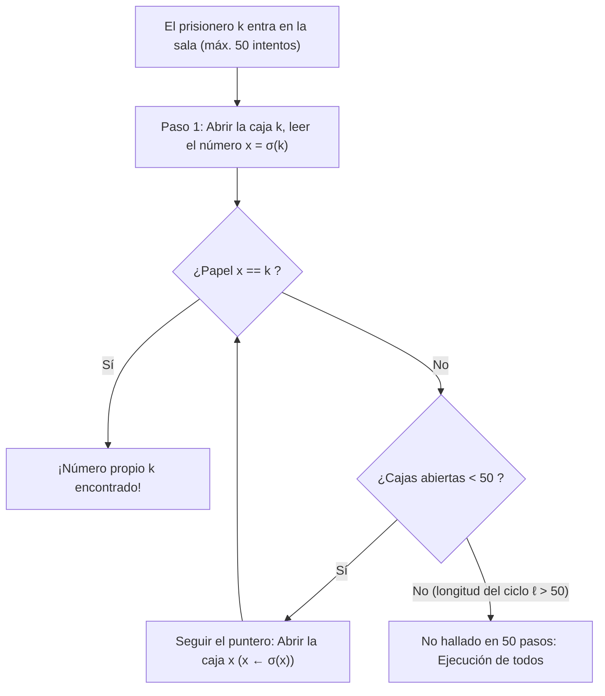
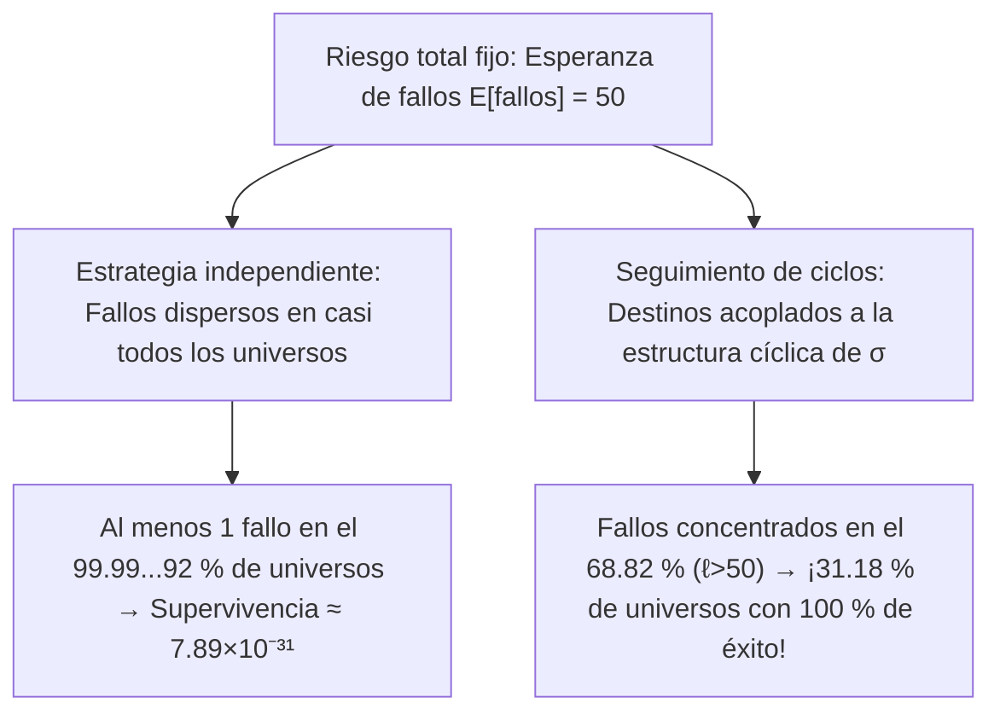

## Introducción: El milagro más contraintuitivo de la probabilidad

En 2003, el científico de la computación danés <strong>Peter Bro Miltersen</strong> planteó el célebre <strong>problema de los 100 prisioneros</strong>:
- $100$ condenados a muerte están numerados del $1$ al $100$. En una sala hay $100$ cajas cerradas que contienen los números del $1$ al $100$ distribuidos al azar (una permutación $\sigma \in S_{100}$).
- <strong>Regla</strong>: Cada prisionero entra solo por turno y puede abrir hasta <strong>$50$ cajas</strong> buscando su propio número. Al salir, la sala queda exactamente igual y <strong>está prohibida toda comunicación una vez iniciado el proceso</strong> (aunque pueden acordar una estrategia antes de empezar).
- <strong>Condición de vida o muerte</strong>: Solo si <strong>los $100$ prisioneros encuentran su número</strong> se salvan todos; si <strong>uno solo falla</strong>, los $100$ son ejecutados.

Si cada prisionero abre $50$ cajas al azar (<strong>estrategia independiente</strong>), cada uno acierta con probabilidad $1/2$, pero la probabilidad de supervivencia conjunta es:

$$\mathbb{P}(\text{todos sobreviven})_{\text{indep.}} = \left(\frac{1}{2}\right)^{100} \approx 7.89 \times 10^{-31}$$

Sin embargo, <strong>Sven Skyum</strong> descubrió la <strong>estrategia de seguimiento de punteros (Pointer-Following Strategy)</strong>, ¡que eleva la supervivencia conjunta al <strong>$31.18\,\%$</strong> sin transmitir un solo bit de información!

---

## Capítulo 1: Seguimiento de punteros y descomposición en ciclos disjuntos

Para el prisionero número $k \in \{1, \dots, 100\}$, la estrategia de Skyum consiste en:
1. <strong>Paso 1</strong>: Abrir primero la <strong>caja n.º $k$</strong>.
2. <strong>Paso 2</strong>: Si el papel interior muestra $x_1 = k$, ha triunfado; si $x_1 \neq k$, abrir a continuación la <strong>caja n.º $x_1$</strong>.
3. <strong>Paso 3</strong>: Leer el número $x_2$ y abrir la caja n.º $x_2$, siguiendo la cadena $k \mapsto \sigma(k) \mapsto \sigma^2(k) \mapsto \cdots$ hasta hallar $k$ o agotar los $50$ intentos.

¿Por qué funciona? La asignación caja $\mapsto$ papel es una biyección $\sigma$ del <strong>grupo simétrico $S_{2n}$</strong> ($2n=100$). Toda permutación finita se descompone de forma única en <strong>ciclos disjuntos</strong>:

$$\sigma = C_1 \circ C_2 \circ \cdots \circ C_m, \qquad \sum_{i=1}^m |C_i| = 2n = 100$$

Al ser $\sigma$ biyectiva, partiendo de la caja $k$ el prisionero recorre el único ciclo cerrado que contiene a $k$ y termina en $\sigma^{-1}(k)$ (la caja que guarda el papel $k$). Por tanto:
- El prisionero $k$ triunfa en $\le 50$ pasos si y solo si su ciclo tiene longitud $\ell \le 50$.
- <strong>¡Los $100$ prisioneros sobreviven todos si y solo si la permutación $\sigma \in S_{100}$ no contiene ningún ciclo de longitud $\ell > 50$!</strong>

---

## Capítulo 2: Conteo de ciclos largos y números armónicos ($1 - \ln 2$)

Para $2n$ prisioneros ($n = 50$), una permutación $\sigma \in S_{2n}$ puede tener <strong>como máximo un único ciclo de longitud $\ell > n$</strong>, pues dos ciclos disjuntos de longitud $> n$ sumarían al menos $2n+2 > 2n$ elementos. Así, los sucesos $E_\ell := \{\sigma \text{ contiene un ciclo de longitud } \ell\}$ para $\ell = n+1, \dots, 2n$ son <strong>mutuamente excluyentes</strong>. El número de permutaciones en $E_\ell$ es:
1. Elegir los $\ell$ elementos del ciclo largo: $\binom{2n}{\ell}$;
2. Ordenarlos en un ciclo circular único: $(\ell - 1)!$;
3. Permutar los $2n - \ell$ elementos restantes: $(2n - \ell)!$.

Multiplicando se cancelan los factoriales:

$$|E_\ell| = \binom{2n}{\ell} \cdot (\ell - 1)! \cdot (2n - \ell)! = \frac{(2n)!}{\ell! \, (2n - \ell)!} \cdot (\ell - 1)! \, (2n - \ell)! = \frac{(2n)!}{\ell}$$

Dividiendo por $|S_{2n}| = (2n)!$ resulta <strong>$\mathbb{P}(E_\ell) = \frac{1}{\ell}$</strong>. Usando los <strong>números armónicos</strong> $H_N = \sum_{k=1}^N \frac{1}{k}$, la probabilidad exacta de supervivencia es:

$$\boxed{P_{\text{success}}(2n) = 1 - \sum_{\ell = n+1}^{2n} \frac{1}{\ell} = 1 - \left(H_{2n} - H_n\right) \xrightarrow{n \to \infty} 1 - \int_1^2 \frac{dx}{x} = 1 - \ln 2 \approx 30.685\,\%}$$

Para $2n = 100$, obtenemos $P_{\text{success}}(100) = 1 - (H_{100} - H_{50}) \approx \mathbf{31.1828\,\%}$.

---

## Capítulo 3: Acoplamiento de riesgos sin transmisión de información

| Característica | 1. Estrategia independiente | 2. Estrategia de ciclos |
| :--- | :--- | :--- |
| <strong>Éxito individual $\mathbb{P}(A_k)$</strong> | $50.00\,\%$ | $50.00\,\%$ (idéntico) |
| <strong>Esperanza de éxitos $\mathbb{E}[X]$</strong> | $50$ prisioneros | $50$ prisioneros (idéntico) |
| <strong>Correlación</strong> | Nula (independiente) | <strong>Fuertemente acoplada vía $\sigma$</strong> |
| <strong>Supervivencia de los $100$</strong> | $(1/2)^{100} \approx 7.89 \times 10^{-31}$ | <strong>$1 - (H_{100} - H_{50}) \approx 31.18\,\%$</strong> |
| <strong>Límite $n \to \infty$</strong> | $0$ | <strong>$1 - \ln 2 \approx 30.685\,\%$</strong> |

1. <strong>Acoplamiento (Coupling)</strong>: Como 1 fallo o 51 fallos producen la misma condena, la estrategia de ciclos concentra todos los fallos en el $68.82\,\%$ de permutaciones con un ciclo $\ell > 50$, ¡despejando un <strong>$31.18\,\%$ del espacio muestral con cero fallos</strong>!
2. <strong>Defensa ante un alcaide malicioso</strong>: Acordando de antemano una biyección aleatoria secreta $\tau \in S_{100}$, la conjugación $\tau \sigma \tau^{-1}$ garantiza exactamente el <strong>$31.18\,\%$</strong> de supervivencia.
