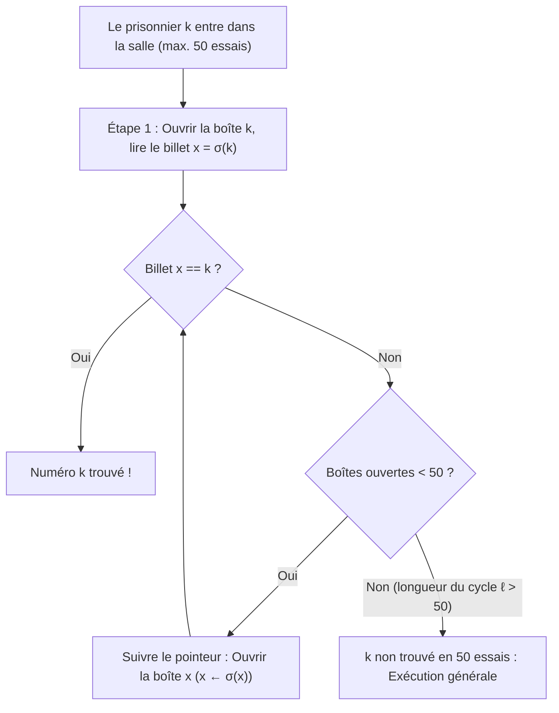
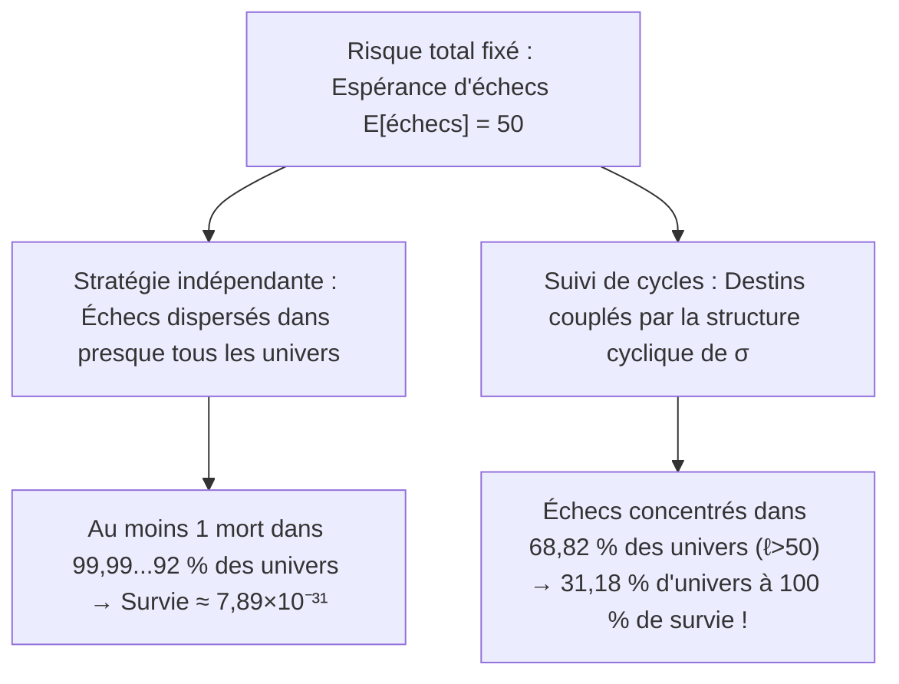

## Introduction : Le miracle le plus contre-intuitif des probabilités

En 2003, l'informaticien danois <strong>Peter Bro Miltersen</strong> a présenté une énigme devenue célèbre, le <strong>problème des 100 prisonniers</strong> :
- $100$ condamnés à mort sont numérotés de $1$ à $100$. Dans une pièce se trouvent $100$ boîtes fermées contenant chacune un numéro de $1$ à $100$ mélangé aléatoirement (une permutation $\sigma \in S_{100}$).
- <strong>Règle</strong> : Chaque prisonnier entre seul à son tour et peut ouvrir au plus <strong>$50$ boîtes</strong> pour trouver son propre numéro. Les boîtes sont refermées à l'identique après son passage et <strong>toute communication est strictement impossible après le début du jeu</strong> (mais une stratégie commune peut être fixée avant).
- <strong>Verdict</strong> : Si les <strong>$100$ prisonniers trouvent tous leur numéro</strong>, tous sont graciés ; si <strong>un seul échoue</strong>, les $100$ sont exécutés.

Si chacun ouvre $50$ boîtes au hasard (<strong>stratégie indépendante</strong>), chacun réussit avec probabilité $1/2$, mais la survie collective tombe à :

$$\mathbb{P}(\text{survie collective})_{\text{indép.}} = \left(\frac{1}{2}\right)^{100} \approx 7{,}89 \times 10^{-31}$$

Pourtant, <strong>Sven Skyum</strong> a découvert la <strong>stratégie du suivi de pointeurs (Pointer-Following Strategy)</strong> qui hisse la probabilité de survie collective à <strong>$31{,}18\,\%$</strong> sans transmettre le moindre bit d'information !

---

## Chapitre 1 : Suivi de pointeurs et décomposition en cycles disjoints

Pour le prisonnier numéro $k \in \{1, \dots, 100\}$, la stratégie de Skyum consiste à :
1. <strong>Étape 1</strong> : Ouvrir d'abord la <strong>boîte n° $k$</strong>.
2. <strong>Étape 2</strong> : Si le billet intérieur vaut $x_1 = k$, c'est gagné ; si $x_1 \neq k$, ouvrir ensuite la <strong>boîte n° $x_1$</strong>.
3. <strong>Étape 3</strong> : Lire le billet $x_2$ et ouvrir la boîte n° $x_2$, en suivant la chaîne $k \mapsto \sigma(k) \mapsto \sigma^2(k) \mapsto \cdots$ jusqu'à trouver $k$ ou épuiser ses $50$ essais.

Pourquoi cela fonctionne-t-il ? L'application boîte $\mapsto$ billet est une bijection $\sigma$ du <strong>groupe symétrique $S_{2n}$</strong> ($2n=100$). Toute permutation finie se décompose de manière unique en un produit de <strong>cycles disjoints</strong> :

$$\sigma = C_1 \circ C_2 \circ \cdots \circ C_m, \qquad \sum_{i=1}^m |C_i| = 2n = 100$$

Comme $\sigma$ est bijective, en partant de la boîte $k$, le prisonnier parcourt l'unique cycle fermé contenant $k$ et finit par atteindre $\sigma^{-1}(k)$ (la boîte contenant le billet $k$). Ainsi :
- Le prisonnier $k$ réussit en au plus $50$ essais si et seulement si son cycle est de longueur $\ell \le 50$.
- <strong>Les $100$ prisonniers survivent tous si et seulement si la permutation $\sigma \in S_{100}$ ne contient aucun cycle de longueur $\ell > 50$ !</strong>

---

## Chapitre 2 : Dénombrement des grands cycles et nombres harmoniques ($1 - \ln 2$)

Pour $2n$ prisonniers ($n = 50$), une permutation $\sigma \in S_{2n}$ contient <strong>au plus un seul cycle de longueur $\ell > n$</strong>, car deux cycles disjoints de longueur $> n$ nécessiteraient au moins $2n+2 > 2n$ éléments. Les événements $E_\ell := \{\sigma \text{ possède un cycle de longueur } \ell\}$ pour $\ell = n+1, \dots, 2n$ sont donc <strong>deux à deux disjoints</strong> ! Le nombre de permutations dans $E_\ell$ vaut :
1. Choix des $\ell$ éléments du grand cycle : $\binom{2n}{\ell}$ ;
2. Nombre de cycles orientés sur ces $\ell$ éléments : $(\ell - 1)!$ ;
3. Permutations des $2n - \ell$ éléments restants : $(2n - \ell)!$.

Le produit se simplifie remarquablement :

$$|E_\ell| = \binom{2n}{\ell} \cdot (\ell - 1)! \cdot (2n - \ell)! = \frac{(2n)!}{\ell! \, (2n - \ell)!} \cdot (\ell - 1)! \, (2n - \ell)! = \frac{(2n)!}{\ell}$$

En divisant par $|S_{2n}| = (2n)!$, on obtient <strong>$\mathbb{P}(E_\ell) = \frac{1}{\ell}$</strong>. Avec les <strong>nombres harmoniques</strong> $H_N = \sum_{k=1}^N \frac{1}{k}$, la probabilité exacte de survie collective est :

$$\boxed{P_{\text{success}}(2n) = 1 - \sum_{\ell = n+1}^{2n} \frac{1}{\ell} = 1 - \left(H_{2n} - H_n\right) \xrightarrow{n \to \infty} 1 - \int_1^2 \frac{dx}{x} = 1 - \ln 2 \approx 30{,}685\,\%}$$

Pour $2n = 100$, on trouve $P_{\text{success}}(100) = 1 - (H_{100} - H_{50}) \approx \mathbf{31{,}1828\,\%}$ !

---

## Chapitre 3 : Couplage des risques sans transmission d'information

| Caractéristique | 1. Stratégie indépendante | 2. Stratégie des cycles |
| :--- | :--- | :--- |
| <strong>Succès individuel $\mathbb{P}(A_k)$</strong> | $50{,}00\,\%$ | $50{,}00\,\%$ (identique) |
| <strong>Espérance de succès $\mathbb{E}[X]$</strong> | $50$ prisonniers | $50$ prisonniers (identique) |
| <strong>Corrélation</strong> | Nulle (indépendance) | <strong>Fortement couplée via $\sigma$</strong> |
| <strong>Survie des $100$ prisonniers</strong> | $(1/2)^{100} \approx 7{,}89 \times 10^{-31}$ | <strong>$1 - (H_{100} - H_{50}) \approx 31{,}18\,\%$</strong> |
| <strong>Limite $n \to \infty$</strong> | $0$ | <strong>$1 - \ln 2 \approx 30{,}685\,\%$</strong> |

1. <strong>Couplage (Coupling)</strong> : Comme 1 échec ou 51 échecs entraînent la même peine capitale, la stratégie des cycles concentre tous les échecs dans les $68{,}82\,\%$ de permutations ayant un cycle $\ell > 50$, libérant ainsi <strong>$31{,}18\,\%$ de l'espace probabiliste sans aucun échec</strong> !
2. <strong>Parade contre un gardien malveillant</strong> : En convenant d'avance d'une bijection secrète aléatoire $\tau \in S_{100}$, la conjugaison $\tau \sigma \tau^{-1}$ restaure exactement la probabilité de survie de <strong>$31{,}18\,\%$</strong>.
