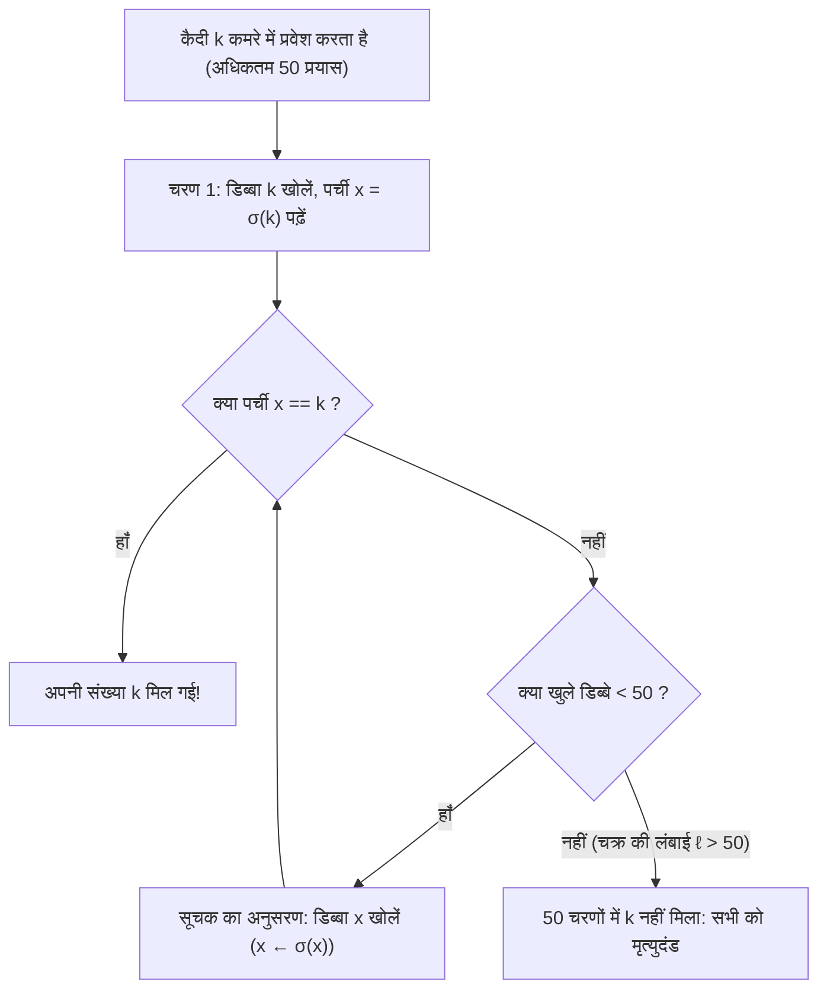
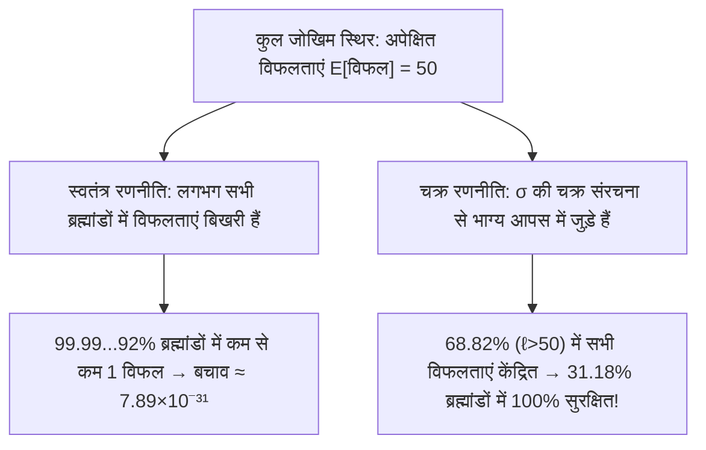

## प्रस्तावना: प्रायिकता सिद्धांत का सबसे अद्भुत चमत्कार

2003 में डेनिश कंप्यूटर वैज्ञानिक <strong>पीटर ब्रो मिल्टरसन (Peter Bro Miltersen)</strong> ने प्रसिद्ध <strong>100 कैदियों की समस्या (100 Prisoners Problem)</strong> प्रस्तुत की:
- मृत्युदंड पाए $100$ कैदियों को $1$ से $100$ तक संख्या दी गई है। एक कमरे में $100$ बंद डिब्बे हैं जिनमें $1$ से $100$ तक की पर्चियां यादृच्छिक रूप से रखी हैं (एक क्रमचय $\sigma \in S_{100}$)।
- <strong>नियम</strong>: प्रत्येक कैदी बारी-बारी से अकेले कमरे में जाता है और अपनी संख्या खोजने के लिए अधिकतम <strong>$50$ डिब्बे</strong> खोल सकता है। बाहर आने पर कमरा पूर्ववत कर दिया जाता है और <strong>खेल शुरू होने के बाद किसी भी प्रकार का संवाद पूर्णतः वर्जित है</strong> (किंतु शुरू होने से पहले रणनीति तय की जा सकती है)।
- <strong>जीवन-मरण शर्त</strong>: यदि <strong>सभी $100$ कैदी अपनी संख्या खोज लेते हैं</strong>, तो सभी रिहा कर दिए जाते हैं; यदि <strong>एक भी विफल रहा</strong>, तो सभी $100$ को मृत्युदंड दिया जाता है।

यदि प्रत्येक कैदी यादृच्छिक रूप से $50$ डिब्बे खोलता है (<strong>स्वतंत्र रणनीति</strong>), तो प्रत्येक की सफलता प्रायिकता $1/2$ है, किंतु सभी के बचने की प्रायिकता नगण्य है:

$$\mathbb{P}(\text{सभी बचें})_{\text{स्वतंत्र}} = \left(\frac{1}{2}\right)^{100} \approx 7.89 \times 10^{-31}$$

किंतु <strong>स्वेन स्कायुम (Sven Skyum)</strong> ने <strong>सूचक-अनुसरण रणनीति (Pointer-Following Strategy)</strong> खोजी, जो बिना एक भी बिट सूचना भेजे सामूहिक जीवन रक्षा प्रायिकता को <strong>$31.18\%$</strong> तक पहुँचा देती है!

---

## अध्याय 1: सूचक-अनुसरण रणनीति और असंयुक्त चक्र वियोजन

कैदी संख्या $k \in \{1, \dots, 100\}$ के लिए स्कायुम की रणनीति:
1. <strong>चरण 1</strong>: सबसे पहले <strong>डिब्बा सं. $k$</strong> खोलें।
2. <strong>चरण 2</strong>: यदि अंदर की पर्ची $x_1 = k$ है, तो सफल; यदि $x_1 \neq k$, तो अगला <strong>डिब्बा सं. $x_1$</strong> खोलें।
3. <strong>चरण 3</strong>: नई संख्या $x_2$ पढ़ें और डिब्बा सं. $x_2$ खोलें, अर्थात् श्रृंखला $k \mapsto \sigma(k) \mapsto \sigma^2(k) \mapsto \cdots$ का अनुसरण करें जब तक $k$ न मिल जाए या $50$ प्रयास समाप्त न हो जाएं।

यह क्यों काम करता है? डिब्बा $\mapsto$ पर्ची प्रतिचित्रण <strong>सममित समूह $S_{2n}$</strong> ($2n=100$) में एक एकैकी आच्छादक क्रमचय $\sigma$ है। प्रत्येक परिमित क्रमचय अद्वितीय रूप से <strong>असंयुक्त चक्रों (Disjoint Cycles)</strong> के गुणनफल में टूटता है:

$$\sigma = C_1 \circ C_2 \circ \cdots \circ C_m, \qquad \sum_{i=1}^m |C_i| = 2n = 100$$

चूंकि $\sigma$ एकैकी आच्छादक है, डिब्बा $k$ से शुरू करने पर कैदी $k$ को समाहित करने वाले अद्वितीय बंद चक्र में घूमता हुआ अंततः $\sigma^{-1}(k)$ (जिस डिब्बे में पर्ची $k$ है) पर पहुँचता है। अतः:
- कैदी $k$ अधिकतम $50$ चरणों में तभी सफल होता है जब उसके चक्र की लंबाई $\ell \le 50$ हो।
- <strong>सभी $100$ कैदी तभी बचते हैं जब क्रमचय $\sigma \in S_{100}$ में लंबाई $\ell > 50$ का कोई भी चक्र न हो!</strong>

---

## अध्याय 2: लंबे चक्रों की गणना और हरात्मक संख्याएं ($1 - \ln 2$)

$2n$ कैदियों ($n = 50$) के लिए, किसी क्रमचय $\sigma \in S_{2n}$ में लंबाई $\ell > n$ का <strong>अधिकतम एक ही चक्र</strong> हो सकता है, क्योंकि $> n$ लंबाई के दो असंयुक्त चक्रों के लिए कम से कम $2n+2 > 2n$ अवयव चाहिए। अतः घटनाएं $E_\ell := \{\sigma \text{ में लंबाई } \ell \text{ का चक्र है}\}$ ($\ell = n+1, \dots, 2n$) <strong>परस्पर अपवर्जी</strong> हैं! $E_\ell$ में क्रमचयों की संख्या:
1. लंबे चक्र के लिए $\ell$ अवयव चुनना: $\binom{2n}{\ell}$;
2. उन्हें एक वृत्तीय चक्र में सजाना: $(\ell - 1)!$;
3. शेष $2n - \ell$ अवयवों का क्रमचय: $(2n - \ell)!$।

गुणा करने पर क्रमगुणित कट जाते हैं:

$$|E_\ell| = \binom{2n}{\ell} \cdot (\ell - 1)! \cdot (2n - \ell)! = \frac{(2n)!}{\ell! \, (2n - \ell)!} \cdot (\ell - 1)! \, (2n - \ell)! = \frac{(2n)!}{\ell}$$

$|S_{2n}| = (2n)!$ से भाग देने पर <strong>$\mathbb{P}(E_\ell) = \frac{1}{\ell}$</strong> मिलता है। <strong>हरात्मक संख्याओं (Harmonic Numbers)</strong> $H_N = \sum_{k=1}^N \frac{1}{k}$ से बचने की सटीक प्रायिकता है:

$$\boxed{P_{\text{success}}(2n) = 1 - \sum_{\ell = n+1}^{2n} \frac{1}{\ell} = 1 - \left(H_{2n} - H_n\right) \xrightarrow{n \to \infty} 1 - \int_1^2 \frac{dx}{x} = 1 - \ln 2 \approx 30.685\%}$$

$2n = 100$ के लिए $P_{\text{success}}(100) = 1 - (H_{100} - H_{50}) \approx \mathbf{31.1828\%}$!

---

## अध्याय 3: बिना सूचना प्रसारण के जोखिम युग्मन (Coupling)

| विशेषता | 1. स्वतंत्र रणनीति | 2. चक्र-अनुसरण रणनीति |
| :--- | :--- | :--- |
| <strong>व्यक्तिगत सफलता $\mathbb{P}(A_k)$</strong> | $50.00\%$ | $50.00\%$ (समान) |
| <strong>अपेक्षित सफल कैदी $\mathbb{E}[X]$</strong> | $50$ कैदी | $50$ कैदी (समान) |
| <strong>सहसंबंध</strong> | शून्य (स्वतंत्र) | <strong>$\sigma$ के माध्यम से प्रबल धनात्मक युग्मन</strong> |
| <strong>सभी $100$ के बचने की प्रायिकता</strong> | $(1/2)^{100} \approx 7.89 \times 10^{-31}$ | <strong>$1 - (H_{100} - H_{50}) \approx 31.18\%$</strong> |
| <strong>सीमा $n \to \infty$</strong> | $0$ | <strong>$1 - \ln 2 \approx 30.685\%$</strong> |

1. <strong>युग्मन (Coupling)</strong>: चूंकि 1 विफलता और 51 विफलताओं का दंड एक समान है, चक्र रणनीति सभी विफलताओं को $\ell > 50$ वाले $68.82\%$ क्रमचयों में समेट देती है, जिससे <strong>$31.18\%$ प्रतिदर्श समष्टि पूर्णतः विफलता-मुक्त हो जाती है</strong>!
2. <strong>दुर्भावनापूर्ण जेलर से बचाव</strong>: पहले से एक गुप्त यादृच्छिक एकैकी आच्छादन $\tau \in S_{100}$ तय करने पर संयुग्मन $\tau \sigma \tau^{-1}$ पुनः <strong>$31.18\%$</strong> सफलता सुनिश्चित करता है।
