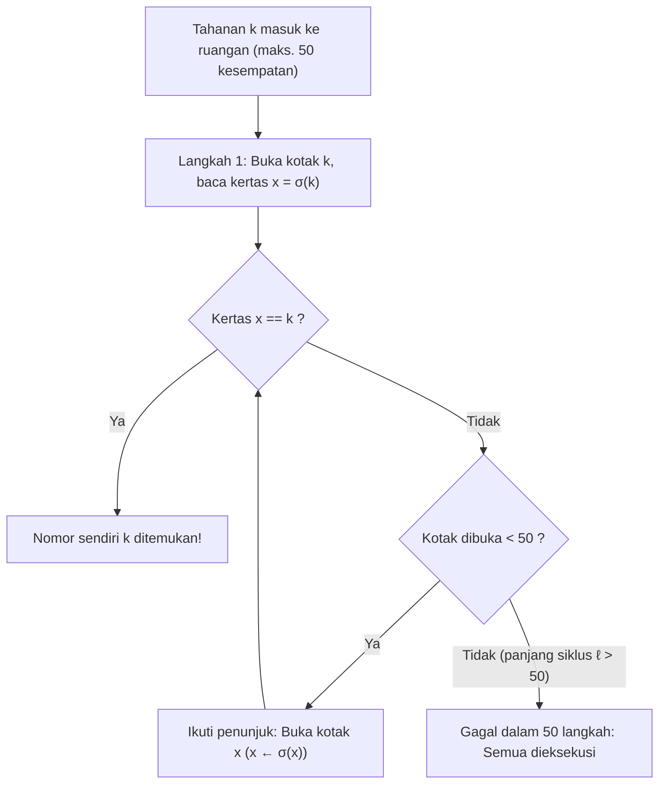
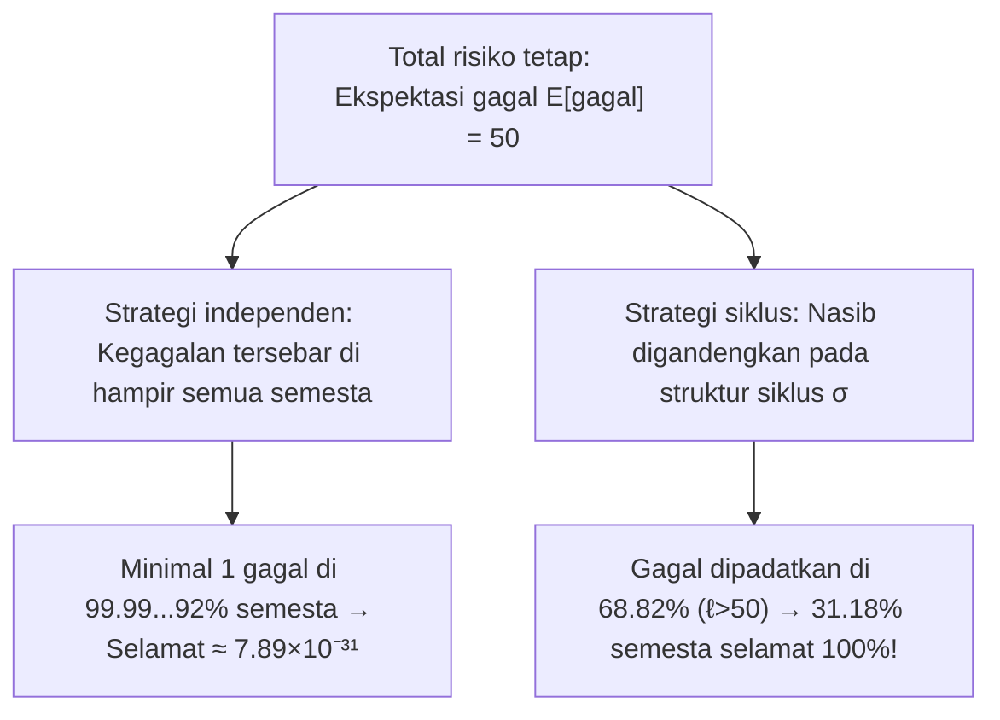

## Pendahuluan: Keajaiban Paling Kontraintuitif dalam Teori Probabilitas

Pada 2003, ilmuwan komputer Denmark <strong>Peter Bro Miltersen</strong> memperkenalkan teka-teki terkenal <strong>Masalah 100 Tahanan (100 Prisoners Problem)</strong>:
- $100$ terpidana mati diberi nomor $1$ sampai $100$. Di sebuah ruangan terdapat $100$ kotak tertutup berisi kertas bernomor $1$ sampai $100$ yang dikocok secara acak (sebuah permutasi $\sigma \in S_{100}$).
- <strong>Aturan</strong>: Setiap tahanan masuk sendirian secara bergiliran dan boleh membuka paling banyak <strong>$50$ kotak</strong> untuk menemukan nomornya sendiri. Ruangan dikembalikan ke kondisi semula dan <strong>segala komunikasi dilarang setelah permainan dimulai</strong> (tetapi strategi boleh disepakati sebelumnya).
- <strong>Vonis</strong>: Hanya jika <strong>ke-$100$ tahanan semuanya menemukan nomor mereka</strong>, semuanya dibebaskan; jika <strong>satu orang saja gagal</strong>, ke-$100$ tahanan dieksekusi.

Jika setiap tahanan membuka $50$ kotak secara acak (<strong>strategi independen</strong>), peluang masing-masing adalah $1/2$, namun peluang selamat bersama menjadi:

$$\mathbb{P}(\text{semua selamat})_{\text{indep.}} = \left(\frac{1}{2}\right)^{100} \approx 7.89 \times 10^{-31}$$

Namun, <strong>Sven Skyum</strong> menemukan <strong>Strategi Penelusuran Penunjuk (Pointer-Following Strategy)</strong> yang mendongkrak peluang selamat bersama menjadi <strong>$31.18\%$</strong> tanpa mengirim satu bit informasi pun!

---

## Bab 1: Penelusuran Penunjuk dan Dekomposisi Siklus Saling Lepas

Untuk tahanan bernomor $k \in \{1, \dots, 100\}$, strategi Skyum adalah:
1. <strong>Langkah 1</strong>: Buka terlebih dahulu <strong>kotak No. $k$</strong>.
2. <strong>Langkah 2</strong>: Jika kertas di dalamnya bernomor $x_1 = k$, berhasil; jika $x_1 \neq k$, selanjutnya buka <strong>kotak No. $x_1$</strong>.
3. <strong>Langkah 3</strong>: Baca nomor $x_2$ dan buka kotak No. $x_2$, mengikuti rantai $k \mapsto \sigma(k) \mapsto \sigma^2(k) \mapsto \cdots$ hingga menemukan $k$ atau menghabiskan $50$ kesempatan.

Mengapa ini berhasil? Pemetaan kotak $\mapsto$ kertas adalah bijeksi $\sigma$ dalam <strong>grup simetris $S_{2n}$</strong> ($2n=100$). Setiap permutasi hingga terurai secara tunggal menjadi <strong>siklus-siklus saling lepas (Disjoint Cycles)</strong>:

$$\sigma = C_1 \circ C_2 \circ \cdots \circ C_m, \qquad \sum_{i=1}^m |C_i| = 2n = 100$$

Karena $\sigma$ bijektif, berangkat dari kotak $k$, tahanan akan mengelilingi satu-satunya siklus tertutup yang memuat $k$ dan berakhir di $\sigma^{-1}(k)$ (kotak yang menyimpan kertas $k$). Maka:
- Tahanan $k$ berhasil dalam $\le 50$ langkah jika dan hanya jika siklusnya memiliki panjang $\ell \le 50$.
- <strong>Ke-$100$ tahanan selamat semuanya jika dan hanya jika permutasi $\sigma \in S_{100}$ tidak memiliki siklus dengan panjang $\ell > 50$!</strong>

---

## Bab 2: Pencacahan Siklus Panjang dan Bilangan Harmonik ($1 - \ln 2$)

Untuk $2n$ tahanan ($n = 50$), sebuah permutasi $\sigma \in S_{2n}$ paling banyak memuat <strong>satu siklus dengan panjang $\ell > n$</strong>, sebab dua siklus lepas berukuran $> n$ membutuhkan minimal $2n+2 > 2n$ elemen. Jadi kejadian $E_\ell := \{\sigma \text{ memuat siklus sepanjang } \ell\}$ untuk $\ell = n+1, \dots, 2n$ <strong>saling lepas</strong>! Banyaknya permutasi di $E_\ell$ adalah:
1. Memilih $\ell$ elemen siklus panjang: $\binom{2n}{\ell}$;
2. Menyusunnya menjadi satu siklus melingkar: $(\ell - 1)!$;
3. Mempermutasikan $2n - \ell$ elemen sisanya: $(2n - \ell)!$.

Perkaliannya menyederhanakan faktorial secara elegan:

$$|E_\ell| = \binom{2n}{\ell} \cdot (\ell - 1)! \cdot (2n - \ell)! = \frac{(2n)!}{\ell! \, (2n - \ell)!} \cdot (\ell - 1)! \, (2n - \ell)! = \frac{(2n)!}{\ell}$$

Dibagi $|S_{2n}| = (2n)!$, diperoleh <strong>$\mathbb{P}(E_\ell) = \frac{1}{\ell}$</strong>. Dengan <strong>bilangan harmonik</strong> $H_N = \sum_{k=1}^N \frac{1}{k}$, peluang selamat eksaknya adalah:

$$\boxed{P_{\text{success}}(2n) = 1 - \sum_{\ell = n+1}^{2n} \frac{1}{\ell} = 1 - \left(H_{2n} - H_n\right) \xrightarrow{n \to \infty} 1 - \int_1^2 \frac{dx}{x} = 1 - \ln 2 \approx 30.685\%}$$

Untuk $2n = 100$, kita peroleh $P_{\text{success}}(100) = 1 - (H_{100} - H_{50}) \approx \mathbf{31.1828\%}$!

---

## Bab 3: Penggandengan Risiko (Coupling) Tanpa Komunikasi

| Karakteristik | 1. Strategi Independen | 2. Strategi Siklus |
| :--- | :--- | :--- |
| <strong>Peluang Individu $\mathbb{P}(A_k)$</strong> | $50.00\%$ | $50.00\%$ (identik) |
| <strong>Ekspektasi Berhasil $\mathbb{E}[X]$</strong> | $50$ tahanan | $50$ tahanan (identik) |
| <strong>Korelasi</strong> | Nol (independen) | <strong>Tergandeng kuat lewat $\sigma$</strong> |
| <strong>Peluang $100$ Selamat</strong> | $(1/2)^{100} \approx 7.89 \times 10^{-31}$ | <strong>$1 - (H_{100} - H_{50}) \approx 31.18\%$</strong> |
| <strong>Limit $n \to \infty$</strong> | $0$ | <strong>$1 - \ln 2 \approx 30.685\%$</strong> |

1. <strong>Penggandengan (Coupling)</strong>: Karena gagal 1 orang sama fatalnya dengan gagal 51 orang, strategi siklus memadatkan seluruh kegagalan ke dalam $68.82\%$ permutasi bersiklus $\ell > 50$, sehingga <strong>$31.18\%$ ruang sampel bersih tanpa satu pun kegagalan</strong>!
2. <strong>Pertahanan terhadap Sipir Licik</strong>: Dengan menyepakati bijeksi acak rahasia $\tau \in S_{100}$ sebelumnya, konjugasi $\tau \sigma \tau^{-1}$ tetap menjamin peluang selamat <strong>$31.18\%$</strong>.
