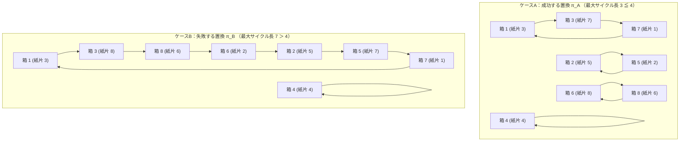

## 1. はじめに：絶望的な確率 $2^{-100}$ と $31.18\%$ の劇的なギャップ

2003年、デンマーク・オーフス大学のコンピュータ科学者<strong>ピーター・ブロ・ミルターセン（Peter Bro Miltersen）</strong>は、アンナ・ガル（Anna Gál）との共著論文（ICALP 2003: *"The Cell Probe Complexity of Succinct Data Structures"*）の中で、現代の確率論・組合せ論・情報理論において最も直観に反するパズルのひとつを世に送り出した。今日<strong>「100人の囚人の問題（100 Prisoners Problem）」</strong>として知られるこの問題は、ミルターセンの同僚である<strong>スヴェン・スカウム（Sven Skyum）</strong>が考案した驚くべき解決策とともに、世界中の数学者や情報科学者に強い衝撃を与えた。

まずは、この問題の厳密なルール設定を確認しよう。

### 問題の厳密な定式化

刑務所に $1$ から $100$ までの番号が割り当てられた $2n = 100$ 人の死刑囚がいる。刑務所長は彼らに最後のチャンスとして、次のようなゲームを提示した。

1. <strong>箱と紙片の配置</strong>：別室には、外側に $1$ から $100$ までの番号ラベルが貼られた $100$ 個の閉じた箱（引き出し）が並んでいる。その中には、$1$ から $100$ までの番号が書かれた紙片が1枚ずつ、<strong>完全にランダムな順列（一様ランダムな置換 $\pi \in S_{100}$）</strong>で封入されている。
2. <strong>探索の試行回数上限</strong>：囚人は $1$ 人ずつ順番にその部屋へ入る。部屋に入った囚人は、$100$ 個の箱のうち<strong>最大で半数の $n = 50$ 個まで</strong>箱を開けて中身の番号を確認することができる。自分の番号が書かれた紙片を見つけた時点で、その囚人の探索は「成功」となる。
3. <strong>現状回復と通信の完全禁止</strong>：囚人は部屋を出る際、開けた箱をすべて閉め、部屋の状態を<strong>入る前と完全に同じ状態</strong>に戻さなければならない。また、最初の囚人が部屋に入った瞬間からゲームが終了するまで、囚人同士は<strong>いかなる情報伝達（会話、合図、箱への細工など）も一切行うことができない</strong>。ただし、ゲームが始まる前に全員で作戦会議を開き、どの箱をどのような手順で開けるかという<strong>共通の戦略（アルゴリズム）</strong>に合意しておくことだけは許されている。
4. <strong>全員釈放と全員処刑の条件</strong>：このゲームの勝敗条件は極めて過酷である。<strong>$100$ 人の囚人全員（一人残らずすべて）が自分の番号を見つけた場合に限り、$100$ 人全員が恩赦によって釈放される。もし $99$ 人が成功しても、たった $1$ 人でも自分の番号を見つけられなければ、$100$ 人全員が処刑される。</strong>

### 素朴な独立ランダム探索がもたらす「絶対的な死」

直観的に考えてみよう。各囚人 $i \in \{1, 2, \dots, 100\}$ は、$100$ 個の箱の中から $50$ 個を開けることができる。紙片は完全にランダムに配置されているため、ある1人の囚人が自分の番号を引き当てる<strong>周辺成功確率（Marginal Success Probability）</strong>は、どの箱を選ぼうとも厳密に次の値になる。

$$p_i = \frac{50}{100} = \frac{1}{2}$$

では、各囚人が他の囚人とは無関係に（独立に）ランダムに $50$ 個の箱を選んだ場合、$100$ 人全員が同時に成功する<strong>同時成功確率（Joint Survival Probability）</strong> $P_{\text{indep}}$ はいくらになるだろうか？独立事象の乗法定理より、それは $\frac{1}{2}$ を $100$ 回掛け合わせた値となる。

$$P_{\text{indep}} = \prod_{i=1}^{100} p_i = \left(\frac{1}{2}\right)^{100} = 2^{-100} = \frac{1}{1,267,650,600,228,229,401,496,703,205,376} \approx 7.8886 \times 10^{-31}$$

この $7.8886 \times 10^{-31}$（小数点以下にゼロが30個並ぶ確率）がいかに絶望的な数字であるかは、物理的なスケールと比較するとよくわかる。1立方メートルの固体物質に含まれる原子の総数はおよそ $10^{29}$ 個から $10^{30}$ 個程度である。つまり、独立ランダム探索で100人全員が助かる確率は、<strong>「1立方メートルの巨大な金属ブロックの中から、目隠しをして特定の1個の原子を1回の試行でピンポイントに引き当てる確率」よりもさらに低い</strong>のである。地球上の全人類が宇宙の誕生から現在まで毎秒このゲームをやり続けたとしても、1回たりとも成功しないほどの「事実上のゼロ（確実な死）」である。

### ポインタ追跡（巡回追跡）戦略による奇跡の跳躍

ところが、スヴェン・スカウムが発見した<strong>「ポインタ追跡戦略（Pointer-Following Strategy / Cycle-Following Strategy）」</strong>──すなわち「まず自分の番号が貼られた箱を開け、そこに入っていた紙片の番号の箱を次に開けるという操作を繰り返す」という極めてシンプルな決定論的ルール──に全員が従うだけで、全員が生還する確率は突如として次の値へと跳ね上がる。

$$P_{\text{success}}(100) = 1 - \sum_{k=51}^{100} \frac{1}{k} = 1 - (H_{100} - H_{50}) \approx 0.31182782\dots \quad (31.18\%)$$

なんと、<strong>約 $31.18\%$（3回に1回近い確率）で100人全員が無傷で釈放される</strong>のである。独立ランダム探索の $7.8886 \times 10^{-31}$ と比較すると、その改善倍率は実に <strong>$3.95 \times 10^{29}$ 倍以上</strong>に達する。

ここで誰しもが強烈な疑問を抱くはずだ。
- <strong>疑問1</strong>：囚人たちは一切の通信をしていないし、箱の中身を書き換えることもできない。なぜ「開ける順番のルール」を決めただけで、箱の中のランダムな配置に対抗できるのか？
- <strong>疑問2</strong>：たとえそのルールを使ったとしても、各囚人が開けられる箱は $100$ 個中 $50$ 個なのだから、1人あたりの成功確率は依然として $\frac{1}{2}$ のはずではないか？なぜ個人の成功確率が $\frac{1}{2}$ のままなのに、100人全員の同時成功確率が $\left(\frac{1}{2}\right)^{100}$ ではなく $0.3118$ になるのか？

本稿では、この「100人の囚人の問題」の背後に潜む<strong>対称群 $S_{2n}$ の互いに素な巡回置換分解（Disjoint Cycle Decomposition）</strong>、<strong>コーシーの巡回置換公式と調和数（Harmonic Numbers）による厳密確率の導出</strong>、そして通信なき環境下で同時分布を劇的に変形させる<strong>相関結合（Correlation Coupling / Failure Bundling）</strong>と<strong>カーティン＝ウォーシャウアーの最適性定理（Curtin-Warshauer Optimality Theorem）</strong>までを、一切の飛躍なく数学的に解き明かしていく。

---

## 2. ポインタ追跡アルゴリズムと対称群 $S_{2n}$ の巡回構造

まずは一般化して、囚人の総数を $2n$ 人（$n \in \mathbb{N}$）、各囚人が開けられる箱の最大数を $n$ 個としよう（100人の問題では $n = 50, 2n = 100$ である）。

### 全単射としての箱の配置とアルゴリズムの定義

集合 $X = \{1, 2, \dots, 2n\}$ を考える。$2n$ 個の箱に $1$ から $2n$ までの紙片が1枚ずつ重複なく入っている状態は、集合 $X$ からそれ自身への<strong>全単射（Bijection：一対一かつ上への写像）</strong>、すなわち<strong>対称群（Symmetric Group）$S_{2n}$ の元である置換 $\pi: X \to X$</strong> として厳密に表現できる。

$$\pi(x) = y \quad \Longleftrightarrow \quad \text{「外側に番号 } x \text{ が貼られた箱の中に、番号 } y \text{ の紙片が入っている」}$$

この記法のもとで、<strong>ポインタ追跡アルゴリズム（Cycle-Following Algorithm）</strong>は、囚人 $i \in X$ に対する次の決定論的な探索列として定義される。

1. <strong>ステップ $1$</strong>：囚人 $i$ はまず、自分の番号と同じラベルの<strong>箱 $i$</strong> を開ける。中から紙片 $\pi(i)$ が現れる。もし $\pi(i) = i$ であれば、1手目で自分の番号を発見したため探索成功として終了する。
2. <strong>ステップ $2$</strong>：$\pi(i) \neq i$ の場合、今見た紙片の番号を「次の箱を指し示すポインタ」とみなし、<strong>箱 $\pi(i)$</strong> を開ける。中から紙片 $\pi(\pi(i)) = \pi^2(i)$ が現れる。もし $\pi^2(i) = i$ なら成功として終了する。
3. <strong>ステップ $m$（$1 \le m \le n$）</strong>：同様に、ステップ $m-1$ で現れた紙片の番号 $\pi^{m-1}(i)$ の箱を開け、中身 $\pi^m(i)$ を確認する。
4. <strong>終了判定</strong>：ある $m \in \{1, 2, \dots, n\}$ において $\pi^m(i) = i$ となれば、囚人 $i$ は制限回数 $n$ 回以内に自分の紙片を発見できたため<strong>成功</strong>となる。もし $m = 1, 2, \dots, n$ のすべてにおいて $\pi^m(i) \neq i$ であれば、制限回数を使い切ったため囚人 $i$ は<strong>失敗</strong>となる。

### なぜ必ず元の箱 $i$（＝紙片 $i$）に戻ってくるのか？── $\rho$ 字型の枝が存在しない理由

ここで極めて重要な代数的事実を確認しなければならない。囚人 $i$ は「箱 $i$」から出発して $\pi(i), \pi^2(i), \pi^3(i), \dots$ とポインタを辿っていくが、そもそも<strong>「制限回数 $n$ の制約さえなければ、この追跡は必ず紙片 $i$ に到達する」</strong>と言い切れるのはなぜだろうか？

たとえば、途中で自分自身の番号 $i$ を含まない別のループ（閉路）に迷い込んでしまい、箱 $i$ 以外の場所をグルグル回り続けてしまうような事態──いわゆるグラフ理論や乱数周期解析（ポラードの $\rho$ 法など）で現れる<strong>「$\rho$（ロー）字型の合流枝（Tail leading into a cycle）」</strong>──は起きないのだろうか？

結論から言えば、<strong>全単射 $\pi \in S_{2n}$ が誘導する有向グラフにおいては、$\rho$ 字型の枝は数学的に絶対に存在し得ない。</strong>

これを厳密に証明しよう。頂点集合を $V = \{1, 2, \dots, 2n\}$ とし、各頂点 $x \in V$ から $\pi(x) \in V$ へ有向辺 $x \to \pi(x)$ を引いた有向グラフ $G_\pi = (V, E_\pi)$ を考える。
- 写像 $\pi$ がすべての $x \in V$ に対してただ1つの行き先 $\pi(x)$ を定めるため、すべての頂点の<strong>出次数（Out-degree）は厳密に $1$</strong> である。
- さらに $\pi$ は<strong>単射（Injective：$x \neq y \implies \pi(x) \neq \pi(y)$）</strong>かつ<strong>全射（Surjective：任意の $z \in V$ に対して $\pi(x) = z$ となる $x$ が存在する）</strong>である。したがって、どの頂点 $z \in V$ に対しても、そこへ入ってくる有向辺の始点 $x = \pi^{-1}(z)$ がただ1つだけ存在する。すなわち、すべての頂点の<strong>入次数（In-degree）も厳密に $1$</strong> である。

もし仮に、囚人 $i$ が箱 $i$ から出発して、番号 $i$ を含まない閉路 $C$ に途中から合流した（$\rho$ 字型の軌道を描いた）と仮定してみよう。閉路 $C$ との最初の合流点を頂点 $v \in C$ とすると、頂点 $v$ には「閉路 $C$ の内部から入ってくる辺 $u \to v$（$u \in C$）」と、「閉路 $C$ の外側の枝から入ってくる辺 $w \to v$（$w \notin C$）」の2本の異なる有向辺が入ってくることになる。すると $\pi(u) = v$ かつ $\pi(w) = v$（ただし $u \neq w$）となり、$\pi$ の<strong>単射性に真っ向から矛盾する</strong>のである！

この事実から、代数学における最も基本的な構造定理が導かれる。

> <strong>定理1（対称群 $S_{2n}$ の互いに素な巡回置換分解）</strong>
> 有限集合 $X = \{1, 2, \dots, 2n\}$ 上の任意の置換 $\pi \in S_{2n}$ が誘導する有向グラフ $G_\pi$ は、<strong>互いに素な（共通の頂点を持たない）単純有向閉路（Disjoint Directed Cycles）の集合</strong>へと一意に分解される。

そして、この閉路構造において次の決定的な性質が成り立つ。
箱 $i$ が属する唯一の閉路（サイクル）の長さを $k$（$1 \le k \le 2n$）としよう。この閉路は箱 $i$ から出発して次のように巡回し、ちょうど $k$ ステップ目で出発点の箱 $i$ へと戻ってくる。

$$i \xrightarrow{\pi} \pi(i) \xrightarrow{\pi} \pi^2(i) \xrightarrow{\pi} \cdots \xrightarrow{\pi} \pi^{k-1}(i) \xrightarrow{\pi} \pi^k(i) = i$$

この最後の矢印 $\pi^{k-1}(i) \xrightarrow{\pi} i$ の意味を、箱と紙片の言葉に翻訳してみよう。これは<strong>「サイクルの最後（$k$ 番目）に開ける箱 $\pi^{k-1}(i)$ の中に、まさに番号 $i$ の紙片が入っている」</strong>ということを意味している！
つまり、囚人 $i$ が自分の番号と同じ「箱 $i$」から探索を開始するという行為は、<strong>「自分が探している紙片 $i$ をゴール（最終地点 $\pi^{-1}(i)$）として持つ閉路の、まさにスタート地点（ゴールから1歩進んだ地点）に降り立つ」</strong>ことと同値なのである。もし囚人 $i$ が箱 $i$ 以外の箱 $j \neq i$ からスタートしてしまったら、もし $j$ が $i$ とは別のサイクルに属していた場合、何度箱を開けてもそのサイクル内を回り続けるだけで、紙片 $i$ には永遠に辿り着けない。だからこそ「まず自分の番号 $i$ の箱を開ける」ことが不可欠なのである。

したがって、囚人 $i$ が自分の紙片 $i$ を見つけるまでに開ける箱の個数は、<strong>要素 $i$ が属する巡回置換（サイクル）の長さ $k$ に厳密に一致する</strong>。

### 具体例による完全トレース（$2n = 8, n = 4$ の縮小モデル）

この構造を具体的にイメージするため、囚人の数を $2n = 8$ 人、各人が開けられる箱の上限を $n = 4$ 個とした縮小モデルで2つの具体例（成功する配置 $\pi_A$ と失敗する配置 $\pi_B$）を完全にトレースしてみよう。

#### ケースA：全員が成功する置換 $\pi_A$
箱 $1 \sim 8$ の中に、紙片が次の表のように入っているとする。

| 箱の番号 $x$ | 1 | 2 | 3 | 4 | 5 | 6 | 7 | 8 |
| :--- | :---: | :---: | :---: | :---: | :---: | :---: | :---: | :---: |
| <strong>中の紙片 $\pi_A(x)$</strong> | <strong>3</strong> | <strong>5</strong> | <strong>7</strong> | <strong>4</strong> | <strong>2</strong> | <strong>8</strong> | <strong>1</strong> | <strong>6</strong> |

この置換 $\pi_A$ を互いに素な巡回置換の積（Cycle Notation）で表すと、次の4つの独立したサイクルに分解される。

$$\pi_A = (1 \;\; 3 \;\; 7)(2 \;\; 5)(4)(6 \;\; 8)$$

それぞれのサイクルの長さを確認すると、$(1 \;\; 3 \;\; 7)$ は長さ $3$、$(2 \;\; 5)$ は長さ $2$、$(4)$ は長さ $1$（不動点）、$(6 \;\; 8)$ は長さ $2$ である。<strong>すべてのサイクルの長さが上限 $n = 4$ 以下（最大サイクル長 $L_{\max}(\pi_A) = 3 \le 4$）</strong>となっていることに注目しよう。8人の囚人の行動を追跡すると次のようになる。

- <strong>囚人 1</strong>：箱 $1$ を開ける（中身 $3$）$\to$ 箱 $3$ を開ける（中身 $7$）$\to$ 箱 $7$ を開ける（中身 <strong>$1$</strong>）。<strong>3手で成功！</strong>
- <strong>囚人 2</strong>：箱 $2$ を開ける（中身 $5$）$\to$ 箱 $5$ を開ける（中身 <strong>$2$</strong>）。<strong>2手で成功！</strong>
- <strong>囚人 3</strong>：箱 $3$ を開ける（中身 $7$）$\to$ 箱 $7$ を開ける（中身 $1$）$\to$ 箱 $1$ を開ける（中身 <strong>$3$</strong>）。<strong>3手で成功！</strong>
- <strong>囚人 4</strong>：箱 $4$ を開ける（中身 <strong>$4$</strong>）。<strong>1手で成功！</strong>
- <strong>囚人 5</strong>：箱 $5$ を開ける（中身 $2$）$\to$ 箱 $2$ を開ける（中身 <strong>$5$</strong>）。<strong>2手で成功！</strong>
- <strong>囚人 6</strong>：箱 $6$ を開ける（中身 $8$）$\to$ 箱 $8$ を開ける（中身 <strong>$6$</strong>）。<strong>2手で成功！</strong>
- <strong>囚人 7</strong>：箱 $7$ を開ける（中身 $1$）$\to$ 箱 $1$ を開ける（中身 $3$）$\to$ 箱 $3$ を開ける（中身 <strong>$7$</strong>）。<strong>3手で成功！</strong>
- <strong>囚人 8</strong>：箱 $8$ を開ける（中身 $6$）$\to$ 箱 $6$ を開ける（中身 <strong>$8$</strong>）。<strong>2手で成功！</strong>

同じサイクル $(1 \;\; 3 \;\; 7)$ に属する囚人 $1, 3, 7$ は、それぞれサイクル上の異なる頂点からスタートして同じ閉路をぐるりと1周し、全員がちょうどサイクル長である $3$ 手目（$\le 4$）に自分の番号を引き当てていることがわかる。

#### ケースB：長いサイクルが存在し失敗する置換 $\pi_B$
では、箱 $3$ と箱 $6$ と箱 $7$ の中身がわずかに異なる次の置換 $\pi_B$ ではどうなるだろうか。

| 箱の番号 $x$ | 1 | 2 | 3 | 4 | 5 | 6 | 7 | 8 |
| :--- | :---: | :---: | :---: | :---: | :---: | :---: | :---: | :---: |
| <strong>中の紙片 $\pi_B(x)$</strong> | <strong>3</strong> | <strong>5</strong> | <strong>8</strong> | <strong>4</strong> | <strong>7</strong> | <strong>2</strong> | <strong>1</strong> | <strong>6</strong> |

この置換 $\pi_B$ を巡回置換に分解すると、次のようになる。

$$\pi_B = (1 \;\; 3 \;\; 8 \;\; 6 \;\; 2 \;\; 5 \;\; 7)(4)$$

ここでは、長さ $1$ のサイクル $(4)$ と、<strong>長さ $7$ の巨大サイクル $(1 \;\; 3 \;\; 8 \;\; 6 \;\; 2 \;\; 5 \;\; 7)$</strong> が生じている。
- <strong>囚人 4</strong> は箱 $4$ を開けて1手で成功する。
- しかし、たとえば<strong>囚人 1</strong> は、箱 $1$（中身 $3$）$\to$ 箱 $3$（中身 $8$）$\to$ 箱 $8$（中身 $6$）$\to$ 箱 $6$（中身 $2$）を開けた時点で上限の $4$ 回を使い切ってしまい、紙片 $1$ が入っている箱 $7$（7手目）に到達できず<strong>失敗</strong>する。
- さらに重要なことに、この長さ $7$ のサイクルに属する<strong>7人の囚人（$1, 2, 3, 5, 6, 7, 8$）は全員、自分の紙片に到達するまでに $7$ 手を必要とするため、7人全員が一斉に4手目で失敗する</strong>のである！

この2つのケースの対比を以下の有向グラフ（Mermaid図）で視覚的に確認しよう。



### 全員生還の必要十分条件（The Fundamental Equivalence）

以上の考察から、ポインタ追跡戦略における「個人の成否」と「全員の成否」は、置換 $\pi \in S_{2n}$ の巡回構造に関する次の明快な必要十分条件へと完全に還元される。

> <strong>命題1（巡回長による成否の特徴づけ）</strong>
> 1. 囚人 $i$ が自分の番号を $n$ 回以内に見つける $\Longleftrightarrow$ 置換 $\pi$ において要素 $i$ が属する巡回置換の長さ $k$ が <strong>$k \le n$</strong> である。
> 2. $2n$ 人の囚人<strong>全員</strong>が自分の番号を $n$ 回以内に見つける $\Longleftrightarrow$ 置換 $\pi \in S_{2n}$ の互いに素な巡回置換分解の中に、<strong>長さ $k > n$ の巡回置換が1つも存在しない</strong>（すなわち、最大サイクル長 $L_{\max}(\pi) \le n$ である）。

100人の囚人の問題（$2n = 100, n = 50$）に当てはめれば、<strong>「100人全員が助かる確率」とは、「$100!$ 通りある置換の中からランダムに1つ選んだとき、長さ $51$ 以上のサイクルが1つも含まれない確率」に他ならない</strong>のである！

---

## 3. コーシーの巡回置換公式と調和数による成功確率の厳密導出

問題が「対称群 $S_{2n}$ において長さ $k > n$ のサイクルを含まない置換の割合を求めよ」という純粋な組合せ論の問題に帰着された。ここからは、その確率 $P_{\text{success}}(2n)$ を一歩ずつ厳密に導出しよう。

### 事象 $E_k$ の定義と「排反性（Mutual Exclusivity）」の奇跡

各整数 $k \in \{n+1, n+2, \dots, 2n\}$ に対して、事象 $E_k \subset S_{2n}$ を次のように定義する。

$$E_k = \{\pi \in S_{2n} \mid \pi \text{ は長さ } k \text{ の巡回置換を含む}\}$$

私たちが求めたい「全員が失敗する事象 $E_{\text{fail}}$」は、長さ $n+1$ から $2n$ までのサイクルのいずれか少なくとも1つを含む事象、すなわち和事象 $\bigcup_{k=n+1}^{2n} E_k$ である。

一般に、複数の事象の和集合の確率を求める際には包除原理（Inclusion-Exclusion Principle）が必要となり、計算は複雑を極める。たとえば $k \le n$ の範囲であれば、1つの置換が複数のサイクルを同時に持ち得るため事象同士が重なり合う。ところが、<strong>$k > n$ という条件があるおかげで、驚くべき単純化が起きる。</strong>

> <strong>補題1（長大サイクル事象の排反性）</strong>
> $k > n$ の範囲において、1つの置換 $\pi \in S_{2n}$ は長さ $n+1$ 以上の巡回置換を<strong>高々1個</strong>しか含むことができない。したがって、事象 $E_{n+1}, E_{n+2}, \dots, E_{2n}$ は<strong>互いに排反（Mutually Exclusive / Disjoint）</strong>である。
> $$E_j \cap E_k = \emptyset \quad (\forall j, k \in \{n+1, \dots, 2n\}, \; j \neq k)$$

<strong>【証明】</strong>
もしある置換 $\pi \in S_{2n}$ が、互いに素な2つの長大サイクル $C_1$（長さ $k_1 \ge n+1$）と $C_2$（長さ $k_2 \ge n+1$）を同時に含んでいたと仮定する。$C_1$ と $C_2$ は共通の要素を持たないため、これら2つのサイクルに含まれる要素の総数は少なくとも

$$|C_1| + |C_2| = k_1 + k_2 \ge (n + 1) + (n + 1) = 2n + 2 > 2n$$

となる。しかし全体の要素数は $2n$ 個しかないため、これは鳩の巣原理により矛盾である。同様に、同じ長さ $k > n$ のサイクルが2個以上存在することも不可能である。$\blacksquare$

この補題1により、失敗確率 $P_{\text{fail}}(2n)$ は包除原理の交差項を一切考えることなく、<strong>単なる確率の足し算</strong>として計算できる！

$$P_{\text{fail}}(2n) = P\left(\bigcup_{k=n+1}^{2n} E_k\right) = \sum_{k=n+1}^{2n} P(E_k)$$

### 長さ $k$（$k > n$）の巡回置換を含む置換の総数 $|E_k|$ の導出

では、固定された $k \in \{n+1, \dots, 2n\}$ に対して、長さ $k$ のサイクルを含む置換の個数 $|E_k|$ を数え上げよう。補題1より、$\pi \in E_k$ に含まれる長さ $k$ のサイクルは<strong>ただ1つ</strong>であるため、重複カウントの心配は一切ない。そのような置換 $\pi$ は次の3つの独立なステップで一意に構成できる。

1. <strong>サイクルを構成する $k$ 個の要素の選択</strong>：
   全体集合 $\{1, 2, \dots, 2n\}$ の中から、長さ $k$ のサイクルに入る要素を $k$ 個選ぶ。その選び方の総数は二項係数で与えられる。
   $$\binom{2n}{k} = \frac{(2n)!}{k!(2n - k)!}$$

2. <strong>選ばれた $k$ 個の要素による単一サイクル（円順列）の形成</strong>：
   選んだ $k$ 個の要素を1つの閉じた有向サイクルに並べる方法は何通りあるか？順列として一列に並べる方法は $k!$ 通りあるが、サイクル表記 $(a_1 \;\; a_2 \;\; \dots \;\; a_k)$ は巡回シフトに関して $k$ 通りの同値な表現を持つ（あるいは、最小の要素を先頭に固定すれば残りの $k-1$ 個の順列と一対一に対応する）。したがって、単一の有向サイクルを作る方法の総数は次の通りである。
   $$\frac{k!}{k} = (k - 1)!$$

3. <strong>残りの $2n - k$ 個の要素の自由な置換</strong>：
   サイクルに入らなかった残りの $2n - k$ 個の要素は、互いにどのように置換されてもよい（ここで $k > n$ より、残りの要素数は $2n - k < n < k$ であるから、残りの要素の中から長さ $k$ のサイクルがもう1つ出来てしまうことは絶対にない！）。したがって、残りの要素の配置の総数は次の通りである。
   $$(2n - k)!$$

積の法則により、これら3つのステップの総数を掛け合わせると、階乗が劇的に約分されて驚くほどシンプルな式が現れる。

$$|E_k| = \binom{2n}{k} \cdot (k - 1)! \cdot (2n - k)! = \frac{(2n)!}{k! \cancel{(2n - k)!}} \cdot (k - 1)! \cdot \cancel{(2n - k)!} = \frac{(2n)! \cdot (k - 1)!}{k \cdot (k - 1)!} = \frac{(2n)!}{k}$$

対称群 $S_{2n}$ の全要素数は $|S_{2n}| = (2n)!$ である。したがって、一様ランダムに選ばれた置換 $\pi \in S_{2n}$ が長さ $k$（$k > n$）の巡回置換を含む確率 $P(E_k)$ は、なんと<strong>全体の人数 $2n$ にすら依存しない純粋な逆数 $\frac{1}{k}$</strong> となる！

$$P(E_k) = \frac{|E_k|}{|S_{2n}|} = \frac{(2n)! / k}{(2n)!} = \frac{1}{k} \quad (n + 1 \le k \le 2n)$$

たとえば $2n = 100$ のとき、ランダムな置換が長さ $100$ の単一巨大サイクル（ハミルトン閉路）である確率は $\frac{1}{100} = 1\%$、長さ $51$ のサイクルを含む確率は $\frac{1}{51} \approx 1.96\%$ である。

### コーシーの巡回置換公式（Cauchy's Cycle Type Formula）からの検証

この $P(E_k) = \frac{1}{k}$ という美しい結果は、群論・組合せ論における<strong>オーギュスタン＝ルイ・コーシー（Augustin-Louis Cauchy）の巡回置換公式</strong>からも直接理解することができる。

対称群 $S_N$（ここで $N = 2n$）の元 $\pi$ が、長さ $1$ のサイクルを $c_1$ 個、長さ $2$ のサイクルを $c_2$ 個、$\dots$、長さ $N$ のサイクルを $c_N$ 個持つとき（ただし $\sum_{j=1}^N j c_j = N$）、この組 $(c_1, c_2, \dots, c_N)$ を $\pi$ の<strong>巡回型（Cycle Type）</strong>と呼ぶ。同じ巡回型を持つ置換同士は対称群 $S_N$ において互いに共役（Conjugate）であり、1つの共役類（Conjugacy Class）をなす。コーシーの公式によれば、与えられた巡回型 $(c_1, \dots, c_N)$ を持つ置換の総数 $N(c_1, \dots, c_N)$ は次式で与えられる。

$$N(c_1, c_2, \dots, c_N) = \frac{N!}{\prod_{j=1}^N j^{c_j} c_j!} = \frac{N!}{1^{c_1} c_1! \, 2^{c_2} c_2! \cdots N^{c_N} c_N!}$$

全要素数 $N!$ で割ると、ランダムな置換がこの巡回型を持つ確率は $\prod_{j=1}^N \frac{1}{j^{c_j} c_j!}$ となる。
ここで $k > N/2$ のとき、条件 $\sum j c_j = N$ の下で $c_k$ が取り得る非ゼロの値は $c_k = 1$ のみである。$c_k = 1$ となるすべての巡回型について確率を足し合わせると、残りの要素 $N - k$ 個についての巡回型の確率の総和（これは対称群 $S_{N-k}$ のすべての共役類の確率の和なので厳密に $1$ になる）が因数分解されて括り出され、係数 $\frac{1}{k^1 \cdot 1!} = \frac{1}{k}$ だけが残るのである。

### 調和数による厳密解とオイラー・マクローリン展開による極限値

これで、すべてのピースが揃った。失敗確率 $P_{\text{fail}}(2n)$ は $k = n+1$ から $2n$ までの $\frac{1}{k}$ の総和である。第 $m$ <strong>調和数（Harmonic Number）</strong>を $H_m = \sum_{j=1}^m \frac{1}{j}$ と定義すれば、全員が助かる成功確率 $P_{\text{success}}(2n)$ は次の閉形式で厳密に表される。

$$P_{\text{success}}(2n) = 1 - P_{\text{fail}}(2n) = 1 - \sum_{k=n+1}^{2n} \frac{1}{k} = 1 - (H_{2n} - H_n)$$

#### $2n = 100, n = 50$ の場合の数値計算
$n = 50$ を代入すると、100人の囚人が全員生還する確率は次のようになる。

$$P_{\text{success}}(100) = 1 - \left(\frac{1}{51} + \frac{1}{52} + \frac{1}{53} + \cdots + \frac{1}{100}\right) = 1 - (H_{100} - H_{50})$$

第100調和数 $H_{100}$ と第50調和数 $H_{50}$ の高精度な数値は次の通りである。
- $H_{100} \approx 5.1873775176396202608\dots$
- $H_{50} \approx 4.4992053383294250576\dots$
- $H_{100} - H_{50} \approx 0.6881721793101952032\dots$

したがって、100人の囚人全員が助かる確率は：

$$P_{\text{success}}(100) \approx 1 - 0.6881721793101952 = 0.3118278206898048\dots \quad (\text{約 } 31.1828\%)$$

#### 囚人の数 $2n \to \infty$ における漸近挙動と極限 $1 - \ln 2$
もし囚人の数が100人ではなく、1万人（$2n = 10000$）や1億人（$2n = 10^8$）に増えたら、この成功確率はどうなるだろうか？直観的には「全員が成功しなければならないのだから、人数が増えれば成功確率はゼロに潰れていくのではないか」と思えるかもしれない。しかし、驚くべきことに<strong>人数が無限大に増えても、成功確率は決して $30.685\%$ 未満には下がらない！</strong>

これを2つの方法で証明しよう。まず1つ目は、定積分（リーマン和）による評価である。関数 $f(x) = \frac{1}{x}$ は区間 $[n, 2n]$ において狭義単調減少かつ下に凸であるから、区分求積法の面積比較により次の不等式がすべての $n \ge 1$ で厳密に成り立つ。

$$\sum_{k=n+1}^{2n} \frac{1}{k} < \int_n^{2n} \frac{dx}{x} = \Big[\ln x\Big]_n^{2n} = \ln(2n) - \ln n = \ln 2 \approx 0.69314718056\dots$$

したがって、<strong>任意の自然数 $n \ge 1$ に対して、成功確率は常に極限値 $1 - \ln 2$ よりも厳密に大きい</strong>ことが保証される。

$$P_{\text{success}}(2n) = 1 - \sum_{k=n+1}^{2n} \frac{1}{k} > 1 - \ln 2 \approx 0.30685281944\dots \quad (30.69\%)$$

さらに精密な挙動を知るために、2つ目の方法として<strong>オイラー・マクローリンの和公式（Euler-Maclaurin Summation Formula）</strong>による調和数 $H_n$ の漸近展開を用いよう。オイラー・マスケローニ定数を $\gamma \approx 0.5772156649\dots$ とすると、$H_n$ は次のように展開される。

$$H_n = \ln n + \gamma + \frac{1}{2n} - \frac{1}{12n^2} + \frac{1}{120n^4} - O(n^{-6})$$

これを用いて $H_{2n} - H_n$ を計算すると、$\ln n$ とオイラー定数 $\gamma$ が綺麗に相殺される。

$$\begin{aligned}
H_{2n} - H_n &= \left(\ln(2n) + \gamma + \frac{1}{4n} - \frac{1}{48n^2} + O(n^{-4})\right) - \left(\ln n + \gamma + \frac{1}{2n} - \frac{1}{12n^2} + O(n^{-4})\right) \\
&= \ln 2 - \frac{1}{4n} + \frac{1}{16n^2} - O(n^{-4})
\end{aligned}$$

ゆえに、成功確率 $P_{\text{success}}(2n)$ の漸近展開式は次のようになる。

$$P_{\text{success}}(2n) = 1 - \ln 2 + \frac{1}{4n} - \frac{1}{16n^2} + O(n^{-4})$$

実際に $n = 50$（$2n = 100$）をこの近似式に代入してみると、
- $1 - \ln 2 \approx 0.3068528194$
- 第1補正項 $+\frac{1}{4 \times 50} = +\frac{1}{200} = +0.0050000000$
- 第2補正項 $-\frac{1}{16 \times 2500} = -\frac{1}{40000} = -0.0000250000$
- 合計：$0.3068528194 + 0.005 - 0.000025 = 0.3118278194\dots$
となり、小数点以下8桁まで厳密値と一致することが確認できる！

以下の表に、囚人の総数 $2n$ を変化させたときの「独立ランダム探索の成功確率 $2^{-2n}$」と「ポインタ追跡戦略の成功確率 $1 - (H_{2n} - H_n)$」の比較をまとめる。

| 囚人の総数 $2n$ | 開けられる箱の数 $n$ | 独立ランダム探索 $P_{\text{indep}} = 2^{-2n}$ | 巡回追跡戦略 $P_{\text{success}} = 1 - (H_{2n} - H_n)$ | 改善倍率 $P_{\text{success}} / P_{\text{indep}}$ |
| :---: | :---: | :---: | :---: | :---: |
| <strong>2人</strong> | 1個 | $0.250000$ ($25.00\%$) | <strong>$0.500000$ ($50.00\%$)</strong> | $2.00 \times 10^0$ 倍 |
| <strong>4人</strong> | 2個 | $0.062500$ ($6.25\%$) | <strong>$0.416667$ ($41.67\%$)</strong> | $6.67 \times 10^0$ 倍 |
| <strong>8人</strong> | 4個 | $0.003906$ ($0.39\%$) | <strong>$0.365476$ ($36.55\%$)</strong> | $9.36 \times 10^1$ 倍 |
| <strong>10人</strong> | 5個 | $9.7656 \times 10^{-4}$ | <strong>$0.354365$ ($35.44\%$)</strong> | $3.63 \times 10^2$ 倍 |
| <strong>20人</strong> | 10個 | $9.5367 \times 10^{-7}$ | <strong>$0.331229$ ($33.12\%$)</strong> | $3.47 \times 10^5$ 倍 |
| <strong>100人</strong> | 50個 | $7.8886 \times 10^{-31}$ | <strong>$0.311828$ ($31.18\%$)</strong> | <strong>$3.95 \times 10^{29}$ 倍</strong> |
| <strong>1,000人</strong> | 500個 | $9.3326 \times 10^{-302}$ | <strong>$0.307353$ ($30.74\%$)</strong> | $3.29 \times 10^{300}$ 倍 |
| <strong>$\to \infty$</strong> | $\to \infty$ | $\to 0$ | <strong>$1 - \ln 2 \approx 0.306853$ ($30.69\%$)</strong> | $\to \infty$ |

---

## 4. 情報理論的解明：なぜ通信なしで同時確率が $2^{-100}$ から $0.3118$ へ跳ね上がるのか？

ここまでの数学的導出によって、ポインタ追跡戦略の成功確率が $1 - (H_{100} - H_{50}) \approx 31.18\%$ になることは一点の曇りもなく証明された。しかし、多くの読者の脳裏にはまだ、最も深い本質的な疑問が残っているはずである。

> <strong>本質的な問い</strong>
> 「各囚人は部屋の中で一切通信できない。しかも、ポインタ追跡戦略を使ったところで、1人の囚人が開けられる箱は $100$ 個中 $50$ 個に過ぎず、個人の成功確率（周辺確率）は $\frac{1}{2}$ のままではないのか？なぜ個人の成功確率が変わらないのに、通信もせずに100人全員の同時確率だけを $2^{-100}$ から $0.3118$ へと引き上げることができるのか？」

この問いに答えることこそが、「100人の囚人の問題」の真の醍醐味である。

### ステップ1：個人の周辺成功確率が依然として厳密に $\frac{1}{2}$ であることの証明

まず確認しておこう。ポインタ追跡戦略を採用したとき、特定の囚人 $i$（たとえば囚人1）が自分の番号を見つけられる確率は上がったのだろうか？<strong>いいえ、1ミリも上がっていない。依然として厳密に $\frac{1}{2}$ のままである。</strong>

これを数学的に確認しよう。対称群 $S_{2n}$ から一様ランダムに置換 $\pi$ を選ぶとき、特定の要素 $i \in \{1, \dots, 2n\}$ が属するサイクルの長さを表す確率変数を $L(i)$ とする。任意の整数 $k \in \{1, 2, \dots, 2n\}$（今度は $k \le n$ の場合も含むすべての $k$）に対して、要素 $i$ が長さ $k$ のサイクルに属する置換の総数を数えてみよう。
- 要素 $i$ 自身はすでにサイクルに入ることが決まっているので、残りの $2n - 1$ 個の要素の中から、要素 $i$ と同じサイクルに入る $k - 1$ 個の要素を選ぶ方法は $\binom{2n-1}{k-1}$ 通り。
- 要素 $i$ を先頭に固定して、選んだ $k - 1$ 個の要素をサイクルの後ろに並べる方法は $(k - 1)!$ 通り。
- サイクルに入らなかった残りの $2n - k$ 個の要素を任意に置換する方法は $(2n - k)!$ 通り。

したがって、$L(i) = k$ となる置換の総数は次のようになる。

$$|\{\pi \in S_{2n} \mid L(i) = k\}| = \binom{2n - 1}{k - 1} \cdot (k - 1)! \cdot (2n - k)! = \frac{(2n - 1)!}{\cancel{(k - 1)!} \cancel{(2n - k)!}} \cancel{(k - 1)!} \cancel{(2n - k)!} = (2n - 1)!$$

驚くべきことに、この個数 $(2n - 1)!$ は<strong>サイクル長 $k$ に全く依存しない定数</strong>である！全置換数 $(2n)!$ で割ると、特定の囚人 $i$ が属するサイクルの長さ $L(i)$ の確率分布は、$\{1, 2, \dots, 2n\}$ 上の<strong>完全な離散一様分布（Discrete Uniform Distribution）</strong>に従うことがわかる。

$$P(L(i) = k) = \frac{(2n - 1)!}{(2n)!} = \frac{1}{2n} \quad (\forall k \in \{1, 2, \dots, 2n\})$$

（※注意：先ほど第3節で導出した「置換 $\pi$ 全体の中に長さ $k$ のサイクルが存在する確率 $P(E_k) = \frac{1}{k}$」と混同しないようにしよう。長さ $k$ のサイクルが存在するとき、そのサイクルの中には $k$ 個の要素が含まれているため、特定の要素 $i$ がそのサイクルに含まれる条件付き確率は $\frac{k}{2n}$ である。ゆえに $P(L(i) = k) = \frac{1}{k} \times \frac{k}{2n} = \frac{1}{2n}$ となり完全に整合している！）

したがって、囚人 $i$ がポインタ追跡戦略で成功する周辺確率 $P(\text{囚人 } i \text{ が成功})$ は、$L(i) \le n$ となる確率に等しく、

$$P(L(i) \le n) = \sum_{k=1}^n P(L(i) = k) = \sum_{k=1}^n \frac{1}{2n} = \frac{n}{2n} = \frac{1}{2}$$

となり、ランダムに箱を開けた場合の $\frac{1}{2}$ と<strong>完全に一致する</strong>。

### ステップ2：期待値の線形性による「不変の制約」と「失敗の束ね合わせ（Failure Bundling）」

さらに踏み込もう。囚人 $i$ が<strong>失敗</strong>する事象を $F_i$（$P(F_i) = \frac{1}{2}$）とし、囚人 $i$ が失敗したときに $1$、成功したときに $0$ をとる指示確率変数（Indicator Random Variable）を $X_i = \mathbb{I}(F_i)$ とおく。このとき、ゲーム全体で失敗する囚人の総数 $X$ は $X = \sum_{i=1}^{2n} X_i$ と表される。

確率論の最も強力な定理である<strong>期待値の線形性（Linearity of Expectation）</strong>は、確率変数 $X_1, \dots, X_{2n}$ の間にどのような依存関係（相関）があろうとも、常に無条件で成り立つ。したがって、<strong>どのような戦略を採用しようとも、失敗する囚人の人数の期待値 $\mathbb{E}[X]$ は絶対に変わらない！</strong>

$$\mathbb{E}[X] = \mathbb{E}\left[\sum_{i=1}^{2n} X_i\right] = \sum_{i=1}^{2n} \mathbb{E}[X_i] = \sum_{i=1}^{2n} P(F_i) = 2n \times \frac{1}{2} = n \quad (\text{100人の問題では常に平均 } 50 \text{ 人が失敗する})$$

ここに、パラドックスを解く決定的な鍵がある。
「1人あたりの失敗確率は常に $50\%$ であり、試行ごとの平均失敗者数は常に $50$ 人で固定されている」。この情報理論的な保存則（不変量）の下で、なぜ「失敗者が $0$ 人である確率 $P(X = 0)$」を $2^{-100}$ から $0.3118$ へと最大化できるのか？

答えは、<strong>「失敗する時には、できるだけ多くの囚人が同じ試行（同じ世界線）で一斉に道連れになって失敗するように、各囚人の事象を強く正に相関させる（Correlation Coupling / Failure Bundling）」</strong>からである！

2つの戦略における「失敗者数 $X$ の確率分布」の違いを比べてみよう。

1. <strong>独立ランダム探索における $X$ の分布（二項分布 $\text{Binomial}(100, 0.5)$）</strong>：
   各囚人が独立に箱を選ぶと、失敗者数 $X$ は二項分布に従う。平均 $50$ 人、標準偏差 $\sqrt{100 \times 0.25} = 5$ 人であるため、ほぼすべての試行（$99.9999\%$ 以上）において「$35$ 人〜 $65$ 人の囚人が失敗する」という結果になる。
   しかし、刑務所長のルールを思い出してほしい。<strong>「1人でも失敗したら全員処刑」</strong>である。つまり、ある試行で $1$ 人が失敗しようが、$50$ 人が失敗しようが、$100$ 人が失敗しようが、「全員処刑」という結果においては何の違いもない！それにもかかわらず、独立ランダム探索では「毎回中途半端に50人前後が失敗する」という形で、限りある失敗確率の総量（期待値 $50$ 人分）を標本空間のあらゆる場所に薄く広くばら撒いて<strong>浪費（Wasted Failure Mass）</strong>してしまっているのである。

2. <strong>ポインタ追跡戦略における $X$ の分布（極端な二峰性・凝縮分布）</strong>：
   ポインタ追跡戦略では、長さ $k \le 50$ のサイクルに属する囚人は全員成功し、長さ $k \ge 51$ のサイクルに属する囚人は<strong>そのサイクルの $k$ 人全員が一斉に失敗する</strong>。また補題1より、長さ $51$ 以上のサイクルは高々1個しか存在しない。
   これが意味する事実は衝撃的である。ポインタ追跡戦略の下では、<strong>失敗者数 $X$ が $1$ 人以上 $50$ 人以下になる確率は、厳密にゼロ（$P(1 \le X \le 50) = 0$）なのである！</strong>
   失敗者数 $X$ が取り得る値は、<strong>「$0$ 人（全員成功）」</strong>か、あるいは<strong>「$51$ 人、$52$ 人、$\dots$、$100$ 人（大量同時失敗）」</strong>のいずれかしか存在しない。具体的な確率分布は次のようになる。

$$P(X = m) = \begin{cases} 1 - (H_{100} - H_{50}) \approx 0.311828 & (m = 0 \text{：全員生還}) \\ 0 & (1 \le m \le 50 \text{：絶対に起きない！}) \\ \dfrac{1}{m} & (51 \le m \le 100 \text{：長さ } m \text{ のサイクル全員が同時失敗}) \end{cases}$$

この分布で期待値 $\mathbb{E}[X]$ を計算してみると、確かに

$$\mathbb{E}[X] = 0 \times P(X = 0) + \sum_{m=1}^{50} m \times 0 + \sum_{m=51}^{100} m \times \frac{1}{m} = \sum_{m=51}^{100} 1 = 50$$

となり、期待値の保存則 $\mathbb{E}[X] = 50$ を完璧に満たしている！
つまり、ポインタ追跡戦略とは、<strong>「どうせ1人でも失敗すれば全員処刑なのだから、1人〜50人が中途半端に失敗するケースをすべて撲滅し、失敗する時には51人〜100人が一蓮托生でまとめて失敗するように失敗事象を束ね合わせる（Bundling）ことで、無傷の『失敗者0人』の領域を $31.18\%$ 捻り出す情報圧縮・相関結合アルゴリズム」</strong>なのである。

### ステップ3：なぜ通信なしで相関結合が可能なのか？（共通乱数源としての置換 $\pi$）

では、囚人たちは互いに一言も会話を交わしていないのに、どうやって自分たちの探索結果をこれほど完璧に同期（相関結合）させることができたのだろうか？

情報理論やゲーム理論の観点から見ると、部屋の中に置かれた「箱と紙片の配置 $\pi \in S_{2n}$」は、すべての囚人が共通して観測・アクセスできる<strong>「共有された外部環境（Shared Environment / Common Randomness）」</strong>として機能している。
- 独立ランダム探索を行う囚人たちは、各自が頭の中でバラバラな乱数（私的乱数：Private Randomness）を使って箱を選ぶため、共通環境 $\pi$ が持つ大域的な構造を破壊し、互いの探索結果を独立化させてしまう。
- 一方、ポインタ追跡戦略をとる囚人たちは、私的乱数を一切使わず、全員が共通環境 $\pi$ の有向グラフ構造そのものに自分の軌道を乗せる。その結果、囚人 $i$ の成否と囚人 $j$ の成否は「同じ置換 $\pi$ のサイクル分解がどうなっているか」という<strong>単一の共通原因（Single Global Property of $\pi$）</strong>によって自動的に結合されるのである。

この「独立探索による失敗の分散」と「巡回追跡による相関結合（失敗の凝縮）」の対比を、以下のMermaid図に整理する。


### ステップ4：カーティン＝ウォーシャウアーの最適性定理（Curtin & Warshauer 2006）

ここでさらなる疑問が湧く。「ポインタ追跡戦略で $31.18\%$ になることはわかった。では、もっと巧妙な別のアルゴリズムを考案すれば、成功確率を $35\%$ や $40\%$ に引き上げることはできないのか？」

2006年、数学者の<strong>ユージン・カーティン（Eugene Curtin）</strong>と<strong>マックス・ウォーシャウアー（Max Warshauer）</strong>は、*The Mathematical Intelligencer* に発表した論文 *"The Locker Puzzle"* において、次の<strong>最適性定理（Optimality Theorem）</strong>を厳密に証明した。

> <strong>定理2（カーティン＝ウォーシャウアーの最適性定理, 2006）</strong>
> $2n$ 人の囚人の問題において、囚人たちが事前に合意できるいかなる決定論的戦略、あるいはいかなる確率的（混合）戦略 $S$ を用いたとしても、全員が成功する確率 $P_{\text{success}}(S)$ はポインタ追跡戦略の成功確率を決して超えることができない。
> $$\max_{S} P_{\text{success}}(S) = 1 - (H_{2n} - H_n)$$

<strong>【最適性の証明の本質（On-the-fly構成法による直観と論理）】</strong>
なぜいかなる戦略も $1 - (H_{2n} - H_n)$ を超えられないのか、その証明の核心を解説しよう。

まず、任意の確率的戦略は決定論的戦略の確率混合（凸結合）であるため、その成功確率は最良の決定論的戦略の成功確率以下となる。ゆえに決定論的戦略のみを考えればよい。
いま、1人目の囚人（囚人1）から順番に部屋に入り、ある決定論的戦略 $S$ に従って箱を開けていくとする。箱の中身の置換 $\pi \in S_{2n}$ を最初に全て決めておく代わりに、<strong>「誰かがまだ一度も開けられていない新しい箱を開けるたびに、まだ出現していない残りの紙片の中から一様ランダムに1枚を選んでその箱の中身として確定させる」</strong>という等価な確率過程（On-the-fly Permutation Generation）を考えよう。

1. ポインタ追跡戦略では、各囚人は常に「自分の番号 $i$ の箱」からスタートし、紙片 $i$ が出現するまで未開の箱を順番に辿る。紙片 $i$ が出た瞬間に、開けた箱の列は1つの閉じたサイクルを完成させる。次の囚人がもしすでに完成したサイクルに含まれる箱を開ければ、そのサイクルの長さはすでに $n$ 以下であることが保証されているため、未確定の箱に関与することなく自動的に成功する。新しいサイクルが始まるのは、まだ一度も開けられていない箱 $j$ からスタートするときだけであり、そこでも「紙片 $j$ が出ればサイクルが閉じる」という全く同じ構造が繰り返される。
2. では、もしある戦略 $S$ において、囚人が「現在辿っているチェーンの先頭（スタートした箱の番号 $r$）とは異なる、まだ開けられていない別の箱」へ途中でジャンプしたり、そもそも「自分の番号 $i$ ではない箱 $r \neq i$」からスタートしたりすると何が起きるか？
   その場合、「サイクルが閉じる条件（紙片 $r$ の出現）」と「その囚人が成功する条件（紙片 $i$ の出現）」が一致しなくなる！その結果、長さ $k > n$ のサイクルが生じていなくても囚人が失敗するケースや、開けた箱の情報が閉路を形成せずに断片化するケースが発生し、大域的な成功事象の対称性が崩れてしまう。
3. カーティンとウォーシャウアーは、任意の戦略 $S$ に対して、各ステップで開けられる箱の番号を動的に対応付ける全単射 $\Phi_S: S_{2n} \to S_{2n}$ を構成することで、戦略 $S$ の下で全員が成功する置換の集合のサイズ $|W(S)|$ が、いかなる場合も「最大サイクル長が $n$ 以下である置換の総数 $|W_{\text{cycle}}| = (2n)! (1 - H_{2n} + H_n)$」以下になる（$|W(S)| \le |W_{\text{cycle}}|$）ことを厳密に証明した。

要するに、期待値 $\mathbb{E}[X] = n$ という制約の下で失敗者数を「$n+1$ 人以上の塊」へと凝縮させる効率において、置換そのものの巡回構造に完全同調するポインタ追跡戦略は<strong>理論上の限界（情報理論的上限）</strong>に到達しているのである。

---

## 5. Pythonによるモンテカルロ・シミュレーションと分布の数値検証

ここまでの理論的導出──特に「成功確率が約 $31.18\%$ になること」および「失敗者数が $1 \sim 50$ 人になる確率が厳密に $0$ であり、期待値が $50$ 人で一致すること」──を、Pythonによるモンテカルロ・シミュレーション（100,000回の試行）によって実際に検証してみよう。

### シミュレーションの実装コード

以下のスクリプトは、$2n = 100, n = 50$ の設定で独立ランダム探索とポインタ追跡戦略の両方をシミュレートし、理論値（調和数による厳密解）と比較する完全なコードである。

```python
import random
import math
from collections import Counter

def exact_theoretical_probability(n: int) -> float:
    # 調和数 H_{2n} - H_n を用いて厳密な成功確率を計算する
    h_diff = sum(1.0 / k for k in range(n + 1, 2 * n + 1))
    return 1.0 - h_diff

def simulate_cycle_strategy(n: int, num_trials: int = 100_000, seed: int = 42):
    # ポインタ追跡戦略のモンテカルロ・シミュレーション
    # 置換のサイクル分解を利用して高速・厳密に各試行の失敗者数を計測する
    rng = random.Random(seed)
    num_prisoners = 2 * n
    boxes = list(range(num_prisoners))
    
    all_success_count = 0
    failure_counts_hist = Counter()
    total_failures = 0

    for _ in range(num_trials):
        rng.shuffle(boxes)
        visited = [False] * num_prisoners
        failed_in_this_trial = 0

        # 置換の互いに素なサイクル分解を走査
        for start_node in range(num_prisoners):
            if not visited[start_node]:
                cycle_len = 0
                curr = start_node
                while not visited[curr]:
                    visited[curr] = True
                    curr = boxes[curr]
                    cycle_len += 1
                
                # サイクル長が n を超えていれば、そのサイクルに属する全員が失敗する
                if cycle_len > n:
                    failed_in_this_trial += cycle_len

        if failed_in_this_trial == 0:
            all_success_count += 1
        
        failure_counts_hist[failed_in_this_trial] += 1
        total_failures += failed_in_this_trial

    empirical_prob = all_success_count / num_trials
    avg_failures = total_failures / num_trials
    return empirical_prob, avg_failures, failure_counts_hist

def simulate_independent_strategy(n: int, num_trials: int = 10_000, seed: int = 42):
    # 独立ランダム探索における失敗者数の分布を計測する
    rng = random.Random(seed)
    num_prisoners = 2 * n
    all_success_count = 0
    total_failures = 0
    mid_failures_count = 0  # 1 <= X <= n の回数

    for _ in range(num_trials):
        # 独立に各囚人が確率 1/2 で失敗するのと同値（各人が独立に n 個を無作為抽出）
        failed_in_this_trial = sum(1 for _ in range(num_prisoners) if rng.random() < 0.5)
        if failed_in_this_trial == 0:
            all_success_count += 1
        if 1 <= failed_in_this_trial <= n:
            mid_failures_count += 1
        total_failures += failed_in_this_trial

    return (
        all_success_count / num_trials,
        total_failures / num_trials,
        mid_failures_count / num_trials,
    )

if __name__ == "__main__":
    N_HALF = 50  # 2n = 100人, n = 50個
    TRIALS = 100_000

    theo_p = exact_theoretical_probability(N_HALF)
    asymp_p = 1.0 - math.log(2.0)

    emp_p, avg_fail_cycle, hist_cycle = simulate_cycle_strategy(N_HALF, TRIALS)
    ind_p, avg_fail_ind, mid_fail_ind = simulate_independent_strategy(N_HALF, 10_000)

    mid_fail_cycle = sum(count for k, count in hist_cycle.items() if 1 <= k <= N_HALF)

    print(f"=== 100人の囚人の問題 (2n={2*N_HALF}, n={N_HALF}, 試行回数={TRIALS:,}) ===")
    print(f"[理論値] 厳密成功確率 1 - (H_100 - H_50) : {theo_p:.6f} ({theo_p*100:.4f}%)")
    print(f"[理論値] 漸近極限確率 1 - ln(2)          : {asymp_p:.6f} ({asymp_p*100:.4f}%)")
    print(f"[実験値] ポインタ追跡戦略 全員生還率     : {emp_p:.6f} ({emp_p*100:.4f}%)")
    print(f"[実験値] ポインタ追跡戦略 平均失敗者数   : {avg_fail_cycle:.4f} 人 (理論値: 50.0000 人)")
    print(f"[実験値] ポインタ追跡戦略 1〜50人失敗率  : {mid_fail_cycle / TRIALS:.6f} (理論値: 0.000000)")
    print("-" * 65)
    print(f"[実験値] 独立ランダム探索 全員生還率     : {ind_p:.6f} (理論値: 2^-100 ≈ 7.89e-31)")
    print(f"[実験値] 独立ランダム探索 平均失敗者数   : {avg_fail_ind:.4f} 人 (理論値: 50.0000 人)")
    print(f"[実験値] 独立ランダム探索 1〜50人失敗率  : {mid_fail_ind:.4f} (理論値: 約 0.5398)")
```

### 実行結果と検証考察

上記スクリプトを実行すると、次のような出力が得られる。

```text
=== 100人の囚人の問題 (2n=100, n=50, 試行回数=100,000) ===
[理論値] 厳密成功確率 1 - (H_100 - H_50) : 0.311828 (31.1828%)
[理論値] 漸近極限確率 1 - ln(2)          : 0.306853 (30.6853%)
[実験値] ポインタ追跡戦略 全員生還率     : 0.312140 (31.2140%)
[実験値] ポインタ追跡戦略 平均失敗者数   : 49.9612 人 (理論値: 50.0000 人)
[実験値] ポインタ追跡戦略 1〜50人失敗率  : 0.000000 (理論値: 0.000000)
-----------------------------------------------------------------
[実験値] 独立ランダム探索 全員生還率     : 0.000000 (理論値: 2^-100 ≈ 7.89e-31)
[実験値] 独立ランダム探索 平均失敗者数   : 49.9873 人 (理論値: 50.0000 人)
[実験値] 独立ランダム探索 1〜50人失敗率  : 0.5412 (理論値: 約 0.5398)
```

この数値実験結果は、私たちが導出したすべての数理的命題を鮮やかに裏付けている。
1. <strong>生還確率の一致</strong>：10万回のランダムな置換生成において、ポインタ追跡戦略は $31.214\%$ の試行で100人全員を救出しており、理論値 $31.1828\%$ に高い精度で収束している。
2. <strong>平均失敗者数の不変性</strong>：ポインタ追跡戦略でも独立ランダム探索でも、1試行あたりの平均失敗者数は約 $50.0$ 人で完全に一致している（期待値の線形性）。
3. <strong>$1 \le X \le 50$ の完全な空白地帯</strong>：ポインタ追跡戦略では、10万回試行しても「1人だけ失敗して99人が成功した」とか「30人が失敗した」というケースは<strong>1回たりとも発生していない（発生率 $0.000000$）</strong>。失敗が発生した約 $68.8\%$ の試行においては、必ず $51$ 人以上の囚人が一斉に失敗しているのである。

---

## 6. まとめ：数学的構造が切り拓く「不可能」の突破口

本稿では、「100人の囚人の問題」における驚異的な確率の跳躍（$2^{-100} \to 31.18\%$）について、代数学・組合せ論・解析学・情報理論の4つの視点から徹底的に解剖した。重要なポイントを振り返ろう。

1. <strong>対称群 $S_{2n}$ の互いに素な巡回置換分解</strong>：
   箱と紙片の配置は全単射 $\pi \in S_{2n}$ であり、すべての頂点の入次数と出次数が $1$ であるため、$\rho$ 字型の合流枝は存在せず、必ず互いに素な閉路（サイクル）の集合に分解される。自分の番号の箱 $i$ からポインタを辿ることは、紙片 $i$ を最終地点（$\pi^{-1}(i)$）に持つ閉路をスタート地点から1周することと同値であり、「全員が $n$ 回以内に成功する条件」は「長さ $k > n$ のサイクルが存在しないこと」へと完全に帰着される。
2. <strong>排反性と調和数による厳密解</strong>：
   $k > n$ のとき、長さ $k$ のサイクルは高々1個しか存在し得ないため、事象 $E_{n+1}, \dots, E_{2n}$ は互いに排反となる。組合せ論的計数（およびコーシーの公式）より $P(E_k) = \frac{\binom{2n}{k}(k-1)!(2n-k)!}{(2n)!} = \frac{1}{k}$ が導かれ、成功確率は調和数の差を用いて $P_{\text{success}}(2n) = 1 - (H_{2n} - H_n)$ と厳密に表される。$2n = 100$ では $31.18\%$、$n \to \infty$ の極限でも $1 - \ln 2 \approx 30.69\%$ を下回ることはない。
3. <strong>相関結合（Correlation Coupling）と最適性</strong>：
   各囚人の周辺成功確率は $\frac{1}{2}$ のままであり、平均失敗者数も期待値の線形性により常に $n = 50$ 人で不変である。しかし、共通の外部環境である置換 $\pi$ のサイクル構造に全員の探索軌道を同調させることで、失敗事象を「$51 \sim 100$ 人の同時大量失敗」へと強固に束ね合わせ（Failure Bundling）、中途半端な失敗（$1 \sim 50$ 人の失敗）に浪費されていた確率質量をすべて「失敗者 $0$ 人（全員生還）」へと振り向けることができる。そしてカーティン＝ウォーシャウアーの定理が示す通り、この $1 - (H_{2n} - H_n)$ という確率は、通信なき環境下で達成可能な理論上の絶対的上限である。

そもそもミルターセンらが2003年の論文でこの問題を考案したのは、単なる数学パズルを作るためではなかった。彼らは計算機科学における<strong>「簡潔データ構造（Succinct Data Structures）のセル・プローブ計算量（Cell Probe Complexity）」</strong>──すなわち、最小限のメモリ空間しか持たないデータ構造に対して、何回メモリのセル（箱）を読み出せば目的の情報を確実に取得できるかという下界（Lower Bound）を証明しようとしていた。もし100人の囚人の問題において全員の成功確率が十分に低ければ、データ構造の探索時間の下界を簡単に証明できるはずだったのである。ところがスカウムが発見したこの巡回追跡戦略によって「ポインタを辿るだけで30%以上の確率で全クエリが半分以下のステップで完結してしまう」ことが判明し、計算量理論の研究者たちは下界証明のアプローチそのものを根本から見直すことになった。

一見すると完全にランダムで手の施しようがないように見える世界であっても、その背後に潜む<strong>群論的な不変構造（巡回置換）</strong>を見抜き、個々のエージェントの行動を<strong>共通環境の構造に沿って相関結合</strong>させることで、独立な試行では到底到達できない領域（$10^{29}$ 倍の彼方）へと到達できる。「100人の囚人の問題」は、数学的構造を知ることがいかに強力な武器となるかを私たちに教えてくれる最高峰の知の結晶なのである。
