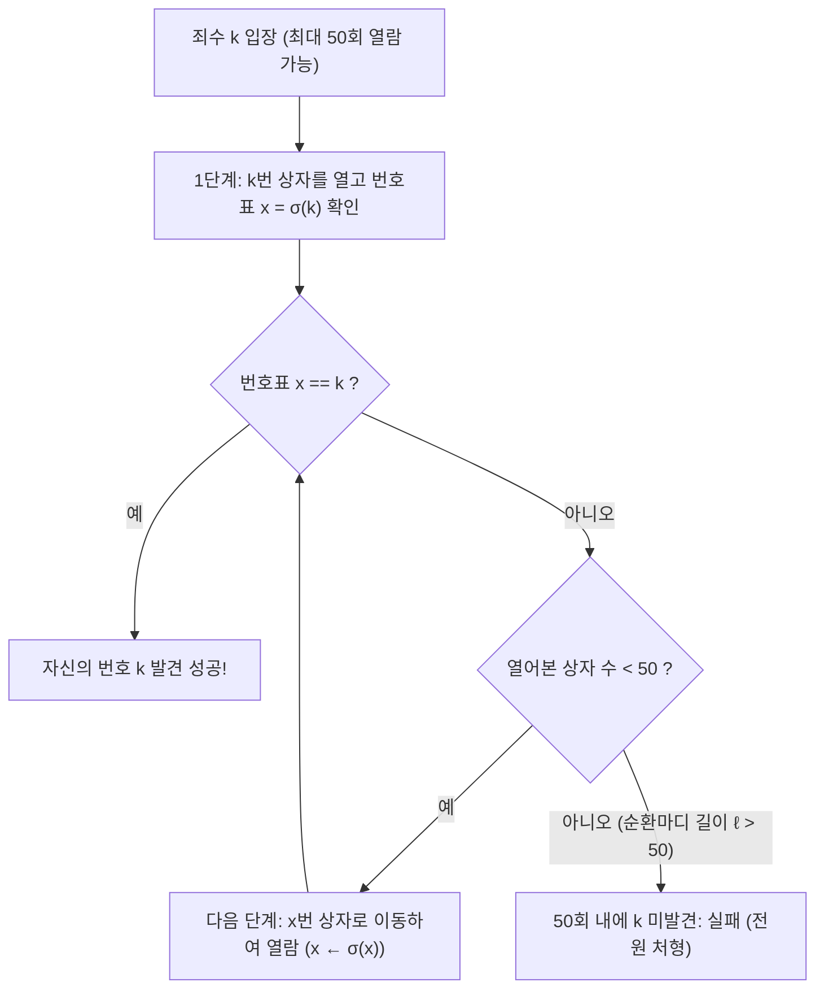
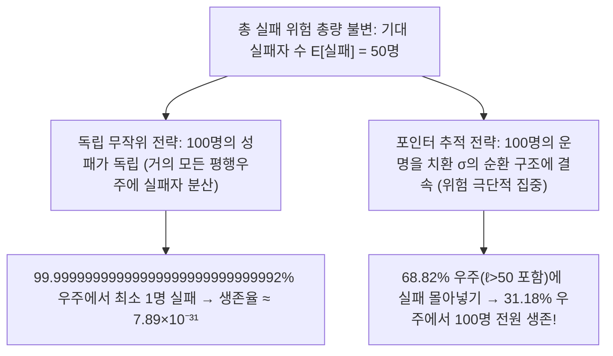

## 들어가며: 확률론에서 가장 직관에 반하는 기적

2003년 덴마크의 컴퓨터 과학자 <strong>페테르 브로 밀테르센(Peter Bro Miltersen)</strong>은 학계를 충격에 빠뜨린 확률 퍼즐인 <strong>100명의 죄수 문제(100 Prisoners Problem)</strong>를 발표했습니다.
- 감옥에 $1$번부터 $100$번까지 번호가 붙은 사형수 $100$명이 있습니다. 교도소장은 방 안에 $1$번부터 $100$번까지 번호가 적힌 상자 $100$개를 두고, 그 안에 $1$부터 $100$까지의 번호표를 무작위로 하나씩 넣었습니다.
- <strong>규칙</strong>: 죄수는 한 명씩 방에 들어가 최대 <strong>$50$개의 상자</strong>를 열어 자신의 번호표를 찾아야 합니다. 나갈 때 상자를 원래대로 닫아두어야 하며, 게임이 시작된 뒤에는 <strong>죄수들 사이에 어떠한 정보 교환이나 신호도 절대 불가능</strong>합니다(단, 시작 전에 함께 전략을 짤 수는 있습니다).
- <strong>생사 판정</strong>: <strong>$100$명 전원이 자신의 번호를 찾아야만</strong> 모두 석방되며, 단 <strong>$1$명이라도 실패하면 $100$명 전원 처형</strong>됩니다.

만약 각 죄수가 무작위로 $50$개의 상자를 여는 <strong>독립 무작위 전략</strong>을 택한다면 개인의 성공 확률은 $1/2$이므로, 전원이 살아남을 확률은 다음과 같이 절망적입니다.

$$\mathbb{P}(\text{전원 생존})_{\text{독립}} = \left(\frac{1}{2}\right)^{100} = \frac{1}{1,\!267,\!650,\!600,\!228,\!229,\!401,\!496,\!703,\!205,\!376} \approx 7.89 \times 10^{-31}$$

그런데 동료 수학자 <strong>스벤 스퀴움(Sven Skyum)</strong>이 제안한 <strong>포인터 추적 전략(Pointer-Following Strategy)</strong>을 사용하면 단 1비트의 통신도 없이 전원 생존 확률이 무려 <strong>$31.18\%$</strong>로 뛰어오릅니다!

---

## 제1장: 포인터 추적 전략과 대칭군의 순환마디 분해

스퀴움의 전략은 놀라울 정도로 간단합니다(죄수 자신의 번호를 $k \in \{1, \dots, 100\}$라 합시다).
1. <strong>1단계</strong>: 방에 들어가면 가장 먼저 자신의 번호가 겉에 적힌 <strong>$k$번 상자</strong>를 엽니다.
2. <strong>2단계</strong>: 상자 안의 번호표 숫자 $x_1 = k$이면 성공입니다. $x_1 \neq k$이면 다음에는 <strong>$x_1$번 상자</strong>를 엽니다.
3. <strong>3단계</strong>: 새로 연 상자 안의 번호 $x_2$를 확인하고 $x_2$번 상자를 여는 과정을 $k \mapsto \sigma(k) \mapsto \sigma^2(k) \mapsto \cdots$를 따라 $k$를 찾거나 $50$번의 기회를 다 쓸 때까지 반복합니다.

상자 번호와 안의 번호표 대응은 $2n = 100$차 <strong>대칭군 $S_{2n}$</strong>의 치환(전단사 함수) $\sigma$입니다. 군론의 기본 정리에 의해 <strong>모든 유한 치환 $\sigma \in S_{2n}$은 서로소인 순환마디(Disjoint Cycles)들의 곱으로 유일하게 분해</strong>됩니다.

$$\sigma = C_1 \circ C_2 \circ \cdots \circ C_m, \qquad \sum_{i=1}^m |C_i| = 2n = 100$$

$\sigma$는 일대일 대응이므로 $k$번 상자에서 출발해 번호표를 따라가면 반드시 $k$가 속한 유일한 닫힌 고리(순환마디)를 한 바퀴 돌아 출발점인 $k$번 상자 바로 직전 단계($\sigma^{-1}(k)$, 즉 번호표 $k$가 들어 있는 상자)에 도달합니다! 따라서:
- 죄수 $k$가 $50$번 이내에 성공할 필요충분조건은 <strong>$k$가 속한 순환마디의 길이 $\ell$이 $\ell \le 50$인 것</strong>입니다.
- <strong>$100$명 전원이 생존할 필요충분조건은 치환 $\sigma \in S_{100}$의 분해에 길이 $\ell > 50$인 긴 순환마디가 단 하나도 없는 것($L_{\max}(\sigma) \le 50$)입니다!</strong>

---

## 제2장: 긴 순환마디의 개수 정리와 조화수 $1 - \ln 2$ 유도

전체 인원을 $2n$($2n=100, n=50$)이라 합시다. 두 개의 서로소인 순환마디가 모두 길이 $n$보다 크면 합이 최소 $2n+2 > 2n$이므로, <strong>하나의 치환 $\sigma \in S_{2n}$ 안에 길이 $\ell > n$인 순환마디는 기껏해야 단 1개만 존재할 수 있습니다!</strong> 따라서 사건 $E_\ell := \{\text{치환 }\sigma\text{가 길이 }\ell\text{인 순환마디를 포함}\}$ ($\ell = n+1, \dots, 2n$)은 <strong>서로 배반(Mutually Exclusive)</strong>입니다. $E_\ell$에 속하는 치환의 개수는 다음과 같습니다.
1. $2n$개 원소 중 순환마디를 이룰 $\ell$개를 고르는 경우의 수: $\binom{2n}{\ell}$
2. 고른 $\ell$개 원소를 하나의 원순열로 배열하는 경우의 수: $(\ell - 1)!$
3. 나머지 $2n - \ell$개 원소를 임의로 배열하는 경우의 수: $(2n - \ell)!$

셋을 곱하면 놀라운 약분이 일어납니다.

$$|E_\ell| = \binom{2n}{\ell} \cdot (\ell - 1)! \cdot (2n - \ell)! = \frac{(2n)!}{\ell! \, (2n - \ell)!} \cdot (\ell - 1)! \, (2n - \ell)! = \frac{(2n)!}{\ell}$$

전체 치환의 수 $(2n)!$로 나누면 $\mathbb{P}(E_\ell) = \frac{1}{\ell}$이 되며, <strong>조화수(Harmonic Number)</strong> $H_N = \sum_{k=1}^N \frac{1}{k}$를 쓰면 전원 생존 확률은 다음과 같습니다.

$$\boxed{P_{\text{success}}(2n) = 1 - \sum_{\ell = n+1}^{2n} \frac{1}{\ell} = 1 - \left(H_{2n} - H_n\right) \xrightarrow{n \to \infty} 1 - \int_1^2 \frac{dx}{x} = 1 - \ln 2 \approx 30.685\%}$$

$2n = 100, n = 50$일 때 정확한 생존율은 $P_{\text{success}}(100) = 1 - (H_{100} - H_{50}) \approx \mathbf{31.1828\%}$입니다!

---

## 제3장: 왜 정보 전달 없이도 운명이 바뀌는가? — 위험의 완벽한 결합(Coupling)

| 비교 항목 | ① 독립 무작위 전략 | ② 포인터 추적 (순환마디) 전략 |
| :--- | :--- | :--- |
| <strong>개인 성공 확률 $\mathbb{P}(A_k)$</strong> | $50.00\%$ | $50.00\%$ (동일) |
| <strong>기대 성공 인원 $\mathbb{E}[X]$</strong> | $50$명 | $50$명 (동일) |
| <strong>죄수 간 상관관계</strong> | 무상관 (독립) | <strong>공유 환경 $\sigma$의 순환 구조를 통한 강한 양의 상관</strong> |
| <strong>$100$명 전원 생존율</strong> | $(1/2)^{100} \approx 7.89 \times 10^{-31}$ | <strong>$1 - (H_{100} - H_{50}) \approx 31.18\%$</strong> |
| <strong>$n \to \infty$ 점근 하한</strong> | $0$ (지수적 소멸) | <strong>$1 - \ln 2 \approx 30.685\%$</strong> |

1. <strong>결합(Coupling)을 통한 집단 실패와 전원 생존의 양극화</strong>: 개인의 성공 확률($50\%$)과 기대 성공자 수($50$명)는 두 전략에서 완전히 같습니다. 그러나 "1명만 실패해도 전원 처형"이라는 규칙에서는 1명이 실패하든 51명이 함께 실패하든 결과가 같습니다. 포인터 추적 전략은 모든 실패 사건을 길이 $\ell > 50$인 순환마디가 존재하는 $68.82\%$의 치환에 한꺼번에 몰아넣음으로써, 나머지 <strong>$31.18\%$의 표본 공간을 단 한 명의 실패자도 없는 무결점 생존 구간으로 비워낸 것</strong>입니다!
2. <strong>적대적 교도소장에 대한 방어</strong>: 교도소장이 고의로 길이 100짜리 순환마디를 만들더라도, 죄수들이 입장 전에 비밀 무작위 치환 $\tau \in S_{100}$을 약속해 번호를 재지정하면 켤레 변환 $\tau \sigma \tau^{-1}$에 의해 순환 구조가 완전히 무작위화되어 여전히 <strong>$31.18\%$</strong>의 생존율이 보장됩니다.
