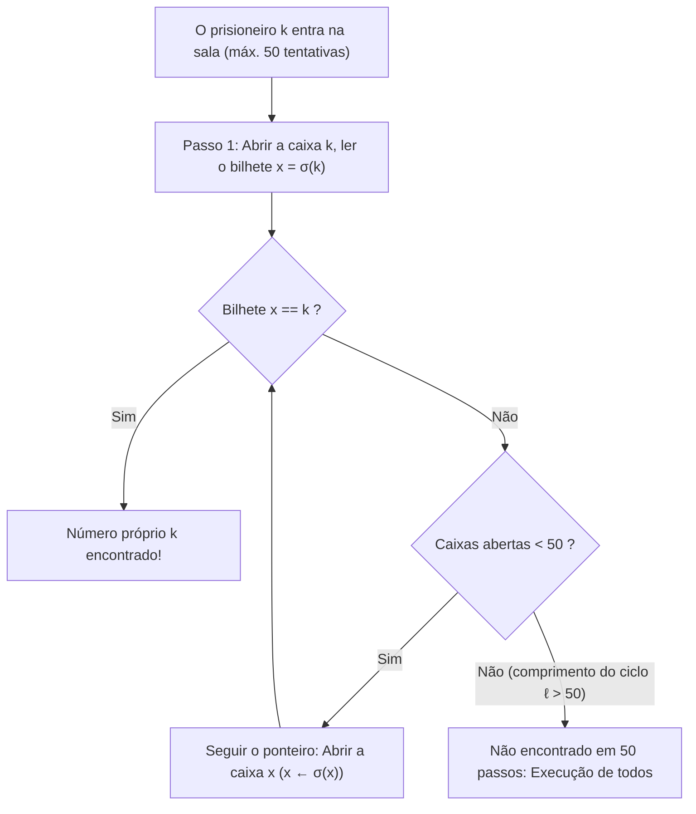
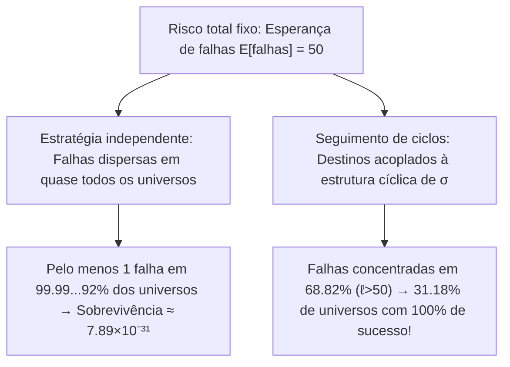

## Introdução: O milagre mais contraintuitivo da probabilidade

Em 2003, o cientista da computação dinamarquês <strong>Peter Bro Miltersen</strong> apresentou o famoso <strong>problema dos 100 prisioneiros</strong>:
- $100$ condenados à morte são numerados de $1$ a $100$. Em uma sala há $100$ caixas fechadas contendo os números de $1$ a $100$ embaralhados aleatoriamente (uma permutação $\sigma \in S_{100}$).
- <strong>Regra</strong>: Cada prisioneiro entra sozinho por vez e pode abrir no máximo <strong>$50$ caixas</strong> procurando seu próprio número. Ao sair, a sala é deixada exatamente como estava e <strong>toda comunicação é proibida após o início</strong> (mas uma estratégia pode ser combinada antes).
- <strong>Condição de sobrevivência</strong>: Somente se <strong>todos os $100$ prisioneiros encontrarem seu número</strong> todos são libertados; se <strong>um único falhar</strong>, todos os $100$ são executados.

Se cada prisioneiro abrir $50$ caixas ao acaso (<strong>estratégia independente</strong>), cada um tem chance $1/2$, mas a sobrevivência coletiva cai para:

$$\mathbb{P}(\text{todos sobrevivem})_{\text{indep.}} = \left(\frac{1}{2}\right)^{100} \approx 7.89 \times 10^{-31}$$

Contudo, <strong>Sven Skyum</strong> descobriu a <strong>estratégia de rastreamento de ponteiros (Pointer-Following Strategy)</strong>, que eleva a sobrevivência coletiva para <strong>$31.18\%$</strong> sem transmitir um único bit de informação!

---

## Capítulo 1: Rastreamento de ponteiros e decomposição em ciclos disjuntos

Para o prisioneiro número $k \in \{1, \dots, 100\}$, a estratégia de Skyum consiste em:
1. <strong>Passo 1</strong>: Abrir primeiro a <strong>caixa n.º $k$</strong>.
2. <strong>Passo 2</strong>: Se o bilhete interno mostrar $x_1 = k$, sucesso; se $x_1 \neq k$, abrir em seguida a <strong>caixa n.º $x_1$</strong>.
3. <strong>Passo 3</strong>: Ler o número $x_2$ e abrir a caixa n.º $x_2$, seguindo a cadeia $k \mapsto \sigma(k) \mapsto \sigma^2(k) \mapsto \cdots$ até achar $k$ ou esgotar as $50$ tentativas.

Por que funciona? O mapeamento caixa $\mapsto$ bilhete é uma bijeção $\sigma$ do <strong>grupo simétrico $S_{2n}$</strong> ($2n=100$). Toda permutação finita decompõe-se de forma única em <strong>ciclos disjuntos</strong>:

$$\sigma = C_1 \circ C_2 \circ \cdots \circ C_m, \qquad \sum_{i=1}^m |C_i| = 2n = 100$$

Como $\sigma$ é bijetiva, partindo da caixa $k$ o prisioneiro percorre o único ciclo fechado que contém $k$ e termina em $\sigma^{-1}(k)$ (a caixa que guarda o bilhete $k$). Portanto:
- O prisioneiro $k$ tem sucesso em $\le 50$ passos se e somente se seu ciclo tiver comprimento $\ell \le 50$.
- <strong>Os $100$ prisioneiros sobrevivem todos se e somente se a permutação $\sigma \in S_{100}$ não contiver nenhum ciclo de comprimento $\ell > 50$!</strong>

---

## Capítulo 2: Contagem de ciclos longos e números harmônicos ($1 - \ln 2$)

Para $2n$ prisioneiros ($n = 50$), uma permutação $\sigma \in S_{2n}$ pode ter <strong>no máximo um único ciclo de comprimento $\ell > n$</strong>, pois dois ciclos disjuntos de comprimento $> n$ somariam pelo menos $2n+2 > 2n$ elementos. Assim, os eventos $E_\ell := \{\sigma \text{ contém um ciclo de comprimento } \ell\}$ para $\ell = n+1, \dots, 2n$ são <strong>mutuamente exclusivos</strong>. O número de permutações em $E_\ell$ é:
1. Escolher os $\ell$ elementos do ciclo longo: $\binom{2n}{\ell}$;
2. Ordená-los em um único ciclo circular: $(\ell - 1)!$;
3. Permutar os $2n - \ell$ elementos restantes: $(2n - \ell)!$.

Multiplicando, os fatoriais se cancelam:

$$|E_\ell| = \binom{2n}{\ell} \cdot (\ell - 1)! \cdot (2n - \ell)! = \frac{(2n)!}{\ell! \, (2n - \ell)!} \cdot (\ell - 1)! \, (2n - \ell)! = \frac{(2n)!}{\ell}$$

Dividindo por $|S_{2n}| = (2n)!$, temos <strong>$\mathbb{P}(E_\ell) = \frac{1}{\ell}$</strong>. Usando os <strong>números harmônicos</strong> $H_N = \sum_{k=1}^N \frac{1}{k}$, a probabilidade exata de sobrevivência é:

$$\boxed{P_{\text{success}}(2n) = 1 - \sum_{\ell = n+1}^{2n} \frac{1}{\ell} = 1 - \left(H_{2n} - H_n\right) \xrightarrow{n \to \infty} 1 - \int_1^2 \frac{dx}{x} = 1 - \ln 2 \approx 30.685\%}$$

Para $2n = 100$, obtemos $P_{\text{success}}(100) = 1 - (H_{100} - H_{50}) \approx \mathbf{31.1828\%}$.

---

## Capítulo 3: Acoplamento de riscos sem transmissão de informação

| Característica | 1. Estratégia independente | 2. Estratégia de ciclos |
| :--- | :--- | :--- |
| <strong>Sucesso individual $\mathbb{P}(A_k)$</strong> | $50.00\%$ | $50.00\%$ (idêntico) |
| <strong>Esperança de sucessos $\mathbb{E}[X]$</strong> | $50$ prisioneiros | $50$ prisioneiros (idêntico) |
| <strong>Correlação</strong> | Nula (independente) | <strong>Fortemente acoplada via $\sigma$</strong> |
| <strong>Sobrevivência dos $100$</strong> | $(1/2)^{100} \approx 7.89 \times 10^{-31}$ | <strong>$1 - (H_{100} - H_{50}) \approx 31.18\%$</strong> |
| <strong>Limite $n \to \infty$</strong> | $0$ | <strong>$1 - \ln 2 \approx 30.685\%$</strong> |

1. <strong>Acoplamento (Coupling)</strong>: Como 1 falha ou 51 falhas produzem a mesma condenação, a estratégia de ciclos concentra todas as falhas nos $68.82\%$ de permutações com um ciclo $\ell > 50$, liberando <strong>$31.18\%$ do espaço amostral com zero falhas</strong>!
2. <strong>Defesa contra um diretor malicioso</strong>: Combinando antes uma bijeção aleatória secreta $\tau \in S_{100}$, a conjugação $\tau \sigma \tau^{-1}$ garante exatamente os <strong>$31.18\%$</strong> de sobrevivência.
