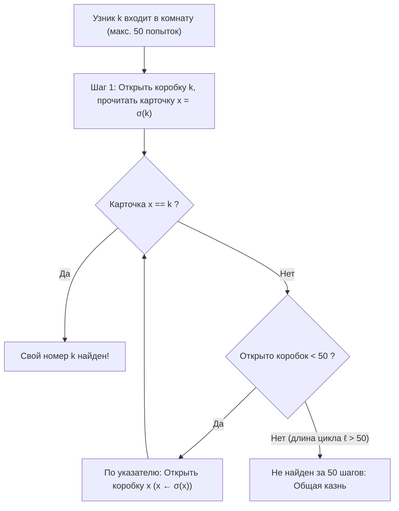
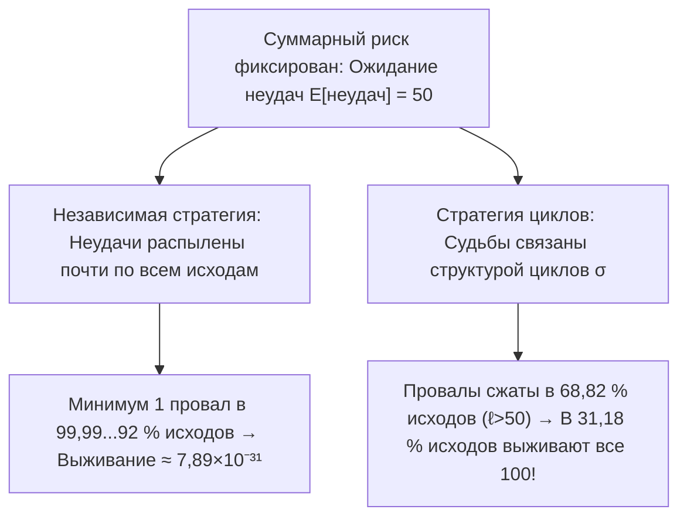

## Введение: самое парадоксальное чудо теории вероятностей

В 2003 году датский информатик <strong>Петер Бро Милтерсен</strong> сформулировал знаменитую <strong>задачу о 100 узниках</strong>:
- $100$ приговоренных к смерти узников имеют номера от $1$ до $100$. В комнате стоят $100$ закрытых коробок, внутри которых случайно разложены карточки с номерами от $1$ до $100$ (подстановка $\sigma \in S_{100}$).
- <strong>Правило</strong>: Каждый узник по очереди входит в комнату и может открыть не более <strong>$50$ коробок</strong>, чтобы найти свой номер. После его выхода коробки закрываются, и <strong>любое общение после начала испытания исключено</strong> (но стратегию можно обсудить заранее).
- <strong>Условие спасения</strong>: Только если <strong>все $100$ узников найдут свои номера</strong>, всех помилуют; если <strong>хотя бы один потерпит неудачу</strong>, казнят всех $100$.

Если каждый открывает $50$ случайных коробок (<strong>независимая стратегия</strong>), шанс одного равен $1/2$, но вероятность общего спасения ничтожна:

$$\mathbb{P}(\text{все спасены})_{\text{незав.}} = \left(\frac{1}{2}\right)^{100} \approx 7{,}89 \times 10^{-31}$$

Однако коллега Милтерсена <strong>Свен Скайум</strong> нашел <strong>стратегию следования по указателям (Pointer-Following Strategy)</strong>, которая без передачи единого бита информации поднимает шанс общего спасения до <strong>$31{,}18\,\%$</strong>!

---

## Глава 1: Следование по указателям и разложение на независимые циклы

Стратегия Скайума для узника с номером $k \in \{1, \dots, 100\}$:
1. <strong>Шаг 1</strong>: Сначала открыть <strong>коробку № $k$</strong>.
2. <strong>Шаг 2</strong>: Если внутри карточка $x_1 = k$, успех; если $x_1 \neq k$, следующей открыть <strong>коробку № $x_1$</strong>.
3. <strong>Шаг 3</strong>: Прочитать номер $x_2$ и открыть коробку № $x_2$, двигаясь по цепочке $k \mapsto \sigma(k) \mapsto \sigma^2(k) \mapsto \cdots$, пока не найдется $k$ или не исчерпаются $50$ попыток.

Почему это работает? Соответствие коробка $\mapsto$ карточка есть биекция $\sigma$ в <strong>симметрической группе $S_{2n}$</strong> ($2n=100$). Любая конечная подстановка единственным образом раскладывается в произведение <strong>независимых (непересекающихся) циклов</strong>:

$$\sigma = C_1 \circ C_2 \circ \cdots \circ C_m, \qquad \sum_{i=1}^m |C_i| = 2n = 100$$

Так как $\sigma$ биективна, стартуя с коробки $k$, узник движется по единственному замкнутому циклу, содержащему $k$, и завершает обход на $\sigma^{-1}(k)$ (коробке с карточкой $k$). Следовательно:
- Узник $k$ успешен за $\le 50$ шагов тогда и только тогда, когда длина его цикла $\ell \le 50$.
- <strong>Все $100$ узников выживают тогда и только тогда, когда подстановка $\sigma \in S_{100}$ не содержит ни одного цикла длины $\ell > 50$!</strong>

---

## Глава 2: Подсчет длинных циклов и гармонические числа ($1 - \ln 2$)

Для $2n$ узников ($n = 50$) подстановка $\sigma \in S_{2n}$ может содержать <strong>не более одного цикла длины $\ell > n$</strong>, так как два непересекающихся цикла длины $> n$ требовали бы минимум $2n+2 > 2n$ элементов. Значит, события $E_\ell := \{\sigma \text{ содержит цикл длины } \ell\}$ при $\ell = n+1, \dots, 2n$ <strong>попарно несовместны</strong>! Число подстановок в $E_\ell$ равно:
1. Выбор $\ell$ элементов длинного цикла: $\binom{2n}{\ell}$;
2. Число ориентированных циклов на этих $\ell$ элементах: $(\ell - 1)!$;
3. Перестановки остальных $2n - \ell$ элементов: $(2n - \ell)!$.

При перемножении факториалы сокращаются:

$$|E_\ell| = \binom{2n}{\ell} \cdot (\ell - 1)! \cdot (2n - \ell)! = \frac{(2n)!}{\ell! \, (2n - \ell)!} \cdot (\ell - 1)! \, (2n - \ell)! = \frac{(2n)!}{\ell}$$

Деление на $|S_{2n}| = (2n)!$ дает <strong>$\mathbb{P}(E_\ell) = \frac{1}{\ell}$</strong>. Через <strong>гармонические числа</strong> $H_N = \sum_{k=1}^N \frac{1}{k}$ получаем точную вероятность выживания:

$$\boxed{P_{\text{success}}(2n) = 1 - \sum_{\ell = n+1}^{2n} \frac{1}{\ell} = 1 - \left(H_{2n} - H_n\right) \xrightarrow{n \to \infty} 1 - \int_1^2 \frac{dx}{x} = 1 - \ln 2 \approx 30{,}685\,\%}$$

При $2n = 100$ имеем $P_{\text{success}}(100) = 1 - (H_{100} - H_{50}) \approx \mathbf{31{,}1828\,\%}$!

---

## Глава 3: Связывание рисков (Coupling) без передачи информации

| Характеристика | 1. Независимая стратегия | 2. Стратегия циклов |
| :--- | :--- | :--- |
| <strong>Личный успех $\mathbb{P}(A_k)$</strong> | $50{,}00\,\%$ | $50{,}00\,\%$ (одинаково) |
| <strong>Ожидание успехов $\mathbb{E}[X]$</strong> | $50$ узников | $50$ узников (одинаково) |
| <strong>Корреляция</strong> | Нулевая (независимость) | <strong>Сильная положительная связь через $\sigma$</strong> |
| <strong>Выживание всех $100$</strong> | $(1/2)^{100} \approx 7{,}89 \times 10^{-31}$ | <strong>$1 - (H_{100} - H_{50}) \approx 31{,}18\,\%$</strong> |
| <strong>Предел при $n \to \infty$</strong> | $0$ | <strong>$1 - \ln 2 \approx 30{,}685\,\%$</strong> |

1. <strong>Связывание (Coupling)</strong>: Поскольку 1 неудача и 51 неудача одинаково ведут к казни, стратегия циклов концентрирует все неудачи в $68{,}82\,\%$ перестановок с длинным циклом ($\ell > 50$), очищая <strong>$31{,}18\,\%$ пространства элементарных исходов от единой ошибки</strong>!
2. <strong>Защита от коварного начальника тюрьмы</strong>: Тайно выбрав заранее случайную биекцию $\tau \in S_{100}$, узники сопряжением $\tau \sigma \tau^{-1}$ гарантируют те же <strong>$31{,}18\,\%$</strong> выживания.
