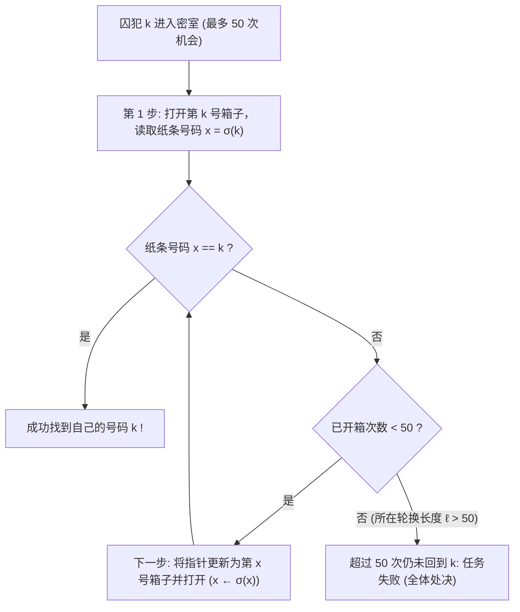
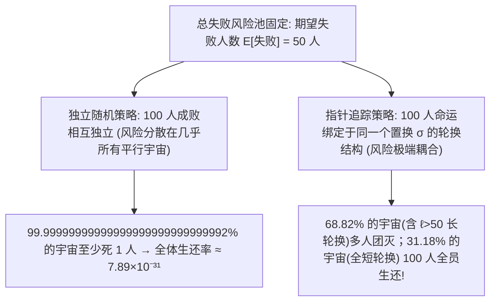

## 引言：概率论中最反直觉的奇迹

2003年，丹麦计算机科学家<strong>彼得·布罗·米尔特森（Peter Bro Miltersen）</strong>提出了一个轰动数学界的智力谜题——<strong>100名囚犯问题（100 Prisoners Problem）</strong>：
- 监狱里有编号为 $1$ 到 $100$ 的 $100$ 名死刑犯。典狱长在一个密室里放了 $100$ 个抽屉（箱子），箱子外侧贴着 $1$ 到 $100$ 的编号；箱子内部随机放入了写有 $1$ 到 $100$ 号码的纸条（每个箱子一张，构成 $1$ 到 $100$ 的随机排列）。
- <strong>规则</strong>：每名囚犯依次独自进入密室，最多可以打开 <strong>$50$ 个箱子</strong>寻找写有自己编号的纸条。离开时必须将所有箱子恢复原状，且一旦游戏开始，<strong>囚犯之间绝对禁止任何形式的信息传递或暗示</strong>（但在游戏开始前可以共同商定策略）。
- <strong>生死判定</strong>：只有当 <strong>全部 $100$ 名囚犯都找到自己的号码</strong> 时，所有人才能被无罪释放；哪怕只有 <strong>$1$ 人失败</strong>，全体 $100$ 人立即处决。

如果每名囚犯都各自随机打开 $50$ 个箱子（<strong>独立随机策略</strong>），单人成功率为 $50/100 = 1/2$。由于各人成败相互独立，全体生还的概率是令人绝望的：

$$\mathbb{P}(\text{全体生还})_{\text{独立}} = \left(\frac{1}{2}\right)^{100} = \frac{1}{1,\!267,\!650,\!600,\!228,\!229,\!401,\!496,\!703,\!205,\!376} \approx 7.89 \times 10^{-31}$$

然而，米尔特森的同事<strong>斯文·斯카이姆（Sven Skyum）</strong>发现了一个极为简单的<strong>指针追踪策略（Pointer-Following Strategy）</strong>，在不传递任何1比特信息的前提下，将全体生还率一举提升到了 <strong>$31.18\%$（超过三分之一）</strong>！

---

## 第一章：指针追踪策略与置换群的轮换分解

斯文·斯카이姆提出的策略只有三步（设囚犯自己的编号为 $k \in \{1, \dots, 100\}$）：
1. <strong>第1步</strong>：进入密室后，首先打开外侧标有自己编号的 <strong>第 $k$ 号箱子</strong>。
2. <strong>第2步</strong>：若箱内纸条号码 $x_1 = k$，则成功；若 $x_1 \neq k$，下一步就去打开 <strong>第 $x_1$ 号箱子</strong>。
3. <strong>第3步</strong>：读取新箱子里的号码 $x_2$，再去打开第 $x_2$ 号箱子……以此类推，沿着链条 $k \mapsto \sigma(k) \mapsto \sigma^2(k) \mapsto \cdots$ 追踪，直到找到号码 $k$ 或用完 $50$ 次机会。

为什么这个动作能创造奇迹？在代数学中，箱子编号与内部纸条的对应关系是 $2n = 100$ 元<strong>对称群 $S_{2n}$</strong> 中的一个双射置换 $\sigma$。由群论基本定理，<strong>任意有限置换 $\sigma \in S_{2n}$ 都可以唯一地分解为若干个不相交轮换（Disjoint Cycles）的乘积</strong>：

$$\sigma = C_1 \circ C_2 \circ \cdots \circ C_m, \qquad \sum_{i=1}^m |C_i| = 2n = 100$$

因为 $\sigma$ 是双射，从箱子 $k$ 出发沿着指针追踪，绝不会陷入旁支死胡同，而必定沿着包含 $k$ 的唯一闭合轮换绕行一周，最终<strong>必然回到起点箱子 $k$</strong>（因为指向箱子 $k$ 的那张写有号码 $k$ 的纸条正是轮换中 $k$ 的前驱 $\sigma^{-1}(k)$）！因此：
- 囚犯 $k$ 能否在 $50$ 步内找到号码 $k$，等价于<strong>包含 $k$ 的那个轮换的长度 $\ell$ 是否满足 $\ell \le 50$</strong>。
- <strong>全体 $100$ 名囚犯全部生还，当且仅当置换 $\sigma \in S_{100}$ 的轮换分解中没有任何一个轮换的长度超过 $50$（即最大轮换长度 $L_{\max}(\sigma) \le 50$）！</strong>

---

## 第二章：长轮换计数定理与调和数 $1 - \ln 2$ 的严密推导

设总人数为 $2n$（此处 $2n = 100, n = 50$）。如果一个置换 $\sigma \in S_{2n}$ 含有长度严格大于 $n$ 的长轮换（$\ell \in \{n+1, \dots, 2n\}$），由于两个长度都大于 $n$ 的不相交轮换之和至少为 $(n+1)+(n+1) = 2n+2 > 2n$，<strong>在同一个置换中，长度 $\ell > n$ 的长轮换最多只能存在唯一一个！</strong>

这意味着事件 $E_\ell := \{\text{置换 }\sigma\text{ 含有长度为 }\ell\text{ 的轮换}\}$ 对 $\ell = n+1, n+2, \dots, 2n$ 是<strong>两两互斥（Mutually Exclusive）</strong>的！我们来精确计算满足 $E_\ell$ 的置换个数：
1. 从 $2n$ 个元素中选出构成该长轮换的 $\ell$ 个元素，共有 $\binom{2n}{\ell}$ 种选法；
2. 将这 $\ell$ 个元素排成一个单一的闭合圆周轮换，共有 $(\ell - 1)!$ 种排法（圆排列）；
3. 剩下的 $2n - \ell$ 个元素可以任意排列，共有 $(2n - \ell)!$ 种排法。

将三者相乘，阶乘发生惊人的约分：

$$|E_\ell| = \binom{2n}{\ell} \cdot (\ell - 1)! \cdot (2n - \ell)! = \frac{(2n)!}{\ell! \, (2n - \ell)!} \cdot (\ell - 1)! \, (2n - \ell)! = \frac{(2n)!}{\ell}$$

除以总排列数 $|S_{2n}| = (2n)!$，得到含有长度为 $\ell > n$ 的轮换的精确概率仅为 <strong>$\mathbb{P}(E_\ell) = \frac{1}{\ell}$</strong>！利用互斥事件的可加性与<strong>调和数（Harmonic Number）</strong> $H_N = \sum_{k=1}^N \frac{1}{k}$，全体生还概率为：

$$\boxed{P_{\text{success}}(2n) = 1 - \sum_{\ell = n+1}^{2n} \frac{1}{\ell} = 1 - \left(H_{2n} - H_n\right) \xrightarrow{n \to \infty} 1 - \int_1^2 \frac{dx}{x} = 1 - \ln 2 \approx 30.685\%}$$

对 $2n = 100, n = 50$，精确生还率为 $P_{\text{success}}(100) = 1 - (H_{100} - H_{50}) \approx 1 - 0.688172 = \mathbf{31.1828\%}$！

---

## 第三章：为什么没有传递信息却能逆天改命？——风险的完美耦合

为什么单人成功率明明始终是 $50\%$（成功人数的数学期望在两种策略下完全相同：$\mathbb{E}[\sum I_k] = 100 \times 0.5 = 50$），全体生还率却暴涨了 $3.95 \times 10^{29}$ 倍？

| 比较维度 | ① 独立随机策略 | ② 指针追踪（轮换）策略 |
| :--- | :--- | :--- |
| <strong>单人成功概率 $\mathbb{P}(A_k)$</strong> | $50.00\%$ | $50.00\%$（完全不变） |
| <strong>期望成功人数 $\mathbb{E}[X]$</strong> | $50$ 人 | $50$ 人（完全不变） |
| <strong>囚犯间相关性</strong> | 零相关（相互独立） | <strong>通过共享环境 $\sigma$ 的轮换结构强正相关</strong> |
| <strong>$100$ 人全体生还率</strong> | $(1/2)^{100} \approx 7.89 \times 10^{-31}$ | <strong>$1 - (H_{100} - H_{50}) \approx 31.18\%$</strong> |
| <strong>$n \to \infty$ 渐近下界</strong> | $0$（指数级归零） | <strong>$1 - \ln 2 \approx 30.685\%$（恒定正常数）</strong> |

1. <strong>概率论中的耦合（Coupling）与团灭换生机</strong>：在规则“哪怕1人失败即全员处决”下，失败1人和失败51人的惩罚完全相同。独立策略把失败风险均匀撒在所有样本路径上，导致几乎每条路径都有约50人失败；而指针追踪策略将所有人的命运<strong>耦合（Coupled）</strong>在同一个置换 $\sigma$ 的拓扑结构上——把所有的失败高度浓缩进那 $68.82\%$ 含有 $\ell > 50$ 长轮换的排列里（一旦失败至少51人一起失败），从而把整整 <strong>$31.18\%$ 的样本空间彻底清空为“零失败净土”</strong>！
2. <strong>如果典狱长恶意排布纸条怎么办？</strong> 如果典狱长故意把纸条排成一个长度为 $100$ 的大轮换，生还率将降为 $0$。但囚犯们只需在进场前秘密商定一个随机的<strong>重命名双射 $\tau \in S_{100}$</strong>，将箱子 $x$ 视为 $\tau(x)$，則新置换 $\tau \sigma \tau^{-1}$ 的轮换结构被完全随机化，无论典狱长如何做手脚，生还率依然严格保持 <strong>$31.18\%$</strong>！
